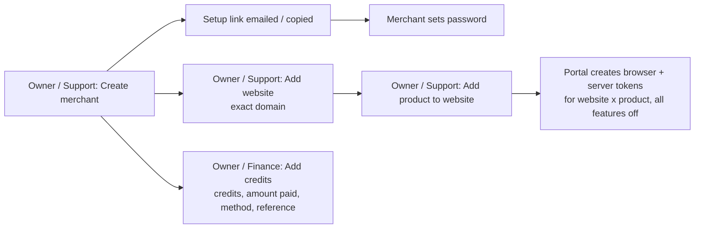
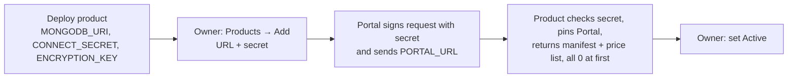
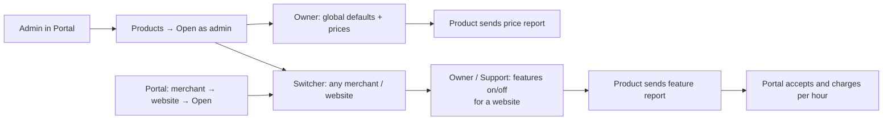
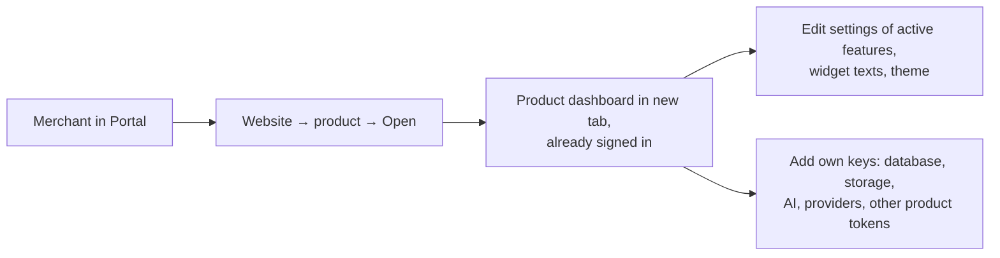
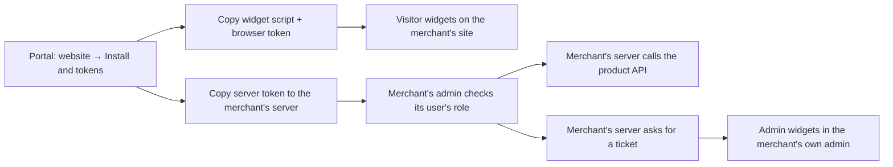
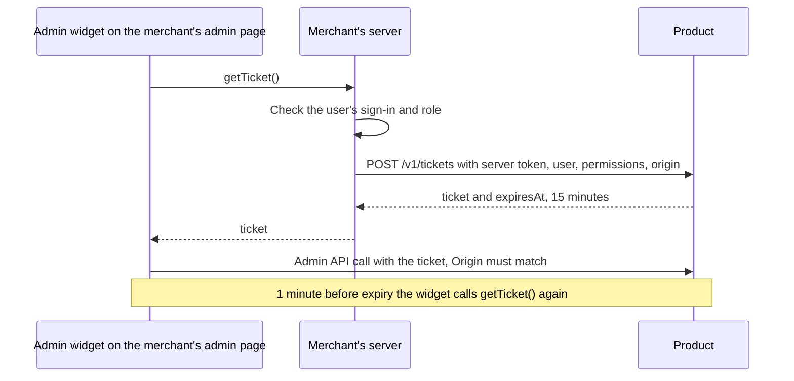
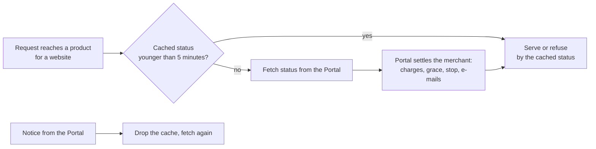
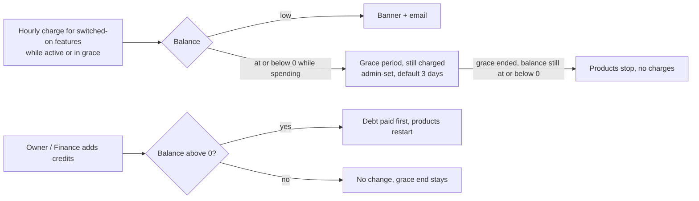
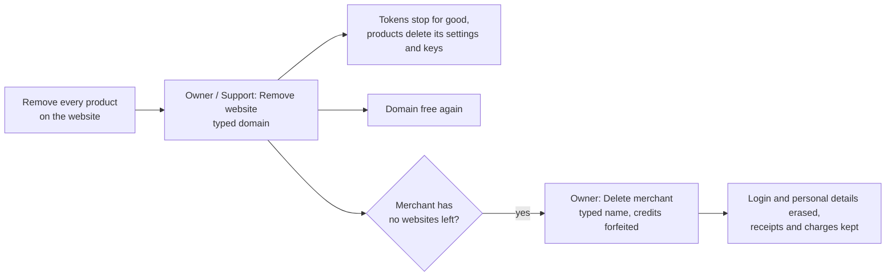

# Single Solution — Platform Plan (single source of truth)

|                  |                                                                                                                       |
| ---------------- | --------------------------------------------------------------------------------------------------------------------- |
| **Status**       | Part 0 decided 2026-10-07 and built (steps 1–11; 0.12) · changes only with the owner (0.13)                           |
| **Date**         | 2026-10-07 · Owner: Bilal (single-solution)                                                                           |
| **Deliverables** | **A. Portal** · **B. Six products** (0.3) · **C. Shared kit** (`packages/*`, 0.9)                                     |
| **Hosting**      | Vercel Hobby + one MongoDB Atlas M0 while testing; move to a commercial host before charging merchants (0.12 step 14) |
| **Language**     | JavaScript (ESM), functional, JSDoc-typed, `tsc --checkJs --strict` in CI (0.10)                                      |
| **This file**    | The only planning document. **Part 0 is the plan.**                                                                   |

> **Read Part 0 first.** It records the owner's decisions (interviews of 2026-10-07 and later) and is **binding**. If
> Part 0 says nothing on a point, **ask the owner**; do not invent an answer. 0.1 is the only summary of what we build,
> and 0.7 holds the only walkthroughs.

---

# PART 0 — The plan (owner decisions of 2026-10-07, binding)

**Contents**: 0.0 Words · 0.1 Idea and scope · 0.2 People, roles and logins · 0.3 Products · 0.4 How products work · 0.5
Credits and billing · 0.6 Look and feel · 0.7 Flows · 0.8 Further decisions, Portal screens and Chat · 0.9 Portal
modules, shared kit and hosting · 0.10 Standing technical rules · 0.11 Environment variables · 0.12 Build order · 0.13
Rules for building agents.

**Conventions**: "must" and "never" are requirements. Times are UTC unless a rule says otherwise. `<…>` is a
placeholder. References such as "0.4.4" point inside Part 0.

## 0.0 Words

One meaning per word. New code, screens, APIs and docs use only these words, with these meanings.

**People and access**

- **Admin**: one of our own people, with a Portal login and exactly one role: Owner, Support or Finance.
- **Owner**: the admin role that can do everything (0.2), including Products, prices, global defaults, Admins, Settings
  and deleting merchants.
- **Support**: the admin role for merchants, websites, products on websites, tokens, suspending and resuming, and
  opening product dashboards for a merchant's website. It cannot add credits or change prices, global defaults,
  products, admins or Settings.
- **Finance**: the admin role for Credits and billing (add credits, receipts, charges), with merchants and websites
  read-only. It never sees tokens and never opens product dashboards.
- **Merchant**: one business customer: a single record holding its business details and exactly one login. Only an admin
  creates one. It has no team members.
- **Merchant's users**: the people who use the merchant's own website and admin: visitors and the merchant's staff. They
  never use the Portal or product dashboards.
- **Merchant's staff**: the merchant's users who work in the merchant's own admin (for example answering chats).
  Products learn who they are from tickets (0.4.5). "Staff" never means our admins.
- **Visitor**: a person using a visitor widget or the visitor API on the merchant's website, either signed in through
  Accounts or a guest.
- **Login**: an e-mail address and a password, with optional two-step, belonging to exactly one admin or one merchant.
  The e-mail is unique across the whole Portal.
- **Two-step**: a 6-digit authenticator-app code asked after the password. Optional for everyone; an Owner can require
  it for admins.
- **Recovery codes**: 10 single-use codes shown once when a person turns two-step on. Each one can replace one two-step
  code.
- **Setup link**: a single-use link to set a first password (72 hours for merchants, 24 hours for admins). It works only
  while the login has no password.
- **Typed confirmation**: a confirm dialog whose button works only after the admin types the exact name it shows (the
  business name, the domain or the product name).

**Websites and products**

- **Portal**: the web app we host. Our admins use it to manage merchants, websites, products on websites, credits,
  admins and settings. Merchants use it to see their websites, tokens, install code, usage and credits, and to open
  product dashboards.
- **Deployable**: one separately hosted app with its own database and environment variables: the Portal, or one product.
- **Website**: one exact, normalised domain owned by one merchant (0.2). `shop.com` and `www.shop.com` are two websites.
  A domain belongs to at most one website platform-wide.
- **Product**: one of the six separately hosted apps, with ids `accounts`, `ecommerce`, `chat`, `notifications`,
  `payments` and `growth`. Each offers an API plus widgets and has its own setup dashboard.
- **Connected product**: a product an Owner connected in Portal → Products. It is either active (offered in Add product)
  or inactive (not offered; websites that already have it are unaffected).
- **Product on website**: a website paired with a product, added by an Owner or Support admin, with its own browser
  token and server token. It is either added or removed.
- **Product dashboard**: a product's setup app, opened from the Portal in a new tab. Tabs: Overview, Features, Settings,
  Connections, Developers, plus Defaults and Prices for Owners. It never shows business data.
- **Admin view**: a product dashboard opened by an Owner or Support admin, with the website switcher and an Admin view
  banner.
- **Switcher**: the website picker in a product dashboard. Merchants see their own websites that have the product;
  admins see every website that has it. Removed ones are never listed.
- **Launch**: a single-use, 60-second, Portal-signed token (kind merchant or admin) that opens a product dashboard. The
  product exchanges it for its own session.
- **Widget**: a ready-made piece of UI served by a product's `widget.js`. **Visitor widgets** serve visitors and use the
  browser token. **Admin widgets** run in the merchant's own admin and use tickets.
- **Headless**: building your own UI on a product's API. There is no SDK and there are no framework adapters.
- **API**: a product's `/v1` HTTP routes. Each route belongs to exactly one feature and works only while that feature is
  on.

**Features and settings**

- **Feature**: one on/off switch inside a product, with a permanent key, a name, a description and an hourly price. Only
  Owner or Support admins switch it, and the switches decide what is charged.
- **Feature key**: the permanent identifier of a feature. It never changes, even when the feature is renamed.
- **Setting**: a value, edited in the product dashboard, that changes how a feature behaves on one website.
- **Limit**: a setting that caps use. The merchant sets it within hard maximums fixed in the product's code. Rate limits
  that protect our hosting are code constants, not settings.
- **Global default**: an Owner-set value used by every website that has not saved its own value for that setting.
  Changing it changes those websites at once.
- **Widget texts**: every word a widget shows. Each has an English default in the product's string files, and the
  merchant can overwrite any of them per website (0.4.10).
- **Connections**: the product dashboard tab holding the merchant's own database, storage, AI and provider keys, and
  pasted tokens. Values are encrypted and write-only.
- **Pasted token**: another product's server token for the same website, entered in a product's Connections so that one
  product can call the other.

**Money**

- **Credit**: the only money unit merchants see. 1 credit = 1000 millicredits.
- **Millicredit**: the integer unit every amount is stored in: 1/1000 of a credit.
- **Price**: credits per hour for one feature. The same for every merchant and website, set by an Owner in the product's
  Prices screen, starting at 0, with up to 3 decimals.
- **Receipt**: a ledger entry that adds whole credits, recorded by an Owner or Finance admin with amount paid, payment
  method and reference. It is never edited or reversed.
- **Amount paid**: free text on a receipt (for example `PKR 5,000`), shown exactly as typed, to admins only, and never
  totalled.
- **Charge**: credits the Portal takes for one switched-on feature, for one UTC clock hour, on one product on a website.
- **Day charge**: the stored ledger entry for one product on a website for one UTC day, with per-feature lines (hours,
  credits). Today's charges are computed live and not stored.
- **Charging**: the state in which hours are charged: product-on-website status active or grace.
- **Balance**: a merchant's single credit total, shared by all their websites: receipts minus stored day charges minus
  today's charges so far.
- **Debt**: a negative balance, caused by charged grace hours. The next receipts pay it first.
- **Hourly cost / daily cost**: for one product on one website, the sum of the current hourly prices of its switched-on
  features; daily cost is 24 times that, shown as a projection.
- **Daily spend**: 24 × the sum of the current hourly prices of every switched-on feature on all of a merchant's
  products on websites, removed ones excluded.
- **Days left**: balance ÷ daily spend, rounded down. Shown as — when daily spend is 0.
- **Use**: any request a product receives for a website.
- **Check (settle)**: the Portal working out, for one merchant, the elapsed hours and charges, low balance, grace and
  stop, and any due billing e-mail. It runs when a product fetches a status or a Portal page shows that merchant.

**Statuses**

- **Status**: in Part 0, always a billing or lifecycle state. Never system health or uptime. Other states are always
  named in full: connection state (0.4.3), conversation status (Chat), product Active or Inactive.
- **Merchant status**: exactly one of suspended, stopped, in grace, low balance or active, checked in that order
  (0.5.5). Setup pending is a separate badge.
- **Product-on-website status**: exactly one of removed, suspended, stopped, grace or active, checked in that order
  (0.5.5). It is sent to the product and shown on cards and chips.
- **Low balance**: daily spend > 0 and 0 < balance < threshold days × daily spend.
- **Grace period**: a fixed window that starts at the first moment the balance is ≤ 0 while daily spend > 0, and lasts
  the grace days set when it started. Products keep working and keep being charged. It ends only when a receipt brings
  the balance above 0 or when its end time passes (0.5.6).
- **Stopped**: the state after a grace period ended with the balance still ≤ 0, until a receipt brings the balance
  above 0. Products refuse service and nothing is charged. The merchant can still sign in, open dashboards and see
  usage; only an admin can add credits.
- **Suspended**: a state set by an Owner or Support admin, with an internal reason. The merchant cannot sign in, all
  their products refuse service, and nothing is charged until they are resumed.
- **Removed**: the status of a product on a website after an admin removed it. Its tokens are refused and nothing is
  charged; its settings, connections and tokens are kept for a re-add.
- **Status response**: the Portal's answer to `GET /v1/product/websites/:websiteId/status`, which products cache for at
  most 5 minutes.
- **Notice**: a signed Portal → product message (`status.changed`, `token.revoked`, `sessions.revoked` or
  `website.deleted`) telling the product to drop a cache or delete a website's data.
- **Price report**: the product → Portal message (`PUT /v1/product/prices`) listing every feature with its hourly price.
- **Feature report**: the product → Portal message (`PUT /v1/product/websites/:websiteId/features`) listing the
  switched-on feature keys for one website and the admin who changed them. The switches are saved only after the Portal
  accepts it.

**Tokens**

- **Browser token**: a public, Portal-signed token for one product on one website. Accepted only from https on the exact
  domain and from localhost, and only on visitor routes and widgets.
- **Server token**: a secret, Portal-signed token for one product on one website, for the merchant's server only.
  Refused when sent with an Origin header. Revealed and regenerated only in the Portal.
- **Ticket**: a 15-minute token a product signs for one member of the merchant's staff, one website, one browser origin
  and a set of permissions. The merchant's server requests it with the server token; admin widgets use it.
- **Permission**: a named right inside a product that a ticket can carry (for Chat: `inbox.read`, `inbox.reply`,
  `inbox.manage`, `knowledge.edit`, `reports.read`).
- **Accounts sign-in**: a 15-minute token from Accounts that identifies one of a merchant's users on one website. A
  product trusts it only when the Accounts token is pasted, and it never authorises admin actions.
- **Origin**: scheme + host + port of a web page, as browsers send it in the Origin header (for example
  `https://admin.shop.com`).

**Data**

- **Product database**: a product's own database (its `MONGODB_URI`). It holds switches, settings, connections, prices,
  defaults, sessions, Recent changes and cached status, and no business data.
- **Merchant database**: the merchant's own MongoDB, connected in a product, where all of that product's business data
  for the website lives.
- **Business data**: the records the merchant's business creates or reads day to day (conversations, knowledge entries,
  saved replies, leads, orders, users).
- **Recent changes**: a product's own record of changes made in its dashboard (features, prices, defaults, settings,
  connections), shown on its Overview.
- **Activity log**: a list of actions (who, when, what, target). Portal Activity covers Portal actions and reported
  feature and price changes. Each product also keeps a log of staff actions done through its widgets or API, in the
  merchant database.
- **business.json**: the file at `https://<domain>/.well-known/business.json` giving the business name, logo, e-mail,
  phone, address, country and time zone. Products read it; the Portal never does.
- **Support contact**: the e-mail, phone and optional WhatsApp in Portal Settings, shown to merchants on the welcome
  screen, the suspension message, banners, Features screens and e-mails.
- **Data rights**: every product's export and delete routes for one end user. Accounts calls them using pasted server
  tokens.

**Chat words**

- **Visitor chat**: one Chat feature covering the ready chat widget and the visitor API for a custom chat UI.
- **Inbox**: Chat's admin widget where the merchant's staff read and answer conversations.
- **Handoff**: moving a Chat conversation to a person. The conversation is flagged Waiting for a person and the AI stops
  replying until a staff member replies.
- **Flow**: a short list of scripted chat steps, started by a page rule or a keyword (0.8.3).
- **Lead**: contact details a visitor left in Chat, saved in the merchant database.
- **Back-off checking**: Chat's in-browser schedule for checking new messages: fixed code constants, no websockets, no
  server timers.
- **AI tokens**: the usage units an AI provider reports (input + output), counted by Chat's AI token caps. Never an
  access token.
- **Reports (Chat)**: the Chat feature and widget that show chat numbers. Not the same as price and feature reports.

**Process**

- **Shared kit**: the `packages/*` libraries (app-kit, protocol, contracts, net, ui, cli, config) used by the Portal and
  the products.
- **Grilling**: the in-depth owner interview held right before a product is built. It decides that product's exact
  feature list and dashboard contents.

## 0.1 The idea and the scope

We centralise the code that ibrahimMobiles has, so any merchant can use it. Each **product** is a standalone, separately
hosted app that offers its functionality as an **API** plus **ready-made widgets**. A merchant builds their own website
and their own admin; they drop in our widgets or design their own screens on our API. Our **Portal** is where we
(admins) manage merchants, their websites, which products each website has, and credits; merchants use it to see their
websites, tokens, install code, usage and credits, and to open each product's dashboard. Merchants' users never use the
Portal or our product dashboards: they only use the merchant's own website and admin.

- **Scope rule**: build only what Part 0 names. None of the following is built: health, ready or status endpoints;
  status pages; uptime checks; monitoring, telemetry or diagnostic screens; crons, timers or background loops (0.10);
  extra admin tools, exports, presets or nice-to-haves that Part 0 does not list. If something seems needed but Part 0
  and 0.10 do not cover it, ask the owner instead of building it.
- 0.1 is the only summary of what we build. 0.7 holds the only walkthroughs.

## 0.2 People, roles and logins

| Who                                    | Where they sign in                                                                                                 | What they do                                                                                                                                  |
| -------------------------------------- | ------------------------------------------------------------------------------------------------------------------ | --------------------------------------------------------------------------------------------------------------------------------------------- |
| **Our admins**                         | Portal (the one sign-in page)                                                                                      | One role each: **Owner**, **Support** or **Finance** (rights below).                                                                          |
| **Merchant** (one login each)          | Portal (the same sign-in page)                                                                                     | Sees their websites, products, tokens, install code, usage and credits; opens product dashboards; edits their own details. No team members.   |
| **Merchant's users** (staff, visitors) | The merchant's **own** website and admin (signing in through our **Accounts** product or the merchant's own login) | Whatever the merchant builds. Roles and allowlists from Accounts apply on the merchant's site, never in the Portal or our product dashboards. |

- Admins create every merchant (no self sign-up). The merchant gets a setup link.
- Owner and Support admins add websites and products on websites; Owner and Finance admins add credits. Merchants cannot
  do these themselves.

### Rights per role

The Portal API checks these rights on every request; hiding a button is not enough. Menus hide what a role cannot use.
Each product checks the dashboard rights on its own server for every request.

| Action                                                                              | Owner | Support | Finance     | Merchant                             |
| ----------------------------------------------------------------------------------- | ----- | ------- | ----------- | ------------------------------------ |
| See Overview and Activity                                                           | yes   | yes     | yes         | own only                             |
| Create merchants; edit merchant details                                             | yes   | yes     | view        | edits own (Account)                  |
| Suspend and resume merchants                                                        | yes   | yes     | –           | –                                    |
| Resend or copy merchant setup links                                                 | yes   | yes     | –           | –                                    |
| Turn off another person's two-step                                                  | yes   | –       | –           | –                                    |
| Delete a merchant                                                                   | yes   | –       | –           | –                                    |
| Add and remove websites                                                             | yes   | yes     | view        | views own                            |
| Add and remove products on websites                                                 | yes   | yes     | view        | views own                            |
| Reveal, copy and regenerate server tokens                                           | yes   | yes     | –           | own                                  |
| Open a product dashboard for a website                                              | yes   | yes     | – (refused) | own websites                         |
| Switch features on and off                                                          | yes   | yes     | –           | – (sees them read-only)              |
| Edit settings, widget texts, theme and connections                                  | yes   | yes     | –           | own (settings: active features only) |
| Edit global defaults and prices                                                     | yes   | –       | –           | –                                    |
| Products: connect, reconnect, set active/inactive, Open as admin with no website    | yes   | –       | –           | –                                    |
| Add credits                                                                         | yes   | –       | yes         | –                                    |
| See receipts and charges                                                            | yes   | view    | yes         | own, without amount paid             |
| Admins: invite, resend (or copy) invite, correct invite e-mail, change role, remove | yes   | –       | –           | –                                    |
| Settings (e-mail, billing rules, branding, support contact, security)               | yes   | –       | –           | –                                    |

### Logins

- Every login, admin or merchant, is one e-mail address plus a password. An e-mail belongs to at most one admin or one
  merchant across the whole Portal. Creating or changing a login to an e-mail already in use is refused, so the single
  sign-in page and Forgot password always know which console to open.
- **First admin**: while no admin exists, the sign-in page offers Create admin (name, e-mail, password). It creates an
  Owner. The check is atomic, so only one can ever be created this way. The first visitor wins, so the deployer creates
  the Owner right after deploying. Later admins join only by invite (0.8.2 Admins).
- **Setup links** (merchants and admins) are single-use and work only while that login has no password. They last 72
  hours for merchants and 24 hours for admins; password-reset links last 30 minutes. Resend creates a new link and
  cancels the previous one. It is offered only until the password is set; after that the person uses Forgot password on
  the sign-in page. The admin may copy the link instead of e-mailing it; a copied link is shown once, only to that
  admin, and the copy is logged in Activity. Until the password is set, the admin can correct the e-mail. No admin can
  get a link that replaces an existing password. A suspended merchant's links never sign them in.
- **Changing a login**: to change the login e-mail or password, or to turn two-step off, a person needs their current
  password, plus a two-step code (or a recovery code) when two-step is on. A new e-mail takes effect only after the
  person clicks the link sent to it; the old address gets a notice. A password change ends all other sessions of that
  login, in the Portal and in product dashboards (`sessions.revoked`, 0.4.12). The same rules apply to admins.
- **Sessions**: a sign-in lasts the Security setting Session length (0.8.2 Settings), the same for admins and merchants.
  Product dashboard sessions never last longer than the Portal session that launched them.

### Two-step sign-in

- Optional for everyone, admins and merchants. Turning it on: scan the QR code with an authenticator app, confirm one
  code, then receive **10 recovery codes**, shown once. Each recovery code works once instead of a two-step code. Making
  a new set (password + code) cancels the old set.
- Turning it off yourself: password + a two-step or recovery code.
- **Lost authenticator and recovery codes**: an Owner turns off two-step for that merchant (merchant page) or that admin
  (Admins page), after a confirm. The person gets an e-mail saying so, the action is logged in Activity, their recovery
  codes are deleted, and they can set two-step up again. An Owner cannot do this for themselves; if the only Owner loses
  both, only direct database access helps, so keep at least two Owners.
- While Settings → Security → Require two-step for admins is on, an admin without two-step must set it up right after
  signing in, before any other page opens.

### Merchants

- A merchant is one record: business details plus one login. There are no users, teams or memberships under it.
- Fields: business name (required); owner name (required); owner e-mail (required; it is the login e-mail); phone
  (optional; free text with country code); address (optional; free text); country (optional; ISO 3166-1 list; stored as
  the ISO 3166-1 alpha-2 code and shown by name). The admin fills them in at creation. The merchant edits all of them in
  Account. Admins edit them on the Details tab, except the login e-mail once the merchant has set a password.
- Deleting a merchant: 0.5.9.

### Suspend and resume

- Suspend (Owner or Support, reason required) takes effect at once. The merchant cannot sign in; the sign-in page shows
  `Your account is suspended. Contact <support contact>.` All their Portal and product dashboard sessions end, the
  Portal refuses their launches, every product on their websites gets status suspended (0.5.5), and charges stop from
  the next hour.
- The reason is internal: admins see it and it is in Activity; the merchant does not.
- Admins can still open those product dashboards. Credits can still be added, but adding them does not resume the
  merchant.
- Resume (Owner or Support) restores everything, and the status is worked out again from the balance (0.5). Suspension
  neither pauses nor extends a running grace period. Nothing is deleted.

### Websites

- A website is one exact domain: lowercase, punycode, with no scheme, path, port or trailing dot. IP addresses,
  localhost, single-label names and wildcards are refused (0.10 Formats).
- `shop.com` and `www.shop.com` are two websites, with separate tokens and separate charges; the admin adds the host the
  site actually serves.
- A domain belongs to at most one website across all merchants. A domain cannot be edited: to fix a wrong domain, remove
  the website and add the right one (0.5.9).
- Products key everything by website id, never by domain.

## 0.3 Products (all six in the first launch)

| Product           | What it is                                                                                                                                                                                                                                                                                                                                                                                                                                                                                                                                                                                                                                                     |
| ----------------- | -------------------------------------------------------------------------------------------------------------------------------------------------------------------------------------------------------------------------------------------------------------------------------------------------------------------------------------------------------------------------------------------------------------------------------------------------------------------------------------------------------------------------------------------------------------------------------------------------------------------------------------------------------------- |
| **Accounts**      | Sign-up and sign-in for the merchant's users (phone code via Notifications, e-mail + password, e-mail code / magic link, Google/Apple/Facebook with the merchant's keys); full user profiles incl. addresses, notes and a blocked flag; ready-made and custom roles and rules for the merchant's users; coordinates "download my data / delete my account" across products and keeps a copy of every product's activity log (0.4.11). Extras kept as switches: shopper orders tab, risk checks, terms acceptance.                                                                                                                                              |
| **Ecommerce**     | Everything shop: catalog, categories, brands, variants, optional condition grades and serial numbers (IMEI), search, listings and filters, product page, cart, checkout (COD, bank transfer + proof), orders (couriers, invoices, packing slips), returns/warranty, **coupons, deals, loyalty**, reviews, wishlist, back-in-stock/price alerts, catalog SEO (meta, structured data, sitemaps, feeds, llms.txt), policies, shop-only details (payment methods, delivery info, currency), reports. One product because placing an order reserves stock, counts offer use and spends points in **one database transaction**, with no network calls between parts. |
| **Chat**          | Everything the ibrahimMobiles chat does, plus kept extras. Full specification: 0.8.3.                                                                                                                                                                                                                                                                                                                                                                                                                                                                                                                                                                          |
| **Notifications** | Sends WhatsApp, e-mail, SMS, push and webhooks for any product, through the merchant's own provider keys, with retries and a delivery log.                                                                                                                                                                                                                                                                                                                                                                                                                                                                                                                     |
| **Payments**      | Card and online payments with the merchant's own keys: Stripe, PayFast and local Pakistani gateways, PayPal, plus a generic adapter. Usable by non-shop sites too; Ecommerce uses it through a pasted token.                                                                                                                                                                                                                                                                                                                                                                                                                                                   |
| **Growth**        | Tracking pixels, cookie consent, conversion events, first-party analytics, notice bar, site-wide SEO (robots, verification, IndexNow, SEO checklist).                                                                                                                                                                                                                                                                                                                                                                                                                                                                                                          |

- These six products are the whole catalogue. A product's exact feature list comes only from its grilling, right before
  it is built (0.12); Chat's list is already decided (0.8.3). Until a product is grilled, 0.3 is its only scope.
- Nothing outside 0.3 is built: no Automation, Ops Monitor, Files & Drive, Reports builder, Content product, Messaging
  campaigns, Configurator product, booking system, or any other idea. (Chat's book-a-slot tool calls the
  merchant's own booking system, 0.8.3.)
- There is no "Admin panel" product: each product offers admin widgets and an API, and the merchant builds their own
  admin.
- **Messaging goes through Notifications.** Only Notifications holds messaging provider keys and talks to messaging
  providers; its SMTP and gateway adapters live in `products/notifications/adapters`, and the shared kit has no
  messaging code. The Portal keeps its own mailer
  (`platform/src/infra/mailer.js`). Every other product sends through Notifications, using the pasted Notifications
  token. Without that token, its sending features show `Notifications not connected`. The Portal's own e-mails use the
  Portal's SMTP settings (0.8.2 Settings), not Notifications. Campaigns and segments are not built unless Notifications'
  grilling adds them.
- **AI**: there is no AI gateway, no platform AI key, no AI usage metering and no AI operator in the Portal. Chat calls
  the AI provider directly, with the merchant's key from Chat's Connections, through `@ss/net`.
- **Nothing regional in code**: region-specific providers (PayFast, Pakistani gateways, local couriers) are optional
  adapters a merchant picks. Code never assumes a country, currency, language or time zone; those come from
  business.json and the product's settings.
- **Payment confirmation**: Ecommerce never marks an order paid because of anything the browser sends back (return URL
  parameters, client callbacks). It marks an order paid only after Payments confirms that payment server-to-server, for
  the same website and the order's exact amount, using the Payments token pasted into Ecommerce. How unconfirmed orders
  are rechecked without timers is decided when Payments and Ecommerce are grilled.
- **Growth inputs**: how Growth learns about orders, carts and item changes in other products is decided when Growth is
  grilled. Until then, no product sends anything to Growth, and no event hub or product-to-product event path is built.

### Where ibrahimMobiles code goes

| ibrahimMobiles area                                                                                                                                                                                                                                                                                                                                                                                                                                                                                | Goes to                                                         |
| -------------------------------------------------------------------------------------------------------------------------------------------------------------------------------------------------------------------------------------------------------------------------------------------------------------------------------------------------------------------------------------------------------------------------------------------------------------------------------------------------- | --------------------------------------------------------------- |
| Assistant chat, inquiries inbox, guest limits, handoff, chat alerts                                                                                                                                                                                                                                                                                                                                                                                                                                | Chat                                                            |
| OTP, sessions, profiles and addresses, account pages, roles and allowlists of the merchant's users, copies of activity logs                                                                                                                                                                                                                                                                                                                                                                        | Accounts                                                        |
| Categories, attributes, brands, products, variants, grades, serials/IMEI, CSV, product page blocks and variant selector, storefront cards/grid/filters, search, cart, checkout (COD, bank transfer + proof), order placement and lifecycle, couriers, invoices, packing slips, risk caps, payments/refunds ledger, returns/warranty, coupons, deals, cart locks, loyalty, reviews, wishlist, stock/price alerts, catalog SEO (meta, structured data, sitemaps, feeds, llms.txt), policies, reports | Ecommerce                                                       |
| Message sending, outbox, SMTP/WhatsApp/SMS providers                                                                                                                                                                                                                                                                                                                                                                                                                                               | Notifications                                                   |
| Card and online gateways                                                                                                                                                                                                                                                                                                                                                                                                                                                                           | Payments                                                        |
| Consent banner, tags/pixels, conversion events, telemetry/vitals/first-party analytics, notice bar, robots, verification, IndexNow, SEO checklist                                                                                                                                                                                                                                                                                                                                                  | Growth                                                          |
| Presigned uploads                                                                                                                                                                                                                                                                                                                                                                                                                                                                                  | Shared kit (each product uploads to the merchant's own storage) |
| Admin roles, two-step and audit for our team                                                                                                                                                                                                                                                                                                                                                                                                                                                       | Portal (Owner, Support, Finance)                                |
| Cron jobs and digests                                                                                                                                                                                                                                                                                                                                                                                                                                                                              | Not ported (0.10)                                               |

Anything not listed is decided in that product's grilling. ibrahimMobiles is never modified.

## 0.4 How products work

These rules are the same in every product. A product's grilling adds its own features and settings, never different
rules.

### 0.4.1 Who hosts what

- We host the **Portal** (to manage merchants) and the **six products** (the functionality, each with its own docs). The
  merchant hosts their **own website, admin, database and storage**.
- A product offers exactly two things: **widgets** and its **API**. Merchants use a product only through them. A feature
  that is off does not work, even if it was used before.
- **Everyday work happens on the merchant's own site and admin** (replying in the chat inbox, adding products, handling
  orders and refunds, approving reviews, managing users and roles), through our widgets or the merchant's own screens on
  our API. The merchant's admin checks its user's role (from Accounts or its own login) before it calls the API with the
  server token or asks for a ticket.
- **One product dashboard per product**, for the merchant and our admins only, opened from the Portal in a new tab (no
  separate product login). It is **setup only**: it holds how the product behaves for a website (switches, settings,
  connections, docs) and shows no business data.
- **Products are independent**: a product calls another product only with a pasted token (0.4.6). Products never find or
  call each other on their own.

### 0.4.2 Features, settings, limits, defaults and prices

- **No plans**: every feature has its own hourly price (0.5.2). There are no per-use charges, locks, plan maxima or
  policy layers.
- **Features** are switched on and off per website only by our admins (Owner, Support); merchants see them read-only.
  The switches decide what is charged. A product added to a website starts with all features off.
- **Settings** of active features, limits included, are edited by the merchant and by our admins. Settings of features
  that are off are hidden from merchants; admins see all settings, so they can prepare a feature before switching it on.
  The settings and data of a feature that is turned off are kept, and work again when it is turned back on.
- **Limits** are settings of the feature they belong to, within hard maximums fixed in the product's code (for example
  Chat's 10 MB attachment cap). Rate limits that protect our hosting (requests per minute per website and per visitor)
  are constants in code, not settings.
- **Global defaults** (Owner only): a global default applies to every website that has not saved its own value for that
  setting, so changing a default changes those websites at once. A website's saved value wins, and Reset to default
  clears it.
- **Prices** (Owner only): global, one hourly price per feature for every merchant and website (0.5.2).
- Every API route and every widget belongs to exactly one feature and works only while that feature is on. The docs show
  the feature next to each route and widget.
- Feature keys are permanent. A feature can be on only when the features it needs are on (0.4.3 Features screen).

### 0.4.3 The product dashboard

- **Tabs**, the same in every product: a left sidebar with **Overview · Features · Settings · Connections ·
  Developers**, plus **Defaults** and **Prices** for Owners only. Long settings are split into sections. It opens for
  the website clicked in the Portal, with a website switcher. Dashboards look the same as the Portal (0.6).
- **Opening**: Open in the Portal makes a single-use launch (60 s, 0.10). The product exchanges it for its own session
  cookie (HttpOnly, Secure, SameSite=Lax, host-only), which ends when the launching Portal session ends; the launch
  carries that time as `sessionExpiresAt`.
   - A merchant launch names the merchant, their websites that have this product (not removed) and the website to open.
     The switcher lists only those websites, and the server checks every dashboard request against that list.
   - An admin launch carries the admin's id, name and role: Owner or Support (the Portal refuses Finance). An admin may
     switch to any website that has the product.
   - The launch also carries the branding (name, accent, logo URL) and the support contact.
   - The merchant can open a product whose status is active, grace or stopped, with a banner: `In grace until <time>` or
     `Stopped: out of credits`. Nobody can open a removed product (it has no card in the Portal and is not in the
     switcher). A suspended merchant cannot open any product; admins can, with a `Suspended` banner.
   - The Portal's `sessions.revoked` notice ends dashboard sessions at once when a merchant is suspended or deleted, an
     admin is removed or changes role, or a person changes their password or signs out of the Portal (0.4.12).
   - Product dashboards refuse any write whose Origin is not the product's own address (the base URL it was connected
     with). Neither product dashboards nor the Portal can be shown inside frames.
- **Admin view**: a top bar with the switcher, which is searchable and lists every website that has this product,
  grouped by merchant, including stopped and suspended ones (removed excluded), plus a banner
  `Admin view: <merchant> / <domain>`. Owners also see **Defaults** (the Settings screens, editing global defaults for
  all websites) and **Prices**. Open as admin from Portal → Products opens Defaults with no website picked; the other
  five tabs need a picked website. Support sees the switcher, Features on/off, Settings and Connections, never Prices or
  Defaults. A merchant session can never switch features or open Prices or Defaults, and can edit only the settings of
  active features. Both views have a Back to Portal link.
- **Our admins and business data**: our admins never see business data through a product dashboard. Whether a later
  product gives admins any other help is decided in its grilling (Chat: setup only, 0.8.3).
- **Overview**: a status banner (active / `In grace until <time>` / `Stopped` / `Suspended`); the features that are on;
  today's cost (credits charged so far today, UTC, for this product on this website, from the status response's
  `todayMillicredits`); a setup checklist listing only what switched-on features need (merchant database connected and
  last test passed, the other connections, widget installed, business.json found); and Recent changes. Widget installed
  means a visitor-widget request from the real domain (not localhost) in the last 7 days, shown with its last-seen time.
- **Features screen**: one row per feature with its name, a one-line description, its hourly price in credits, on/off,
  `Needs: <features>` when it depends on others, and a docs link. Merchants see it read-only, with
  `To change features, contact <support contact>` and no request button. Admins tick several features and press Save
  once; this sends one feature report to the Portal (0.4.12), after a confirm that shows the new hourly cost. A feature
  whose dependency is off cannot be ticked: the screen names the dependency and never switches it on automatically.
  Turning a feature off also turns off the features that need it, after a confirm that lists them. A switched-on feature
  is charged even when a connection it needs is missing; it then shows `Not working: connect <X>`.
- **Connections screen**: each item shows `Needed by: <features>`, a status (Connected, Not connected, or Test failed
  with the message) and the actions Test, Replace and Remove. Each item is tested live when saved. Saved secrets are
  write-only: merchants and our admins alike see them masked (last 4 characters). No API, export, log or switcher ever
  returns them.
   - **Database** means a MongoDB connection string only.
   - **Storage** means any S3-compatible bucket (endpoint, region, bucket, access key id, secret). Uploads go from the
     browser straight to the bucket with a short presigned PUT that fixes the type and size, so the merchant must allow
     their site's origin in the bucket's CORS (the docs show the rule).
   - Every address a merchant enters is fetched through `@ss/net` (0.10): storage endpoint, OpenAI-compatible base URL,
     provider endpoints, webhook and booking URLs, knowledge pages and business.json. Merchant database connections use
     its guarded DNS lookup.
- **Recent changes**: every change made in a product dashboard (features, prices, defaults, settings, widget texts,
  theme, connections) is recorded with who, what and when in the product database and shown on Overview. Feature and
  price changes also reach Portal Activity through the reports (0.4.12).
- **Developers**: the product's docs (0.4.10) with features that are off marked, the website's browser token filled in,
  the server token as the placeholder `SS_SERVER_TOKEN`, and a `Manage tokens in the Portal` link.

### 0.4.4 Tokens

- Each product on a website has exactly **two tokens**, created by the Portal when the product is added. Each is
  Portal-signed (EdDSA, 0.10) and names one website (id and exact domain), one product (id) and its kind (browser or
  server). Tokens carry no environment, scopes, subdomain option or address. A product accepts only tokens that name it,
  and refuses any other with the same error as an invalid token.
- Each token carries a unique id (`jti`) and has no expiry. Regenerating adds the old token's id to the revocation list,
  and 0.4.12 row 6 returns revoked token ids. Removing a product never revokes its tokens (the status refuses them), so
  re-adding restores the same ids. Removing a website revokes both ids.
- **Browser token**: public, stored and shown in full. Accepted only from `https://<exact domain>` (default port, no
  subdomains) and from `localhost`, `*.localhost`, `127.0.0.1` or `[::1]` on any port over http or https (0.8.1 Local
  testing); nothing else. It reaches only the product's visitor routes, which may do only what a visitor on that site
  could do and are rate-limited per website and per visitor. A browser-token API request without an Origin header is
  refused with the same error as an invalid token. Loading `widget.js` itself needs no Origin.
- **Server token**: secret, for the merchant's server only. It reaches every route of that product for that website.
  Products send no CORS headers on server-token routes and refuse any server-token request that carries an Origin
  header.
- The Portal stores server tokens **encrypted with `ENCRYPTION_KEY`** (0.4.8), not hashed, so they can be revealed. They
  are revealed, copied and regenerated only in the Portal (website → Install and tokens), by the merchant or by an Owner
  or Support admin; Finance never sees tokens. Every reveal and regenerate is logged in Activity, the merchant sees
  admins' reveals in their own activity, and reveal responses are never cached.
- **Regenerating** a token revokes the old one at once: as soon as the `token.revoked` notice arrives, and never more
  than 5 minutes later (0.8.1). Regenerating the server token also ends every ticket made with the old one.
- Products verify tokens offline against the Portal's keys and the revocation list (0.4.12). There is no online token
  check, no test mode and no live/test pair.

### 0.4.5 Tickets for admin widgets

Admin widgets on the merchant's own admin use **tickets**, never the browser token and never the server token.

1. The merchant's server checks its user's sign-in and role (from Accounts or its own login).
2. It calls the product's `POST /v1/tickets` with the server token and
   `{ user: { id, name, email }, permissions, origin }`. `permissions` come from the product's published list. `origin`
   is the origin of the admin page that will use the ticket: any `https://` origin, or `localhost`, `*.localhost`,
   `127.0.0.1` or `[::1]` on any port over http or https. Anything else is refused.
3. The product returns `{ ticket, expiresAt }`: a ticket it signs, valid for exactly 15 minutes, bound to that website,
   product, user and origin, and to only those requested permissions that belong to switched-on features.

- A ticket is accepted only on that product's admin routes for that website, and only on requests whose Origin header
  equals the ticket's origin. Those routes answer CORS only for that origin. The admin page's origin needs no website of
  its own and costs nothing extra.
- The admin widget takes a `getTicket()` function from the merchant's page; it calls the merchant's own server (the
  docs' server snippet), which re-checks the user every time. The widget calls it at start and 1 minute before expiry,
  and shows `Signed out` if it fails.
- A ticket can never be used to get another ticket. It is kept in memory only (never localStorage or cookies). Tickets
  are refused while the product-on-website status is stopped, suspended or removed.
- Regenerating the server token ends every ticket made with it as soon as the product learns of it (0.4.12). The server
  token never reaches a browser.
- **Staff come from tickets**: the user named in a ticket is the member of the merchant's staff doing the action. A
  product records each such user (id, name, e-mail, last seen) in the merchant database, shows their name on what they
  do (for example Chat replies and notes), and offers them wherever it lists staff (for example Chat assignment). This
  works with any login; Accounts is not needed.
- Each product's docs ship a ready server snippet (Node.js fetch, which also works in Next.js route handlers, plus a
  cURL example).

### 0.4.6 Pasted product tokens and Accounts sign-ins

- **Pasted tokens**: a product calls another product only with that product's server token for the same website. The
  merchant pastes the token into the calling product's Connections. The calling product uses it only for the uses its
  Connections page lists, and calls exactly as the merchant's own server would. Examples: Chat ← Ecommerce token for
  shop lookups; Accounts, Ecommerce and Chat ← Notifications token to send; Ecommerce ← Payments token; Accounts ← every
  product's token for data rights.
- A pasted token is checked when it is saved: it must be a Portal-signed server token of the expected product, for the
  same website; anything else is refused. It is stored encrypted, shown only as its last 4 characters, used only
  server-to-server, and sent only to that product's current address, which the calling product gets from the Portal
  (`GET /v1/product/directory/:productId`, 0.4.12). Tokens carry no addresses.
- A call can fail because the token is refused (for example it was regenerated) or because the other product is stopped
  or removed for that website. Then the features that need it act as unavailable (for example the AI says it cannot look
  up orders right now), the Overview checklist shows the connection as broken, and everything else keeps working.
- **Accounts sign-ins**: a product trusts Accounts sign-ins for a website only after the merchant pastes that website's
  Accounts server token into the product's Connections. The product then fetches that website's Accounts public keys
  from Accounts (through `@ss/net`, cached) and verifies each sign-in offline: it must be signed by Accounts, issued for
  the same website and not expired. Accounts sign-ins last 15 minutes and are renewed by Accounts' widget, so a blocked
  or deleted user stops being trusted within 15 minutes.
- An Accounts sign-in only says who the visitor or user is. Whatever roles it carries, it never authorises admin actions
  in any product; those need the server token or a ticket.
- Some products may also accept a merchant's own login for visitors (decided in their grilling; Chat never does). For
  those, the issuer and its public-keys URL are set in that product's Connections, never in the Portal.

### 0.4.7 Status of a product on a website: what every product must do

The Portal decides each product-on-website status (0.5.5), and the product obeys it. The product learns it from the
status response and notices (0.4.12) and checks it on use (0.8.1).

| Status    | Charged | Visitor widgets                                                                   | API (browser token, server token, ticket)                                  | Merchant opens dashboard              | Admin opens dashboard             |
| --------- | ------- | --------------------------------------------------------------------------------- | -------------------------------------------------------------------------- | ------------------------------------- | --------------------------------- |
| active    | yes     | work                                                                              | work                                                                       | yes                                   | yes                               |
| grace     | yes     | work; visitors see nothing about grace                                            | work                                                                       | yes, banner `In grace until <time>`   | yes, same banner                  |
| stopped   | no      | render nothing; an already open chat window shows `Chat is unavailable right now` | 403, problem code `product_unavailable`, reason `stopped`; tickets refused | yes, banner `Stopped: out of credits` | yes, same banner                  |
| suspended | no      | render nothing                                                                    | 403 `product_unavailable`, reason `suspended`; tickets refused             | no (cannot sign in)                   | yes, banner `Suspended`           |
| removed   | no      | render nothing                                                                    | 403 `product_unavailable`, reason `removed`; tickets refused               | no                                    | no (no card, not in the switcher) |

- Data and settings are kept in every status. Everything works again, with nothing re-pasted, as soon as the status is
  active or grace again.
- When a feature is off, its widgets render nothing and its routes answer 403 `feature_off`.
- Until the merchant database is connected, widgets render nothing and the API answers 403 `database_not_connected`
  (0.4.8).
- If the Portal cannot be reached, a product keeps the last status for the offline grace time (0.10: 6 hours after the
  last good fetch; 24 hours before 2026-10-13, decision D11), then refuses with 503, problem code `portal_unreachable`.
  The same applies when the revocation list could not be fetched for longer than the grace.
- Invalid, revoked or wrong-product tokens and tickets get 401, problem code `invalid_token`.
- The status response carries `graceEndsAt`, so a product treats the website as stopped from that time by itself, unless
  a fresher status says otherwise.

### 0.4.8 Where data lives, the settings store and encrypted keys

- **Business data lives only in the merchant database**, connected in each product's Connections. Each product's
  collections there are prefixed `ss_<product id>_` (Chat: `ss_chat_`). Every query carries `websiteId` (tenant guard,
  0.10). Changing the database never moves old data. There is no shared customer model.
- **The product database** (its `MONGODB_URI`) holds only: its Portal connection (pinned `PORTAL_URL`, Portal keys,
  product key); per-website feature switches, settings, widget texts and theme (kept when the product is removed,
  deleted when the website is removed, 0.5.9); global defaults and prices; Connections; ticket signing keys; dashboard
  sessions; Recent changes; the cached status, revocation list and business.json copy; widget last-seen time per
  website; rate-limit counters and idempotency records (TTL); the Accounts public-key cache; the last sent and accepted
  price list (version, feature keys) and a pending-report flag.
- Until the merchant database is connected, the product's widgets show nothing, its API answers 403
  `database_not_connected`, and the Overview checklist says what is missing; switched-on features are still charged.
- **Settings store** (shared kit): one value per website × setting, validated against the feature's settings schema
  (0.4.13). Reading a setting returns the website's saved value, else the global default, else the schema default. Reset
  to default deletes the saved value. Every change is written to Recent changes. Widget texts and the theme are stored
  the same way.
- **Encrypted keys**: every stored secret that must be read back is encrypted with the deployable's `ENCRYPTION_KEY`
  (0.11), and that key is used for nothing else.
   - In a product: every Connections value (merchant database URI, storage keys, AI and provider keys, pasted tokens)
     and any secret the product generates for the merchant (for example Chat's tool signing secret).
   - In the Portal: server tokens, the SMTP password and two-step secrets.
   - Signing keys (the Portal's token and launch keys, a product's own key and ticket keys), the session secret and the
     idempotency secret stay generated and stored in the deployable's own database. Changed by the owner on 2026-10-13
     (0.8.10 decision 11): the private signing keys are stored encrypted with `ENCRYPTION_KEY` too (K-21). Passwords
     stay hashed; recovery codes stay HMAC-hashed.
   - `ENCRYPTION_KEY` is never stored in a database, never logged and never sent anywhere.
   - **One sealing format** (2026-10-13, commits 89a5dbf6, dfbbdffc): `ss2.<keyId>.<iv>.<tag>.<data>` (base64url,
     AES-256-GCM) from `@ss/protocol`; the key comes from `ENCRYPTION_KEY` plus the unit's label, each value is bound
     to where it is stored, and the key id (8 characters) is derived from the key, never the key itself. Values in the
     older formats still open and are converted by Re-seal. Private signing keys are sealed too; keys kept in clear
     before are sealed on first use.
   - **Changing `ENCRYPTION_KEY` safely** (owner, 2026-10-13, 0.8.10 decision 11; RT-14), one deployable at a time:
     (1) make a new random key (32+ characters) and keep offline copies of the old and the new; (2) in the host set
     `ENCRYPTION_KEY_PREVIOUS` to the old key and `ENCRYPTION_KEY` to the new one, and redeploy; (3) as Owner press
     **Re-seal stored secrets** (Portal: Settings → Encryption key; a product: its Prices page); (4) if the answer
     names websites it could not reach, press again later until none are named; (5) press once more: it must say 0
     re-sealed; (6) remove `ENCRYPTION_KEY_PREVIOUS` and redeploy. Re-seal is a button, not automatic, so the owner gets
     a clear "nothing left on the old key". Changing keys stays the owner's job.
   - Accounts staff can turn another user's two-step off (`PATCH /v1/users/:id { twoStep: false }`), and two-step can be
     set up again when its secret no longer opens (ST-18, RT-11, b56558aa); ended sessions are deleted 7 days after
     their end (TTL).
   - **If `ENCRYPTION_KEY` is lost**, or changed without the previous key, old values cannot be read. Products show
     those connections as `Not connected`, and merchants re-enter their keys and re-paste tokens. The Portal shows
     `Cannot be shown: regenerate` for server tokens; old tokens keep working at products until they are regenerated,
     because products verify signatures, not stored values. An Owner re-enters the SMTP password. People with two-step
     sign in with a recovery code, or an Owner turns their two-step off, and they set it up again. Since private
     signing keys are sealed (2026-10-13): a product whose own key no longer opens stays not connected until it is
     reconnected from the Portal (a new key); ticket keys are replaced; the Portal adds new signing keys and keeps
     publishing the old public keys, so issued tokens keep working.

### 0.4.9 business.json

- Business basics come from `https://<exact website domain>/.well-known/business.json`, version 1:
  `{ name, logo (https image URL), email, phone, address, country (ISO 3166-1 alpha-2), timeZone (IANA) }`. Only `name`
  is required. Currency and other shop details live in Ecommerce. Every product's docs ship the template.
- A product fetches the file server-side through `@ss/net`, with no redirects to other hosts and a 64 kB cap. It fetches
  it when its dashboard opens for that website, from a Refresh button, and on use when its copy is older than 24 hours
  (right after that request; the old copy is used meanwhile). It validates the file against the template and keeps the
  last good copy. Every value is treated as plain text, never HTML.
- If the file or a field is missing or invalid, the defaults are: name = the domain, time zone = UTC, other fields
  empty. Overview then shows `business.json not found or invalid`, and the product keeps working.
- The Portal never reads the file; the merchant's details in the Portal are account and billing details.

### 0.4.10 Widgets, widget texts, styling and docs

- Each product with widgets serves one script from its own deployment:
  ``. The script mounts the
  visitor widgets of switched-on features and exposes a JS API (`window.SSChat` for Chat). It mounts admin widgets into
  elements the merchant places (for example `

`), using tickets (0.4.5).
- On an admin page the same `widget.js` is included without `data-token`. Visitor widgets are mounted only when
  `data-token` is present. The page registers its ticket function with `window.SS<Product>.admin({ getTicket })` (for
  Chat, `window.SSChat.admin({ getTicket })`), and admin widgets then mount into their `data-ss-<product>` elements.
- The merchant decides where widgets appear; targeting exists only as a product's own settings (for example Chat's hide
  on pages).
- **Styling**: each product has one theme per website, used by all its widgets, visitor and admin: colours, font family
  (inherit, or a font the site already loads; we host no fonts), corner radius, and Light, Dark or Follow device. There
  is also a custom CSS box. Widgets render inside a Shadow DOM so the site's CSS cannot break them, and the custom CSS
  is injected into that shadow root only.
- **Widget texts: every word is editable.** Every word any widget shows (visitor and admin widgets: buttons, labels,
  placeholders, system messages, errors) has an English default in the product's `strings/` files. The merchant can
  overwrite any of them per website in Settings → Texts, in any language, so the whole widget can be translated. There
  is one version per website; there are no per-language catalogs. A text with placeholders (for example `{position}`) is
  saved only if it keeps the same placeholders. Reset to default restores the English text. Texts are settings, so
  global defaults apply. The Portal and product dashboards themselves are English, with texts in files, and are not
  editable.
- **Docs**: each product serves public docs at `<base>/docs`, with no sign-in and no tokens: per-feature guides, widget
  snippets, the ticket server snippet and an API reference generated from its OpenAPI file. The connect answer gives the
  script and docs URLs (0.4.12), and the Portal shows them in Install and tokens. A product without widgets (for example
  Notifications) shows only its tokens and the docs link.
- Products host no page on merchants' domains and inject nothing into them. Anything that must appear on the
  merchant's domain (sitemaps, robots.txt, llms.txt, feeds, structured data, policy pages) is served by the merchant's
  site from the product's API, with a ready snippet in the docs.
- There is one environment: tokens, status, stored documents, the tenant guard, routes and paths have no live/test
  split.

### 0.4.11 Data rights and activity-log copies

- Data rights and log copies use pasted tokens only; nothing is automatic.
- Every product, Chat included, ships two kit routes from its first release, for one end user of a website, called with
  that product's own server token: **export**, which returns that user's records, and **delete**, which deletes or
  anonymises them as the product's grilling decides (Chat: 0.8.3 Retention). The user is identified by Accounts user id,
  e-mail and phone.
- The merchant pastes each other product's server token into Accounts' Connections. When a signed-in user asks, Accounts
  calls each connected product's export or delete route and combines the results. The export is given only to that user,
  through a single-use link valid for 15 minutes.
- A product into which the merchant pasted the Accounts token sends each activity-log entry to Accounts right after the
  action: actor, action, target and time, never message contents. A failed send is retried on that product's next
  request for that website; unsent copies are marked on the activity-log entries in the merchant database. Without the
  token, a product keeps its log only in the merchant database.

### 0.4.12 Product ↔ Portal contract

Product → Portal calls are signed with the product key pinned at connect.
The Portal answers them only for websites that have this product (removed ones included where a row says so). The Portal
uses the last accepted price report for feature names, descriptions, dependencies and prices. The manifest's feature
list is used only to build price-list version 1 at connect.

| #   | Call                                                                                                                                                                          | Purpose and rules                                                                                                                                                                                                                                                                                                                                                                                                                                                                                                                                                                                                                                                                                                                   |
| --- | ----------------------------------------------------------------------------------------------------------------------------------------------------------------------------- | ----------------------------------------------------------------------------------------------------------------------------------------------------------------------------------------------------------------------------------------------------------------------------------------------------------------------------------------------------------------------------------------------------------------------------------------------------------------------------------------------------------------------------------------------------------------------------------------------------------------------------------------------------------------------------------------------------------------------------------- |
| 1   | Connect (Portal → product, `/.well-known/ss-connect`)                                                                                                                         | The connect handshake (0.10): HMAC with `CONNECT_SECRET` both ways. The Portal sends its `PORTAL_URL`, which the product pins together with the Portal keys; the product also stores the base URL it was connected with as its own address. The answer carries the product's manifest (0.4.13) and its current price list (all 0 on first connect, stored as price-list version 1). On reconnect, the returned price list is handled as a price report; switch state is not re-sent and charging continues. The connect and reconnect request carries the Portal's last accepted price-list version, and the product continues from it.                                                                                             |
| 2   | `PUT /v1/product/prices` with `{ version, features: [{ key, name, description, dependsOn, millicreditsPerHour }] }`                                                           | Sent when an Owner saves the Prices screen. The product saves the new prices only after the Portal accepts the report. If the Portal refuses or cannot be reached, nothing changes and the Owner sees an error; there is no background retry. It is also sent on the first request after a deploy that changed the feature list, and only that kind of send is retried on the next request when it fails. Refused whole, changing nothing, when a price is not an integer ≥ 0 or the version is not higher than the last accepted one. A feature missing from the list stops being charged everywhere at once. A new feature starts off on every website. Feature keys never change.                                                |
| 3   | `PUT /v1/product/websites/:websiteId/features` with `{ version, on, adminId, adminName }`                                                                                     | Sent when an admin saves the Features screen; `on` lists the switched-on feature keys. The product saves the switches only after the Portal accepts. If the Portal refuses or cannot be reached, nothing changes and the admin sees an error; there is no background retry. Refused whole when a key is unknown, a switched-on feature has no price, a dependency is off, the website × product never existed, the version is not higher, or `adminId` is not a current Owner or Support admin. Accepted for a product that is stopped, suspended or removed (nothing is charged while that lasts). The Portal timestamps it with its own clock and writes it to Activity with the admin, using its own stored name for that admin. |
| 4   | `GET /v1/product/websites/:websiteId/status` returning `{ websiteId, merchantId, merchantName, domain, status, graceEndsAt, todayMillicredits, featuresVersion, validUntil }` | `status` is `active`, `grace`, `stopped`, `suspended` or `removed`. Fetching it is a use (0.8.1): the Portal settles that merchant first. Products cache it until `validUntil`, at most 5 minutes. `todayMillicredits` is an integer. `graceEndsAt` and `validUntil` are ISO-8601 UTC strings; `graceEndsAt` is null outside grace. `featuresVersion` is the last accepted feature-report version for that website × product; the product sends `featuresVersion + 1`. Answers for removed products too (status `removed`). For a deleted website, or a website × product that never existed, it answers 404 with problem code `website_not_found`.                                                                                 |
| 5   | `GET /v1/product/websites?cursor=`                                                                                                                                            | The websites that have this product, removed ones excluded, each as `{ websiteId, domain, merchantId, merchantName, status }`; used by the admin switcher.                                                                                                                                                                                                                                                                                                                                                                                                                                                                                                                                                                          |
| 6   | `GET /v1/product/revocations?since=` returning `{ tokenIds, cursor }`                                                                                                         | The revoked token ids (`jti`, 0.4.4); fetched together with the status.                                                                                                                                                                                                                                                                                                                                                                                                                                                                                                                                                                                                                                                             |
| 7   | `GET /v1/product/directory/:productId` returning `{ baseUrl }`                                                                                                                | Where to send a pasted token.                                                                                                                                                                                                                                                                                                                                                                                                                                                                                                                                                                                                                                                                                                       |
| 8   | `POST /v1/product/launch/consume` with `{ jti }` returning `{ consumed }`                                                                                                     | Marks a launch used, so each launch works once (0.4.3).                                                                                                                                                                                                                                                                                                                                                                                                                                                                                                                                                                                                                                                                             |
| 9   | `GET /v1/product/directory` returning `{ items: [{ productId, name, baseUrl }] }`                                                                                             | Every connected product by id, name and address (one query, no secrets; built 2026-10-15, 8159e446): products serve one another without naming them in code (the kit keeps it 5 minutes, the last good list while the Portal is down).                                                                                                                                                                                                                                                                                                                                                                                                                                                                                              |

**Notices** (Portal → product) go to `POST <product base>/.well-known/ss-events`, signed with `SS-Signature`,
with body `{ type, websiteId?, subject? }`. There are four types:

- `status.changed`: a product on a website was added or removed, or its status changed (credits added, suspend, resume,
  grace started, stop). The product drops its cached status and fetches it again.
- `token.revoked`: a token was regenerated. The product fetches the revocation list again.
- `sessions.revoked`: end one person's dashboard sessions (merchant suspended or deleted, admin removed or role changed,
  password changed, signed out of the Portal).
- `website.deleted`: a website was removed (0.5.9). The product deletes everything it holds for that website in its
  product database (switches, settings, widget texts, theme, connections, Recent changes, cached status). It never
  touches the merchant database.

Notices are sent right after the request that caused them, to every product concerned. A failed notice is kept and
retried right after (`after()`) that product's next call to the Portal, oldest first, and dropped once the product
answers 2xx. Grace-started and stopped notices are sent by the check that finds them.

### 0.4.13 Product standard

- Every product is one deployable unit (0.10) with these folders: `core/` (pure logic), `server/` (routes; not `api/`, which Vercel would deploy as one function per file), `adapters/`
  (merchant database, storage, providers, Portal), `ui/` (widgets), `app/` (dashboard pages), `strings/` (English
  texts), `schemas/` (settings schemas), `tests/`, `docs/`. Imports go from server to core or adapters, from adapters to
  core, and from ui to core, never the reverse.
- **API rules**: `/v1` paths; RFC 9457 problems with a stable code; cursor pagination; `Idempotency-Key` on routes that
  create things or move money; ISO-8601 UTC times; money as integer minor units plus a currency; an OpenAPI file
  generated from the routes. Every merchant-data query carries `websiteId` (kit tenant guard).
- **Every call is described** (owner's model, 2026-10-13: a merchant's own developer builds the shop on our APIs):
  `schemas/api.json` gives each browser, server and ticket route its summary, query parameters, request headers, JSON
  body and success answer (a JSON Schema subset, with shared objects); `ss app assets` merges it into `openapi.json`;
  `ss app validate` refuses a route without an entry (`api.missing`) or an entry without a route; each product's tests
  check every success answer against it (`apiChecker`), so the descriptions cannot drift; `/docs` renders the API
  reference from it (`renderApiReference`). Lists page with `{ items, nextCursor, hasMore }`. A repeat of the same
  request under the same `Idempotency-Key` within 24 hours gets the first answer again (K13).
- **Every word is editable** (0.4.10): widgets never print a server's English problem detail; they show their own
  texts by problem code and field, and server-side notes and warnings travel as codes.
- Browser-token routes serve visitors; server-token and ticket routes serve the merchant's server and admin. Headless
  means building your own UI on that API; there is no headless SDK and there are no React/Vue/Svelte adapters.
- `manifest.json` declares only: `id`, `name`, `version`, `endpoints` (base, dashboard), `widgetScriptUrl` (or null),
  `docsUrl`, `features` (key, name, description, dependsOn, settings schema), `permissions` (key, name, feature) and
  `widgets` (key, feature, visitor or admin). It carries no prices; prices live in the product database, start at 0 and
  are set by an Owner.
- `ss app init` generates this layout and `ss app validate` checks it (0.9).

## 0.5 Credits and billing

Merchants see **credits only**, never money. Only the Portal's clock counts for money.

### 0.5.1 Amounts

- Every credit amount (hourly prices, receipts, charges, balances) is stored as **integer millicredits** (1 credit =
  1000). The rounding unit is 1 millicredit; no amount is ever stored with a fraction of a millicredit.
- Prices accept up to 3 decimals; receipts accept whole credits of 1 or more.
- Amounts are shown with up to 3 decimals (trailing zeros dropped) and a minus sign when negative.

### 0.5.2 Prices

- One hourly price per feature, global: the same for every merchant and website. Never negative. Every feature starts at
  **0**; an Owner sets prices in each product's Prices screen. There are no per-merchant prices, discounts, price books
  or pins. No e-mail is sent when a price changes.
- A price change takes effect the moment the Portal stores the price report. It applies to every later hour, and to any
  feature first switched on after the change inside the current hour. An hour already charged is never re-priced.

### 0.5.3 Charging

- A product on a website is **charging** while its status is **active or grace**. Hours while it is stopped, suspended
  or removed are never charged.
- Charging at instant t means the status at t is active or grace, and grace covers [start, end). An hour is charged for
  a feature only if that feature was on at some instant of the hour while charging.
- The charging unit is the UTC clock hour [hh:00, hh+1:00). A switched-on feature is charged once for every clock hour
  in which it was on at any moment while charging. The charge uses the price in force at the first moment in that hour
  when the feature was both on and charging, and counts from that moment, so the current hour is in the balance straight
  away. A charge is always the full hourly price; hours are never split.
- Switching a feature off, removing the product, or stopping or suspending the merchant in the middle of an hour never
  gives back the started hour. Switching a feature back on in the same hour never charges that hour again: there is at
  most one charge per website × product × feature × hour. The same feature on two websites is charged twice.
- A report, status change or receipt takes effect when the Portal stores it, never at a time a product sends, and
  nothing is applied to the past.
- Charges follow only the last accepted feature report. They do not depend on traffic, on reaching a limit, on setup
  being finished (database, keys), or on whether the product can be reached; the Portal never checks product health. If
  a product is down, charges continue until an admin removes the product from the website, and removing works even when
  the product cannot be reached.
- The Portal accepts feature reports for a product on a website that is stopped, suspended or removed, and charges
  nothing while that status lasts. When the status is charging again, charging resumes from the stored switches.
  Re-adding a removed product resets its switches to all off (0.5.9). Reports for a website × product that never existed
  are refused.

### 0.5.4 Balance, daily spend, low balance and days left

- Each merchant has **one balance**, shared by all their websites: all receipts − all stored day charges − today's
  charges so far. It can be negative (debt), because grace hours are charged (0.5.6).
- **Hourly cost** of a product on a website = the sum of the current hourly prices of its switched-on features. **Daily
  cost** = 24 × hourly cost; a projection, shown on product cards.
- **Daily spend** of a merchant = 24 × the sum of the current hourly prices of all switched-on features on all their
  products, on websites where the product is not removed.
- **Low balance** means daily spend > 0 and 0 < balance < threshold days × daily spend, compared on exact values, not
  the rounded display.
- **Days left** = balance ÷ daily spend, rounded down. It shows `less than 1 day` below 1, and — when daily spend is 0.
  In grace it shows `Grace ends <date time>` instead; when stopped, `Stopped since <date time>`.
- Settings bounds (0.8.2 Settings): low-balance threshold 1–30 whole days, default 3; grace 0–30 whole days, default 3
  (0 stops as soon as grace would start).

### 0.5.5 Statuses and their order

- **Merchant status**, first match wins: **suspended** (an admin suspended them, as recorded in the money history, the same record that stops charging) › **stopped** (a grace period ended
  with the balance ≤ 0 and no receipt has since brought it above 0) › **in grace** (a grace period is running) › **low
  balance** › **active**. When daily spend is 0, the merchant is never low balance; a running grace period keeps running
  and a stop stays until the balance is above 0. **Setup pending** (password not set yet) is a separate badge, not a
  status.
- **Product-on-website status**, first match wins: **removed** › **suspended** › **stopped** › **grace** › **active**.
  The merchant's status applies to all their products on websites that are not removed; low balance counts as active.
- Stored and API values: merchant status `active` | `low_balance` | `grace` | `stopped` | `suspended`;
  product-on-website status `active` | `grace` | `stopped` | `suspended` | `removed`. Labels are as in 0.6.

### 0.5.6 Grace period, debt and stop

- A grace period starts at the first moment at which balance ≤ 0 and daily spend > 0 both hold, whatever caused it (a
  charge, a switch-on, a price change, a resume, a re-add), provided no grace period is running and the merchant is not
  stopped. That moment is worked out from the ledger and the histories (0.5.7), never from when someone noticed.
- Grace ends exactly grace-days later, using the setting's value at its start. Later Settings changes apply only to new
  grace periods. Suspension neither pauses nor extends a grace period.
- **During grace, products work normally and their hours are charged**, so the balance goes below zero (debt).
- Warnings during grace: the banner in the merchant console (showing the stop time; it cannot be dismissed), the product
  dashboard banner, and one e-mail when grace starts. There are no reminder e-mails.
- At the end of grace the merchant is **stopped** (one e-mail), and no hour starting at or after the end is charged.
  With 0 grace days only the products-stopped e-mail is sent (0.5.10 past-state rule).
- **Credits pay the debt first.** A receipt that brings the balance above 0 ends grace or a stop at once, and the Portal
  sends `status.changed` so products restart. A receipt that leaves the balance ≤ 0 changes nothing, and the original
  grace end stays.
- A grace period ends only when a receipt brings the balance above 0 or when its end time passes. Daily spend falling to
  0 neither ends nor resets it. After a grace period ends with the balance ≤ 0, the merchant stays stopped until a
  receipt brings the balance above 0. No new grace period starts in the meantime, and switching a priced feature on does
  not restart products. A new grace period starts only when the balance drops to ≤ 0 after having been above 0.

### 0.5.7 Checks on use and money records

- **Checks run only on use** (0.8.1): when a product fetches a status, and when a Portal page shows a merchant. Each
  check replays the time since the merchant was last settled, in order and hour by hour across all their websites. It
  charges each hour, finds the exact moment the balance reached ≤ 0 and the exact grace end, and charges nothing after
  that end, even if the check happens days later. It reads the histories from a day before that point and the ledger
  from that point on, never a merchant's whole history (K-19). Its day charges, grace and stop records and the billing
  state are saved in one transaction, and a check that loses the race to another saves nothing, so a day is never
  charged twice (BP-1, 2026-10-13). A check that finds the ledger busy for more than a second answers live and writes
  nothing; the next check writes.
- Lists, totals, merchant pages and status responses all use the same pure money function, so their numbers always
  match.
- Any view may compute any merchant's balance, charges and status live with the pure function without writing anything.
  Only a check writes day charges, billing-state changes, notices and e-mails.
- **Money records in the Portal**:
   - (a) Append-only histories stamped with Portal time: price lists per product, feature reports per website × product,
     status changes (add, remove, suspend, resume, grace start, stop) and receipts.
   - (b) The **ledger**, append-only and hash-chained, with exactly two kinds of entry: **receipt** (+credits) and **day
     charge** (−credits). There is one day charge per website × product × UTC day, holding per-feature lines (feature
     key, hours, credits), idempotent by website × product × day. A day charge is written by the first check after that
     UTC day ends; quiet days are written in order. Today is worked out live from (a) by the same pure function. Days
     with 0 credits are not written, and views treat a missing day as 0.
   - (c) A cached balance and billing state per merchant.

### 0.5.8 Adding credits (receipts)

- Owner and Finance add credits as a **receipt** with these fields: **credits** (whole number of 1 or more, required);
  **amount paid** (free text, required, up to 60 characters, for example `PKR 5,000`; shown exactly as typed, never
  totalled or converted); **payment method** (free text, required, up to 60 characters); **reference** (free text,
  optional, up to 120 characters).
- A confirm step repeats the merchant, the credits, the amount paid and the new balance before saving. The form carries
  a one-time key that also names the receipt, so a double submit or a repeat after an error saves once. Once the receipt
  is saved, the request succeeds even if the e-mail or the Activity entry fails (that failure is logged) (BP-2).
- Adding or removing a product, feature reports, suspend and resume save the state and its money history together; a
  repeated add, remove, suspend or resume whose history entry was lost writes the missing entry (BP-3).
- Receipts are never edited, voided, refunded or reversed, so a mistaken receipt stays. There are no negative receipts,
  adjustments, refunds, trial credits, spend caps, bundles or discounts, and no minimum balance to add a product.
  Credits are never deducted or corrected by hand.
- The amount paid is shown to admins only; merchants see credits only.

### 0.5.9 Adding and removing products and websites; deleting a merchant

- **Add product to a website** (Owner or Support): the website's card → Add product (a dialog). It lists active connected
  products not yet on the website. The chosen product is added with all features off, and the Portal creates its two
  tokens, or restores them if the product was removed from this website before.
- **Remove product from a website** (Owner or Support, typed confirmation with the product name): the website's card →
  the product's menu → Remove. Its status becomes removed: it stops, nothing is charged from the next hour, and its tokens are
  refused. Its settings and connections are kept in the product. Adding it again restores the settings, the connections
  and the same tokens (no re-pasting), with all features off like every add; our admin then switches features on again.
  Removing works even when the product cannot be reached.
- **Remove a website** (Owner or Support, typed confirmation with the domain): allowed only after all its products are
  removed; until then the button is disabled with `Remove its products first`. Then:
   - the website and its tokens stop for good (revoked, never restored);
   - the Portal sends `website.deleted` to every product the website ever had, and each product deletes that website's
     switches, settings, widget texts, theme, connections and Recent changes from its product database; the merchant
     database is never touched;
   - the domain is free again at once, for any merchant; adding it again creates a new website with new tokens and
     nothing restored;
   - past usage, day charges and Activity entries are kept and shown under the domain, marked Removed.
- **Delete a merchant** (Owner only, typed confirmation with the business name): allowed only when the merchant has no
  websites (removed websites do not count), whatever the balance. The dialog shows the leftover credits, which are
  **forfeited** (a debt is dropped). The login and personal details (owner name, e-mail, phone, address, country,
  two-step) are erased, all their sessions end, and the e-mail is free for a new login. Receipts, day charges and
  Activity entries are kept for records under the business name, marked Deleted. In those Activity entries the owner
  name, e-mail addresses, phone and address are replaced by "Deleted merchant". A deleted merchant does not appear in
  Merchants lists and cannot be restored.

### 0.5.10 Portal e-mails

- The complete list: merchant setup link; admin invite; password reset; login e-mail change confirmation (to the new
  address) and notice (to the old address); two-step turned off by an Owner (to the person); low balance; grace started
  (`Credits ran out: products stop on <date>`); products stopped; credits added.
- Low balance, grace started and products stopped go to the merchant's login e-mail and to every Owner and Finance
  admin. All other e-mails go only to the person concerned.
- Each billing-state e-mail is sent once, when the merchant enters that state. An atomic compare-and-set on the stored
  billing state decides this, so two requests at once send one e-mail. It can be sent again only after the merchant has
  left that state. If a check finds the merchant already past a state, only the e-mail for the current state is sent.
  Credits added is sent for every receipt.
- E-mails are sent right after the response of the request that triggered them (`after()`, 0.10). Without SMTP settings,
  e-mails are skipped (setup links can still be copied) and admin Overview shows a warning.
- The low-balance banner in the merchant console stays until the state ends and cannot be dismissed. All e-mails and
  banners show the support contact.

### 0.5.11 Usage

- One row per product × website × UTC day × feature, showing hours charged and credits; zero-price features show 0.
  Today's row is live. Feature names come from the current price list; a feature no longer in the price list shows the
  name from the last price list that had it. Removed products and websites keep their past rows.
- All Portal days, months, 30-day charts and this-month totals are UTC and labelled UTC; single timestamps show in the
  viewer's local time.
- Spent this month = the merchant's charges in the current UTC month, today included. Earned this month (Products page)
  = that product's charges in the current UTC month, today included.

### 0.5.12 Activity log

- Each entry records who, when, what and the target, and is kept forever (personal details of a deleted merchant are
  blanked, 0.5.9).
- Logged: sign-ins and failed sign-ins; password, e-mail and two-step changes (including an Owner turning off someone's
  two-step); setup and reset links issued or copied; merchant created, edited, suspended, resumed or deleted; website
  added or removed; product added or removed on a website; token revealed or regenerated; credits added; product
  connected, reconnected, or set active or inactive; admin invited, role changed or removed; Settings changed; product
  dashboard opened; every feature and price change a product reports, with the admin who made it.
- Admins see everything, filterable by merchant, admin and date. A merchant sees the entries about their own account,
  with admins shown under the Branding name (default Single Solution).

## 0.6 Look and feel

- **Brand**: Single Solution, indigo accent, friendly business style (like Stripe / Shopify admin). Name, accent
  and logo can be changed in Settings → Branding.
- **Layout** (owner decisions 2026-10-09): main left sidebar; list sections are **list-and-detail screens**: a rich list
  on the left (search, filters, the main Add action, per row the name, a status dot and one figure) beside an item's
  detail, on one screen. There is no separate plain list page: with nothing in the URL, wide screens open the **first
  item of the list** by default, so the page is never half empty (phones show the list until an item is chosen); the
  detail side shows a short empty state only when the list is empty. Spacious, at most 1200 px wide; fewer levels: actions sit one
  level up (in the header or on the card), there are no deep child pages and **no tabs** (a page shows its sections one
  under another; the product dashboards keep their sidebar sections, and a section list too long for one page picks one
  section at a time), and secondary forms open in dialogs.
- **Header actions**: a detail header keeps its one or two main actions as buttons; any others go in a compact **More**
  menu (⋯), a destructive action last in danger text and still behind its typed confirmation. The actions sit beside
  the title while both fit on one line; otherwise they move together onto their own row under the title.
- **Masonry**: lists of cards of very different heights (settings cards, website cards, feature and connection cards)
  are laid out as a masonry of 1, 2 or 3 columns by the available width, so no column leaves a hole. A fixed row of
  cards (e.g. on an overview) gives them one height.
- **Merchant menu**: Overview · Websites · Usage and credits · Account.
- **Admin menu**: Overview · Merchants · Products · Credits and billing · Admins · Settings · Activity, plus My account
  in the user menu. Each role sees only the items it can use (0.2).
- **List-and-detail screens**: admin Merchants, Products and Admins, and merchant Websites. Credits and billing and
  Activity stay plain pages. The URL holds the selection (`/admin/merchants/<id>`) and the list's filter, so a link
  opens the same screen.
- **Merchant page (admin)**: one page, no sub-pages and no tabs: a header (name, status, balance, owner; **Add credits**
  and **Edit merchant** as buttons, and Suspend / Resume, the setup link, Turn off two-step and Delete in its More menu;
  all as dialogs), then a masonry of **website cards**, then the Credits and Activity sections. A website card shows the
  domain and daily cost, its products (status, features on, daily cost, Open, a menu with Remove), an obvious **Add
  product** button, **Install and tokens** and **Usage**, all as dialogs, and a menu with Remove website. There is no
  separate website page.
- **Websites (merchant)**: the list of websites beside the selected website's card (products with Open; Install and
  tokens and Usage as dialogs; no admin actions).
- **Lists**: search and filters inside each list (no global search). Bulk actions exist only on Merchants: Suspend /
  Resume (one reason for all) and Resend setup link (for merchants without a password), with a checkbox on each row. No
  other list has bulk actions, and there is no CSV export. The Merchants search also matches owner e-mail and website
  domains; this is how an admin finds a website. Merchants is paged at 50. Long names and domains wrap to two lines on
  whole words (a domain or e-mail between its parts) before they are cut with an ellipsis (the full text on hover).
- **Forms**: centred dialogs; a full page only when a form would still scroll a lot after a smarter layout. **Fields sit
  in a grid**, not full width: short inputs (names, e-mails, numbers, selects, switches, dates, short text) pack into 1
  column on phones, 2 on tablets and 3 on wide screens (by the width of the form, so dialogs get fewer); long text, code,
  JSON and lists span the whole row, and so does a lone short field. The shared form components do this for every
  Portal form and every product dashboard's settings form; a settings schema field with a long-text `format` or
  `x-ui.wide` spans the row.
- **Home cards**: numbers with small 30-day charts; a chart with nothing to draw is one line of text instead.
- **Visual style (owner decisions 2026-10-14, look "A. Workbench"; replaces the 2026-10-08 "A + B" style)**:
   - **Floating, never glued to the window edges**: the sidebar and the top bar are panels with space around them (the
     top bar stays on desktop too: theme switch and account actions on its right; owner: "I loved that header"). The
     top bar and the page share one width (at most 1200 px, centred beside the sidebar).
   - **One rhythm**: the same 24 px between all blocks of a page and around the panels; cards side by side in a row have
     the **same height** (no holes between cards and sections; owner: "spaces between cards and sections, I hate
     that"). Masonry (below) stays for cards of very different heights.
   - **Flat at rest**: surfaces have a hairline edge and no shadow; lift or a soft glow appears **only on hover** (owner:
     "shadows and elevation by default is not premium, but can be on hover"). Only things that sit above the page
     (menus, dialogs, toasts) carry a shadow.
   - **Type**: Figtree for text, Bricolage Grotesque for page titles, the brand name and key figures; one short scale
     (titles 26 px, card titles 15 px, text 14 px, help 12–13 px); labels in sentence case, never all caps.
   - **Colour**: warm neutrals kept light (canvas `#f7f6f4`; dark: warm plum-black), white surfaces; indigo stays the
     only accent (colour rule below).
   - **Controls**: one height for inputs, selects and medium buttons (36 px), 10 px corners for controls and 14 px for
     cards; kit-drawn checkboxes, radios and switches (the same in every browser); a disabled button turns neutral
     grey, a busy one keeps its colour with a spinner; long lists of choices (more than 12, e.g. countries) are a
     searchable picker with chips, countries shown by name.
   - **Overviews talk**: the admin Overview opens with a greeting and one sentence of what matters now, a **Needs you**
     list (each item says what happens if it waits and carries its button), a setup checklist while the platform is
     new, the month's numbers, the first merchants with initials and their balance, the products, and the latest
     activity as a timeline. The merchant Overview and the product dashboards' overviews follow the same pattern (to
     do). Same style in light and dark, and in product dashboards.
- **Colour rule (owner decision 2026-10-09: one accent, final)**: **indigo is the only accent** — primary buttons,
  links, the active item, icon tiles and badges; surfaces are neutral; **green, amber and red only for status**. No
  screen names a colour for meaning, and the product dashboards follow the same rule.
- **Product dashboards** look the same as the Portal.
- **Light and dark**, following the device, with a switch. The Portal and product dashboards are English, with texts
  kept in files. Widget texts are editable by merchants (0.4.10).

### Status labels and colours

- Merchant (0.5.5): Active green, Low balance amber, In grace amber, Stopped red, Suspended red; Setup pending is a grey
  badge.
- Product on a website: Active green, In grace amber, Stopped red, Suspended red; an active product with no features on
  shows grey `No features on`. Removed products show no card or chip.
- Opening a Portal page runs the check (0.5.7) for the merchants it shows: the merchant console checks its own merchant,
  and admin pages check the merchants on screen (lists are paged at 50).

### Phones and tablets

- No horizontal page scroll from 360 px wide. Below 1024 px, the main sidebar becomes a menu button, and list-and-detail
  screens stack: the list first, the selected item's detail alone with a Back link to the list. Tables keep the name, status and amount
  columns and scroll the rest inside the table. Below 640 px, dialogs become full-screen sheets.
- **Medium widths** (owner decision 2026-10-09): a list-and-detail screen puts the list beside the detail only where
  both have room, from 1280 px. From 1024 to 1279 px the list is a strip above the detail that opens and closes (open
  while nothing is picked, closed once an item is). Summary tiles and their grids, masonry, field grids and website
  cards follow the width of their own container, not the screen: in a narrow one a tile puts its icon above the label,
  labels wrap on whole words, tile grids drop to one or two columns, and a value stays on one line (a smaller step if
  needed), never cut. Table cells keep one line, so a table wider than its card scrolls inside it rather than squeezing
  words.
- The same applies to product dashboards and admin widgets (the inbox shows the list, then the conversation with Back).

## 0.7 Flows

### Admin sets up a merchant

### Connecting a product to the Portal (once per product)

### Admin works inside a product (the only way charges change)

### Merchant configures a product

### Merchant puts a product on their website

### Admin widget with a ticket

### Status on use

### Credits

### Removing a website and deleting a merchant

## 0.8 Further decisions, Portal screens and Chat

### 0.8.1 Decisions

- **Checks on use, without scheduled jobs.** A use is any request a product receives for a website. A product keeps each
  website's status for at most 5 minutes. A use with no fresh copy makes the product fetch the status again. That fetch
  is the moment the Portal settles that merchant's hours, works out low balance, grace and stop, and sends any due
  billing e-mail (0.5). Opening a Portal page does the same for the merchants it shows. Products never call the Portal
  on every request. Changes made in the Portal (credits added, suspend, resume, product added or removed, token
  regenerated, website removed) reach products at once through notices (0.4.12), and the 5-minute refresh covers a lost
  notice. **Immediately** in this plan means as soon as the notice arrives, and never more than 5 minutes later while
  the product can reach the Portal. While it cannot (offline grace, 0.4.7), the change takes effect on the product's
  first successful fetch, and after the offline grace (6 hours, 0.10) the product refuses everything with 503.
- **Local testing**: a website's browser token also works on pages served from `localhost`, `*.localhost`, `127.0.0.1`
  or `[::1]`, on any port, over http or https. Localhost is not a website: it cannot be added, has no tokens of its own,
  and costs nothing beyond the normal hourly feature prices. Localhost use never counts as widget installed, and
  business.json is always read from the real domain. Calls from localhost use the website's real database, keys and
  providers, so they make real orders, messages and payments; the docs and snippets say so plainly. No test mode.
  `@ss/protocol` `originAllowed` accepts local origins for every browser token.
- **Product ids** are `accounts`, `ecommerce`, `chat`, `notifications`, `payments` and `growth`. The deployer creates the
  first Owner (0.2); each product is deployed and connected when it ships (0.12 steps 6–11).
- **Portal address**: the Portal's address is the environment variable `PORTAL_URL` (0.11), its final public address. It
  is used for links in e-mails, as the issuer of the tokens and launches the Portal signs, and as the CSRF origin (the
  Portal refuses writes whose Origin differs). Products pin it at connect. It is never derived from request headers
  (Host, X-Forwarded-Host, X-Forwarded-Proto). Changing it means reconnecting every product (Products → Reconnect).
- **Encryption key**: each deployable has its own `ENCRYPTION_KEY` (0.4.8, 0.11).
- **Prices**: every feature starts at 0; an Owner sets prices in each product's Prices screen (0.5.2).
- **Kept as switchable features**: the Chat extras listed in 0.8.3, and the Accounts extras (shopper orders tab, risk
  checks, terms acceptance). **Not built**: website transfer, admin notes on merchants, and the Chat items listed as not
  built in 0.8.3.
- **ibrahimMobiles** is connected only after the SaaS is built (0.12 step 14), and is never modified. Its own assistant
  text goes into Chat's AI instructions setting when it connects.
- **Product depth**: each product is grilled in depth right before it is built (Chat is already specified in 0.8.3) and
  finished fully before moving to the next (0.12).

### 0.8.2 Portal screens

**Sign-in**: one sign-in page for admins and merchants; the Portal opens the right console. A two-step code (or a
recovery code) is asked when two-step is on. Forgot password e-mails a reset link to admins and merchants. A suspended
merchant is not let in and sees `Your account is suspended. Contact <support contact>.` While no admin exists, the page
offers Create admin (0.2). While two-step is required for admins, an admin without it must set it up right after signing
in, before any other page opens. A merchant with no websites sees a short welcome
(`Your admin will add your websites and products`) with the support contact.

**Admin**

- **Overview**: totals (merchants, websites, active products, credits added and spent this month), needs attention
  (merchants that are low, in grace or stopped), recent activity, per-product numbers (for each connected product, the
  websites using it and the credits it earned this month); numbers with 30-day charts. Active products = products on
  websites with status active or grace and at least one feature on. A warning shows while SMTP is not set. (Decided
  2026-10-15: the Workbench Overview of 0.6 replaced this tile list.)
- **Merchants** (list-and-detail, 0.6): the list (search by name, owner e-mail or domain; status filter; per row name +
  owner e-mail, status dot and balance; bulk actions, 0.6) beside the selected merchant's page (on wide screens the
  first merchant of the list until another is picked). **Add merchant** (Owner, Support) opens a dialog with the merchant
  fields (0.2); saving creates the merchant and e-mails the setup link (or offers to copy it).
   - Merchant page (one page, no tabs): header with name, status, balance; the buttons **Add credits** (Owner, Finance;
     the main action) and **Edit merchant** (a dialog with the merchant fields; Owner and Support), and in the header's
     More menu **Suspend / Resume** (Owner, Support; a reason is required to suspend), **Resend setup link** / **Copy
     setup link** (Owner, Support; only until the password is set), **Turn off two-step** (Owner; only while it is on)
     and, last, **Delete** (Owner; only with no websites; removed websites do not count; typed confirmation; 0.5.9).
   - Then **Websites**: a masonry of website cards and **Add website** (a dialog with the exact domain; Owner and
     Support).
     Each card: domain and daily cost; its products (status, features on, daily cost, **Open**; **Remove** in the
     product's menu, 0.5.9); an **Add product** button (0.5.9); **Install and tokens** and **Usage** buttons; **Remove
     website** in the card's menu (0.5.9). Admin actions are for Owner and Support. Only our admins switch features,
     inside the product dashboard; the merchant sees Features read-only and edits settings of active features.
   - Then **Credits** (this merchant's numbers, receipts and day charges) and **Activity**.
- **Website dialogs** (from a website card, admin and merchant):
   - **Install and tokens**: one block per product: the widget script tag with the browser token filled in (only for
     products with widgets); the browser token (copy); the server token (reveal / copy / regenerate; regenerating needs
     a typed confirmation with the product name that explains the old token stops at once); and the docs link. Finance
     does not see it.
   - **Usage**: 30-day chart + table by product and feature (0.5.11).
- **Products** (Owner only; list-and-detail, 0.6): the list (search, Active / Inactive filter; per row name, status dot
  and websites using it) with **Add product**, which opens a dialog for the product URL and connect secret; new products
  start inactive. The selected product (on wide screens the first of the list until another is picked) shows a header
  with name, Active or Inactive, address and connected date, and the actions **Open as admin**, **Set active /
  inactive** and **Reconnect**; then its numbers (credits earned this month + 30-day chart, one line while there is
  nothing to draw; number of websites) and its websites (domain with its merchant, status, features on, daily cost; a
  domain opens the website's card on its merchant's page), on one page without tabs.
   - Inactive means the product is not offered in Add product. Nothing else changes: websites that have it keep working
     and paying, and merchants can still open it.
   - Reconnect runs on the existing product with a new URL and/or secret. The product must answer with the same product
     id, and all websites, tokens, switches and charges stay. The returned price list is handled as a price report.
   - Connected products are never deleted, only set inactive.
- **Credits and billing** (Owner and Finance; Support read-only), one page without tabs: needs attention, all receipts
  (filter by merchant, date, method), charges by day / merchant / product. Add credits opens the receipt form (0.5.8).
- **Admins** (Owner only; list-and-detail, 0.6): the list (search; per row name, e-mail, status dot — invited grey —
  and role) with **Invite** (e-mail + role; sends a setup link; the invitee sets their name and password); the selected
  admin (on wide screens the first of the list until another is picked) shows e-mail, role, two-step on/off and last
  sign-in, with the actions **Resend invite** or **Copy invite link** and **Correct invite e-mail** (only until the
  invite is accepted, as 0.2 Logins), **Change role**, **Turn off two-step**, **Remove**, as dialogs — the first two as
  buttons, the rest in the header's More menu with Remove last. Activity entries keep the removed admin's name. There is
  always at least one Owner: the last Owner cannot be removed or demoted, and no one can remove themselves. A role change or removal takes effect at once
  and ends all that admin's sessions, in the Portal and in product dashboards.
- **Settings** (Owner only): one page without tabs; each part below is a card with its own Save, laid out in a masonry.
   - **E-mail sending**: SMTP (host, port, user, password, sender name and address), which works with any provider. Send
     test e-mail sends to the signed-in admin.
   - **Billing rules**: grace days (0–30) and the low-balance threshold in days of spend (1–30), default 3 each (0.5.4).
   - **Branding**: name, accent and logo, default Single Solution, indigo. The logo is PNG, JPEG or WebP, at most
     200 kB, never SVG; it is stored in the Portal database and served by the Portal at `/branding/logo`, because the
     Portal has no file storage. Branding is used by the Portal, its e-mails and product dashboards (passed in the
     launch).
   - **Support contact**: e-mail, phone and optional WhatsApp, shown on the new-merchant welcome, the suspended message,
     billing banners, product Features screens and Portal e-mails.
   - **Security**: Session length (hours, default 12), the same for admins and merchants (product dashboard sessions
     never last longer); Require two-step for admins (off by default).
- **Activity**: every entry (0.5.12), filterable by merchant, admin and date.
- **My account** (every admin, from the user menu): name, login e-mail, password, two-step (on/off, recovery codes), own
  activity.

**Merchant**

- **Overview**: balance + days left at current spend, 30-day spend chart, websites with product chips and Open buttons,
  warnings (low, grace, stopped).
- **Websites** (list-and-detail, 0.6): the list (search; per row domain, status dot and daily cost) beside the selected
  website's card — on wide screens the first website until another is picked (products with Open; Install and tokens
  and Usage as dialogs; no admin actions).
- **Usage and credits**: spend per product × website × day × feature; credit receipts (date, credits, method, reference;
  the amount paid is shown to admins only).
- **Account**: business details (business name, owner name, phone, address, country), login e-mail (confirmed by e-mail)
  and password, two-step sign-in (on/off, recovery codes), own activity.

**Fuller screens (owner request 2026-10-10)**: empty space is filled with what the Portal API already has, never with
decoration; no exports, no new bulk actions, nothing for monitoring. Rights stay as in 0.2 (a button or menu item
shows only to the roles that may use it).

- **Shared**: list panes show a count beside their title (Merchants `50+` while more pages load). Pages filtered by UTC
  days have a **Period** dropdown (last 7, 30 or 90 days, this month, last month; typed dates show as Custom dates)
  beside the date fields. Activity tables (Activity, merchant page, Overview, an admin's page) link the admin and
  merchant names to the Activity page filtered by them, and admin views show each entry's **Changes** (its before and
  after fields) under the action. Own activity (My account, Account) has Load more. Website cards (both consoles)
  have **Visit website** and **Copy domain** in their menu, before Remove website.
- **Admin Overview**: Add merchant in the header; the hero card also shows credits added this month (UTC) and the
  number of merchants needing attention; tiles for merchants, websites, products on websites and connected products
  (active count); **Needs attention** (low, grace, stopped; checked now) with Add credits on each row (Owner, Finance)
  and a link to Credits and billing, shown only while a merchant needs attention; each product card has a More menu
  (View product, Open as admin; Owner); Recent activity has View all.
- **Merchants**: the status filter also offers **Setup pending** (merchants whose password is not set yet). The merchant
  page shows a warning under the header while the merchant is low (days left), in grace (when it ends) or stopped,
  with Add credits; a **Details** card (owner, login e-mail, phone, country, address, added, last sign-in, two-step
  with recovery codes left, password set or not, websites, products on websites); the header's More menu also has
  **Usage, all websites** (a dialog with the 30-day usage by website, product and feature), **Receipts in Credits and
  billing** and **Open in Activity** (both filtered by the merchant); Activity has Load more and Open in Activity.
- **Products**: the list sorts by name, credits this month or websites. The product shows a features tile (how many,
  how many with a price); **Features and prices** (each feature with its description, the features it needs, and its
  price per hour and per day from the last accepted price list; read-only, prices are set in the product dashboard);
  **Connection** (product id, product version, price list version, widget script, docs, connected and reconnected);
  and in the More menu **Open docs** and **Copy address** before Reconnect.
- **Credits and billing**: Add credits in the header (pick the merchant, then the receipt form); tiles for credits
  added, receipts and credits charged in the period, and merchants needing attention; the receipt filter has a
  merchant dropdown (by name), the Period dropdown, method suggestions from the receipts shown and Clear filters;
  charges by day also show a bar chart; merchant and product names in the charges open their pages.
- **Activity**: the merchant filter is a dropdown of merchants by name and, for Owners, the admin filter a dropdown of
  admins; Period dropdown and Clear filters.
- **Admins**: the list has a role filter. The admin shows **Details** (status, role, two-step with recovery codes left,
  last sign-in, added), **What this role can do** (the 0.2 rights in four lines) and its **Recent activity** (latest 10) with Open in Activity.
- **Merchant console**: Overview adds **Recent activity** (latest 8, View all opens Account) and **Latest credits added**
  (latest 5, View all opens Usage and credits). A website's page adds tiles for its spend over the last 30 UTC days,
  features on and the day it was added, and a 30-day spend chart when there was spend. Usage and credits has the
  Period dropdown.
- **API addition**: `GET /v1/admin/merchants?setup=pending` lists only merchants whose password is not set yet (it
  combines with `status` and `q`; any other value is refused with 422).

### 0.8.3 Chat — full specification

Chat (`products/chat`, 0.12 step 8) does everything the ibrahimMobiles chat does, plus the kept extras below. Every
option is managed inside the Chat product (settings per website; Owners set global defaults and prices). Each feature
has its own switch and hourly price, starting at 0. No owner interview is needed before building it: this section is
the specification. "As in ibrahimMobiles" names code to port, not history to follow.

#### Features (final list)

Every feature also needs the merchant database (0.4.8). A needed connection is not a feature: the feature can be on
without it, is charged, and shows `Not working: connect <X>`. Features marked step 10 need Ecommerce: they are added to
Chat when Ecommerce is built (0.12 step 10) and are not in Chat's feature list before that. Feature keys are permanent.

| Feature                                                 | Key                | Needs features                 | Needs connection                             | Step |
| ------------------------------------------------------- | ------------------ | ------------------------------ | -------------------------------------------- | ---- |
| Visitor chat (ready widget + visitor API)               | `visitor_chat`     | —                              | —                                            | 8    |
| Guest chat                                              | `guest_chat`       | `visitor_chat`                 | —                                            | 8    |
| Signed-in chat, with guest-to-account merge             | `signed_in_chat`   | `visitor_chat`                 | Accounts token                               | 8    |
| AI replies                                              | `ai_replies`       | `visitor_chat`                 | AI provider key                              | 8    |
| Backup AI provider                                      | `ai_backup`        | `ai_replies`                   | backup AI provider key                       | 8    |
| AI instructions                                         | `ai_instructions`  | `ai_replies`                   | —                                            | 8    |
| AI token caps                                           | `ai_caps`          | `ai_replies`                   | —                                            | 8    |
| AI cost alerts                                          | `ai_cost_alerts`   | `ai_caps`                      | Notifications token                          | 8    |
| Language lock                                           | `language_lock`    | `ai_replies`                   | —                                            | 8    |
| Knowledge base (FAQ entries, articles)                  | `knowledge_base`   | `ai_replies`                   | —                                            | 8    |
| Website pages as knowledge                              | `knowledge_pages`  | `ai_replies`                   | —                                            | 8    |
| Knowledge editor (widget)                               | `knowledge_editor` | `knowledge_base`               | —                                            | 8    |
| Custom webhook tools                                    | `webhook_tools`    | `ai_replies`                   | —                                            | 8    |
| Book-a-slot tool                                        | `book_slot`        | `ai_replies`                   | — (booking URL is a setting)                 | 8    |
| Shop tools: product search and details                  | `shop_search`      | `ai_replies`                   | Ecommerce token                              | 10   |
| Shop tools: deals and savings quotes                    | `shop_deals`       | `ai_replies`                   | Ecommerce token                              | 10   |
| Shop tools: top and new products                        | `shop_top`         | `ai_replies`                   | Ecommerce token                              | 10   |
| Shop tools: my orders and account                       | `shop_my_orders`   | `ai_replies`, `signed_in_chat` | Ecommerce token                              | 10   |
| Track-shipment tool                                     | `track_shipment`   | `ai_replies`, `signed_in_chat` | Ecommerce token                              | 10   |
| Product cards with add-to-cart                          | `product_cards`    | `shop_search`                  | Ecommerce token                              | 10   |
| Proactive idle nudge                                    | `proactive_idle`   | `visitor_chat`                 | —                                            | 8    |
| Proactive page rules                                    | `proactive_pages`  | `visitor_chat`                 | —                                            | 8    |
| Proactive exit intent                                   | `proactive_exit`   | `visitor_chat`                 | —                                            | 8    |
| Lead capture and flows                                  | `leads_flows`      | `visitor_chat`                 | —                                            | 8    |
| Custom fields                                           | `custom_fields`    | `visitor_chat`                 | —                                            | 8    |
| Attachments                                             | `attachments`      | `visitor_chat`                 | storage                                      | 8    |
| Typing indicator and read receipts                      | `typing_receipts`  | `visitor_chat`                 | —                                            | 8    |
| Ratings                                                 | `ratings`          | `visitor_chat`                 | —                                            | 8    |
| Transcripts by e-mail                                   | `transcripts`      | `visitor_chat`                 | Notifications token                          | 8    |
| Inbox (widget)                                          | `inbox`            | `visitor_chat`                 | —                                            | 8    |
| Human handoff                                           | `handoff`          | `inbox`                        | —                                            | 8    |
| Assignment                                              | `assignment`       | `inbox`                        | —                                            | 8    |
| Staff presence, max concurrent chats and queue position | `presence_queue`   | `handoff`, `assignment`        | —                                            | 8    |
| Internal notes                                          | `internal_notes`   | `inbox`                        | —                                            | 8    |
| Saved replies                                           | `saved_replies`    | `inbox`                        | —                                            | 8    |
| Conversation context panel                              | `context_panel`    | `inbox`                        | Ecommerce token for shop info (from step 10) | 8    |
| AI conversation summary                                 | `ai_summary`       | `inbox`, `ai_replies`          | —                                            | 8    |
| Staff alerts                                            | `staff_alerts`     | `inbox`                        | Notifications token                          | 8    |
| Moderation                                              | `moderation`       | —                              | —                                            | 8    |
| Reports (widget)                                        | `reports`          | —                              | —                                            | 8    |

**Not built**: teams and automatic assignment (round-robin, least
loaded, rules); SLA targets and breach alerts; priorities and tags; snooze, merge, transfer and auto-close; channels
other than the website widget (WhatsApp, Messenger, Instagram, e-mail-to-inbox, SMS); a JSON flow graph or any
visual flow builder; per-language text catalogs; transcript retention days; topic grouping in reports; guest order
lookup by order number; a realtime service or websockets. Tuning knobs (BM25, chunk sizes, timeouts, the inbox's poll
intervals, retry counts) are constants in code, not settings (the widget's poll intervals are settings since C19).

**Rules between features**

- The Features screen warns when visitor chat is on but neither guest chat nor signed-in chat is on (no one can start a
  chat), and when neither AI replies nor the inbox is on (no one answers).
- When a feature is off: AI instructions off → the AI uses Chat's built-in neutral instructions; guest chat off →
  visitors must sign in before their first message; signed-in chat off → everyone chats as a guest; human handoff off →
  there is no talk-to-a-person option and the AI never hands off (staff can still reply in the inbox); AI token caps off
  → no caps; knowledge editor off → knowledge is managed through the API only.

#### Visitor chat and widget look

- One switch covers the ready chat widget and the visitor API (for a custom chat UI). Both use the browser token; Chat
  cannot tell them apart and does not try.
- The widget's JS API is `window.SSChat`, including `identify(token)`, `setPage(context)` and `onUnread(callback)`
  (below).
- **Widget look**: launcher style and position (hide on pages), window style (floating, side panel, full screen on
  mobile), branding (bot name, avatar, header, separate guest and signed-in welcome messages), theme and custom CSS
  (0.4.10). Every word in the widget is editable (0.4.10).

#### AI

- Providers: OpenAI, Anthropic and Google Gemini built in, plus any OpenAI-compatible service (base URL + key). The
  model is free text, with suggestions from a list kept in code per provider; models are not fetched live.
- Answers use Chat's built-in neutral instructions (no store-, country- or language-specific text) plus the name and
  contact from business.json; the merchant's own text when AI instructions is on (up to 12,000 characters, as in
  ibrahimMobiles); and knowledge, website pages and shop data only from features that are on.
- Behaviour on AI failure is a setting: backup provider (when on), a message, and/or handoff.
- **AI label**: the merchant's choice. By default AI replies carry a label (text `AI assistant`, editable in Texts); the
  merchant may hide it. While it is hidden, Settings show a warning: laws in some places (for example the EU AI Act and
  California's bot disclosure law) require telling visitors they are talking to a bot, and the merchant is responsible
  for following the law where they operate.
- **AI token caps** count AI tokens (input + output, as reported by the provider; primary and backup together) per
  website, with daily and monthly windows in the business.json time zone (UTC if missing). At a cap, AI replies stop
  until the window resets, and the on-failure setting applies (message and/or handoff; never the backup provider).
- **AI cost alerts**: when the month's AI tokens cross a set share of the monthly cap (setting, default 80%), one alert
  goes through the Notifications token to the staff alert recipient list, once per monthly window (setting
  `alertPercent`).
- AI reply limits per visitor and per IP, and the human-like typing pace, carry over from ibrahimMobiles.
- **Language lock** (`products/chat/core/language.js`, from ibrahimMobiles). The visitor's language is
  detected from each message and the AI must answer in it. An answer in another language is retried once; if it still
  fails, the on-failure setting applies. Settings: allowed languages (empty = any) and marker words for Latin-script
  languages.
- **Custom webhook tools** (`products/chat/core/tools.js`). The merchant defines tools in Settings → Tools
  (name, description, typed parameters, HTTPS URL, whether to include the signed-in visitor's id and e-mail). The call
  timeout and the maximum response size are constants in code, the same for every tool and for the book-a-slot calls.
  The AI may call them. Chat sends each call as a POST through `@ss/net`, signed (HMAC over timestamp and body) with the
  website's tool signing secret, which the merchant reveals, copies and regenerates in Settings → Tools; it is stored
  encrypted (0.4.8).
- **Book-a-slot tool**: the AI offers free time slots and books one for the visitor through the merchant's own booking
  endpoint (an HTTPS URL in Settings → Tools), called and signed like a webhook tool, with two fixed requests defined in
  Chat's docs: list free slots for a date range, and book a slot with the visitor's name and contact. We build no
  booking system.

#### Shop tools (step 10)

- Shop tools follow ibrahimMobiles' assistant tools (`apps/web/src/lib/chat/assistant/tools.ts`, `offerQuote.ts`):
  `search_catalog`, `get_product_details`, `quote_product_savings` (a product's price after active deals),
  `list_active_deals`, `get_top_products` (top and new), `get_my_orders` and `get_my_account`; `escalate_to_human`
  belongs to handoff. The track-shipment tool adds `track_shipment`.
- Chat's docs define the Ecommerce endpoint each tool calls, and Ecommerce implements exactly those. Shop tools only
  read.
- My orders and account, and track shipment, run only for a visitor whose Accounts sign-in Chat verified on that
  request. Chat forwards that sign-in to Ecommerce, which verifies it itself and returns only that user's data: the last
  5 orders with status and total, loyalty points and the name; for track shipment, the courier, tracking number,
  tracking link and latest status of that user's orders. It never returns full street addresses or phone numbers. The AI
  never chooses or changes the user, website or token, and tool arguments naming another user are ignored.
- **Product cards with add-to-cart**: products returned by shop tools show in the chat as cards (image, name, price,
  link to the product page) with an Add to cart button. How Add to cart reaches the Ecommerce cart is decided in
  Ecommerce's grilling.

#### Guests and signed-in visitors

- **Guests**, with defaults from ibrahimMobiles: a message limit per conversation of 5 (0 = no limit), remembered on the
  device for 90 days, and ibrahimMobiles' guest and signed-in welcome texts. At the limit, the visitor sees
  `Sign in to continue`, linking to the Sign-in page URL setting and returning to the same page, when signed-in chat is
  on. Otherwise they see `Leave your contact and we will reply` when lead capture is on, and otherwise
  `Message limit reached`. Contact capture: never, before the first message, or when handed to a person (setting).
- **Signed-in visitors**: Accounts sign-ins only (0.4.6; needs the Accounts token). The merchant's page passes the
  visitor's Accounts sign-in to the widget with `SSChat.identify(token)`, and calls `SSChat.identify(null)` on sign-out.
  Chat verifies the sign-in offline and uses the Accounts user id as the visitor id. Visitors signed in only to the
  merchant's own login count as guests. A guest's open conversation moves to the account only when the same device
  presents both its guest key and a verified Accounts sign-in for that website.

#### Proactive

- **Idle nudge**: default 7 minutes without activity, as in ibrahimMobiles.
- **Page rules**: a path pattern + a delay in seconds + a message; the first matching rule wins.
- **Exit intent**: the pointer leaves the top of the window; desktop only.
- Each shows at most once per visitor session, never while the chat window is open, and not again for N days after the
  visitor dismisses one (setting, default 7).
- The page can call `SSChat.setPage({ kind, productId, productName })` with `kind` one of `product`, `category`,
  `deals`, `cart` or `other`, so the nudge and the opener can mention what the visitor is viewing, as ibrahimMobiles'
  ProductChatBeacon does. A chat started on a product page sends that page context with the first message. Without
  setPage, Chat uses the page URL and title.
- Path patterns (page rules, flow page rules and hide on pages): an exact path, `*` = one segment, `**` = any (for
  example `/products/**`).

#### Handoff

- As in ibrahimMobiles. Triggers: the visitor asks (button or phrases), the AI decides (escalate tool), a keyword rule
  matches, or N AI failures happen in a row (setting).
- On handoff, the conversation is flagged Waiting for a person, the AI stops replying in it, and a `Chat needs you`
  staff alert goes out (when staff alerts are on). A staff reply clears the flag and lets the AI reply again, unless
  staff paused the AI for that conversation.
- Office hours are a Handoff setting in the business.json time zone (UTC if missing). Outside office hours, the visitor
  is told when staff are back and the message waits in the inbox.
- A guest with no known contact is asked for a name and contact, which are saved on the conversation, and as a lead when
  lead capture is on.

#### Lead capture and flows

- **Lead capture** asks for the fields the merchant picks (name, e-mail, phone, message, and custom fields when that
  feature is on), with an optional consent text. It runs at the guest limit, outside office hours, at handoff for a
  guest with no known contact, and in flows. Each lead is saved in the merchant database with its conversation and page,
  counted in reports and read through the API.
- **Flows** are simple step lists, edited as a form in Settings → Flows. Each flow has a name, a start rule and steps.
  Steps: **message** (text); **question with buttons** (text + buttons; the chosen answer is saved on the conversation);
  **collect a field** (name, e-mail, phone, free text, or a custom field; validated); **hand off** (skipped when handoff
  is off); **end**. Steps run top to bottom; there is no branching.
- A flow starts by a **page rule** (a path pattern and an optional delay in seconds: it starts when the visitor opens
  the chat on a matching page, or when the delay passes, which shows its first message like a proactive message with the
  same once-per-session limits) or by a **keyword** (a visitor message contains one of its keywords or phrases). The
  first matching flow in the list wins. A flow runs at most once per conversation and is not interrupted by another
  flow. If the visitor types instead of tapping a button, the flow ends and the message is handled normally (AI or
  inbox).
- Collected fields are saved on the conversation; contact fields also create a lead.

#### Inbox, staff and assignment

- **Inbox** (admin widget, via tickets). Statuses as in ibrahimMobiles (`packages/shared/src/chat/inquiryStatus.ts`):
  Open, Awaiting visitor, Resolved. A staff reply moves Open to Awaiting visitor, and a visitor message reopens a
  Resolved conversation. Flags: Waiting for a person (after handoff), and AI paused (a per-conversation staff toggle, as
  in ibrahimMobiles). There are no other statuses.
- Filters: status; assigned (me / unassigned / anyone, when assignment is on); waiting for a person; guest or signed in.
  Search covers visitor name, e-mail, phone and message text. Newest activity comes first, with unread counts per
  conversation and in total.
- The inbox shows assignment, internal notes, saved replies (created and edited there), custom fields, the context panel
  and the AI summary only when those features are on.
- **Staff list from tickets** (0.4.5): every user named in a ticket who has opened the inbox is recorded (id, name,
  e-mail, last seen) and offered for assignment. Their name is shown on their replies and notes. It works with any
  login; Accounts is not needed.
- **Assignment** is manual: a user with `inbox.manage` assigns or unassigns a conversation to anyone on the staff list.
  There are no teams and no automatic assignment.
- **Staff presence, max concurrent chats and queue position** (without teams or automatic assignment):
   - Each staff member sets Online, Away or Offline in the inbox. Someone whose inbox has not checked in for 5 minutes
     is shown as Offline (judged when read). Presence is shown in the staff list and the assignment picker.
   - Max concurrent chats: a default in Settings (empty = no limit, otherwise 1–200), which a user with `inbox.manage`
     can change per staff member. A staff member who has that many Open conversations assigned cannot be given more; the
     picker shows them as Full.
   - Queue position (setting, on by default when the feature is on): after handoff, while the conversation is
     unassigned, the visitor sees their place in the queue (unassigned conversations waiting for a person on that
     website, handed off earlier, + 1), updated on the normal back-off checks.
- **Custom fields**: the merchant defines extra fields for conversations and leads in Settings (label, key, type: text,
  number, yes/no or a choice list). Staff with `inbox.manage` fill conversation fields in the inbox; flows and lead
  capture can collect them; the API returns them.

#### Context panel, unread and typing

- **Context panel**: the visitor's name, e-mail and phone (from the Accounts sign-in or guest capture), the page and
  product the chat started on, the device, and the number of conversations. Then shop info (from step 10), which needs
  the Ecommerce token and a signed-in visitor: the last 5 orders with status and total, and loyalty points. Then the AI
  summary and ratings.
- **Unread and typing**: the visitor's launcher shows replies they have not seen yet. The visitor sees typing while an
  AI reply is being prepared; staff typing is not sent. Staff see Seen once the visitor has opened staff replies, and
  the visitor sees Seen once staff have opened the conversation. Both update on the normal back-off checks.

#### Staff alerts and attachments

- **Staff alerts** go through the Notifications token to the recipient list the merchant sets, plus the assigned staff
  member's e-mail when there is one, as in ibrahimMobiles (`packages/shared/src/notifications/inquiryStaffNotify.ts`).
  New message: sent on a visitor message, at most once per conversation until a staff member replies or opens it. Chat
  needs you: sent on handoff. Each alert links to the Inbox address setting (for example `https://admin.shop.com/inbox`)
  with the conversation id.
- **Unread badge**: the inbox widget's unread count. It is also available to the merchant's own menu through
  `SSChat.onUnread(callback)` and `GET /v1/inbox/unread` (ticket or server token). There is no separate badge widget.
- **Attachments**: staff can always attach. Visitors can attach according to a setting: off, signed-in only or everyone
  (default off). Allowed types are chosen from images (JPEG, PNG, WebP, GIF) and PDF; SVG, HTML and executables are
  never allowed. Max size is a setting, default 5 MB, with a hard cap of 10 MB. Uploads go from the browser straight to
  the merchant's storage with a presigned PUT that fixes type and size, and Chat stores only the object key. Images may
  show inline; PDFs are served only as downloads. Visitor uploads count toward the guest message limit and the rate
  limits. The attach button is hidden while no storage is connected.

#### Ratings, transcripts, moderation, summary and reports

- **Ratings**: settings for the rating scale, when to ask and an optional comment.
- **Transcripts by e-mail**, via the Notifications token: a visitor can ask for a copy at the end of a chat (a signed-in
  visitor's Accounts e-mail is prefilled), and staff can send one from the inbox.
- **Moderation** (`products/chat/core/moderation.js`): PII redaction (cards, IBAN,
  e-mail, phone, IP), a leak filter on AI answers, a link policy, and the merchant's blocked-terms list.
- **AI conversation summary**: made when a conversation is handed to a person, and on demand (Summarise in the context
  panel). It is saved on the conversation and counted in the AI token caps.
- **Reports widget**: for a date range in the business.json time zone (default the last 30 days), it shows conversations
  per day, visitor messages, conversations answered only by AI vs handed to a person, median first staff reply time,
  resolved count, average rating and number of ratings, leads captured, and AI tokens used. Everything is read from the
  merchant database. There is no topic grouping.

#### Live updates and retention

- **Live updates**: back-off checking from the browser, with fixed constants in code (not settings), as in
  ibrahimMobiles (`packages/shared/src/chat/chatTransport.ts`; here `products/chat/ui/transport.js`). While the window
  is open and the tab visible, it checks every 10 s; after 5 minutes without activity, every 20 s; after 15 minutes without
  activity it stops. There are no checks while the tab is hidden, and an immediate check when it becomes visible or on
  any visitor input. After a send, while an AI reply is pending, it checks every 3 s for 45 s. With the window closed,
  the launcher checks unread on page load, on tab focus (at most once a minute) and every 5 minutes while visible, as
  ibrahimMobiles' unread store does. The inbox widget uses the same back-off while visible. No websockets and no
  realtime key. These are requests from an open browser, which 0.10 allows: the no-polling rule means no server-side
  timers. The checking code sits behind one small adapter, so another transport can be added if hosting changes.
- **Retention**: Chat never deletes conversations because of their age; there are no retention days. Conversations are
  deleted only when the merchant deletes them through the API, or by a delete request coordinated by Accounts (0.4.11).
  Such a request deletes that user's conversations, messages and attachments, including guest chats merged into the
  account; an export returns them.

#### Chat data

- **In Chat's product database**: switches; settings (AI instructions, tools, booking URL, flows, custom field
  definitions and the rest); widget texts; theme and custom CSS; encrypted connections and the tool signing secret;
  prices; global defaults; cached status; the business.json copy; Recent changes; dashboard sessions.
- **In the merchant database** (prefix `ss_chat_`): conversations, messages, guest records, the staff list (with
  presence and max chats), leads, ratings, internal notes, saved replies, custom field values, knowledge entries, the
  website page list and crawled page text, AI summaries, AI token counts, and Chat's activity log. The activity log
  records staff actions done through widgets and the API (reply, assign, note, status, knowledge edits) and is forwarded
  to Accounts when the Accounts token is pasted (0.4.11).
- Chat neither consumes nor publishes platform events: its manifest has no events or event scopes. Shop data
  comes only from Ecommerce lookups made with the pasted token.

#### Widgets and ticket permissions

- **Widgets**: visitor chat (with `window.SSChat`); inbox; knowledge editor (FAQ entries, articles, and the website
  pages to learn from when that feature is on; pages are fetched when added and by a Fetch again button, never on a
  schedule); reports.
- **Ticket permissions**: `inbox.read` (see conversations, set your own presence), `inbox.reply` (reply and attach),
  `inbox.manage` (status, assignment, notes, saved replies, custom field values, per-person max chats),
  `knowledge.edit`, `reports.read`. A widget shows only what its ticket allows.
- `inbox.read`, `inbox.reply` and `inbox.manage` belong to `inbox`; `knowledge.edit` to `knowledge_editor`;
  `reports.read` to `reports`. Actions inside a permission that need another feature (assignment, internal notes, saved
  replies, custom fields) also need that feature on.

#### Our admins and Chat

- Our admins see and change only Chat's setup: features, settings, connections, global defaults and prices. They never
  see conversations, knowledge content, leads or reports. Chat data stays in the merchant database and is used only
  through the merchant's own widgets and API.

#### Chat dashboard

- **Overview**: as 0.4.3. The setup checklist shows only the items needed by switched-on features: database connected
  (last test passed), storage connected (attachments), AI key set (AI replies; the backup key when backup is on),
  booking URL set (book-a-slot), the Ecommerce / Notifications / Accounts tokens (for features that need them), widget
  installed, and business.json found (warning only).
- **Features**: read-only for merchants (0.4.3).
- **Settings**: Assistant (bot name, avatar, AI instructions, AI label on/off with the law warning, on-failure
  behaviour, token caps, cost alert share, the don't-know answer, language lock options); Tools (webhook tools, tool
  signing secret, booking URL); Widget look, theme and custom CSS; Texts (every widget word, welcome messages included);
  Guests; Proactive rules; Flows; Lead capture fields and consent text; Custom fields; Handoff and office hours (queue
  position); Inbox (Inbox address, staff alert recipients, default max concurrent chats); Attachments; Ratings;
  Transcripts; Moderation.
- **Connections**: database, storage, AI provider primary and backup with model, and the Ecommerce / Notifications /
  Accounts tokens.
- **Developers**: as 0.4.3.
- The dashboard has no Inbox or Knowledge pages: those are the inbox and knowledge editor widgets.

### 0.8.5 Notifications — owner interview (2026-10-08)

Notifications sends messages for any product **and** for the merchant's own server (send API), through the merchant's
own provider keys. All behaviour below is managed inside the Notifications product (per website; our admin sets
defaults and prices). Features start at price 0.

- **Feature switches**: WhatsApp · Email · SMS · Browser push · Staff push · Outgoing webhooks · Fallback channel ·
  Quiet hours · Send limits · Delayed send · Multi-language templates · Merchant send API.
- **Providers (merchant's own keys)**: WhatsApp — Meta WhatsApp Cloud API, Twilio WhatsApp, Connectivity.pk / local
  gateways, generic HTTP (URL, headers, body template). Email — SMTP, Resend, SendGrid, Mailgun, Amazon SES. SMS —
  Twilio, local gateways and any API via generic HTTP. Browser and staff push use the merchant's own push keys.
- **Templates live in Notifications**: products and the send API say "send `<template key>` to `<recipient>` with
  these values"; the merchant edits every template per event, per channel and **per language** (recipient's language,
  fallback English) in the Notifications dashboard (and the template editor widget).
- **Failures**: retry on the same channel a bounded number of times (on the next uses, no background jobs), then an
  optional **fallback channel** (e.g. WhatsApp → SMS); every attempt is recorded in the delivery log.
- **Opt-out**: required messages (sign-in codes, order and account updates) always send; non-essential messages
  (promotions, alerts) honour a per-recipient unsubscribe (link or keyword).
- **Timing**: quiet hours (non-urgent messages wait for the recipient's morning), send limits per recipient per
  hour/day, delayed send (sent on the first use after its due time; no scheduled jobs, so it can be late on a quiet
  site).
- **Webhooks**: outgoing events to the merchant's own URLs, signed so they can be verified, retried on failure.
- **Push**: browser push to visitors who allow it, and staff push to the merchant's staff browsers.
- **Delivery log**: kept **forever** in the merchant's own database by default; our admins never see it (setup only).
  Changed by the owner on 2026-10-13 (0.8.10 decision 11): sign-in codes, reset and setup links and other secrets are
  hidden before an entry is saved (always), and a "keep the log for N days" setting lets a merchant choose a shorter
  time (default forever).
- **Hosted pages**: Notifications serves the unsubscribe page and the push-permission widget; the merchant can restyle
  them and edit every word.
- **Admin widgets** (via tickets, on the merchant's own admin): delivery log, template editor, send a one-off message.
- **Dashboard**: Overview (what's on, today's cost, setup checklist) · Features (read-only for merchants) · Settings ·
  Connections (database, providers per channel, push keys) · Developers (send API, template keys, widget snippets,
  ticket snippet, webhook signature check).

### 0.8.6 Accounts — owner interview (2026-10-08)

Accounts is the merchant's sign-in and user system for **their own website and admin** (never our Portal). All
behaviour below is managed inside Accounts (per website; our admin sets defaults and prices). Features start at 0.

- **Feature switches**: Phone code · Email + password · Email code / magic link · Google · Apple · Facebook · Roles and
  permissions · Custom fields · Two-step sign-in · Approval / invite sign-up · Risk checks · Terms acceptance · Data
  rights · Activity log copy (plus the Orders tab, which needs the merchant's pasted Ecommerce token).
- **One user list with roles**: shoppers and the merchant's staff are all users of that website; roles decide what each
  can do on the merchant's site.
- **Roles**: ready-made like ibrahimMobiles — Customer, Owner, Business manager, Product manager, Marketing manager,
  Support staff — which the merchant can copy and adjust, plus their own roles.
- **Permissions**: each connected product supplies its permission list when the merchant pastes that product's token
  into Accounts (e.g. Chat: reply to chats; Ecommerce: refund orders); the merchant ticks them per role and may add
  their own permission names for their own site.
- **Sign-up rules (merchant sets)**: open sign-up, invite only, approval required, and which profile fields are
  required.
- **Profile**: standard fields (name, e-mail, phone, addresses, merchant-only notes, blocked flag + reason) plus custom
  fields (text, number, date, choice).
- **Security**: two-step sign-in (optional or required per role), password rules (minimum length, breached-password
  check), login limits (block after repeated wrong attempts), device/session list with sign-out.
- **Sessions**: merchant sets session length and "remember me" per role (defaults 1 day, remember 30 days).
- **Session check**: Accounts issues short signed sign-in tokens; products and the merchant's server verify them with
  Accounts' public keys (no call per check).
- **Extras kept**: terms acceptance (version recorded), risk checks (disposable e-mails, many accounts from one
  device/phone), Orders tab (via the pasted Ecommerce token).
- **Data rights**: "download my data" runs at once; "delete my account" waits for merchant approval (or N days), then
  Accounts asks every connected product (via pasted tokens) to erase that user.
- **Messages** (codes, invites, resets) are sent through Notifications via its pasted token.
- **Widgets**: sign-in / sign-up (all methods), My account (profile, addresses, devices, two-step, data rights), and
  admin widgets via tickets: Users admin (list, search, block, roles, invite, notes) and Roles admin. Every word
  editable.
- **Dashboard**: Overview · Features (read-only for merchants) · Settings · Connections (database, Notifications token,
  Google/Apple/Facebook app keys, other products' tokens) · Developers (token verification, public keys, widget and
  ticket snippets, API).

### 0.8.7 Payments — owner interview (2026-10-08)

Payments takes online payments for the merchant's customers with the **merchant's own gateway keys**. All behaviour is
managed inside Payments (per website; our admin sets defaults and prices). Features start at 0.

- **Feature switches** (same pattern as Notifications/Accounts: per gateway + extras): Stripe · PayPal · PayFast
  (South Africa) · PayFast (Pakistan) · JazzCash · Easypaisa · Rapid Gateway · Bank transfer (manual) · Generic gateway
  adapter · Payment links · Merchant payment API · Subscriptions · Refunds. Owner decision 2026-10-10: the existing
  `payfast` is PayFast South Africa (`payfast.co.za`, ZAR), relabelled and keeping its key; PayFast Pakistan (gopayfast,
  `apps.net.pk`, PKR) is `payfast_pk` and Rapid Gateway (`rapidgateway.pk`, PKR) is `rapid`.
- **Uses**: shop checkout (Ecommerce sends the total via a pasted Payments token), payment links for any amount
  (invoices, bookings, donations), the merchant's own server via API, and subscriptions.
- **Paying**: on the **gateway's own page or embedded form**; card details never touch our servers.
- **Bank transfer (manual)**: shows the merchant's bank details; optional proof upload to the merchant's own storage;
  the merchant confirms receipt.
- **Currency**: per payment; each gateway lists what it supports.
- **Refunds**: full and partial, by admin widget or API, recorded in the payment's history.
- **Confirmations**: Payments verifies the gateway's signed confirmation, marks the payment paid, and tells the
  merchant's server / Ecommerce via a signed webhook (through Notifications) and the API.
- **Subscriptions**: gateway-managed (Stripe, PayPal); Payments mirrors their status. No scheduled jobs.
- **Widgets**: pay button / checkout, hosted payment-link page (every word editable), admin widgets via tickets:
  Payments admin (list, search, refund, export) and Subscriptions admin (see, cancel).
- **Payment records** live in the merchant's own database. Our admins see setup only.
- **Dashboard**: Overview · Features (read-only for merchants) · Settings · Connections (database, storage, gateway keys,
  Notifications token) · Developers (API, webhook verification, widget and ticket snippets).

### 0.8.8 Ecommerce — owner interview (2026-10-08)

Ecommerce is the whole shop (following ibrahimMobiles, generic for any shop).
Stock, offer use and points change in **one database step** at order placement. All behaviour is managed inside
Ecommerce (per website; our admin sets defaults and prices). Features start at 0.

- **Feature switches (per area + extras)**: Catalog · Variants · Multi-location stock · Grades and serials · Digital
  goods · Bookings · Cart and checkout · Cash on delivery · Delivery zones · Courier APIs · Taxes · Coupons · Deals ·
  Loyalty · Bundles · Reviews · Wishlist · Alerts · Compare · Returns · Invoices · CSV · Bulk actions · Reports · SEO ·
  Feeds · AI copy · llms.txt.
- **Items**: physical goods (including used/graded items with condition grades and serial numbers such as IMEI —
  part of physical goods, not a separate type), digital goods (download/licence after payment), services/bookings
  (**simple slots**: duration, weekly hours, no double booking).
- **Catalog**: nested categories (with SEO text), brands, variants + attributes (own price, stock, SKU), multiple stock
  locations, media in the merchant's own storage.
- **Delivery**: zones and fees (by city/area, free over an amount), store pickup, couriers with tracking-link templates,
  courier booking via courier APIs with the merchant's keys.
- **Taxes**: simple rules (percentage per category/region; prices shown with or without tax).
- **Checkout payment**: cash on delivery, online via the merchant's pasted **Payments** token, bank transfer + proof,
  pay at pickup.
- **COD safety (ibrahimMobiles lessons)**: confirmation step, max COD value and optional advance, blocklist and
  returned-parcel (RTO) flag, open-order cap per customer.
- **Promotions**: coupons, automatic deals, loyalty points (earn, redeem, expiry, history), bundles / buy X get Y.
- **Orders**: **merchant-defined statuses and allowed moves**, defaulting to the ibrahimMobiles flow (placed →
  confirmed → packed with serials → dispatched → delivered; cancel and return-to-origin rules).
- **Returns and warranty**: claims with time windows per item/grade, photos, approval, refund (through Payments when
  paid online) and restock exactly once.
- **Shopper extras**: reviews (only after delivery), wishlist, back-in-stock / price alerts (via Notifications),
  compare.
- **Admin tools**: CSV import/export, invoices and packing slips (serials per line), bulk actions, reports (sales by
  product/category/brand/city, stock age, return rate, margin).
- **Catalog SEO**: meta and structured data, sitemaps and product feeds, AI copy with the merchant's AI key, llms.txt.
- **Shoppers** are Accounts users (pasted Accounts token); Ecommerce keeps only shop records (orders, loyalty,
  blocklist) linked to the Accounts user id. Messages go through Notifications; payments through Payments.
- **Shopper widgets**: product grid + filters + search, product page blocks (gallery, variant picker, price, buy box,
  reviews), cart + checkout + success page, my orders + tracking + invoices + returns. Every word editable.
- **Admin widgets** (via tickets): products and catalog; orders and returns; promotions; customers, reviews moderation,
  reports and CSV.
- **Business details** come from the merchant's business.json; shop-only details (payment methods, delivery info,
  policies) live in Ecommerce settings.
- **Dashboard**: Overview · Features (read-only for merchants) · Settings · Connections (database, storage, Accounts,
  Payments, Notifications tokens, courier keys, AI key) · Developers.
- **Chat's shop tools** (step 8 stubs) use Ecommerce's public lookup API built here.

### 0.8.9 Growth — owner interview (2026-10-08, round 1; round 2 left to builder defaults)

Growth handles a merchant site's tracking, consent, own analytics and site-wide SEO. Catalog SEO stays in Ecommerce. All
behaviour is managed inside Growth (per website; our admin sets defaults and prices). Features start at 0.

- **Feature switches (per tool)**: Meta pixel · Google tags (GA4, Ads, Tag Manager) · TikTok pixel · Custom scripts ·
  Consent banner · Visitor analytics · Conversion funnel · Searches and 404s · Web Vitals · robots and verification ·
  IndexNow · SEO checklist · Notice bar.
- **Tags**: the merchant enters their own IDs; custom scripts are pasted by the merchant. Tags load only after the
  visitor consents to their category.
- **Consent**: a banner with categories (necessary, analytics, marketing), Google Consent Mode v2, and every word
  editable. The visitor's choice is stored in their own browser.
- **Own analytics** (in the merchant's database): visits, page views, sources, devices and countries; the funnel
  (view → cart → checkout → purchase); site searches and 404s; Web Vitals.
- **Privacy** (builder default): anonymous; no IPs stored and no cross-site IDs; counts only after consent where the
  merchant requires it.
- **Retention** (builder default): the merchant sets it. Raw events default to 13 months and are removed by a database
  expiry index, not a timer. Daily totals are kept forever.
- **How Growth learns about carts and orders** (closes the 0.3 open point): there is no server path between products.
  Growth's page script listens for browser events that Ecommerce's shopper widgets dispatch on the merchant's page:
  `ss:view_item`, `ss:add_to_cart`, `ss:begin_checkout`, `ss:purchase`. The merchant's own code may dispatch them too.
  Growth records them and forwards them to the merchant's pixels.
- **Site-wide SEO**: robots.txt rules and verification tags (Google, Bing, Meta), served for the merchant's site to
  include; IndexNow submits on the merchant's request (widget or API, no timers); an SEO checklist checks the merchant's
  pages on request and shows what to fix, with steps.
- **Notice bar**: an announcement bar with editable text, a link and dates (checked on use).
- **Widgets** (builder default: all four): consent banner and notice bar (visitor-facing, browser token); analytics
  dashboard and SEO checklist (admin, via tickets).
- **Dashboard**: Overview · Features (read-only for merchants) · Settings · Connections (database) · Developers (page
  script, event names, API, widget and ticket snippets).

### 0.8.10 Converting existing stores

Owner decisions of 2026-10-10. Three merchant websites move onto the products with **no visible change**: **SB**
(Sisters Boutique, clothing), **CT** (Chandni Traders, fans) and **IM** (ibrahimMobiles, phones). They share one
codebase lineage (IM, then SB, then CT). Their parity audits are condensed here into decisions; nothing below depends on
the audit files. In this section a **store** is one of these three websites with its own storefront, admin and database,
and tags SB, CT and IM name the stores that need a change. Where this section changes an earlier rule of Part 0, it says
so and wins.

#### Owner decisions after the re-audit (2026-10-13)

A second, deeper audit checked every store file against this section (the report and its findings, cited below by id
such as K-1 or CK-1, are kept outside git in `audit/REAUDIT-2026-10-13.md` and `audit/sections/`). The owner answered
its 12 questions one by one (D1–D12; "owner decision n" elsewhere means Dn). These decisions win over anything below
that says otherwise.

- **D1.** **Build order.** First the stores' own math as parity tests and the re-audit's 17 blockers, then the importer
  and a dry run of the first store on a read-only copy of its data; Phase 4b items only as the store being moved needs
  them, each after the owner's go; widgets and docs for E18–E36 later. **Rule:** the stores work and are running, so the
  products match them; but where something exists only to copy a store and is wrong in itself (a store bug, a bad rule),
  it is raised with the owner, not copied.
- **D2.** **Store order: SB, then CT, then IM.** Before SB moves: SA-1 (new members get their guest orders and points)
  and SA-2 (no membership takeover) are fixed, and E39, E41 and E43–E47 are built (each 4b item after the owner's go).
- **D3.** **References are the live code.** Each store's reference is its GitHub `main`, which is what runs live: SB
  `8f809d8`, CT `d97278a`, IM `aca5a07` (2026-08-27). IM's local `audit-fixes` branch (2026-09-30, never pushed or
  deployed) is not a reference: its improvements belong in the products as general features. Several IM facts in this
  section came from that branch and do not hold for live IM, which has no serials or IMEI capture, no claims, no stock
  or price alerts, no wishlists, no staff two-step sign-in, no order reservation window, no message outbox and no daily
  health digest, and still ships PayFast and Rapid Gateway card code. Every IM fact below is re-checked against live IM
  before IM's turn; until then an IM tag means "a product feature IM may use", not "an IM behaviour to keep".
- **D4.** **Totals: one option per rule** (rounding, COD fee base, first or best deal, stacking a checkout offer with
  item deals and its threshold base, which deals block points). Defaults keep the products' current math for new
  merchants; the importer writes every store value explicitly, so a later change of a global default never changes a
  moved store (RT-15). E23 and E25 done-when tests cover both values, and parity tests replay each store's carts.
- **D5.** **Switched-off features and store bugs: keep what shoppers see.** CT and SB send shoppers no WhatsApp or order
  messages and take no card payments today; that stays so until the owner switches it on, and the importer skips their
  unused rows (AO-3, MS-6, MS-12). Overnight offers are imported switched off (PR-16). Deal hours are shifted so deals
  run at the same real time, once SB's and CT's server clock is confirmed as UTC (PR-14). Harmless display fixes are
  accepted and listed in "Fixed, not copied" (CH-28, CH-29, PL-14, CU-26).
- **D6.** **Old links may break.** No acceptance of old stop tokens, no 301 work for changed addresses and no pause of
  SB setup links (K-8, K-9, IMP-40, SG-1, SG-7, SG-8, RW-7, RW-8). They are one-time visible effects (Migration).
- **D7.** **Timers: nothing that matters may be lost.** No timers where nothing is lost: the work happens on the next
  visit or a person can simply do it again (expiries, CK-18; activity copies, RT-5; the first-edit alert burst, IMP-29),
  and those are fixed without timers. Where a message would really be lost with no way to send it again (order messages
  and staff alerts, K-17; messages of bulk moves, OR-27; chat replies and alerts in after-response work, RT-6), it is
  saved before sending and retried on the next activity, and one small retry timer per product for these alone is
  allowed if that is not enough. This corrects 0.10's "no background work" only there.
- **D8.** **Rewiring in two steps per store** (Store-side rewiring): first, inside the store, every database call moves
  behind a named function with no behaviour change; then those functions switch to product calls one product at a time,
  and the old logic is deleted. Store repositories change only after the owner's go.
- **D9.** **No going back.** Once a store runs on the products it stays there; problems are fixed forward. There is no
  reverse export and no rollback step. The write freeze during the final copy stays, so no order is lost at that moment.
- **D10.** **Backups only at no cost.** A nightly encrypted dump of the Portal and product databases (store databases
  only with the owner's go) runs as a GitHub Actions workflow in a separate private repository, never in this public
  one, within GitHub Free's allowance, with the Actions spending limit at $0 so it can never be charged (the owner
  confirms that setting). It keeps the last few copies. If GitHub ever charges for it, it is not done.
- **D11.** **Security rules changed** (SE-3, SE-6, RT-11, K-21, RT-14, ST-18): sign-in codes and links are hidden in the
  delivery log (always); a "keep the log for N days" setting (default forever, 0.8.5); signing keys are stored encrypted
  and the 24-hour trust in a saved Portal status is shortened; a previous `ENCRYPTION_KEY` is accepted so a key change
  does not break stored data (changing keys stays the owner's job).
- **D12.** **Credits: the stop rule stays.** Before a store moves: its prices are checked, several months of credits are
  added and the low-balance e-mail is tested; BP-1 and BP-3 (a false "credits ran out" and an early stop) are fixed
  before any moved store depends on billing.

**Owner answers, 2026-10-14 (store quirks raised under D1; all as Claude recommended).** (1) Account lock: keep a lock;
the stores' values become `networkLimit` 8, `maxAttempts` 20, `lockMinutes` 1. (2) A guest who types a member's phone
at checkout: the order is linked to the member's customer record and moves into their account only at a verified
sign-in (changes E59). (3) A staff cancel note stays internal; only a separate "reason for the shopper" reaches the
shopper (changes E61). (4) A deal that ended between cart and order answers `price_changed` (E58; fixed, not copied).
(5) CT's chat inbox: `inbox.guests: escalated`. (6) CT's price filter and sort on the sale price and "In stock" hiding
sold-out variants: accepted. (7) The importer copies the "seen" markers, so old orders do not turn unread. (8) Customer
"spent" counts paid orders only. (9) Chat attachment image sizes: not now. (10) CT's "never disclose" persona: off.
(11) The products' own caps and page-view counting: accepted. **Phase 4b go for SB (2026-10-14):** E39, E41, E43, E44,
E45, E46, E47 are built now, with the re-audit's amendments (PL-3, CU-10, CU-14, SG-10, SG-20, RW-5). **SB conversion
go (2026-10-14):** the owner created the SB merchant; the work happens on a branch of the SB repository, never pushed or
deployed without the owner; SB's live data may be read (never written), through an address the owner gives.

**Owner decisions, 2026-10-14 (later the same morning; binding).** (a) **Global, and dynamic by the merchant:**
"anything" named or shaped for one shop type, store or country goes (e.g. the IMEI check); what a shop needs beyond
true primary fields is an element the merchant switches on or a field the merchant creates (like menus and
categories today): "a product can be digital/physical, a physical can be grade or a simple product based on merchant
allowed product element". The three stores are references "so we don't hallucinate", never the target. Built after a
written design the owner approves (`audit/design/ecommerce-dynamic-model.md`): product kinds and elements,
merchant-defined fields with formats (a serial number with digits, 15, Luhn is one merchant's choice), addresses with
region and postcode, delivery zones and tax by region, guest checkout by phone / e-mail / either, size-chart units
beyond in/cm, landing pages by any attribute, Chat visitor-alert channels in the merchant's order, selling by length
or weight. (b) **Order flow:** order steps and the moves between them are configurable per merchant and must be done
"correctly in the saas ... these products are very sensitive" (not a one-store E40). (c) **Brands:** one brand list;
a brand can be in many categories ("like nike sells shoes and caps"). (d) **Old secret formats:** removed only after
the owner presses Re-seal in the Portal and each product and the answers show nothing old is left. (e) **Remove all
legacy and leftovers** ("I can't bear a single mistake, this is a professional platform"): the list is
`audit/global-audit-2026-10-14.md`.

**Owner direction, 2026-10-14 13:25 (binding, overrides any older wording).** "The saas is not related to current
stores, and saas is universal and global; it should never use any store specific items, name, references, example;
use US international English, global formats … but saas should have everything so that current stores that are already
my merchants I can onboard them to my saas without having their user experience corrupted. That is the main thing."
So: (1) no store, shop-type or country specifics anywhere in the repository — code, texts, docs, examples, defaults,
tests, comments; store values live only in the importer's store mappings; (2) **US English** everywhere, user-visible
and in identifiers (one coordinated rename across products for British-spelled API/data names), and **global
formats** (en-US style by default, ISO in APIs, the website's own Format setting for its shoppers); (3) **parity**:
every feature and behavior the existing stores' shoppers and staff rely on exists as a general feature or setting, so
each store onboards as a normal merchant with no visible change; parity is checked per store
(`audit/parity-<store>.md`) and gaps are closed with global features before its switch-over.

**Owner answers, 2026-10-14 ~14:00.** (1) IM's checkout page promises WhatsApp updates that IM never sent: after the
move IM's shoppers **get WhatsApp order updates** (IM's mapping switches them on; templates needed). (2) Time: "keep
UTC and local conversion as saas default and no need to make it complex" — the SaaS computes dates in **UTC by default**
(day boundaries, reports, order-number years, deal hours) unless a merchant sets a business time zone, and **shows
times to people in their own local time**; no extra per-store options; the store mappings set no business time zone
(the stores used UTC), so their numbers stay the same.

**Owner direction, 2026-10-14 ~21:40 — professional SaaS first (binding; refines 13:25 point 3).** Answering the
CT/IM import questions (`audit/design/importer-ct-im.md` §8): "what is professional should be in saas, stores can be
adapted to that"; "should be built as professional saas and stores can adapt it" (Q1, Q2, Q3, Q7, Q8); "I want best
SEO" (Q3, Q6: "I want best SEO for all stores and then comes the SEO product so if merchant has any I want the best of
it"). So: each feature is built the professional, best-practice way; a store's behavior that differs from it is **not
copied** — the store adapts and its shoppers and staff see the professional way. The importer still keeps each store's
data, links, order numbers and wording (continuity), and keeps a merchant's own hand-written SEO where it exists, with
best-practice SEO as everyone's default. Answers: Q1 CT shopper messages and Q2 IM WhatsApp (which statuses send,
provider, chat replies) = the SaaS defaults (official WhatsApp Business templates); Q3 brand × category pages = the
professional SEO rule (only pages with enough products, no thin pages); Q4 **grades are a global, universal system**:
any merchant in any niche defines its grades, each mapped to the standard condition (new, refurbished, used) for feeds
and structured data — grade sets per item type come with phase 4; Q5 an unpaid order that is not dispatched may be
moved to refunded (it acts as a cancel, no money: the E40 option `unpaid: cancel`, now the default), but **a dispatched
order cannot be canceled or refunded as a cancel: the parcel must come back (returned to origin) first** — money can
still be refunded while it is out (the refund action, no status change); Q6 best SEO for every store first, then the
SEO features merchants use, keeping their own SEO where they wrote it; Q7 sign-in code limits and Q8 the data checks
follow the SaaS's professional defaults (the importer normalizes store data to the SaaS rules).
Owner, ~21:50: "yes correct, these stores are legacy … they share the same code but for different clients, and that is
why features are different, but saas should be universal and global standard, and professional to make sure that admin
can provide merchants what their requirements are." So SB's earlier D5 ("SB sends shoppers no message") is replaced:
SB gets the SaaS's standard shopper messages like CT and IM (its mapping writes the default channels and leaves every
status's `notify` at the default). Merchants differ only by the features and settings the admin and the merchant switch
on, never by code.
Owner, ~21:55: "dont touch any store now until i ask, just complete saas and if any store has any changes ignore it."
Until the owner asks: no work on or reading of the store repositories, and no store-mapping or conversion work (SB
messages switch, SB importer fixes, CT and IM mappings, data dry runs); the SaaS is completed first. A SaaS change that
would break the importer's existing tests gets only the smallest mechanical mapping change (the SaaS default), listed
for review.

**Owner, 2026-10-14 ~22:02 (binding):** "do it … this time complete and professionally without any issues, and in the
way if you find any bug or issue just fix that too, and I want 0 legacy code, folders, files, nothing extra even."
So every bug found on the way is fixed with a test, and before the SaaS is called complete a final sweep removes
anything unused or left over (files, folders, exports, settings, texts, generated output in git, stale docs). SEO
(`audit/seo-audit-2026-10-14.md`, built in phases S1–S12): baseline SEO — product, category and listing answers,
sitemaps and the new site answer (E49) — is served whenever the catalog is on; the priced `seo` feature is the SEO
product (patterns, score, automatic copy, IndexNow, glossary and landing pages).

- **SEO S5–S9 built (2026-10-15; a1454526, 00fb34ac, ed9f5693, 7a07e1f1, d0bfc2b9, aeb8d520; importer 55196021,
  24b34880 — SaaS defaults to review when the owner asks):** basic SEO comes with the catalog (product, category,
  listing and home heads and sitemaps follow the SEO settings' defaults while `seo` is off; `seo` is the SEO product,
  recommended for `marketing.seo`); `GET /v1/seo/site` answers an OnlineStore or LocalBusiness plus a WebSite with
  store-wide return and shipping policies that offers point to by `@id`; settings home title and description, other
  site name, site type, social profiles, empty-category choice, handling and transit days, return method and fee,
  returns accepted without the Returns feature; health checks business country, logo and delivery days; thin pages out
  of the index and sitemap; listing `total`/`empty`/`status` (404); landing pages stay indexed once indexed
  (`landing_index`); `contentUpdatedAt` dates the sitemap (stock changes never move it), the home page is in it and
  index files are dated; Growth's robots.txt names `/sitemap.xml` by default; a `?html=1` server HTML core printed by
  the snippets, the widget's h1 (`data-heading`) and card image sizes; ETag, Cache-Control and 304 on SEO and shop
  reads, `lastModified`, and a webhook route that clears the cache. Left for S-C: feeds send handling/transit days.
- **SEO S1–S4 built (2026-10-15; 3ea19105, 2ff59f39, 5136a716, f22e29f1, e2e c5947c07; SB mapping mechanical
  9f3272a7, 480aa3c7, cd4cb1c0 — to review when the owner asks):** structured data meets Google's merchant-listing
  rules (variant images and unique ids, no zero-price offers, no Product node without offers, return windows per item,
  policy/shipping nodes only when complete — shipping markup waits for S6's delivery days, FAQ markup off by default
  `seo.faqMarkup`, self canonicals and per-page ItemList on listings, non-canonical pages out of the sitemap); a
  merchant's own SEO kept as written (`seo.source`, `seo.titleMode`, never the store name twice, own descriptions never
  cut, pattern copy computed on read with facts {price} {minPrice} {maxPrice} {options} {inStockOptions} {conditions}
  {topSpecs}, optional [groups], `seo.variantTitle`, a facts default description); stable image addresses in every SEO
  answer, sitemap and feed (public address, else `catalog.mediaPath` `/media` with `GET /v1/media`; dashboard prompt,
  health check `images_short_lived`, warning under 500 × 500); one shown price (`shownPrice`) for cards, product page,
  quotes, JSON-LD (strikethrough, `validFrom`, `priceValidUntil`) and feeds (`sale_price`,
  `sale_price_effective_date`, Meta CSV). Bug fixed: feeds dropped the imported group id and the specs deal conditions
  use.

**"Nothing extra" sweep of every unit but Ecommerce (2026-10-15; aff05747 Payments, 1877aaac Growth, 269c4b44
Notifications, d28bf2c2 Chat, 64cf5587 Accounts, 38bc0eae Portal, cfd2b9e7 + 14724e5a contracts, 2cb79f27 net, e4821482
ui, 9fe238f6 importer, 165ad2c0 protocol, 04e8884e app-kit, 51feb69f config, e45fc49c cli, 5d565b96 e2e, a3f6e769
root):** unused texts, config fields, options, dead branches and exports removed; copied helpers merged; each package's
public entry offers only its documented API; phase-named tests renamed by subject. Bugs fixed: Chat's "Talk to a
person" switch, "times and day dividers" and the review-pause notice did nothing, and chats past 50 messages lost the
older ones ("Show earlier messages" added); Accounts' users widget accepted address parts the API refuses (one shared
limits table); Payments' docs named a generic-gateway status the code does not accept; the Portal Setup page did not
show "What your website builds". Kept on purpose: the old secret readers (until Re-seal), Notifications' reading of
messages queued before 3ec0bfec and the Portal's repair of old history entries (live data may hold them), `vercel.json`
region `bom1` (next to the Atlas cluster). The flaky e2e import run came from a helper changing a shared fixture
mid-run (e2e must run on a clean worktree of HEAD while helpers edit).

**Review of the new features (2026-10-15; `audit/review-new-features-2026-10-15.md`; fixes 26d2dbf4 Chat, 6cf9c47a
app-kit, fcbb5b4f Growth, then f7c901c9 Chat, 75711a1c Portal):** nine confirmed problems fixed, each with a failing-first
test: Growth's robots.txt matching and HTML/sitemap scanning could run for minutes on hostile input (now linear, one
forward pass); the SEO run limit was counted per route; a Redirects CSV with a huge empty header was slow inside a
transaction; the kit asked a down Portal for the product list on every send (now once a minute); Chat's comparison
parsing was slow on punctuation-heavy messages; non-secret connection parts could hide ids in the Setup sheet; gzipped
sitemaps were refused; the Redirects CSV download lost its byte order mark. Also: Chat delete-all checks its time
between groups of ten (a slow batch is never redone); a shared Setup link survives a reload (the tab keeps its key).
Kept as designed: a fresh Notifications instance without the product list treats `name.something` keys as a
product's while the Portal is down; any Notifications server token may send other products' keys (as before).

**Portal and kit gaps closed (2026-10-15; `audit/plan-gaps-2026-10-15.md` §6; 4e9eb4b2, 431ba1d2, 2ce96f75, b91dc21e,
ddf09859, 586ab3fc, 7216213c, 8e28653f, 0aea03a5, 434a76e1):** product dashboards can no longer be framed (0.4.3):
`@ss/app-kit/headers` `dashboardHeaders()` in each product's `next.config.js` gives the dashboard page `X-Frame-Options:
DENY`, CSP `frame-ancestors 'none'` and the Portal's other static security headers (Accounts, Notifications, Chat,
Payments, Growth, the CLI template and the Notes fixture; Ecommerce's one line comes with its next helper). A website's
setting, text, theme, Format and list saves are activity-log entries (`settings.changed`, by who saved them; parity SB
#12) besides Recent changes and the event; the kit offers `product.settingsChanged` for settings a product saves through
its own routes (Chat's and Ecommerce's dashboard lists do not use it yet). Settings API reads get 3,000 per minute per
route and website (SG-31). A re-add raises `featuresVersion` with every feature off, and a product with older switches
turns them off on its next status read (0.8.4). The admin Overview's credits added this month are summed by the Portal
over every receipt (not in the browser from at most 500). Setup sheet: `website.status` (the status of the website's
products), `apiBase` per product, and a setting whose value holds a secret shows `set: true` instead of its value.
Kept by decision: the Portal's optional `LOG_LEVEL` and every deployable's optional `ENCRYPTION_KEY_PREVIOUS` (0.11,
0.12). Closed by decision: the Developers tab's browser token (the Setup sheet's install snippet carries it) and step
4's splittable-unit test (per-unit CI runs and the `ss app init` tests). Bug fixed: the Setup page's part headings were
all caps (0.6: sentence case).

**Owner request, 2026-10-14 ~22:00 — website setup sheet and setup advisor (new SaaS feature, design
`audit/design/website-blueprint.md`).** "Once it is complete I will add websites and products … there should be
something you tell me what to enable and add for each website, and there should be an auto JSON which can also be
shared with the client … and this can also help any developer what access he has and what to build." Each website gets
a Setup sheet: one generated JSON (`ss.blueprint/1`) and page with every product's features, settings (never secrets),
connections state, widgets with the install snippet, API and docs addresses, staff permissions, events, checklist and
"what your website builds"; downloadable, and shareable by an expiring, revocable, read-only link. A setup advisor
recommends features from a short merchant profile (what they sell, how shoppers pay, delivery, countries, languages …),
from tags in each product's manifest. Built after the Ecommerce clean pass (kit endpoint, Portal page, share links,
advisor).

- **Stages 1–3 built (2026-10-14; 444260da, 5ab21a5b, 77f65b92, be8b2f3e, b5553a94, 779896e6, 86a4d35e, a7c46a8e,
  2a77bb8d):** signed Portal → product calls (`ss-call.v1`, packages/protocol); `ss.blueprint/1` in @ss/contracts;
  every product answers `GET /v1/blueprint?websiteId=` through the kit (auth `portal`: features, settings with defaults
  marked, lists summarized, connection states, widget readiness, permissions, events, checklist, docs, a product hook
  `hooks.blueprint`; secrets never shown — the contract refuses secret fields and any text holding a saved secret is
  replaced, property-tested). The Portal gathers all products in parallel (5 s each, unreachable ones shown, 60 s
  in-memory cache), adds domain, origins, browser tokens and install snippets (never server tokens), and shows a Setup
  page in the admin and merchant consoles (not Finance) with Refresh, Copy and Download JSON. Share links: a 256-bit
  key in the URL fragment, stored hashed, 1–30 days (default 7), at most 50 per website, revocable, values and install
  switchable off; a public read-only page and `POST /v1/setup/shared` (rate-limited, noindex); all in Activity. Kit
  fix: route responses pass byte for byte (a CSV keeps its UTF-8 byte order mark). **Stages 4–5 still need, per
  product:** `hooks.blueprint` (event types, list summaries in its own words), the `openapi` option, `recommendFor`
  tags (a manifest contract change), a "what your website builds" guide section; the CLI template could add the hook
  and option.
- **Stages 4–5 built (2026-10-14/15; 28ad438e, 49b25ea5, 48fd8a7c, d4064dd5, 4f2f6955, d731dd38, c2e2632d, 3b73cb8b,
  b02e8393, 406ac0c4, 368f5cfc, 2a8af6bf, 7a063575, c6ba0247, 2050b81a):** a business profile per website
  (`@ss/contracts/profile`: what it sells, how shoppers pay, delivery, sign-in, who answers chat, messaging channels,
  marketing, offers, moving from another system, countries, languages; optional, stored in the Portal); manifest
  `recommendFor` rules (validated tags such as `pays.online+countries.za`; a feature is recommended when one rule
  matches, "not recommended" only when every rule fails on answered questions); the Setup page shows Business profile
  and Recommendations ("Recommended, not on" with the reason and one-click Switch on for Owner and Support through a
  signed `POST /v1/blueprint/features` and the product's feature report; merchants see "ask your account manager";
  "On, not recommended" as a hint), also in shared links and the JSON (`website.profile`, `recommended`,
  `notRecommended`). Kit options `openapi` and `build` (each feature's "What your website builds" text, also in
  `/docs`), product `hooks.blueprint` summaries. Built for Accounts, Notifications, Chat, Payments, Growth, the CLI
  template and the Notes fixture; bug fixed: `/openapi.json` was missing from every product's Next.js rewrites (404
  when deployed); Notifications forwarded events only from five named products. **Ecommerce's part is next** (tags,
  guide `build` texts, `openapi` + `build` options, `hooks.blueprint` with event types and list/route/SEO summaries,
  `/openapi.json` rewrite, its setup-sheet test, and removing the Ecommerce skip in e2e setup-sheet).
- **Ecommerce Setup-sheet part built (2026-10-15; da6b5648, fb7789b3, 0110b39e, bc5032ff, adbd6d95):** `recommendFor`
  tags on 25 of 34 features (size charts, multi-location, grades and serials, compare, CSV, bulk actions, reports,
  events and AI copy stay neutral where the profile cannot tell); a "What your website builds" text for every feature
  (sheet and `/docs`); `openapi` + `/openapi.json` rewrite; `hooks.blueprint` with the event types (`core/events.js`,
  while Events is on), the seven lists in its own words and summaries of the pages, the routes served from the
  merchant's domain and the SEO tags. Chat's product answers use `shownPrice` with `compareAtPrice` and the deal (Chat
  said 1,100.00 where the page said 990.00); the quote adds the own "was" price. Bug fixed: the product page opens the
  variant its address names (`variantQuery`; shoppers from a shopping ad saw another variant). Known limit (same as
  the shop's listing filters): price filters compare the variants' own prices, not deal prices.

**Ecommerce dynamic model — approved by the owner 2026-10-14 (all 10 decisions as recommended).** The design is
`audit/design/ecommerce-dynamic-model.md` (binding; this paragraph is its summary). Merchants make **item types** (kind
physical / digital / service, plus the parts it uses: variants, grades, unit numbers, measurement table, measured
selling, parcel, downloads, licence keys, slots, warranty); a category gives a default type; built-in types reproduce
today. **Fields** widen attributes (product, variant, unit, order, customer; text, number, choice, yes/no, date; format
checks without any merchant-built regular expression: characters, length, starts with, mask, check digit none/Luhn);
up to 3 unit-number fields per type, one may hold 2 values; IMEI is one shop's field. **Order steps:** one flow per
shop; statuses tie to the 10 fixed stages; per-move options (refund after delivery puts items back: **not by
default**, merchant may choose ask or always); E40's extra moves allowed only when listed; the ten checkout settings
that describe moves move into the flow; claims keep their small workflow; one transition engine for every path, one
transaction per move, pending external effects retried on use, a flow-save guard (a step's key and stage cannot change
while orders are in it). **Guests:** phone, e-mail or either (phone wins under either), "phone needed" yes/no.
**Measured selling:** new feature `measured_sales` (off, price 0), quantities in thousandths of the selling unit, unit
fixed once there is stock, not in bundles. Region and postcode in addresses, zones and tax; measurement tables with any
unit; landing pages by any attribute. Build order: phase 1 the order engine with no behaviour change (golden replay and
property tests first), then flow options, fields and unit numbers (IMEI code removed), item types, addresses/guests,
tables and landing facets, measured quantities.

- **Phase 1 built (2026-10-14; c0c6eda4, 5ebf3e3d, + 852d4a3f, ae8130dc, e686aa40):** order facts written only by the
  engine (older orders get them from their flags on first use); one pure plan (`core/transitions.js`
  `planTransition`) and one MongoDB transaction per transition (`server/transitions.js`) on every path (staff and bulk
  moves, shopper cancel, window end, Payments confirmation, recorded payment with confirm, refunds covering payments,
  delete, typed serial numbers); refunds through Payments run after the commit as effects, kept pending, retried on use,
  never sent twice (a hand refund first settles a pending one; a Payments 4xx marks it failed, answered 502
  `payments_refused`); flow-save guard on both save routes (a status with orders keeps its key and role; the role its
  orders are in is always accepted), `POST /v1/orders/restatus`, 409 `flow_changed`; status index includes the role.
  Tests: golden replay; pure property test 1,000 flows × 6 orders × 12 steps; database property test 40 flows × 5
  orders × 12 steps (~530 moves, ~600 concurrent pairs, ~160 retries, random Payments failures) checking stock, money
  (also against Payments), points, offer uses, RTO counts, one history and activity line per move. Fixed on the way: a
  coupon use given back by a cancel was then refused (`offer_unavailable`). Visible changes: a move into refunded while
  Payments is down happens with warning `refund_failed` and retries; shopper cancels, window ends and Payments
  confirmations add an activity line. Path differences kept for phase 2: only a staff cancel refunds online money
  (shopper cancel/window end leave "refund due"); staff need a listed move, shopper cancels and window ends follow role
  rules; Payments' confirmation goes to the first listed open status; a shopper may cancel a waiting order with a paid
  advance but not a paid open order; only staff moves record payment on confirm and check video/shipment/serials/refund
  permission. Open risk for phase 2: the staff refund route calls Payments before its write (two simultaneous staff
  refunds of one order) → a refund lock on the order.
- **Phase 2 built (2026-10-14; 65e4ee45, importer 22cd98af, e2e f770962c):** each move of the flow carries `who`
  (staff | staff + shopper | shopper | system), `permission`, `needs` (note, reason = a note for the shopper, units) and
  the options its stages leave open (§3.4): `paidOnConfirm`, `window` restart | none, `video` off | optional |
  required, `tracking` required | optional, cancel `refund` auto | staff, `shopperPaid` refuse | flag | refund (default
  flag out of waiting, refuse out of open/packed), `unpaid` refuse | cancel (E40), `restock` yes | no | ask (refunds and
  cancels after delivery default **no**, owner), `points` take_back | keep (E39). Statuses have `shopperLabel`,
  `shopperText` per payment method and `notify`; the flow has `triggers` { paid, windowEnd, refundsCover } and `starts`
  { cod, pickup, free }; at most one awaiting-confirmation status (none allowed). E40's extra moves are allowed when
  listed and settle by the facts. Removed (no aliases): checkout.returnRestock, shopperCancel, paidOnConfirm,
  rewaitWindow, trackingRequired, packingVideo, autoRefundedStatus, notifyStatuses, freeOrderStart, cod.startStatus.
  New checkout settings `editPricing` reprice | keep_placed and `deleteGivesBack` held | all. Staff refunds go through a
  refund lock (`lockedRefund`). Dashboard flow editor (`app/dashboard/flow-editor.js`); the admin move dialog asks what
  a move needs and replaces the dispatch video; My orders shows the status line and the notes for the shopper. Defaults
  reproduce phase 1 exactly (golden replay and both property tests green, the pure one with random options and E40
  moves). The 8 fixes of `audit/review-order-engine-2026-10-14.md` are in with failing-first tests
  (`tests/transitions-money.test.js`); also: a move or shopper cancel that loses its race after Payments cancelled the
  payment drops it (`dropVoided`), a courier booking left by a failed move is kept and reused, a refund asked before
  is first looked up in Payments' refunds (`unrecordedRefund`), deletes are refused while a refund is pending or money
  is held, warning `refund_skipped`. SB mapping: its rules as flow options, `editPricing: keep_placed`,
  `deleteGivesBack: all`; `loyalty.returnPoints` dropped. Ecommerce 90 files / 878 tests; importer 38; e2e 7 files.

- **Phase 3 built (2026-10-15; 0888bb88, a4f416e5, 7d400c84, 192c9cdd, 96158e2e, cb14f88c; importer fa39e5bd,
  980e3e8b — store mappings to review when the owner asks; e2e 0347924d, 51c4eec6, ab35ccca):** attributes widened into
  merchant **fields** (screens say Fields; same collection and `/v1/attributes` routes) on products, variants, units,
  orders or customers; types text, number (unit, min, max, 0–3 decimals), choice, yes/no, date (any, past, future),
  several values up to `maxValues`; text formats checked by one linear-time `checkFormat` (characters, length, starts,
  mask, Luhn, ignore spaces, upper-case; no merchant-built regular expression; a live "Try a value" box);
  `required`/`requiredAt` (checkout; before packed, shipped or delivered); `show` per place (page, card, filter,
  compare, feeds incl. custom labels and color/material/size/pattern, JSON-LD, Chat, the shopper's order, invoice,
  packing slip) replaces filterable/comparable/card, and staff-only values never leave staff answers; limits 200 per
  shop, 3 unit fields per category (per type with phase 4). Units keep `values`/`keys` under a unique multikey index
  (`by_key`), formats checked on stock add, CSV, import and packing. **IMEI is no longer built in** (a merchant unit
  field: digits, 15, Luhn, 2 values). GTIN (GS1 check) and MPN are built-in variant fields used by JSON-LD, feeds and the
  CSVs. Grades always keep a standard condition. Checkout asks the order fields shown to shoppers; staff edit order and
  customer fields; invoices and slips print the fields set to show there. Bugs fixed: grades could get different
  conditions in feeds and JSON-LD; stock-added units skipped the format check; data-rights erasure kept order fields;
  the Meta CSV lacked gtin/mpn. Left for phase 4: `serialMode`/`serialized`/`requiresSerial`/`isSerialized` into item
  types' `units`, the flow's `needs: ['units']`, unit fields scoped by type, `typeKeys` scope and per-type limits, kind
  booking → service.

- **Phase 4 built (2026-10-15; cf5e00ea, a839d90b, cc55a02c; importer 42b74a1d test only; e2e 590164af):** item types
  (`item_types` list of `catalog`, at most 50, kept with the settings): kind physical | digital | service, offered or
  not, elements variants, grades, units { fieldIds ≤ 3, capture stock | packing, requiredBefore packed | shipped | null },
  chart, parcel, warranty, downloads, licenceKeys, slots, and the fields a type names (≤ 40, none = every field; the
  link lives on the type, not on fields). A product's type is its own, else its first category's (or the nearest above),
  else the built-in type of its kind; built-in types have every element the features allow except numbered units (a
  merchant turns those on through a type), so shops without types are otherwise unchanged. Saving refuses values of
  elements the type lacks, with paths; a type change is refused (409) while units are in stock (product, category, list).
  Answers carry `type { key, kind }`. Removed: `grades_serials.serialMode`, `product.serialized`,
  `category.requiresSerial`, `isSerialized`/`serializedOf`, the flow's `needs: ['units']`, category-scoped unit fields;
  each order line follows its type (`unitCapture`, `unitsRequiredBefore`), and numbers can be given with the packed,
  shipped or delivered move (typed numbers needed before shipped are also needed before delivered). Grades per item type
  (`typeKeys`). Kind booking → service (services without slots sell without a time). Variant packages feed
  `g:shipping_weight`, the Meta CSV and courier `{weightG}`. Dashboard Item types editor, type pickers, the product
  editor follows the type; features shown as "Condition grades and unit numbers" and "Services and bookings". Bugs
  fixed: orders that skip packing could not take unit numbers; units could be stocked for products that never number
  them. For US-2: `licenceKeys`.

#### Principles

- **Latest, not legacy** (owner, 2026-10-10). The stores were built the old way; the products keep the current,
  correct way of doing each thing (official gateway protocols, current libraries, the products' own data shapes). "No
  visible change" means the same features, wording, URLs and outcomes for merchants, staff and shoppers, never copying
  a store's internals or bugs.
- **The stores are references, not targets** (owner, 2026-10-12). Nothing is built for these three stores alone and
  nothing about them is hardcoded; more stores will come. Each behaviour they show is a general option any merchant
  sets, and the importer only writes the three stores' values (A14–A16, E38–E50, C16–C20 came from their audit).
  Restated by the owner on 2026-10-13: "the saas should be product specific but global, so I don't want anything just
  specific to a specific [store]". Each feature belongs to one product and works the same for every merchant; a store
  differs from another only by the values in its settings, and those values appear only in the importer's per-store
  table (Migration), never in product code or product defaults. Product sections describe only global options; their
  "Why" lines merely say which store showed the need.
- **Options with safe defaults.** Every behaviour a store has that the products lack becomes a general option of the
  product it belongs to, per website, open to every merchant. Its default keeps today's behaviour. A change that is
  plainly better for every website has no switch and is marked **always**; no merchant is live yet, so these break
  nothing.
- **Billing.** Each change is either a **new feature** (new key, off, price 0, switched by our admins, 0.4.2) or a
  **setting or list of an existing feature**; every item names which. Kit routes (like `/v1/tickets`) have no feature of
  their own: whatever they read or write stays gated by its own feature.
- **The store keeps its own UI.** Storefront and admin screens stay the store's code and call the products' APIs: the
  store's server with the server token (also for visitor calls, K3), the store's pages with the browser token, and SaaS
  admin widgets, where a store picks them, with tickets. Widgets gain each visitor- and staff-facing option too, so
  other merchants get it, but no store depends on a widget.
- **"No visible change"** covers URLs (products, categories, orders, landing pages, setup links), formats (money, dates,
  order numbers), statuses (keys, labels, moves), messages (texts, channels, moments, recipients) and sign-in (methods,
  codes, session length). The only accepted visible effects are the one-time effects of the cut-over (Migration),
  which include old links that break (owner decision 6). Store bugs are **fixed, not copied**; a store rule that is
  wrong in itself is raised with the owner, not copied (owner decision 1).
- **Products stay independent** (0.4.1, 0.4.6): they talk only through pasted tokens, and every new cross-product call
  below names the token it uses.
- **No background work** (0.10): the stores' crons (live IM and SB: SEO reconcile) become rules judged on read or work
  on use. The only exception is owner decision 7: a message that would otherwise be lost may be retried by one small
  timer per product. (Order expiry, loyalty expiry, outbox retries and IM's daily health digest exist only on IM's
  never-live branch, owner decision 3; no daily digest is built.)
- **Migration by importers** that run on request (an admin-switched feature plus a CLI), re-runnable, with deterministic
  ids (Migration). The store repositories change only later, with separate owner approval (Store-side rewiring).
- 0.10 binds everything new: splittable units, `@ss/net` for every address a merchant enters, the tenant guard,
  JSDoc-typed JavaScript, and no store names in product code (they appear only in the importer's source mapping).

**Store-only** (stays in store code; no product change): layout, fonts, motion, hero media and marquee, About and
concept pages, WhatsApp links and "Order via WhatsApp", the size finder and fit preview (data from E5), closest-match
variant picking, cart line re-mapping, infinite scroll and URL-synced filters, prefetching and skeletons, OG image
rendering (data from the APIs), CSP and legacy redirects, the store's own consent banner (it passes the choice with
`SSGrowth.consent.set`), and store-only settings (hero, about, social links, opening hours) in the store's own database.

#### Fixed, not copied

- IM: the admin chat panel sends PATCH to a route that only takes PUT, so status, assignee and notes are never saved;
  Pause/Resume bot sends `{action}` where `{enabled}` is expected; older messages are paged by time where the route
  expects an id. Chat saves all three correctly (C11) and pages by sequence (C8).
- IM: keyword escalation always mutes the bot (its "soft" branch is dead code); Chat's handoff settings decide exactly
  (C4).
- IM and CT: the guest-limit text always says 5; Chat answers the real remainder (`guestMessagesLeft`, C7).
- IM: an unpaid order can be marked refunded, because "refunds ≥ paid" holds when both are 0; refunded before delivery
  needs money paid and refunded (E27).
- CT: the success page and the payment start act on any order number without a session; a guest order needs its order
  key (E21).
- CT: the admin chat panel calls a missing `/read` route, so unread never clears; the inbox clears it on open.
- CT: guest phones are stored as typed, so one person has several customer records; phones are normalised (E21) and the
  importer merges duplicates.
- CT: a debug route (`/api/test-product`) ships; nothing like it is ported.
- SB: after a guest orders, the success page sends them to a member sign-in they cannot use; a guest sees the order with
  its order key (E21).

Accepted display fixes (owner decision 5; the side-by-side check expects them):

- CT: opening a chat clears its unread count (the store never cleared it, CH-28); the guest's "preview messages left"
  is the real remainder, not a count of the loaded page (CH-29).
- CT and SB: the bell and dashboard low-stock counts read fields that do not exist and always show 0; the products count
  real stock (PL-14, EN-18).
- SB and CT: shoppers see their "pending" points, which the stores never showed (CU-26).

To raise with the owner before the store that needs it moves (owner decision 1; not decided): CT's price filter and sort
on the sale price and "In stock" hiding sold-out variants (SF-16); CT staff seeing escalated guest chats (CH-13); the
caps the products drop (PL-20); page views counted once per page, not per beacon (IMP-16); old orders turning unread
(IMP-19, AO-16).

#### Kit and platform changes (all products)

They go into `@ss/app-kit`, `@ss/contracts` and `@ss/protocol` first (phase 1), and every product mounts them.

**K1. Settings API for the merchant's server.** Kit routes, server token only, with the rights of a merchant dashboard
session: settings only of switched-on features, never feature switches, prices or global defaults.

- `GET /v1/features` → `{ features: [{ key, name, description, on, millicreditsPerHour }] }`, read-only.
- `GET /v1/settings` → `{ features: [{ key, name, on, schema, values }] }` (values only of switched-on features);
  `PUT /v1/settings/<feature>.<key>` with `{ value }` answers the saved value, 422 `validation_failed` with `errors`, or
  403 `feature_off`; `DELETE` resets to the default.
- `GET /v1/texts`, `PUT|DELETE /v1/texts/:key`; `GET|PUT /v1/theme`; `GET|PUT /v1/format` (K7).
- `GET /v1/lists/:list` and `PUT /v1/lists/:list` with `{ value }`: the whole list, checked by the product's own list
  check (422 with its errors). Ecommerce: `order_flow`, `couriers`, `delivery_zones`, `tax_rules`, `grades`,
  `booking_hours` and the new lists below; Chat: tools, flows, custom fields, page rules and the new lists below.
- `GET /v1/connections` → `{ connections: [{ name, kind, neededBy, state, last4, message }] }` with `state` `connected`,
  `not_connected` or `test_failed`; `PUT /v1/connections/:name` with `{ value }` (checked and tested live, as in the
  dashboard); `DELETE /v1/connections/:name`; `POST /v1/connections/:name/test`. Secrets never come back.
- Every write is a Recent change by the acting user (K2), else `Server`; at most 60 writes per minute per website (code
  constant). Records in the merchant database keep their own routes (Notifications templates: N4).
- Why: the settings, integrations and chat settings tabs of SB, CT and IM.

**K2. Acting user on server-token calls.** Any server-token request may name the member of the merchant's staff it acts
for: `SS-Actor-Id` (1–64 characters of `A–Z a–z 0–9 _ . : @ -`; the Accounts user id when the store uses Accounts),
`SS-Actor-Name` (percent-encoded UTF-8, at most 120 characters), and optional `SS-Actor-Role` (at most 40) and
`SS-Actor-Email`.

- The product records `{ kind: 'user', id, name, role }` wherever it records an actor today (activity log, order and
  claim history `by`, payments and refunds, chat replies and notes, Recent changes) and upserts the staff record as a
  ticket does (0.4.5), so staff lists include people who act only through the merchant's server.
- A malformed header answers 400 `invalid_actor`; without the headers the actor stays `Server` (Chat: `Team`).
- The headers grant nothing: the server token stays all-powerful, except for Accounts' self-protection guards, which use
  the id (A4).
- Why: every store shows staff names on order timelines and in its activity screen.

**K3. Visitor calls from the merchant's server.** As 0.4.4 says, the server token reaches every route: every
browser-token route also accepts it.

- Such a request acts for one visitor, named by `SS-Sign-In` (verified as usual), `SS-Guest` (Chat), `SS-Order-Key`
  (E21) and `SS-Visitor-IP` (that visitor's address, used for per-visitor limits and Accounts' risk checks; required on
  writes, else 400 `visitor_ip_required`). The answer is exactly the visitor answer.
- These calls count in their own window of 3,000 requests per minute per route per website (code constant), not the
  browser one, plus the per-visitor limits; they never count as widget installed.
- Accounts answers its sign-in and session routes with the refresh token in the body, for the server to keep (A12).
- Uses: server-rendered and cached listings, product pages, search and landing pages; sign-in and checkout from the
  store's server; the store's admin on its own host, which browser tokens never reach.
- Why: SB, CT and IM render every shop page on the server (ISR) and run their admins on separate hosts.

**K4. Counts.** Every list route `GET /v1/<list>` gains `GET /v1/<list>/count` with the same filters →
`{ count, capped }` (exact up to 100,000), and `GET /v1/<list>/counts?by=<field>` →
`{ total, groups: { <value>: <n> } }` for the fields the product names (at most 50 groups). Ticket twins sit under
`/v1/admin/`. Same feature and permission as the list; at most 3 s per count, else 503 `count_timeout`.

- Ecommerce orders (`status`, `role`, `paymentState`, `paymentMethod`), products (`status`, `stockState`, `featured`,
  `grade`, `brand`), customers (`segment`), reviews and returns (`status`); Accounts users (`status`, `role`) and role
  requests (`status`); Chat conversations (`status`, `waiting`, `guest`, `unread`); Payments payments (`state`,
  `gateway`).
- Why: the dashboards, tabs, bells and badges of SB, CT and IM.

**K5. Events.** Payments' event mechanism (0.8.4 step 9), moved into the kit for every product that publishes events.

- Each event `{ id, type: '<product>.<event>', at, data }` (`data` at most 16 kB: ids and small facts, never addresses
  or message contents) is stored in `ss_<product>_events` (TTL 30 days) and listed by
  `GET /v1/events?since=&types=&limit=` (server token, Payments' shape).
- When the Notifications token is pasted, each event is forwarded right after the request to Notifications'
  `POST /v1/events`, which signs it and sends it to the merchant's webhook URLs (retries on use; N5 filters them).
- Ecommerce gains a feature for it (E32); Payments moves onto it unchanged.
- Why: the stores' servers refresh cached pages and admin badges when catalog or orders change.

**K6. Staff alerts.** A kit helper for products that alert the merchant's staff through Notifications.

- Recipients: the feature's `recipients` setting (e-mail addresses and phone numbers, at most 20); plus, when its
  `staffPermission` setting names a permission, every unblocked Accounts user whose role grants it (through the pasted
  Accounts token, `GET /v1/users?permission=<product>:<key>&blocked=false`, A4, cached 5 minutes); plus the assignee
  where the product has one.
- An e-mail address gets e-mail; a phone gets WhatsApp, or SMS with the feature's `phoneChannel` setting.
- Templates `<product>.staff_<event>` (required, not urgent); one message per address per event, sent right after the
  request; links built from the feature's `adminUrl` template.
- Used by Ecommerce (E32) and Chat (C5). Why: SB, CT and IM alert every active member of their staff.

**K7. Format.** A per-website value stored like the theme (0.4.10): global defaults, Settings → Format in every product
that shows money or dates, and `GET|PUT /v1/format` (K1).

- Fields: `locale` (BCP 47; '' = the viewer's browser in widgets and `en` in text the server makes); `currencyDisplay`
  (`code` default, "PKR 12,500.00" | `symbol`, the locale's symbol, "Rs 12,500.00" | `custom`); `currencySymbol` (at
  most 8 characters, with `custom`); `wholeUnits` (false; true shows no minor units, "Rs 12,500"); `times` (`viewer`
  default | `business`: dates and times in the business.json time zone).
- One kit `formatMoney` and `formatDate` serve widgets, messages, invoices, hosted pages and chat answers (Ecommerce
  sends `priceText`). Feeds keep the currency code. Ecommerce also rounds its amounts when `wholeUnits` is on (E25).
- Why: SB, CT and IM show "Rs 12,500" and dates like "12 Mar 2026" everywhere, messages and chat answers included.

**K8. Time zone.** Every calendar rule uses the business.json `timeZone` (UTC when missing), **always**: the
order-number year, report and analytics days (Growth's daily totals were UTC), loyalty months, deal weekdays and hours,
and Chat's caps and reports (already so). Portal billing stays UTC (0.5). Why: IM numbers orders by the Asia/Karachi
year; every store reports in store time.

**K9. Activity log reads and detail.**

- Entries gain `label` (at most 200 characters, for example the order number or the product name), `detail` (at most
  2,000 plain-text characters; never message contents, secrets or addresses) and `actor.role`.
- Each product serves `GET /v1/activity?actor=&action=&target=&q=&from=&to=&cursor=` (server token, newest first).
  Copies to Accounts carry the new fields, and Accounts' `GET /v1/activity-copies` takes the same filters;
  `@ss/contracts` updates the activity-copy shape.
- Why: the Activity screens of SB, CT and IM, with per-order and per-staff timelines.

**K10. Import routes.** A kit helper for the `import` features (Migration): checked, idempotent bulk upserts with given
ids and no side effects.

**K11. Tenant guard and Atlas Search.** The guard accepts `$search` as the first stage of a pipeline only when its
`compound.filter` holds an `equals` on `websiteId` with the request's website; everything else stays refused (0.10).
Needed by E14.

**K12. Phone numbers (always; owner, 2026-10-13; commits 169941a3, 168b3b81, 9c54cd55, 404d77cd, 9e916c2e, bc2863e5).**
One normaliser, `normalisePhone` of `@ss/contracts/phone`, reads every phone a product takes as E.164, for any country.
With `+` or `00` the number names its calling code (any assigned code, +800 and +882 too). A trunk `0` or `(0)` right
after the code is dropped, except where national numbers keep their 0. Without them, the number takes the website's
default calling code (the product's setting, else the business.json `country`'s; none: refused) and is read as already
international (`923001234567`), national after its trunk prefix, or national as typed. The country's usual lengths only
pick the reading; when they cannot, the digits are kept as typed with no second code. Any reading of 8–15 digits is
accepted (a wrong number fails at delivery rather than refusing a real foreign one). Lookups compare E.164 exactly.
Accounts, Chat, Notifications and the kit's staff alerts use it; Ecommerce switches next; the importer normalises and
merges customers with it. Why: `923001234567` became `+92923001234567` and `+92 0320…` became `+920320…` (K-7, CK-3,
SA-3).

**K13. Reliability (always; 2026-10-13, re-audit K-14, K-16, K-17, K-19, SE-2, RT-5, SG-14; commits bc324b03, 449e6c31,
1bf4b93f, f315a130, 04a98205, 391b8d1e, cdfd6435, f7beb27f, 9e811edb, 49a47886).** Idempotent routes give the first
answer again (`Idempotent-Replayed: true`) to a repeat of the same request (method, address, body, ticket or acting
user, `SS-Guest`, `SS-Order-Key`) within 24 hours; another request under the key gets 409 `duplicate_request`, and one
still running 409 `in_progress` with `Retry-After: 1`; a 5xx frees the key. Database calls have deadlines (server
selection and connect 5 s, pool wait and each send or receive 10 s; `DATABASE_DEADLINES`) and pools of 5, connections
opening on demand and closing after 60 s idle; an unreachable or slow database answers 503 `database_unavailable` with
`Retry-After: 5`, never a 500; indexes are built once per database and instance. A status copy within the offline grace
never makes a request wait: it is refreshed after the response, one fetch per website per instance at a time (a request
waits at most 5 s, only when it has no usable copy). The kit's staff alerts are sent `required`, with one
Idempotency-Key each, and an alert Notifications did not take is saved (`ss_<product>_staff_alerts`, TTL) and retried on
later uses (1, 5, 15, 60 minutes, then every 3 hours, for a day). Per-visitor rate limits come first, and the website's
window counts only what passed them. Activity copies Accounts refuses pause for 15 minutes and are dropped after 3
refusals. Products with events publish `<product>.settings.changed { what, key? }` on every settings, texts, theme,
Format or list save.

#### Accounts

**A1. Legacy password hashes.** Password checks also accept bcrypt (`$2a$`, `$2b$`, `$2y$`, any cost) and
`pbkdf2$<iterations>$<salt>$<hash>` (PBKDF2-HMAC-SHA256 of the password joined with a pepper, without Unicode
normalisation on this path). After a successful check the password is re-hashed with scrypt and saved; failed checks
keep the timing of the dummy check.

- Why: SB (staff and members, bcrypt cost 12), CT (staff, bcrypt), IM (staff, PBKDF2 peppered with `AUTH_SECRET`).
- Key: always, inside every password sign-in. New Connections item `legacy_pepper` (a write-only secret, needed by no
  feature, used only for `pbkdf2$` hashes).
- API and widgets: none.
- Data: `users.passwordHash` holds `scrypt$…`, `$2…` or `pbkdf2$…`. New dependency `bcryptjs`.

**A2. Phone + password sign-in and reset.**

- Why: SB members sign in with phone and password.
- Key: new feature `phone_password`. Settings: `minLength` (8; 6–128), `letterAndDigit` (false), `breachedCheck` (true),
  `maxAttempts` (5), `lockMinutes` (15), `selfReset` (`code` default | `off`), `forgotUrl` ('' ; with `selfReset` off,
  Forgot password links here, for example a WhatsApp chat). The phone format settings `defaultCallingCode` and
  `trunkPrefix` become one setting shared by `phone_code` and `phone_password`, visible while either is on.
- API: `POST /v1/sign-in/phone-password` `{ phone, password, remember }`; `POST /v1/sign-up/phone-password` (while
  sign-up is open); `POST /v1/password/phone/forgot` `{ phone }` sends a code (template `accounts.phone_code`);
  `POST /v1/password/phone/reset` `{ phone, code, password }`; `PUT /v1/me/password` also serves phone users. The
  sign-in widget offers Phone and password while it is on.
- Data: sessions record the method `phone_password`; no new fields.

**A3. Staff-issued sign-in codes and setup links.**

- Why: SB (staff send setup links by WhatsApp), CT and IM (staff read a code to customers whose WhatsApp code does not
  arrive).
- Key: new feature `staff_links`. Settings: `codeMinutes` (15; 5–60), `setupDays` (7; 1–30), `setupPageUrl` (the
  merchant's page that takes the link's code, for example `https://shop.com/account/setup/{code}`; '' = the sign-in
  widget's page with `?ss_setup=`).
- API (server token; ticket twins under `/v1/admin/` with `users.manage`): `POST /v1/users/:id/sign-in-code` →
  `{ code, expiresAt }` (6 digits, single use, shown to staff only, never sent; typed into the normal phone-code,
  e-mail-code or phone + password screen; a new one cancels the old); `POST /v1/users/:id/setup-link` →
  `{ url, expiresAt }` (sets a password, also for users with no e-mail; a new one cancels the old); visitor
  `POST /v1/setup-links/accept` `{ code, password }` sets it and signs in; `POST /v1/users/invite` gains `deliver`
  (`send` default | `return`: answers the link instead of sending it). Activity `user.sign_in_code_issued` and
  `user.setup_link_issued` name the acting user. Users widget: both buttons.
- Data: `codes` kinds `staff_code` and `setup` (hashes only, TTL).

**A4. Staff and customer management.**

- Why: SB, CT and IM create active customers by phone, edit staff contacts and passwords, delete people, and protect
  roles.
- Key: existing `roles` (its routes).
- API: `POST /v1/users` creates an active user `{ name, email?, phone?, role, password?, addresses?, notes?, custom? }`
  and sends nothing; `PATCH /v1/users/:id` also takes `email`, `phone` (normalised, unique, marked verified), `password`
  (ends the user's sessions) and `addresses`; `DELETE /v1/users/:id` `{ reason }` erases at once, as an approved
  deletion request does (every connected product deletes or anonymises, 0.4.11). `GET /v1/users` takes `phone` (exact),
  `phoneDigits` (the last 10 digits), `permission` (`<product>:<key>` granted by the role, K6), several `roles` and
  `createdAfter`, has counts (K4), and its answers carry `hasPassword`. Users widget: create, edit contacts and
  password, delete.
- Guards (always), with an acting user (K2) or a ticket: nobody changes their own role or blocks or deletes themselves;
  nobody edits, blocks or deletes a user whose role ranks above theirs; the last unblocked Owner cannot be demoted,
  blocked or deleted.
- Data: roles gain `rank` (ready roles in the order Owner, Business manager, Product manager, Marketing manager, Support
  staff, Customer; the merchant places their own roles); users gain `phoneDigits` (indexed).

**A5. Role requests (membership).**

- Why: SB "premium members": a visitor asks with name and WhatsApp number, staff approve and send a setup link, members
  get a discount (E19) and loyalty (E20). Sign-up approval (`approval`) would hold back every buyer.
- Key: new feature `role_requests` (needs `roles`). Settings: `requestableRoles` ([]), `requireNote` (false).
- API: visitor `POST /v1/role-requests` `{ role, name, phone | email, note }` (no account; per-visitor limits); server
  and ticket `GET /v1/role-requests?status=`, `POST /v1/role-requests/:id/invite` (creates the user, or gives the role
  to the existing user with that phone or e-mail, and answers a setup link, A3, unless the user already has a password),
  `POST /v1/role-requests/:id/decline`, `POST /v1/role-requests/:id/reopen`. Statuses: `pending`, `invited`, `completed`
  (password set or role given), `declined`, `expired` (its setup link expired; judged on read). Users widget: a Requests
  list.
- Data: new collection `ss_accounts_requests` with `id` (`rrq_…`), `role`, `name`, `phone`, `email`, `note`, `status`,
  `userId`, `invitedBy`, `invitedAt` and `completedAt`; users gain `roleSince` (when the role was last set: "Member
  since").

- Built (parity, 2026-10-14, 2e5d5634, bc057335, ffbca3dc): a repeat request answers 201 with `outcome`
  (`requested`, `already_requested`, `already_invited`, `invite_expired`, `already_member`) and changes nothing (no
  409, no overwrite); staff give an invited or expired request a new link (the old one stops) or decline it (the link
  is canceled and the invite undone: a never-signed-in user it created is removed, else the earlier role returns);
  `role_requests.giveRoleAt` `invite` (default) | `completion`; `POST /v1/setup-links/lookup { code }` (POST so the code
  never sits in request logs; 6/min per visitor) answers `valid` with the display name, the phone's last 4 digits and
  the end date, else `expired`, `used`, `canceled` or `invalid` (unknown codes are always `invalid`); a City (or any
  profile field) is a custom field. Privacy (5965e9c4): `role_requests.revealStatus` (default false) — while false every
  request answers the same `{ outcome: 'requested' }` with the same database work, so nobody can probe who is a member
  or invited; true gives the detailed outcomes (a store that shows them today sets it in its mapping).

**A6. Per-role sign-in options.**

- Why: IM (30 days across browser restarts with no Remember me box; staff sign in only with e-mail + password), SB
  (30-day sessions), CT (customer sign-in paused while guest checkout is on).
- Key: role fields of `roles`: `remember` (`ask` default | `ask_ticked` | `always`: no box, always remembered);
  `methods` (allowed sign-in methods; [] = all); `signIn` (`on` default | `paused`: users of the role, and new sign-ups
  while it is the default role, get 403 `sign_in_paused` before any code is sent).
- API and widgets: the role routes take the fields; the sign-in widget follows `remember` and shows a paused text
  (editable) instead of the form.
- Data: role records gain `remember`, `methods` and `signIn`.

**A7. Phone-code options.**

- Why: CT and IM (resend after 60 s, per-phone and site-wide hourly caps, home-country numbers only, new customers named
  "Customer 1234").
- Key: settings of `phone_code`, today code constants: `cooldownSeconds` (30; 30–300), `perHour` (6; 1–20),
  `websitePerHour` (0 = no cap; up to 10,000), `countries` ([] = any; ISO codes whose calling codes are accepted),
  `newUserName` ('' ; may hold `{last4}`).
- API: refusals `code_cooldown`, `code_limit` and `country_not_allowed`.
- Data: a TTL counter per website and hour for `websitePerHour`.

**A8. Two-step import and old recovery codes.**

- Why: IM staff use TOTP with 8 recovery codes kept as `sha256("recovery:" + code)`.
- Key: always, inside `two_step`.
- API: import only (Migration): a plain TOTP secret is sealed at once; a recovery code that fails the Accounts format is
  checked against the old-format hashes and works once.
- Data: `twoStep.recovery[]` items gain `format` (`v1` | `sha256_prefixed`).

**A9. Password and lock options.**

- Why: IM staff: a growing lock after 4 free failures (1 to 60 minutes), 8 tries per network and e-mail per 15 minutes,
  12–128 characters, no personal words or runs.
- Key: settings of `email_password`, also read by `phone_password`: `minLength` up to 128; `lockMode` (`fixed` default |
  `growing`: after `maxAttempts` failures each further failure doubles the lock, from 1 up to 60 minutes);
  `networkLimit` (0 = off; tries per IP and identifier per 15 minutes); `personalCheck` (false: refuses passwords
  holding the name, the e-mail's local part, or a run of 4 keyboard or number steps).
- Data: the per-user lock state gains `lockLevel`.

**A10. Sign-in events in the activity log.**

- Why: IM shows staff sign-ins, failures with their IP, resets and recovery-code use in its Activity screen.
- Key: role field `logSignIns` of `roles` (false).
- API: activity entries `user.signed_in`, `user.sign_in_failed`, `user.password_reset` and `user.recovery_code_used`,
  with the IP in `detail` (K9).
- Data: none new.

**A11. Profile options.**

- Why: SB and IM (a default address and an area field), CT (at most 6 addresses and the last one cannot be deleted), SB
  and CT (no city asked).
- Key: new shared Profile settings, visible while any sign-in feature is on: `maxAddresses` (10; 1–10), `keepOneAddress`
  (false), `addressRequired` (["line1", "city"]; may be emptied).
- API and widgets: addresses gain `area` and `default` (one per user; the first when none is set); My account shows
  both.
- Data: address records gain `area` and `default`.

**A12. Sign-in from the merchant's server.** K3 for Accounts: every sign-in, sign-up, code, renew and sign-out route
takes the server token with `SS-Visitor-IP` and answers the refresh token in the body.

- Why: the stores' admins run on their own hosts, and the storefronts sign in from their servers.
- Key: kit (each route keeps its feature).
- Data: none.

**A13. Session hand-over: not built** (owner, 2026-10-10). Everyone signs in once after the cut-over, with the same
password; no hand-over route is added.

**A14. Remember options per role, with "never".** (owner, 2026-10-12)

- Why: every store's admin ends staff sign-in when the browser closes.
- Key: A6 `remember` gains `never` (no box; the sign-in ends with the browser session, within the role's longest
  session).
- Data: none.
- Built (2026-10-14, d33b0915): a role with `remember: never` shows no "Remember me" box; the session cookie ends with
  the browser, and the server ends it at the latest after the role's longest session (its session length or its
  remember-me days); default stays `ask`.

**A15. Address labels.** (owner, 2026-10-12)

- Why: shoppers name their saved addresses ("Home", "Office").
- Key: always: profile addresses take an optional `label` (at most 40 characters), shown wherever addresses are listed.
- Data: `addresses[].label`.

**A16. Staff phones and the Owner rank.** (owner, 2026-10-12)

- Why: staff profiles keep a phone, and some admins have a top rank only its own holders can change.
- Key: always: staff users keep `phone` (shown and edited in staff management; not a sign-in method unless A6 says so);
  a user with the role Owner can be demoted, blocked or deleted only by another Owner (with A4's last-Owner guard).
- Data: none new.

Built after the re-audit (2026-10-13; commits dbbfaac, b671fee, 20d76e6, e52441e, 3011def, ea26b50, d61f426):

- **A2 +** Key: `phone_password.signUp` (true; off: only staff give passwords, through Add user, setup links and
  invites; sign-up answers `sign_up_closed` and the widget hides it). Why: open sign-up let anyone take a member's
  number before the member did (SA-2). **Always:** both Forgot password routes answer 202 at once, the same for every
  address; a reset message that cannot be sent now is kept encrypted (`ss_accounts_outbox`) and sent again on later
  requests while it is valid, no timer (ST-3).
- **A3 + always:** using a setup link marks the user's phone verified and signs out their other devices, so other
  products move their guest orders and points to the account (SA-1).
- **A4 +** API: `DELETE /v1/users/:id?scope=all|accounts` (default `all`, as before); `accounts` removes the person from
  Accounts only (user, sessions, codes, kept messages) with no data-rights erase in other products. A store's "remove
  from team" maps to `scope=accounts`, or, for staff who are also customers, to a role change to the customer role
  plus sign-out (ST-2).
- **A5 + always:** an invite gives nothing to an existing user who never proved the request's phone or e-mail (409
  `contact_unverified`); staff confirm the contact on the user (A4) or remove that account. A user nobody ever signed in
  to is invited again as before (SA-2). This also applies to e-mail requests.
- **A7:** `phone_code.codeMinutes` already exists (10; 1–30) (SA-6).
- **A9 + always:** wrong two-step and recovery codes count toward the lock like wrong passwords; two-step is refused
  while locked; a wrong first code while setting two-step up is not counted (ST-1).
- **A12 + always:** a refresh token presented again within 30 seconds of its renewal gets the same new pair (parallel
  renewals from the merchant's server); later reuse still ends the session (RW-1).
- **A6 + always (984bb9b4):** e-mail code, magic link and Google, Apple and Facebook open only an account whose e-mail is
  verified, and social sign-in links only a verified address. An address held only unverified (typed at phone
  sign-up, in a role request, or at e-mail + password sign-up) counts as unknown: the code is sent, and the sign-up
  answers `already_exists`; that account is never opened or changed. A staff sign-in code proves no address. Open: the
  e-mail Forgot password still sends a reset link to an unverified address on an account that has a password; fixing
  it needs the account's sign-in identity stored (follow-up, done below).

Follow-ups (2026-10-13; commits 02e4be21, dba86054, abd05719, 90ad7bb8, 41202b3e):

- **A6 + always:** users keep `identity` (`email` | `phone` | `provider`), set by the sign-up method; Add user and
  invites use the e-mail when there is one, role-request invites the phone; older accounts with an e-mail and no phone
  have the e-mail, with both the identity is unknown. Forgot password by e-mail sends its link only to a proven address
  or the identity address; otherwise it answers 202 and sends nothing.
- **A6 +** role field `sessionRolling` (false = a fixed end, as today; true = each renewal moves the end to the role's
  session length or remember-me days from then) (K-27).
- **A8 +** `POST /v1/me/two-step/recovery-codes` `{ code } | { recoveryCode }` gives 10 new codes and the old ones
  stop working; wrong codes count toward the lock; activity `user.recovery_codes_replaced`; My account: New recovery
  codes (K-27).
- **A9 +** `email_password.letterAndDigit` (false); `email_password.maxLength` and `phone_password.maxLength` (256;
  128–256) (ST-26). **Always:** `email_password.resetLimit` (3; 1–20) reset requests per address per 15 minutes, in TTL
  counters, counted whether or not the address has an account; more answer 429 `rate_limited` (ST-12). **Always:** the
  right password clears `networkLimit`'s tries for that network and address (SA-13, ST-11). There is no "no lock"
  option (D1): the stores lock no account, only count tries per network; the closest product values are raised with
  the owner.
- **A12 +** `email_password.resetHosts` ([]): more merchant hosts (https, default port) that Forgot password's
  `returnTo` may name, for an admin on its own host (K-27).

Rest of K-27, built 2026-10-15 (20a10ca6, 79e242de, 09ae9ded, 8c153f70): wrong passwords and two-step codes are
forgotten after a quiet period, `email_password.forgetHours` and `phone_password.forgetHours` (24; 1–720): a failure
counts toward the lock only while the one before it came within that many hours (fixed and growing locks). Staff and
customer on one phone: decided (professional SaaS first) as one user, one role, phone unique; a role request never
lowers a role (invite answers 409 `conflict` for a user whose role ranks above the request's, ST-9). Found in the last
look and fixed: settings Phone + password uses could not be changed with it alone, so they are shared now, shown while
either method is on: `passwords.lockMode`, `passwords.networkLimit`, `passwords.personalCheck` (were Email +
password's) and `phone.channel`, `phone.codeLength`, `phone.codeMinutes`, `phone.cooldownSeconds`, `phone.perHour`,
`phone.websitePerHour` (were Phone code's; reset codes and phone invites use them).

#### Notifications

**N0. Default message templates (parity P1, built 2026-10-14: aed7faf3, 9529f321, 4499204e, 08f081f9, adc70151,
59e1cafb, 0884d460, 54e02d38).** Before, Notifications refused a send with `template_not_found` until the merchant had
written every template, so a new merchant got no staff alerts and no password-reset messages. Now each product lists
the messages it sends in `schemas/messages.json` (key, values, flags, US-English words per channel; checked against the
contract `@ss/contracts/templates` at start) and the kit adds those default words to every send (no extra round trip;
also served at `GET /v1/message-defaults`). Notifications uses the website's own template first, then the product's
default (same checks as a saved template); a waiting message keeps its defaults for the fallback channel and never
shows them in the delivery log. Per key and channel the merchant can edit, reset to default (deletes its own) or switch
off (recorded as skipped, reason `switched_off`; Accounts' sign-in messages cannot be switched off). WhatsApp has no
default (Meta-approved templates only): without the merchant's template the attempt fails "Not set up: …" and goes to
the fallback channel. Dashboard: Settings → Templates lists every product's messages by channel (Default words,
Edited, Switched off, Not set up). Defaults: Accounts `email_code`, `password_reset`, `invite`, `phone_code`; Chat
`staff_new_message`, `staff_needs_you`, `staff_cost_alert`, `staff_reply`, `transcript`; Payments and Growth send none.
Chat staff alerts gain `all_staff` (every unblocked Accounts user whose role has `inbox.read`). **Ecommerce clean pass built (2026-10-14;
3ec0bfec … 032251e2):** Ecommerce declares its 12 messages with US-English defaults (`schemas/messages.json`:
order_placed, order_status, return_status, back_in_stock, price_drop, seven staff alerts; email and SMS, WhatsApp only
with the merchant's Meta-approved template); per-status keys `ecommerce.order_status.<status>` fall back through
Notifications' `fallbackTemplate` (the website's template for the status, else its general one, else "Your order
{number} is now {status}"); staff alerts take `all_staff` and `includePhone`. Its dashboard shows viewer-local times.
Order numbers follow `checkout.numberPattern` (default one running number; yearly is a choice); the default payment
order starts with online. Imported feed ids (`feedId`, `feedGroupId`) replace the feeds' `legacy` mode. The kit makes a
product's declared indexes the truth (`upgradeDatabase` removed). Read-time defaults are gone, the guest segment uses
the stored `guest: true`, a video is `{ id }` only, and an order-number prefix is URL-safe (bug fixed). **Ecommerce US English and
neutral test data (2026-10-14; 13a182eb, 91ef8e0e, 45a0eb2b, 9e304ce1, 65400ea4):** every word people read in US
English (identifiers wait for US-2); test data neutral (USD/EUR/GBP, +1/+44 example numbers, London/Paris/Tokyo, neutral
names and shops); test files named by feature (catalog-storefront, seo-catalog, orders-printing, orders-lists-deletes,
e2e ecommerce-catalogs and ecommerce-orders; Chat's chat-conversations); CSV byte order mark asserted; an imported
order's history may carry `shopperNote`.

**N1. WhatsApp template buttons.** A WhatsApp template with a provider template name may list `buttons`
(`[{ index, type: 'url' | 'copy_code', value }]`, values with placeholders such as `{code}`), which the Meta adapter
sends as button components.

- Why: SB and CT authentication templates carry a copy-code button.
- Key: always (template fields under `whatsapp`).
- API: the template routes and the template editor take `buttons`.
- Data: template records gain `buttons`.

**N2. Optional sections in templates.** `{?name}…{/name}` shows its text only when the value `name` is not empty.

- Why: IM's per-status texts show tracking details or a cancel reason only when there is one.
- Key: always. API: template checks accept it. Data: none.

**N3. Long retry plan.**

- Why: IM retries customer and staff messages 6 times over about 10.5 hours.
- Key: setting `retryPlan` of `whatsapp`, `email` and `sms`: `short` (default: now, then 1 and 5 minutes later) |
  `long` (now, then 5 and 15 minutes and 1, 3 and 6 hours later), still sent only on use (0.10).
- Data: messages keep their plan.

**N4. Templates for the merchant's server.**

- Why: IM edits its 7 customer texts in its own admin; SB and CT set their WhatsApp template names there.
- Key: kit-style routes gated by the channel's feature (not `send_api`).
- API: `GET /v1/templates`, `PUT /v1/templates` (one template) and `DELETE /v1/templates/:key/:channel/:language`
  (server token), with the dashboard's checks, Recent changes and the acting user (K2).
- Data: none new.

**N5. Webhook URLs per event.** The `webhooks` setting `urls` becomes the list `webhook_urls` of `{ url, events }`
(empty `events` = every event, today's behaviour).

- Why: the stores' servers take only the events they handle (K5).
- Key: list of `webhooks`.
- Data: the setting moves into the list on first read.

#### Payments

**PayFast Pakistan** (owner, 2026-10-10): `payfast_pk` keeps the protocol built in 97ac5ea from PayFast's integration
guide (GetAccessToken, then PostTransaction, checked with `validation_hash`); the stores' older protocol is not
copied. It is tested in PayFast's sandbox before a store switches.

**P1. Bank details for the merchant's server.**

- Why: SB, CT and IM show bank details at checkout, on the success page and on order pages.
- Key: `bank_transfer`.
- API: `GET /v1/bank-transfer` (server token) → `{ ready, accountTitle, bankName, accountNumber, iban, instructions }`;
  Ecommerce reads it with its pasted token (E24).
- Data: none.

**P2. Bank transfer without details.**

- Why: CT offers bank transfer by its switch alone and sends the details over WhatsApp.
- Key: setting `requireDetails` of `bank_transfer` (true); false makes bank transfer ready with only its instructions.
- Data: none.
- Built 2026-10-15 (ff9f151c): bank transfer is ready only when payers are told how to pay; with `requireDetails` off
  it needs its instructions or an account number or IBAN. `GET /v1/bank-transfer` answers `missing` (`accountHolder`,
  `accountNumber` for the number or IBAN, `instructions`) and the dashboard's Overview says what to set.

**P3. Proof reference and confirmation note.**

- Why: IM keeps a reference with each proof and a note with each confirmation.
- Key: `bank_transfer`.
- API: the proof upload takes `reference` (at most 120 characters); `POST /v1/payments/:id/confirm` takes `reference`
  and `note`; new event `payment.proof_uploaded` (K5).
- Data: payment history entries carry them.

**P4. Cancel a payment (always; K-13, 4309374c).** Key: `payment_api`. API: `POST /v1/payments/:id/cancel { reason? }`
(server token) sets the new status `voided` (`voidedAt`), logs `payment.voided`, and closes the pay page, retry,
gateway switch and bank-proof upload; Stripe's checkout is expired and an approved PayPal order is never captured
(other gateways cannot be stopped). A paid payment answers 409 `already_paid` with the payment; a second cancel returns
it. Money that arrives after a cancel (a gateway notice, or staff confirming a transfer) is recorded `paid` with
`refundDue: true` until fully refunded, `verify` answers `verified: false`, and `payment.paid` carries the flag; the
admin widget shows "Refund due". Ecommerce calls cancel whenever an unpaid order with a payment is cancelled (E-side
work pending).

#### Ecommerce

Catalog:

**E1. Category and brand status, content and scope.**

- Why: SB and IM (an inactive category shows "Coming soon"; hiding a category or brand hides its products), CT and IM
  (icons, content and brands per category).
- Key: `catalog` fields.
- API: categories gain `status` (`active` default | `coming_soon`: listed, products hidden | `hidden`), `icon` (at most
  40 characters, a name the site maps), `content { summary, bullets: [{ text, icon }] }` (at most 12 bullets) and `faqs`
  (at most 20); brands gain `status` (`active` | `hidden`), `categoryIds` ([] = all) and `seo`. A hidden category or
  brand hides its products from every shopper read, feed, sitemap, llms.txt and chat lookup (judged on read).
  `GET /v1/shop/categories?include=coming_soon`; `GET /v1/shop/brands?category=` follows `categoryIds`. Catalog widget:
  these fields.
- Data: those fields on `CategoryRecord` and `BrandRecord`.

**E2. Featured flag and staff list filters.**

- Why: SB, CT and IM (featured filter; filters by stock state and photos; several brands and grades at once).
- Key: `catalog`.
- API: products gain `featured` (false); shop and staff lists take `featured=1`; the staff list takes `stockState`
  (`none` | `out` | `partial` | `full`), `hasMedia`, several `brand` and `grade`, and has counts (K4). Catalog widget: a
  Featured switch and these filters.
- Data: `ProductRecord.featured`; `ProductRecord.stockState` (derived on save).

**E3. Rich descriptions and HTML policies.**

- Why: SB (HTML descriptions; HTML return and privacy policies), IM (five HTML policies, warranty included, with
  placeholders).
- Key: `catalog` (descriptions); settings of `checkout`: `policyFormat` (`text` default | `html`), `policyWarranty`
  ('').
- API: products gain `descriptionHtml` (cleaned on save to `p`, `br`, `strong`, `em`, `u`, `ul`, `ol`, `li`, `h3`, `h4`,
  `blockquote` and `a` with an https or site-relative `href`; at most 20,000 characters); when it is set, `description`
  (plain) is derived from it and serves search, feeds and AI. Policies may hold the same HTML; `GET /v1/policies` fills
  `{returnDays}`, `{warrantyDays}`, `{warrantyMonths}` and `{business}` and leaves out empty policies. The product page
  widget renders the HTML.
- Data: `ProductRecord.descriptionHtml`.

**E4. Product video.**

- Why: SB.
- Key: `catalog`; setting `videoMaxBytes` (67,108,864; up to 209,715,200).
- API: products gain `video`: `{ kind: 'file', key, type, size }` (MP4 or WebM through the presigned upload) |
  `{ kind: 'youtube', id }` | `{ kind: 'url', url }` (https) | null. The product page widget plays it.
- Data: `ProductRecord.video`.

**E5. Size charts.**

- Why: SB (a chart from the product, else the brand, else the category; inches or centimetres; fit advice).
- Key: new feature `size_charts` (needs `catalog`).
- API: `/v1/size-charts` create, read, update and delete (server token; ticket with `catalog.edit`; delete refused while
  linked); products, brands and categories take `sizeChartId`, products `hideSizeGuide`; `GET /v1/shop/products/:ref`
  answers the resolved `sizeChart` or null. Product page widget: a Size guide table with an in/cm switch; catalog
  widget: a chart editor.
- Data: new collection `ss_ecommerce_size_charts` with `id` (`szc_…`), `name`, `unit` (`in` | `cm`), `columns`
  (at most 12 `{ key, label }`), `rows` (at most 40 `{ size, label, values }`), `fitAdvice`, `notes` and `active`.

**E6. Media sizes and per-variant galleries.**

- Why: SB and IM (four WebP sizes and a blur image per photo), CT (photos per variant; the card shows a 2×2 grid).
- Key: `catalog` (sizes), `variants` (variant media).
- API: a media record may carry `sizes { thumb?, card?, detail? }` (storage keys the uploader made; there is no server
  image processing), `width`, `height` and `blur` (a data URI of at most 2 kB); variants gain `media` (at most 24 each,
  200 per product); shop answers give each variant's media, and cards give `cardImages` (the first image of up to 4
  variants with different option values).
- Data: `MediaRecord` gains `sizes`, `width`, `height` and `blur`; `VariantRecord.media`.

**E7. Attributes per category, on variants, with several values.**

- Why: SB (five variant attributes, several colours on one variant, labels per category), CT (generate all variants), IM
  (attributes shown only for some grades).
- Key: `catalog` (attributes), `variants` (variant values and the generator).
- API: attributes gain `slug`, `categoryIds` ([] = all), `on` (`product` | `variant`), `multiple`, choices as
  `{ value, label }`, `visibility` (`always` | `brands` | `grades` | `attribute`, with ids or a value), `card` (`none` |
  `image` | `chips`), `active` and glossary `seo { title, description, body, faqs }`. Variants gain
  `attributes { <attributeId>: value | value[] }`, from which their `options` are derived. Option axes: 3 → 6. Two
  variants may share options when their grades differ (always). Products gain `attributeSetup` (at most 20
  `{ attributeId, values, customValues, defaultValue }`). `POST /v1/products/:id/variants/generate` `{ price, stock }`
  adds every missing combination of the setup values (at most 250 variants); `POST /v1/products/variants/generate`
  `{ ids }` does it for up to 100 products. Catalog widget: the attribute editor and Generate.
- Data: `AttributeRecord` fields; `VariantRecord.attributes`; `ProductRecord.attributeSetup`; `LIMITS.axes` 6.

**E8. Listing and filtering.**

- Why: SB, CT and IM (several brands, grades and values at once; one variant must match every filter; recently updated;
  result totals; page numbers; price ranges on cards).
- Key: `catalog`; the `pageSize` maximum rises from 48 to 60.
- API: in shop listings one active variant must match the price range, attributes, grade and stock together (always);
  `brand`, `grade` and `attr.<slug>` take several comma-separated values; facets carry counts; sorts add `updated` and
  `sold_asc`, and price ties break by newest; `page` (1–500) works beside the cursor; `count=1` adds `total` (exact up
  to 10,000, else `capped`); filters `featured` and `deal` (id or slug); cards carry `priceMax` (always).
- Data: indexes for the new filters.

**E9. Stock display and sold out.**

- Why: SB ("Only N left" at 5 or fewer), CT and IM ("N in stock"; sold out without changing stock).
- Key: settings of `catalog`: `showStock` (`none` default | `low` | `always`), `lowStockShown` (5; 1–1,000).
- API: shop answers and chat lookups carry `stockLeft` per variant as the setting allows; variants gain `soldOut` (shown
  as sold out, not hidden); `POST /v1/products/:id/stock` takes `soldOut`.
- Data: `VariantRecord.soldOut`.

**E10. Grades per category.**

- Why: IM (grades per category with a colour, an inspection video, content, SEO and an item condition; keys with
  hyphens).
- Key: the `grades` list of `grades_serials`.
- API: grade items gain `categoryIds` ([] = all), `color`, `video` (a media key or a YouTube id), `content`, `active`,
  `condition` (`new` | `refurbished` | `used`; JSON-LD and feeds use it instead of the single `gradedCondition`) and
  `seo`; descriptions up to 1,200 characters; keys may contain `-`; up to 100 grades. Shop answers carry the grade
  details.
- Data: the list items.

**E11. Serial (IMEI) capture.**

- Why: IM types IMEIs at packing or later, checks them with Luhn, and requires them per category before dispatch.
- Key: settings of `grades_serials`: `serialMode` (`registered` default: registered in stock and captured at packing |
  `typed`: typed at packing or later, required before a `shipped` status, written as a `sold` serial), `serialCheck`
  (`none` default | `imei`: a 15-digit value must pass Luhn); serials up to 64 characters, inner spaces kept.
- API: categories gain `requiresSerial` (true, false or null), which products with `serialized` null follow;
  `PATCH /v1/orders/:id` takes `serials` per line; shopper order answers show serials per line (always).
- Data: `CategoryRecord.requiresSerial`; `ProductRecord.serialized` may be null.

**E12. Warranty per variant.**

- Why: SB and IM keep warranty per variant and on the order line.
- Key: `catalog` fields; `returns` windows.
- API: variants gain `warrantyDays` (null = the product's, then the grade's, then the setting); order lines keep
  `warrantyDays` from placement and claims use it; shop answers and invoices show it.
- Data: `VariantRecord.warrantyDays`, `OrderLineRecord.warrantyDays`.

**E13. URL templates and slug history.**

- Why: SB, CT and IM product URLs are `/{category}/{slug}` with variant parameters; IM redirects old slugs.
- Key: settings of `catalog`: `productUrl` gains `{category}` (the first category's slug), `{categoryPath}` and
  `{brand}`; `categoryUrl` gains `{path}`; new `variantQuery` ('' ; for example `grade={grade}&{attributes}`, where
  `{attributes}` gives `slug=value` pairs); new `retiredUrl` (`none` default | `category`).
- API: every link the product makes uses them: sitemaps, feeds, canonical URLs, JSON-LD, llms.txt, chat cards, messages
  and cart lines. Products and categories keep `previousSlugs` (at most 20, added on every slug change); slug lookups
  ignore case and match old slugs, answering `moved { slug, url }` so the site sends a 308; with `retiredUrl`
  `category`, an archived product answers `moved` to its category.
- Data: `previousSlugs` on products and categories.

**E14. Atlas Search.**

- Why: SB, CT and IM search with Atlas Search (fuzzy and ranked).
- Key: settings of `catalog`: `search` (`basic` default | `atlas`), `searchIndex` (`ss_ecommerce_products_search`).
- API: the docs give the index definition (autocomplete on the name; text on brand, category and tags; `websiteId` as a
  token). With `atlas`, shop and chat searches run `$search` (filtered on the website and active status; fuzzy
  autocomplete with at most 1 edit; K11), ranked by score, then the other filters; if the stage fails, basic search
  answers and Overview shows `Search index missing`.
- Data: none (the merchant creates the index).

SEO and feeds:

**E15. Landing pages and glossary.**

- Why: SB (category × brand pages; attribute glossary), IM (brand, grade and brand + grade pages; grade glossary), CT
  (brand filter pages in the sitemap); each with its own copy and indexed only when it has enough stock.
- Key: new feature `landing_pages` (needs `seo`). Settings: `landingMinProducts` (3), `landingUrl`
  (`{categoryUrl}?brand={brand}&grade={grade}`).
- API: `/v1/landings` create, read, update and delete (server token; ticket with `catalog.edit`);
  `GET /v1/seo/listing?category=&brand=&grade=&page=&…` answers the h1, title, description, intro, FAQs, canonical URL,
  JSON-LD (CollectionPage, ItemList, BreadcrumbList) and `robots`: `index` only for a category, its pages and indexable
  landings, `noindex` for any other filter. A landing with `indexable` `auto` is indexable while at least
  `landingMinProducts` of its products are in stock (judged on read; no reconcile job). Glossary:
  `GET /v1/seo/attributes/:slug` and `GET /v1/seo/grades/:key` (E7, E10). Sitemaps list indexable landings and glossary
  pages. `POST /v1/landings/:id/ai-copy` suggests copy (with `ai_copy`).
- Data: new collection `ss_ecommerce_landings` with `id` (`lnd_…`), `categoryId`, `brandId`, `grade`, `h1`, `title`,
  `description`, `intro`, `faqs` and `indexable` (`auto` | `yes` | `no`).

**E16. Structured data, SEO fields and sitemaps.**

- Why: SB and IM (ProductGroup, FAQs, condition per grade, shipping and return policy, reviews, canonical and robots
  overrides, default description and image, sitemap files with images, llms-full.txt, IndexNow on every save).
- Key: `seo` (the JSON-LD always); settings `sitemapSize` (10,000; 1,000–50,000), `defaultDescription` (''),
  `defaultImage` (''), `indexNowOnSave` (false); setting `full` of `llms_txt` (false).
- API: products, categories and brands gain `seo { canonicalUrl, ogImage, noindex, nofollow, focusKeyword }`, and
  products `faqs` (at most 20). Product JSON-LD becomes a ProductGroup with its variants, `itemCondition` per grade,
  `shippingDetails`, `hasMerchantReturnPolicy`, review nodes and a FAQPage; category JSON-LD adds an ItemList.
  `GET /v1/seo/sitemap.xml` becomes an index above `sitemapSize` URLs, with `GET /v1/seo/sitemaps/:file` (`categories`,
  `landings`, `products-<n>`) and image entries. `GET /v1/llms-full.txt` lists every in-stock product with its price
  range and the grades per category. `ai-copy` also suggests FAQs. With `indexNowOnSave`, changed product and category
  URLs go to Growth's `POST /v1/indexnow` right after the save, through a new optional pasted Growth token in
  Connections.
- Data: the SEO fields and `faqs`.

**E17. Feed options.**

- Why: SB and IM keep their Merchant Center item ids and labels.
- Key: settings of `feeds`: `itemId` (`variant` default | `legacy`: `<product hex>_<variant hex>` from imported ids),
  `googleCategory` (''), `gradeLabel` (false: the grade label as `custom_label_0`); shipping comes from the default
  delivery fee, and prices follow K7 with whole units.
- Data: none.

Promotions:

**E18. Deal rules, display and cart locks.**

- Why: SB and CT (attribute, price-range, minimum-quantity, cart-total and payment-method conditions; exclusions;
  all/any groups; weekday and hour windows; automatic free delivery; badges and colours; deal pages; "no points with
  this offer"; the offer kept on the cart line), CT (the shopper picks the deal), IM (a grade condition).
- Key: `deals`. Settings: `lockMinutes` (0 = off; up to 10,080), `shopperChoice` (false).
- API: deals gain `slug`; display fields `badgeLabel`, `discountLabel`, `color`, `banner` (media), `content`, `seo` and
  `sort`; `conditions` with `match` (`all` | `any`; one level of groups): products, categories, brands, attributes and
  grades `in` or `not_in`, `priceRange { min, max }` on the variant price, `minQuantity` per line, `cartTotal` (a
  minimum), `paymentMethods`; actions `percent`, `fixed` or `free_delivery`, on the `items` (default) or the `cart`;
  `days` (0–6) and `timeFrom`/`timeTo` (HH:MM in the business time zone; judged on read); `allowPoints` (true). Quotes
  take `paymentMethod` and re-price; quote lines carry the deal's display fields and `minQuantity`. With `lockMinutes`,
  each quote line carries a signed `lock` (deal, variant, unit price and expiry, HMAC with a website secret kept in the
  product database), which placement honours after the deal ends or changes, unless the deal was deleted or its limit is
  used up. With `shopperChoice`, a cart line may name one of its eligible deals (`dealId`). `GET /v1/shop/deals/:ref`
  takes an id or a slug; cards carry `dealCount` and the first deal's badge. The promotions widget edits it all.
- Data: those `DealRecord` fields.

**E19. Role pricing.**

- Why: SB members get 10 % off after offers and before delivery.
- Key: new feature `role_pricing` (needs `checkout`; Accounts token); list `role_prices`
  `[{ role, percent (0–90), label }]`.
- API: a signed-in shopper whose Accounts role is listed gets that percent off the goods after deals; quotes, orders and
  invoices show `roleDiscount` with its label.
- Data: `totals.roleDiscount`; `promotions.role { key, percent }`.

**E20. Loyalty options.**

- Why: SB (members only; one switch redeems the most; earned on the order total), CT (guests earn on their phone), IM
  (expiry in calendar months that applies to past points; points fixed at placement; earned on the total).
- Key: settings of `loyalty`: `roles` ([] = every signed-in shopper), `guests` (`none` default | `earn`: guests earn,
  and redeem once signed in), `earnBase` (`goods` default | `total`: with delivery and fees), `earnAt` (`delivery`
  default | `placement`: fixed at placement, credited on delivery), `capBase` (`order` default | `goods`), `redeemMode`
  (`amount` default | `maximum`), `expiryUnit` (`days` default | `months`, in the business time zone), `expiryRule`
  (`at_earn` default | `current`: expiry = earned + the current setting, so a change applies to past points).
- API: quotes answer `pointsToEarn` (always); `GET /v1/shop/loyalty` adds `lifetimeEarned`, `pending` and paged history
  (always); guests earn through E21.
- Data: loyalty records are keyed by `customerId` (E21), with `userId`.

Checkout:

**E21. Guest checkout and order keys.**

- Why: SB (anyone orders with name and WhatsApp number, but a member's number must sign in), CT (guest checkout is the
  default).
- Key: settings of `checkout`: `guests` (`off` default | `on` | `unless_password`: a phone that belongs to an Accounts
  user with a password must sign in, checked with the pasted Accounts token), `defaultCallingCode` and `trunkPrefix`
  (phone normalising, as in Accounts).
- API: `POST /v1/shop/orders` without a sign-in takes `customer { name, phone, email? }`; its answer carries `orderKey`
  (32 random characters, shown once, kept as a hash), and guest reads, pay, cancel and proof upload send it as
  `SS-Order-Key`. `GET /v1/shop/orders/by-number/:number` (the owner's sign-in or the key) serves order pages by number
  (always). When a signed-in shopper's verified phone matches a guest, the guest's orders, loyalty and alerts move to
  the user on that request. The open-order cap and the blocklist apply per guest phone.
- Data: `CustomerRecord` gains `id` (`cus_…`), `userId` (null for guests), `guest`, `city` and `phoneDigits`; a guest is
  unique by normalised phone; orders gain `customer.customerId` and `accessKeyHash`.

**E22. Payment, delivery and address options.**

- Why: SB, CT and IM (free pickup is the default, with the store's hours; one free-text address with no city; bank
  transfer listed first and preselected; a note per payment method; delivery-time texts; 20 lines of at most 10; the
  shopper returns to the store's own success and checkout pages).
- Key: settings of `checkout`: `paymentOrder` (["cod", "online", "bank_transfer", "pickup"]; the first available is
  preselected), `noteCod`, `noteOnline`, `noteBankTransfer` and `notePickup` (''), `addressRequired` now lists every
  required address field besides name and phone (default ["line1", "city"]), `maxLines` (50; 1–50), `maxQuantity` (99;
  1–99), `successUrl` and `cancelUrl` ('' = today's return with `ss_order`; templates with `{number}` and `{id}`).
  Settings of `delivery_zones`: `defaultMethod` (`delivery` default | `pickup`), one pickup point without
  `multi_location` (`pickupEnabled`, `pickupName`, `pickupAddress`, `pickupHours`), `deliveryNote`, `prepNote` and
  `pickupReadyNote`.
- API: quotes and order answers carry the notes, the pickup point and the method order. The cart widget follows them.
- Data: none (settings).

**E23. COD options.**

- Why: SB (COD confirmed at placement; a "Cash handling" percent), CT (COD at pickup; the surcharge), IM (confirmation
  may wait forever; the COD fee; cash recorded by staff; the advance paid by bank transfer).
- Key: settings of `cod`: `startStatus` (`awaiting_confirmation` default | `open`), `atPickup` (false), `feePercent` (0;
  0–20), `paidOnDelivery` (true; false waits for staff to record the cash, E26), `advanceVia` (`payments` default |
  `manual`); `checkout.confirmationHours` takes 0 = never.
- API: totals gain `fee`, shown in quotes, orders and invoices with the widget text `Cash handling`.
- Data: `totals.fee`.

**E24. Bank transfer options.**

- Why: SB, CT and IM show bank details inline; SB and CT never cancel unpaid transfers; CT offers transfer with no
  details; IM takes the proof on its order page.
- Key: settings of `checkout`: `paymentWindowMinutes` takes 0 = never; `bankTransferVia` (`payments` default |
  `manual`).
- API: quotes and order answers carry `bankDetails`, read from Payments (P1; cached 5 minutes). With `manual`, the order
  waits in its awaiting-payment status with no Payments payment, is offered even without bank details, takes the
  shopper's proof (`POST /v1/shop/orders/:id/proof`: a presigned JPEG, PNG, WebP or PDF up to 10 MB, plus `reference`),
  and staff record the payment (E26).
- Data: `payment.proof { key, reference, at }`.

**E25. Whole-unit amounts.** With `wholeUnits` on in Ecommerce's Format (K7), every amount Ecommerce computes is whole:
deal discounts and the points value round down; percentage fees, role discounts and tax round half up.

- Why: SB, CT and IM work in whole rupees.
- Key: the Format value (K7).
- Data: none.

Orders:

**E26. Payments log on orders.**

- Why: IM records several payments per order (transfer, cash, other) and refunds, each with a reference, a proof and the
  staff member; SB and CT confirm transfers by hand.
- Key: `checkout`; setting `autoRefundedStatus` (false).
- API: `POST /v1/orders/:id/payments` `{ method, amount, reference?, note?, confirm? }` with `method` `bank_transfer`,
  `cash` or `other` (`orders.manage`; `confirm` moves a waiting order to its confirmed status in the same call); the
  refunds route takes `method`, `reference` and `claimId` (`orders.refund`). `payment.paid`, `refunded` and `state`
  come from the entries; Payments confirmations are `online` entries. With `autoRefundedStatus`, an order whose refunds
  reach a paid amount above 0 moves to the refunded status. Shopper answers show paid, balance due and the entries,
  without staff names. The orders widget records payments.
- Data: `OrderRecord.payments: [{ id: 'opy_…', method, amount, reference, proofKey, note, by, at }]` and
  `refunds: [{ id, method, amount, reference, claimId, note, by, at }]`.

**E27. Order flow: more moves.**

- Why: SB (back to an earlier status before dispatch; cancel after dispatch; returned after delivery with restock;
  refunded), IM (back to pending payment; refunded once refunds cover the payments; returned from dispatched as RTO or
  customer return, and from delivered as a customer return, never restocking).
- Key: the `order_flow` list (a move works only when listed; the default flow does not change); settings of `checkout`:
  `returnRestock` (`yes` default | `no`), `shopperCancel` (["awaiting_payment", "awaiting_confirmation"]; may add
  `open`).
- API: status keys may contain `-`. The role rules also allow: `open` or `packed` → `awaiting_payment` (the order waits
  again and its window restarts); `packed` → `open` (captured serials are freed); `shipped` → `cancelled` (the parcel is
  recalled; everything is given back); waiting, `open` or `packed` → `refunded`, only when something was paid and
  refunds cover it, else 409 `nothing_paid` (it acts as a cancel); a new role `returned` (a customer return after
  delivery) from `delivered`, then → `refunded`. Entering `returned_to_origin` takes `reason`: `rto` (counted) or
  `customer_return` (not counted). `returned` takes back earned points and gives back redeemed ones (always); both
  return roles restock as `returnRestock` says. Moves into `refunded` need `orders.refund` (always).
- Data: `STATUS_ROLES` gains `returned`; history entries gain `reason`.

**E28. Shipping and packing options.**

- Why: SB and CT (one-click dispatch with a free-text tracking note and an expected date; a dispatch video to pack), IM
  (courier and tracking optional and editable; the video required to pack; bulk dispatch; links built from today's
  courier list).
- Key: settings of `checkout`: `trackingRequired` (true), `packingVideo` (`off` default | `optional` | `required`).
- API: `PATCH /v1/orders/:id` takes `shipment { courier, trackingNumber, trackingNote, estimatedDeliveryAt }` at any
  time; the courier is kept by name and its link built on read from the current `couriers` list; entering `packed` takes
  `video` (an upload key, a YouTube id or an https URL) as the setting says; shopper answers show the note, the date and
  the video; `bulk-move` takes `items: [{ id, shipment?, serials?, video? }]`.
- Data: `shipment.trackingNote`, `shipment.estimatedDeliveryAt`;
  `OrderRecord.media: [{ kind: 'dispatch_video', key | url }]`.

**E29. Order editing.**

- Why: SB, CT and IM change items, prices, payment and delivery while an order waits.
- Key: `checkout`.
- API: while the order waits for payment or confirmation, `PATCH /v1/orders/:id` also takes `lines` (variant, quantity,
  optional `unitPrice`), `paymentMethod` and `delivery`; the order is re-priced and its stock holds swapped in one
  transaction; the address follows `addressRequired`.
- Data: history entries `edited`.

**E30. Order numbers.**

- Why: SB, CT and IM number orders `IM-YYYY-NNNN` by the store's calendar year and continue from the highest number
  used.
- Key: setting `numberDigits` of `checkout` (6; 4–8); the year from K8.
- API: a missing yearly counter starts after the highest number already used for that prefix and year (always);
  `POST /v1/orders/counter` `{ year, next }` (server token) sets the next number, never below one already used.
- Data: none new.

**E31. Customers, seen markers and deletes.**

- Why: SB and CT (segments and counts; orders and customers each admin has not opened; deleting orders; cleanup), IM
  (phone search on the last digits; seen-up-to times).
- Key: `checkout`; delete-all in `bulk_actions`; new permission `orders.delete` (`checkout`).
- API: the customer list takes `segment` (`loyalty` | `active` | `guest`) and has counts; orders and customers match the
  last 10 digits of a phone (always); the order list takes several statuses, payment and delivery methods, city, dates
  and customer; `POST /v1/orders/:id/seen` and `POST /v1/customers/:id/seen` mark them for the acting user (K2), and
  lists take `unseen=1` and `createdAfter`; `DELETE /v1/orders/:id` gives everything back as a cancel does, then deletes
  (its activity entry keeps the number and total); `POST /v1/data/delete-all`
  `{ scope: 'catalog' | 'orders' | 'customers', confirm: '<domain>' }` (server token only) deletes that scope after
  giving held stock back.
- Data: `seenBy` (at most 50 staff ids) on orders and customers; `phoneDigits` on orders.

**E32. Messages, events and staff alerts.**

- Why: SB and CT (customer WhatsApp on placed, paid and every status; staff e-mail and WhatsApp on new orders, status
  changes, payments and cancels), IM (one editable text per status with first name, order and review links, tracking and
  cancel reason; staff e-mail on proof upload, new claims and expiry).
- Key: new feature `events` (needs `catalog`; K5). New feature `staff_alerts` (needs `checkout`; Notifications token;
  K6) with settings `events` (from `placed`, `status`, `paid`, `proof_uploaded`, `cancelled`, `expired`,
  `return_requested`), `recipients`, `staffPermission` ('' or an Ecommerce permission), `phoneChannel` and `adminUrl`.
  Settings of `checkout`: `statusTemplates` (`one` default | `per_status`: sends `ecommerce.order_status.<status key>`),
  `orderUrl` and `reviewUrl` (templates with `{number}`).
- API: events `order.placed`, `order.status_changed { from, to, reason, by }`, `order.paid`, `order.payment_recorded`,
  `order.proof_uploaded`, `order.cancelled { reason: 'staff' | 'shopper' | 'expired' }`, `order.refunded`,
  `return.requested`, `return.status_changed`, `review.submitted`, `catalog.changed { kind, id, slug }` and
  `stock.low { productId, variantId, stock }`. Message values add `firstName`, `paymentMethod`, `deliveryMethod`,
  `orderUrl`, `trackingDetails`, `cancelReason`, `reviewUrl` and `business` (always); an order its window cancels is
  messaged with the reason `expired`. Staff templates `ecommerce.staff_<event>`.
- Data: `ss_ecommerce_events`.

**E33. Returns and warranty claims.**

- Why: IM (exchange claims; fixed reasons; replaced and repaired outcomes; restock per line; refund method and
  reference; delivery inside the refund cap; points taken back only on a full refund; `RR-` references; staff notes).
- Key: settings of `returns`: `kinds` (["return", "warranty"]; may add `exchange`), `reasons` ([] = free text),
  `referencePrefix` ("R-"), `refundDelivery` (false), `pointsBack` (`proportional` default | `full_refund_only`).
- API: claim statuses add `replaced` and `repaired` (final); `receive` takes `lines[].restock`; `refund` takes `method`
  and `reference`; `POST /v1/returns/:id/notes`; a new claim raises `return_requested` (E32).
- Data: `ReturnRecord.kind` adds `exchange`; lines gain `restock` and `restockedAt`; `notes: [{ at, by, text }]`.

**E34. Reviews, alerts and wishlists.**

- Why: IM (a review per order line written from the order page, a verified badge, names shown as "Ayesha K."; guest
  alerts by phone per variant with a target price and an unsubscribe link; guest wishlists merged at sign-in).
- Key: settings of `reviews`: `per` (`product` default | `order_line`), `nameFormat` (`full` default | `first_initial`),
  `pageSize` (10; 5–20); setting `guests` of `alerts` (false).
- API: `POST /v1/shop/reviews` takes `orderId` and `lineId`; answers carry `verified` and the variant name (always);
  `POST /v1/reviews/:id/pending`; counts by status. Alerts are per variant with an optional `targetPrice`; guests give a
  phone; every alert message carries `{unsubscribeUrl}` for `POST /v1/shop/alerts/unsubscribe/:token` (removes every
  alert of that phone or e-mail); alerts also fire when stock comes back from a cancel, an expiry, a refund, a return or
  an import (always). `POST /v1/shop/wishlist/merge` `{ productIds }` (always).
- Data: `ReviewRecord.lineId`; `AlertRecord` gains `customerId`, `targetPrice` and `tokenHash`.

**E35. Invoices, packing slips and pick lists.**

- Why: IM (warranty, grade and IMEI per line; fee, points and payments on the invoice; the shopper's invoice only once
  confirmed; batch slips; a pick list).
- Key: `invoices`; setting `shopperFrom` (`placed` default | `confirmed`).
- API: invoices show per-line warranty, grade and serials, the fee, role discount and points apart, payment and refund
  entries, and "Cash due on delivery"; `GET /v1/orders/packing-slips?ids=` (at most 50, one document, COD to collect,
  empty serial slots); `GET /v1/orders/pick-list?ids=` (at most 100; quantities per variant).
- Data: none.

**E36. Reports and CSV.**

- Why: SB, CT and IM dashboards (orders, sales, average order value and daily series, each by its own revenue rule), IM
  (sales by grade and payment method, sell-through, oldest stock, CSV of reports, orders per order and customers; price
  and stock updates by CSV with a stale-row check and a sold-out column).
- Key: `reports`; `csv`.
- API: `GET /v1/reports/summary?from=&to=&statuses=&series=day` →
  `{ orders, total, goods, delivery, fees, discount, refunded, units, days: [{ day, orders, total }] }` (business time
  zone; `statuses` decides what counts as revenue);
  `reports/sales` takes `by=grade | payment_method`; `GET /v1/reports/sell-through` and `GET /v1/reports/oldest-stock`;
  every report takes `format=csv`; `GET /v1/csv/orders?per=order` with the list filters; `GET /v1/csv/customers`;
  `POST /v1/csv/products?mode=update` changes only price, stock and `soldOut`, and refuses rows whose `updatedAt` is
  older than the product's.
- Data: none.

**E37. Fuller chat lookups.**

- Why: CT and IM shop tools (filters, 12 results, grades, stock, warranty, quotes per variant and payment method, order
  details) and live store context (C1).
- Key: the features of those routes (`catalog`, `deals`, `checkout`).
- API: `/v1/chat/products` takes `category`, `grade`, `minPrice`, `maxPrice`, `inStock` and `limit` (up to 12); product
  details answer variants with grade, price, `stockLeft` (E9) and warranty; `/v1/chat/products/:id/quote` takes
  `variantId`, `quantity` (up to 5) and `paymentMethod`, and answers fees, delivery and the free-delivery threshold;
  deals carry their display fields; `/v1/chat/me/orders` adds lines, the expected date, the tracking note and the
  dispatch video; `/v1/chat/me/account` adds the city and the default address's area; new
  `GET /v1/chat/context?productId=` (the policies, the 10 newest products with grade prices, the deals table, the named
  product's details and, with a forwarded sign-in, first name, city and points; at most 6,000 characters); every price
  carries `priceText` (K7).
- Data: none.

**E38. Messages on or off.** (owner, 2026-10-12)

- Why: a merchant may stop every customer message, or only some statuses.
- Key: settings of `checkout`: `messagesOn` (true); per status, `notifyStatuses` (E32) already decides.
- Data: none.

**E39. Points on returned orders.** (owner, 2026-10-12)

- Why: some merchants keep the points a returned order earned.
- Key: setting `returnPoints` of `loyalty` (`take_back` default | `keep`); changes E27's "(always)".
- Data: none.

**E40. Order moves as switches.** (owner, 2026-10-12)

- Why: merchants differ on delivered → cancelled, refunds from any status (also unpaid) and moves between closed
  statuses.
- Key: the `order_flow` list gains `extraMoves` switches: `cancel_after_delivery`, `refund_unpaid`, `between_closed`
  (all off). On, the role rules (E27) allow those moves where the flow lists them; a refund of an unpaid order records
  no money and acts as a cancel.
- Data: none.

**E41. Shop health.** (owner, 2026-10-12)

- Why: merchants want a dashboard card of what needs fixing.
- Key: `reports`.
- API: `GET /v1/reports/health` → checks with counts and links: active products without photos, archived products still
  featured, out-of-stock and low-stock variants (E44's level), missing business name or website address, no payment
  method on, badly formed pixel ids (Growth's, when its token is pasted).
- Data: none.
- Built (2026-10-14, b4c4b397): `GET /v1/reports/health` (and its ticket twin, `reports.read`) answers
  `{ checks: [{ key, status, count, link }], attention }`, status `ok` | `attention` | `skipped`; checks
  `products_without_photos`, `archived_featured`, `variants_out_of_stock`, `variants_low_stock`, `business_name`,
  `website_address` (not a public address), `payment_methods`, `pixel_ids` (read with Growth's pasted token, else
  skipped); one aggregation over the products; a Shop health card with Check again above the reports.

**E42. SEO score per record.** (owner, 2026-10-12)

- Why: merchants see a focus-keyword checklist and score on products, categories, brands and deals.
- Key: `seo`.
- API: staff reads of those records add `seo.score` (0–100) and `seo.checks` (worked out on read from the record's SEO
  fields, its focus keyword, content length, photos' alternative text and links); lists can sort by it.
- Data: none (not stored).

**E43. Automatic landing pages and SEO copy.** (owner, 2026-10-12)

- Why: merchants get category × brand (× grade) pages without creating each, and SEO copy written as they save.
- Key: settings of `landing_pages`: `auto` (`off` default | `category_brand` | `category_brand_grade`),
  `autoMinProducts` (2), `autoMinInStockVariants` (3), `autoCopy` (`formula` default | `ai`); setting `autoSeo` of
  `seo` (`off` default | `on_save`, with the merchant's AI key).
- API: E15's landing reads and sitemaps include every eligible combination (no record needed; a stored landing page
  wins); with `autoSeo`, saving a product or attribute writes its SEO title, description and FAQs when empty.
- Data: none new.
- Built (2026-10-14, f1f1d1aa): patterns `autoTitle` (default `{category} {brand} {grade}`) and `autoDescription`
  ({products}, {variants}, {price}, {storeName}); eligible combinations judged on each read, in the listing read
  (`landing.automatic`) and the sitemaps, a stored page wins; while `auto` is on a stored Automatic page also needs the
  in-stock variants (SG-10); `autoCopy: ai` keeps one editable page per product save; `autoSeo: on_save` fills empty
  SEO title, description and FAQs once (AI when on and keyed, else the patterns; the formula writes no FAQs).
  `category_brand_grade` covers category × brand and category × brand × grade (not category × grade alone). To change
  (owner 2026-10-14): landing pages by category + brand + any attribute (grade one choice) — in the dynamic Ecommerce
  design.

**E44. Low-stock level for counts and alerts.** (owner, 2026-10-12)

- Why: dashboards and the bell count low stock by the merchant's level.
- Key: the `catalog` setting `lowStock` (already there) also drives `products/count?lowStock=1` and E41.
- Data: none.
- Built (2026-10-14, 5b219d63): a variant is low when it is offered, not marked sold out and has 1 to `lowStock`
  units, on a product that tracks stock and is not archived; drives `products?lowStock=1`, its count and E41;
  `products/counts?by=variantStock` counts variants out, low and in; level 0 means nothing is low. Events to match
  (low at 1..level, out at 0): in the Ecommerce clean-up (2026-10-14).

**E45. Attributes and grades per category.** (owner, 2026-10-12)

- Why: the same attribute or grade slug may carry different labels, options, units, content and SEO in each category,
  with glossary pages per category.
- Key: always: attributes and grades may be defined per category (`categoryId`); one without a category applies to
  all; E15 glossary reads take `/{category}/{slug}`; the importer stops merging them by slug.
- Data: `AttributeRecord.categoryId`, grade entries' `categoryId`; `unit` on attributes.
- Built (2026-10-14, fc9c301e): slug and key unique per category (index `by_category_slug`); every product read takes
  its category's definition first, then the shop-wide one (cards, pages, structured data, feeds, llms-full, Chat,
  compare, quotes, orders, claims, `attr.<slug>` filters); routes `GET /v1/seo/attributes/:category/:slug` and
  `/v1/seo/grades/:category/:key`; `{category}` in `attributeUrl`, `gradeUrl` and attribute patterns (RW-5, SG-8);
  every active attribute in the sitemap once `attributeUrl` is set (SG-20); the import takes `categoryId` and no longer
  merges by slug (CA-23). In the clean-up (2026-10-14): the old unique `by_slug` index is dropped automatically, and
  the nearest category up the tree wins (sub-categories inherit).

**E46. Customers without an account.** (owner, 2026-10-12)

- Why: staff add customers by phone (with opening points) and keep their addresses; guest addresses are kept.
- Key: `checkout`.
- API: `POST /v1/customers` `{ name, phone, city?, points? }` creates a guest customer (`customers.manage`);
  `PUT /v1/customers/:id/addresses`; a guest order saves its address on the customer record (at most 6, the newest
  first).
- Data: `CustomerRecord.addresses`.

**E47. Loyalty member flag.** (owner, 2026-10-12)

- Why: some merchants mark loyalty members by hand or on their first order.
- Key: setting `memberFlag` of `loyalty` (`off` default | `manual` | `first_order`); with it on, only flagged customers
  earn and see points, and E31's `loyalty` segment is the flag.
- Data: `CustomerRecord.loyaltyMember`.

**E48. A note on any status change.** (owner, 2026-10-12)

- Why: staff explain a move on the order's timeline.
- Key: always (the move's `note`, already accepted); the orders widget offers it on every move.
- Data: none.

**E49. Website-wide structured data.** (owner, 2026-10-12)

- Why: stores publish Organization or LocalBusiness (hours, location, contact, social links) and WebSite with a search
  box.
- Key: `seo`.
- API: `GET /v1/seo/site` → JSON-LD from business.json (and `seo` settings for the type and search address).
- Data: none.

**E50. Old gateway payments on import.** (owner, 2026-10-12)

- Why: imported orders paid through a gateway the merchant no longer uses.
- Key: the `import` feature.
- API: such orders come in paid, with an `other` payment entry carrying the gateway's name and reference.
- Data: none.

Built after the re-audit (2026-10-13, owner decision D4; commits 78214c5, 323b186, c40f343, 1bbf2ec, b629497, a67dd67,
421eea8, 5abe111, dd0afbf). Each default keeps the arithmetic above; the importer writes the stores' values (all three
stores: `total_half_up`, `first`, `one_after_items`, `after_item_deals`, `cart_offer`, `goods_after_discounts`).

**E51. Deal rounding.** Why: the stores round the order's deal total once, half up (K-2). Key: `deals.rounding`
(`per_unit_down` default, E25 | `total_half_up`: each deal is worked out exactly on the line or cart amount, the order's
deal total is rounded once, half up, then spread over the lines). API: carts, product quotes, Chat quotes, orders and
edits; the product quote now also applies whole units and deal hours (K-15). Data: none.

**E52. First or best deal per line.** Why: the stores give a line the first deal in the merchant's order (CK-15). Key:
`deals.lineChoice` (`best` default | `first`: the first live deal by `sort` that saves something; `shopperChoice` and
locks still win). Data: none.

**E53. Checkout deals with item deals.** Why: the stores take one checkout offer after the item deals (K-4, PR-2,
PR-3). Key: `deals.cartOffer` (`per_line_best` default | `one_after_items`: lines take item deals only, then at most
one checkout-level deal (cart target or free delivery), the first live one in show order that applies, comes off what
is left | `one_exclusive`: the same, but none once an item deal applied). A cart deal never replaces an item deal in
the last two. API: a line's `dealDiscount` includes its share of the checkout deal; `dealIds` and `applied` list both.

**E54. Checkout-deal threshold base.** Why: the stores judge "over X" after item deals (PR-3). Key:
`deals.cartThresholdBase` (`goods` default | `after_item_deals`), for cart deals and free delivery.

**E55. Which deals block points.** Why: in the stores only the checkout offer blocks redeeming (K-5). Key:
`deals.pointsBlockedBy` (`any_deal` default | `cart_offer`). Importer: item deals get `allowPoints: true` (PR-5).

**E56. COD fee base.** Why: the stores take the COD fee on goods after offers and the member discount (K-3). Key:
`cod.feeBase` (`order_total` default | `goods_after_discounts`: goods after deals and the role discount, before
points, delivery and tax).

**E57. Edits keep placed offers (always; E29, OR-9).** An edited order is priced with the deals and coupon it was placed
with, even if they ended, were switched off or used up; scope, conditions and the rules still count.

**E58. Expected total (always; CK-14).** `POST /v1/shop/orders` takes an optional `expectedTotal`; a different total
answers 409 `price_changed` with the new `quote`, so a deal that ended between cart and order never charges more.

Open after E51–E58: bundles are still dropped when an order is edited, and `cartThresholdBase` ignores bundles; the
cart widget does not send `expectedTotal` yet; a free-delivery deal locked on a line is checkout-level in the product
(the importer checks whether any store has such deals); `deals.lineLock` (only lines added while a deal was live) is not
built and is raised with the owner (D1).

Built after the re-audit, second batch (2026-10-13; commits b0a06480, b531daa8, 350cd7e1, f5bbd257, 32a33296, 672ee150,
591d24be):

**E59. Customers by customer id (always; K-6, CU-5).** Customer, loyalty and order-lookup routes take `cus_…` (members
and guests) or an Accounts user id; a guest's orders, spend and points are theirs by customer id; answers carry `id` and
`guest`, the CSV `customer_id`; the admin widgets open guests. A guest ordering with a member's phone orders as that
member (one record; block and cap apply) — raised with the owner (D1), since the phone is not proven.

**E60. Customers without orders (CU-2, CU-4).** Key: `checkout.customerRecords` (`first_order` default | `sign_in`: a
signed-in shopper's record is made on their first visit). Opening an Accounts user without orders makes their record
(createdAt from Accounts); `GET /v1/customers?userIds=` (up to 100); customer and loyalty records get `createdAt`.

**E61. Message words (always; K-10).** Message values are words from the merchant's editable texts: `paymentMethod`
from `checkout.method.*`, `deliveryMethod` from `messages.delivery.*`, `cancelReason` from the staff move note, else
`messages.cancelReason.*`; claim `kind` and `status` in words plus `reason`. Events keep the codes. (A staff cancel note
now reaches the shopper as the reason — raised with the owner.)

**E62. Alerts (MS-2, EN-1).** The stop link is sent as `{stopUrl}`, never the reserved `unsubscribeUrl`. Keys:
`alerts.targetPrice` (false), `alerts.stopUrl` ('' = `/alerts/unsubscribe/{token}`); guests give a phone while
`alerts.guests` is on; visitor widget `alerts_stop` (stops only on a button press).

**E63. Outbox (always; K-17, D7).** Order and claim messages and staff alerts are sent `required`, saved before sending
in the merchant database with their own Idempotency-Key, and retried on the next uses (1, 5, 15, 60 minutes, then every
3 hours) for up to a day; a TTL clears rows of sites never visited again. `ss app validate` is clean (PL-15: crypto
moved to `adapters/crypto.js`).

Open after E59–E63: points earned on a guest order are not taken back when a claim is refunded (bug); outbox rows keep
contact details for up to about two days and are not removed by a data-rights delete; the kit's `staffAlerts.send` has
no `required` or retry for the other products; a failed back-in-stock or price-drop send ends `failed`; E46 is not
built.

Built after the re-audit, third batch (2026-10-13; commits 7e649523, c972e42e, aed9a696, 4715b132, 38abdcf8, 31cec4de):

**E64. Cancel the Payments payment (always; K-13, P4).** Before an order whose Payments payment is still open is
cancelled (staff, shopper or window), refunded before delivery, deleted or edited, Ecommerce calls `POST
/v1/payments/:id/cancel` (`payment.voidedAt`). If it was paid just before (409 `already_paid`, not `refundDue`, the
order's amount), the order is confirmed as paid and the cancel, edit or delete is refused. If Payments cannot be
reached, the cancel goes on (`payment.voidPendingAt`) and is retried on use for 3 days; an edit is refused. Money paid
after the cancel is looked for on read and on use for 3 days, recorded once as an `online` payment, and the order shows
`refundDue` ("Refund due"); staff refund it the normal way. `POST /v1/orders/:id/payments` refuses closed orders.

**E65. Payments' share of a refund (always; PM-2).** Only the `online` entries for the order's payment, less refunds made
through Payments, go back through Payments; money staff recorded is never sent to the gateway.

**E66. One money rule (always; CK-5, OR-3, OR-8, K-23).** `orderMoney`: due = total − paid (never a refunded amount;
0 on closed orders), used by the shopper and staff views, Chat and staff lookups, the invoice, courier cash and staff
payments. A claim refund is an order refund: capped at paid − refunded, split the same way, and moved to refunded when
`autoRefundedStatus` is on; a claim on cash never recorded is refused ("record the payment first"). A refund Payments
only records gets method `bank_transfer` or `other` with a "return by hand" warning. A delivered order that is refunded
gives its redeemed points back; earned points are reversed once.

**E67. Paid when staff confirm (OR-7).** Key: `checkout.paidOnConfirm` (`[]` default | any of `cod`, `online`,
`bank_transfer`, `pickup`): when staff move a waiting order of a listed method to open, packed or shipped, its balance
is recorded as a payment of that method, after its open Payments payment is cancelled.

**E68. Guest claim points (always).** Points of a refunded claim are taken back from the guest's record by customer id.

**E69. One restock per unit (always; OR-10).** A return leaves out units a claim already restocked; a claim after the
return restocks nothing.

**E70. Waiting again (OR-5).** Key: `checkout.rewaitWindow` (`restart` default | `none`: an order moved back to waiting
gets no new time to pay).

Open after E64–E70: Ecommerce has no receiver for Payments' `payment.paid` events (late money is found by asking
Payments for 3 days, then by a staff read); no staff alert or "refund due" filter for late money; a payment staff
record by hand does not cancel an open Payments payment, and two "pay" calls at once can race; "delete all orders" does
not cancel payments; K-23 store rules for the owner (refunded move records the unrecorded part as `other`, RTO keeps
redeemed points spent, restock on refund after delivery, dispatched→refunded); AO-1 and CU-3 (report and spend basis).

Built after the re-audit, fourth batch (2026-10-13; commits f80a9f07, 1a0f5ad5, 982cd878, bbf90e6d, 6faf925d, 5df2ca02,
e46a6ce4, e0fc91dc, e1a3c23e, 41c341b4):

**E71. One phone normaliser (always; K12).** Guest checkout, guest alerts, the Payments customer phone and staff alert
recipients use `normalisePhone`; the default calling code is `checkout.defaultCallingCode`, else the business.json
country's, and an empty `trunkPrefix` is the country's usual one. The delivery-address phone is kept as E.164 when it
can be read, else as typed (the courier calls it).

**E72. The shopper's data export (always; SE-1).** Orders as `GET /v1/shop/orders/:id` shows them; customer records
without blocked, blockedReason, rtoCount, seenBy, note or phoneDigits.

**E73. Reviewer names in JSON-LD (always; EN-2).** The Review author follows `reviews.nameFormat`.

**E74. Outbox privacy and alert retries (always; E63).** A data-rights delete removes the person's outbox rows (sent to
their addresses or about their orders). An alert that reached no one waits and is tried again on use after 1, 5, 15 and
60 minutes, then ends `failed`; it is sent per channel, so a channel that got through is never sent twice.

**E75. Manual transfers need the details (always; CK-33).** With `bankTransferVia: manual` and Payments connected, bank
transfer is `not_ready` until Payments reports `ready` (its `requireDetails` is respected).

**E76. Merchant COD switch (AO-2).** Key: `cod.enabled` (true default | false: no cash on delivery for new orders; staff
edits of existing COD orders keep it).

**E77. Free prepaid orders (CK-41).** Key: `checkout.freeOrderStart` (`awaiting_confirmation` default |
`awaiting_payment`: a free online or bank-transfer order starts awaiting payment, already paid, with no Payments payment
and no time to pay).

**E78. The rest of CK-21 (always).** A payment staff record by hand cancels the open Payments payment first (paid
meanwhile: 409; Payments unreachable: 503). Deleting one order, or all orders, is refused while Payments cannot be
reached; delete-all cancels every open payment first. A payment start writes the order only while it has no other
payment; the losing payment is cancelled.

**E79. Phone countries (SE-5).** Key: `checkout.countries` ([] default = any | ISO codes). Guest order and alert phones
of other countries are refused (`country_not_allowed`); a member's phone of another country is left out of alerts.

Built after the re-audit, fifth batch (2026-10-13; commits 314076ea, 72c85505, 5ccabffc, 463924b7, f6b51d72):

**E80. Sealed deal-lock secret (always; RT-14).** Sealed with the label `ecommerce`; a clear one is sealed on first use;
Re-seal (Prices page) re-seals it; a key that no longer opens it gives a new secret.

**E81. Free delivery in feeds and JSON-LD (always; SG-2).** A variant priced at or above `delivery_zones.defaultFreeOver`
ships at 0.

**E82. Title and description patterns (SG-5, SG-21).** Keys: `seo.brandName` ('' = the business name; what
`{business}` and `{storeName}` stand for); `seo.productTitle` and `seo.categoryTitle` ('{name}' default: the page's part
of `titleTemplate`); `seo.productDescription` and `seo.categoryDescription` ('' default, used after the page's own SEO
description), with `{name}`, `{brand}`, `{category}`, `{storeName}`; empty brackets and leftover separators are dropped;
`seo.pagedListings` (`index` default | `noindex`: pages 2+ are noindex, follow, with page 1 as canonical).

**E83. Variant links (always; SG-7).** A multi-value attribute names its first value (`?colour=red&size=S`).

**E84. Glossary patterns (SG-20).** Keys: `landing_pages.attributeTitle` ('{name}') and `attributeDescription` (''),
with `{name}`, `{unit}`, `{values}`, `{storeName}`; when `attributeDescription` is set, every active attribute's page is
in the sitemap.

**E85. Feed options (SG-3, SG-22–SG-24).** Keys: `feeds.itemTitle` ('{name} - {variant}' default; also `{brand}`,
`{options}`), `feeds.itemDescription` (`body` default | `seo`), `feeds.identifierExists` (`auto` default | `no`).
Always: with `itemId: legacy`, `item_group_id` is the imported product id on every row; variants priced 0 are left out.

**E86. SEO read window (always; SG-31).** Server-token SEO, policy, llms, feed and landing reads allow 3,000 per minute
per website.

**E87. Policies (always; SF-1).** `{email}`, `{phone}`, `{address}`, `{deliveryFee}` and `{freeDeliveryOver}` are filled,
and every placeholder also works with double braces; cleaned HTML keeps `h2` and `mailto:`/`tel:` links.

**E88. Default size chart (SF-3).** Key: `size_charts.defaultChartId` ('' = none), used after the product's, brand's and
category's charts; that chart cannot be deleted (409).

**E89. Card variants (always; SF-6).** `GET /v1/shop/products?variants=1` adds each card's active variants (id,
options, attributes, price, compareAtPrice, inStock, grade, url); card brands carry their slug.

**E90. Atlas fallback (always; SF-7, IMP-14).** When a first-page search finds nothing and the index finds none of the
website's active products, the basic search answers and Overview says the index is missing.

**E91. Search modes (SF-10, SF-13).** Keys: `catalog.searchMatch` (`words` default | `phrase`: the whole phrase in the
name or a SKU) and `catalog.chatSearch` (`same` default | `basic` | `atlas`).

Not built from these findings: Google category per category, a product_type template and extra images in feeds (SG-3);
SEO-title overrides used as written (K-25); grade glossary patterns (SG-20); `identifier_exists` in the Meta CSV
(SG-22). The kit's settings API read window (SG-31) was built on 2026-10-15 (ddf09859: 3,000 reads per minute per
route and website).

Built after the re-audit, sixth batch (2026-10-14; commits fd345e30, 9b533e68, e7c26b67, 377bce7c, c799edc1, 0062e958,
2aa4f452, e6a23c96, e6804dfa, 58b6532b; the developer side: every route described in `schemas/api.json`, docs and
widget texts by code, OT-1–OT-4):

**E92. Paged import finish (always).** `POST /v1/import/finish?after=<next>` handles at most 200 records a call and
answers flat counts with `more` and `next` (`categoryProblems` when it reaches the categories), so each call fits a free
host's time limit.

**E93. One live check for deals (always; K-15, PR-4, PR-6, SF-4).** `dealLiveFor` (switched on, dates, use limit,
weekdays and hours, scope and conditions) is behind cards, product quotes, the cart, the shop and Chat deal lists and
`?deal=` listings: a deal is never shown when the cart would not give it.

**E94. Loyalty roles at delivery (always).** A shopper whose role the loyalty settings leave out earns nothing; the 0 is
fixed when the order is placed.

**E95. Guest invoices (always).** The shopper invoice route takes `SS-Sign-In` or `SS-Order-Key`, and an order's
`invoice` field follows the same check.

**E96. A transfer proof stops the payment window (always).** Once the shopper uploads a proof, the order is no longer
cancelled for not paying in time; staff confirm or cancel it.

**E97. Payment events (always).** Cash recorded on delivery raises `order.payment_recorded` and `order.paid`; a cancel's
online refund and a move to a refunded status raise `order.refunded`.

**E98. Deal banners.** `POST /v1/deals/:id/banner/upload` (and the ticket twin) gives a presigned upload under the
deal's folder; the promotions widget uploads, changes the alt text or removes a banner.

**E99. Product list paging (always).** `GET /v1/shop/products` pages with `nextCursor` and `hasMore` like every list;
`?next=` is still read.

#### Chat

**C1. Longer instructions and store context** (changes 0.8.3).

- Why: CT (a 12.4k persona plus live context), IM (a 15.3k playbook plus live context, including the product the visitor
  is viewing).
- Key: `ai_instructions.instructions` up to 32,000 characters (was 12,000); new feature `shop_context` (needs
  `ai_replies`; Ecommerce token).
- API: with `shop_context`, each AI reply adds Ecommerce's `GET /v1/chat/context` (E37) for the product named by
  `setPage`, cached 60 s per website and per verified sign-in.
- Never disclose (owner, 2026-10-10): setting `neverDisclose` of `ai_replies`, default off. While on, Chat's built-in
  instructions tell the AI not to say it is a bot, answers that do are re-asked once, the AI label is hidden, and
  Settings show the law warning of 0.8.3.
- Data: none.

**C2. Rich answers.**

- Why: CT and IM answer with tables, bold text, lists, links and several bubbles.
- Key: always for the markdown subset; setting `bubbles` of `ai_replies` (1; 1–5).
- API: AI and staff messages carry `format: 'markdown'` (bold, italic, lists, tables, and links on the website's domain
  or site-relative; other links follow the moderation link policy); the widget renders them; an AI answer splits on
  `---` lines into at most `bubbles` messages.
- Data: `messages.format`.
- Built (rendering, 2026-10-14, 922eabd6): until then the widgets showed these answers as plain text (raw `**`, dashes,
  pipes). Now the chat and inbox widgets render AI and staff answers (bold, italic, inline code and code blocks, lists,
  tables, links) from DOM nodes only (no HTML from a message, no images or styles), links only through `safeHref`, new
  tab, `rel="noopener noreferrer nofollow"`; the visitor's own text, bot messages and notes stay plain; tables and
  code scroll inside the bubble; no regular-expression lookbehind (Safari before 16.4). Widget +1.5 KB gzipped.

**C3. Fallback answers.**

- Why: CT and IM answer from live data (deals, products by budget, own orders, greetings) when the AI fails or reaches a
  cap.
- Key: new feature `fallback_answers` (needs `ai_replies`); list `fallback_answers` of
  `{ intent, language, keywords, text }` items: `intent` is `greeting`, `deals`, `products`, `budget`, `my_orders` or
  `other`; `language` is '' (any) or a language-lock language; `text` may hold `{deals_table}`, `{top_products}`,
  `{products_under}` and `{my_orders}`, filled by the shop tools that are on.
- API: used before the `onFailure` message when the AI fails, a cap is reached or the answer is refused; the first
  matching entry wins.
- Data: none (a list).

**C4. Handoff options.**

- Why: CT and IM: the AI still answers the message that asked for a person, then goes quiet, then reassures after 3
  minutes; no system text and no button.
- Key: settings of `handoff`: `answerFirst` (false), `notice` (today's text; '' = none), `showButton` (true),
  `reassureAfterMinutes` (0 = off: from that many minutes after handoff, the AI answers the visitor's next messages with
  reassurance only, until staff reply).
- Data: none.

**C5. Staff alerts, extended.**

- Why: CT and IM e-mail every active member of staff on every customer message, guests included, and WhatsApp the
  assignee.
- Key: settings of `staff_alerts`: `frequency` (`first_unanswered` default | `every_message`), `recipients` may hold
  phones (K6), `staffPermission` ('' | `inbox.reply`), `phoneChannel`.
- API: WhatsApp versions of `chat.new_message` and `chat.needs_you`.
- Data: none.

**C6. Reply alerts to visitors.**

- Why: CT sends the customer a WhatsApp when staff reply.
- Key: new feature `visitor_alerts` (needs `inbox`; Notifications token); setting `awaySeconds` (60; 0–3,600).
- API: when staff reply to a visitor with a phone or e-mail (from the sign-in or captured) who has not checked the
  conversation for `awaySeconds`, template `chat.staff_reply` goes out, once until the visitor checks again.
- Data: conversations gain `visitorAlertedAt`.

**C7. Guests and sign-ins.**

- Why: CT and IM keep guest conversations in their own cookies, merge them into the customer's single conversation at
  sign-in, and show "N preview messages left".
- Key: always; setting `claimByPhone` of `signed_in_chat` (false).
- API: guest lookups accept any key of 16–128 characters (`A–Z a–z 0–9 - _`), so a store's own guest cookie works as
  `SS-Guest` once imported; when a signed-in visitor already has a conversation, a moving guest conversation is merged
  into it by time; with `claimByPhone`, guest conversations whose captured phone equals the verified phone move too;
  answers carry `guestMessagesLeft`.
- Data: none new.

**C8. Older messages and times.**

- Why: CT and IM page back through older messages and show times and day dividers.
- Key: always for paging; setting `showTimes` of `visitor_chat` (false).
- API: `GET /v1/chat?before=<seq>&limit=` and `GET /v1/conversations/:id?before=<seq>&limit=` (1–50; ticket twin).
- Data: none.

**C9. Typing, Seen and the paused notice.**

- Why: CT and IM show typing without Seen, and tell the visitor while the team reviews.
- Key: settings of `typing_receipts`: `showTyping` (true), `showSeen` (true); setting `showPaused` of `visitor_chat`
  (false; its text is editable).
- Data: none.

**C10. AI reply in the same request.**

- Why: CT and IM get the AI reply in the send call of their own chat UI.
- Key: always.
- API: `POST /v1/chat/messages?wait=1` waits up to 20 s for the AI reply and answers it with the visitor's message;
  without `wait`, as today.
- Data: none.

**C11. Inbox options.**

- Why: CT and IM (guests hidden until escalated; pausing with reply rights, recording who and why; counts by
  conversation; one notes field; the first replier assigned; delete and call; a customer filter).
- Key: new settings of `inbox`: `guests` (`all` default | `escalated`), `pauseNeeds` (`manage` default | `reply`);
  setting `mode` of `internal_notes` (`timeline` default | `single`: one editable note of up to 4,000 characters);
  setting `autoAssign` of `assignment` (`off` default | `first_replier`).
- API: pausing keeps `aiPausedBy`, `aiPausedAt` and `aiPausedReason` (always); `GET /v1/inbox/unread` adds
  `conversations` and `open` (always); lists take `userId`; counts (K4); the inbox widget offers Delete (`inbox.manage`)
  and a Call link when a phone is known (always).
- Data: those conversation fields; `note` for single notes.

**C12. Staff attachments** (changes 0.8.3).

- Why: CT and IM staff send Office and text files of 64–100 MB.
- Key: settings of `attachments`: `staffTypes` adds `.doc`, `.docx`, `.xls`, `.xlsx` and `.txt` (downloads only),
  `staffMaxSizeMb` (10; up to 100). Visitors keep the 10 MB cap.
- Data: none.

**C13. Fuller shop tools.**

- Why: CT and IM (E37).
- Key: setting `maxResults` of `shop_search` (5; 1–12).
- API: the tools pass E37's filters and answer grades, variants, stock, warranty, quotes per variant and payment method,
  order details, `priceText`, and links from Ecommerce's URL templates.
- Data: none.

**C14. Language and proactive options.**

- Why: IM (a strict language check), CT and IM (nudge texts per page kind; once per product; none on phones).
- Key: setting `strict` of `language_lock` (false: when true, a reply must also match the visitor's language by its
  share of marker words); settings of `proactive_idle`: `messageProduct`, `messageCategory`, `messageDeals` and
  `messageCart` ('' = the general text; `{product}`), `oncePer` (`session` default | `product`), `hideOnMobile` (false).
- API: `setPage` also updates the context of later messages (always).
- Data: none.

**C15. Moderation keeps the website's own contact.**

- Why: IM's own phone number would be redacted as "[phone]".
- Key: always: the business.json phone and e-mail are never redacted.
- Data: none.

**C16. Reply alert frequency.** (owner, 2026-10-12)

- Why: some merchants message the visitor on every staff reply.
- Key: setting `frequency` of `visitor_alerts` (`once` default: C6's rule | `every_reply`).
- Data: none.

**C17. Sign-in off lifts the guest limit.** (owner, 2026-10-12)

- Why: a website that does not use sign-in has no reason to cap guests.
- Key: setting `noLimitWithoutSignIn` of the guest limits (false); on, the limit does not apply while the Customer
  role's sign-in is paused (A6).
- Data: none.

**C18. Comparison answer without the AI.** (owner, 2026-10-12)

- Why: "X vs Y" gets a side-by-side table when the AI is off or fails.
- Key: C3 fallback intents gain `compare` with the placeholder `{comparison}` (a markdown table from E37's details).
- Data: none.

**C19. Poll intervals.** (owner, 2026-10-12)

- Why: merchants tune how often the widget checks for messages.
- Key: settings `pollFocusedSeconds` (code default; 3–60) and `pollBackgroundSeconds` (code default; 10–300).
- Data: none.

**C20. Delete every conversation.** (owner, 2026-10-12)

- Why: merchants clear test chats before going live.
- API: `POST /v1/data/delete-all` `{ scope: 'conversations' | 'leads', confirm: '<domain>' }` (server token only;
  `leads`: every lead, the conversations stay).
- Data: none.

Built after the re-audit (2026-10-13; commits 50d1ea0c, 17a53cd0, 385f3872, 1c53e560, 17074a3f, ea59fecf, and the
default fix after them):

**C21. Slow answers and stale replies (always; CH-1, RT-6).** `?wait=1` waits up to 20 s; a provider call due later
goes on after the response (45 s deadline) and the answer carries `replyPending: true`; a reply pending for 2 minutes
shows no typing, the visitor's next check starts it once more, then it counts as failed. Data: `aiPendingSince`,
`aiRetried`.

**C22. Language lock options (CH-2, CH-16–CH-19, CH-38, CH-39).** Why: shops that accept a language in Latin letters
(Roman Urdu for Urdu), use other thresholds, check every bubble and fall back to English. Key: settings of
`language_lock`: `defaultLanguage` ('' = the first allowed), `minMarkers` (2), `markerShare` (0 = off), `minWordsForShare`
(4), `checkMode` (`whole` default | `presence`: each part needs a marker word or a letter of the script),
`acceptLatinFor` ([]), `unavailableTexts` ([]). Always: languages that share a script are told apart by letters only
some of them use plus marker words (Urdu script is no longer read as Arabic); quoted phrases count as one marker;
Latin words under a non-Latin language mark `<code>-Latn`; a reply still in the wrong language after the retry never
hands off by itself (N failures in a row still do).

**C23. New guests and shared networks (CH-14, CH-15).** Key: `guest_chat.newGuestsPerNetwork` (0 = no limit, the
default, since many shoppers can share one mobile network address; n = at most n new guests per network address in 15
minutes, then `rate_limited`). Always: the per-network AI limit counts guests only, so signed-in visitors are never
silenced by others on the same address.

**C24. Handoff, assignment and sign-in fixes (always; CH-3, CH-5, CH-6, CH-7).** Resuming the AI clears waiting (inbox:
Hand back to the AI); reassurance and the queue count from each handoff (`waitingSince`); `assignedTo` may be an
Accounts user whose role grants `chat:inbox.reply`; a sign-in fills a moved or merged chat's name, e-mail and phone,
and a merged chat is open when its newest message is the visitor's.

**C25. Staff alerts (CH-9, RW-8).** Key: `staff_alerts.includePhone` (false); `{id}` in `inboxUrl` (always). Alerts
gain `name`, `message` (500 characters, line breaks kept) and, with the setting, `phone`.

**C26. Inbox and answer options (CH-13, CH-21).** Key: `inbox.guests` gains `signed_in`; `ai_replies.tableBubble`
(false).

**C27. Attachment links (CH-8).** Key: always; `attachments.pdfInline` (false; changes 0.8.3's "PDFs only as
downloads" only when on). Views link to `GET /v1/files/<signed token>`, which redirects each use to a fresh 10-minute
storage link, so links in old messages keep working.

Open: image sizes and blur for attachments are a missing feature (CH-8, owner's call). Closed (2026-10-15): every
active staff user is `staff_alerts.staffPermission: all_staff` (CH-12, ST-13); the assignee's phone and the staff list
from Accounts are built (CH-12, CH-6, below); CH-7 decided: a guest chat keeps merging into the account's latest
conversation (the professional default; the stores adapt).

**Product directory list (2026-10-15; 4716011e, 8159e446, ad1b896f, 4b0ce918, a7ad349c):** the Portal answers every
connected product with its name and address (0.4.12 row 9), the kit keeps that list for 5 minutes (the last good list
while the Portal is down), and Notifications no longer names products in code: a key belongs to a product by its
`<id>.` prefix for any product in the directory, so a new product's messages send without send_api, are listed with
their defaults and directory name and can be switched off; without the directory, product messages still go and the
list asks to try again. The Accounts rule stays (N6/N8/N10).

**Chat C16–C20 built (2026-10-15; e8c6a6ab, 17ceeb6d, 35872b3c, 1e300955, 5621d8f5, 3ba0c0c6):**
`visitor_alerts.frequency` once | every_reply; `guest_chat.noLimitWithoutSignIn` (Accounts `GET /v1/roles`, the
Customer role's `signIn`, kept 60 s; one limit in send, chat view and widget config); `visitor_chat.pollFocusedSeconds`
(3–60, default 10) and `pollBackgroundSeconds` (10–300, default 300) used by the chat widget (the inbox keeps code
constants; this replaces "poll intervals are code constants" for the widget); fallback intent `compare` with
`{comparison}` (keywords split the message, catalog search with fewer words, a side-by-side table from E37 details in
widget texts; refused without keywords); `POST /v1/data/delete-all` scope `conversations` (server token, domain typed,
100 per batch with `more` after 8 s, audited `data.deleted_all`, leads kept). Bug fixed: a deleted conversation's
pending staff alerts go with it (all three delete paths); deleting conversations reads only attachment keys and deletes
8 files at a time.

**Chat shows the shop's price (2026-10-15; b03df855, e2e 277e5bb2):** product cards show the price on the product page
with the "was" price crossed out (screen readers hear the widget text `chat.wasPrice`); the AI's search, top and details
answers give each product and variant `price`, `wasPrice` and `deal` (name and saving), the quote adds the variant's own
`wasPrice`, the tool descriptions say which price to name, and fallback lists say "(was …)". Bug fixed: the fallback
deals-table headers are widget texts merchants can change (`chat.dealName`, `chat.dealDetails`, `chat.dealEnds`).

**Chat C3/C14 completed (2026-10-15; 175570b0, 397d5bd1):** the widget's idle nudge uses `proactive_idle`'s text per
page kind from `setPage` (`{product}`; empty = the general text), `oncePer` session | product, and `hideOnMobile` (the
phone width shared with full screen); Settings → Assistant edits `fallback_answers` (intent, language from Language
lock, keywords, text with placeholders), checked with the server's shared rules, and warns about placeholders whose
shop tool is off. Bug fixed: a wrong-typed language or keyword list is refused (it used to match every message).

**Chat gaps closed (2026-10-15; 88c43752, 64fabe77, ba45954a, c71381f5, 8210d3c6, 052e4759, e2e 94d066bf):** the law
warning shows whenever the AI label is hidden (label off, or Never disclose on; C1); a transcript goes whole by email in
the values `transcript` … `transcript45` (Notifications takes values of up to 1,000 characters, 50 a message: 45,000
characters), and a longer chat sends its latest messages after a line saying how many (`transcript.earlier`), never cut
silently; outside office hours a guest who left no contact is offered the lead form (`leadOffered`, once a session);
leads are deleted one at a time (`DELETE /v1/leads/:id` and its ticket twin, inbox.manage, audited `lead.deleted`) or
all (C20 scope `leads`), and the inbox widget lists them with Open the chat and Delete; the staff list and assignment
picker hold every Accounts user who may answer chats (read through Accounts, kept 5 minutes; CH-6) and staff alerts
reach the assignee's phone from Accounts (CH-12); the inbox widget has Delete (asked twice), a Call link, the one-note
editor, the AI pause with a typed reason through `PUT …/ai` (a 403 hides only those controls) and Show earlier messages
(C8, C11). Bugs fixed: each check put the saved custom field values back into fields staff were typing in; the widget
script carried the unused list of message templates.

#### Growth

**SEO health report built (2026-10-15; 19710c15, e2e 6a2c2a18, 26d0f83c; SEO audit §3.2 B, S12 Growth side).** The SEO
checklist reads the live website as a search engine does, when staff ask (never on a timer): robots.txt, the sitemap
and its index files, the checklist's pages and samples from the sitemap (product, category, landing or listing,
glossary, told apart by structured data), an address the site does not have, the old paths of up to 3 redirect rules,
28 days of Web Vitals and 90 days of 404s. 30 checks, each pass/warn/fail with a finding code, reason, fix (US-English
widget texts) and a Rich Results Test link: status codes, soft 404, redirect rules applied, robots.txt (RFC 9309 for
Googlebot and Googlebot-Image), sitemap, canonical, noindex, JSON-LD validity and Product data, shown price and server
HTML, breadcrumbs, Organization and WebSite on the home page, h1, lang, image alt and size, response time,
ETag/Last-Modified, Web Vitals per site and page level, 404s without a rule. Reads never follow redirects; at most 4 at a
time, 8 s and 2 MB each (sitemap 16 MB), 25 s per run, 10 runs an hour; the last full run is kept
(`ss_growth_seo_reports`, `GET /v1/seo/report`; the checklist routes need the merchant database); a full run within 5
minutes answers the kept report. Eight checklist bugs fixed (cross-host redirects, Googlebot rules and Allow lines,
noscript images, robots.txt 5xx, relative or several canonicals, 1–2 MB pages, `none`/`googlebot` meta, verification
without a home page).

**Redirects built (2026-10-14; c6d3463f, e2e 3d1ff141; SEO audit G9, Growth part).** Feature `redirects`: rules `{ from,
match exact | prefix, to, code 301 | 308 | 410, note }`, at most 5,000 per website, one per normalized path (one leading
slash, no trailing slash except `/`, percent-encoded, case kept; `?`/`#` in an old path refused). Matching uses the
path only and passes the query string on; a prefix keeps the rest of the path; exact wins, else the longest prefix.
Loops, chains, redirects to a 410 page and chain-making deletes are refused in one transaction. The website's server
reads `GET /v1/redirects/match` (rule and location, or 204) or `GET /v1/redirects/all` (ETag version, `private,
max-age=300`, 304 for one small read). Staff use the `redirects` admin widget (`redirects.edit`) or server-token twins:
list with counts, create, change, delete, suggestions from the 404 log, CSV export and import with a dry run; all
changes in the activity log; the guide has a tested middleware example. Also fixed: raw analytics events moved from
`ss_growth_events` (the kit's per-product event store name) to `ss_growth_analytics_events` (01e4e078).

**G1. Tags without a consent step.**

- Why: SB and CT load their pixels with no consent step; IM grants everything while its banner is off and loads GA4
  inside GTM.
- Key: setting `consentRequired` (true), shared by `meta_pixel`, `google_tags`, `tiktok_pixel` and `custom_scripts` and
  visible while any of them is on: false loads tags without a choice, with Consent Mode defaulting to granted, under the
  same law warning as Chat's AI label; setting `ga4ViaGtm` of `google_tags` (false).
- Data: none.

**G2. More pixel events.**

- Why: IM sends search and contact (WhatsApp clicks) events, with variant ids.
- Key: always for the events; setting `contentIds` (`product` default | `variant`), shared by the pixel features.
- API: `ss:search` (and `SSGrowth.search`) and new `ss:contact` (and `SSGrowth.contact()`) → GA4 `search` and
  `generate_lead`, Meta `Search` and `Contact`, TikTok `Search` and `Contact`.
- Data: none.

**G3. Detailed analytics.**

- Why: IM's analytics screen (live visitors, sessions, bounce, browsers, systems, cities, journeys, slowest pages, 404
  referrers, days in store time).
- Key: setting `detail` of `visitor_analytics` (`anonymous` default | `sessions`).
- API: with `sessions`, events carry a random per-tab session id (sessionStorage; no cross-site id), the browser and
  system family and the city (from edge headers); the analytics widget and `GET /v1/analytics` add sessions, bounce,
  duration, journeys, live visitors (sessions seen in the last 5 minutes, judged on read), vitals per page and 404
  referrers; days follow K8.
- Data: `ss_growth_events` gain `session`, `browser`, `os` and `city`; daily totals gain those keys.

**G4. Robots and verification.**

- Why: IM blocks AI-training crawlers and verifies with Yandex.
- Key: settings of `robots_verification`: `blockAiCrawlers` (false; the crawler list is kept in code),
  `yandexVerification` ('').
- Data: none.

**G5. IndexNow key path.**

- Why: IM serves its key at `/indexnow-key.txt` and pings on every save (E16).
- Key: setting `keyPath` of `indexnow` ('' = `/<key>.txt`).
- Data: none.

**G6. Notice bar for custom UIs.**

- Why: SB hides its bar on the home page and closes it per page; CT and IM draw their own.
- Key: settings of `notice_bar`: `dismissFor` (`visit` default | `page`), `hideOnPages` ([]).
- API: `GET /v1/notice` (browser and server token) → `{ text, linkText, linkUrl, dismissible }` or null.
- Data: none.

**G7. Web Vitals to GA4.**

- Why: SB sends its vitals as GA4 events.
- Key: setting `toGa4` of `web_vitals` (false).
- Data: none.

Built after the re-audit (2026-10-13; commits f49adf8d, bce22e2a, 8cf247ea, f9562710, 631bad3d):

**G8. Fewer database writes.** Why: 12–28 merchant-database operations per page view against a free cluster's ~100 a
second for everything (RT-2). Key: always. API: a batch costs one insert and one update; a page's Web Vitals go in one
batch (a page view costs 2 operations). Data: daily totals in `ss_growth_totals`, one document per day
(`totals.<metric>.<key>` `{ c, s }`, keys escaped and prefixed `_`, a next `part` past 16 MB); `ss_growth_daily` is
still read, never written; Migration step 8 writes the new shape.

**G9. Single-page apps.** Why: shops that navigate without page loads were counted once per document (SG-4). Key:
always. API: pushState and back/forward count a page when the path or query changes, replaceState when the path
changes; each page re-checks the URL search once per path and term and reads its 404 marker after 1 s; the notice bar
follows `hideOnPages` and `dismissFor`; vitals are filed under the page the document was loaded on.

**G7 amended.** Web Vitals are measured by the standard (web.dev) rules (CLS: largest session window; INP near the 98th
percentile; LCP and FCP only while the page is in view), and GA4 events add `metric_id`, `event_category: 'web-vitals'`
and `event_label` (SG-26). `toGa4` works without `visitor_analytics`: vitals then go to GA4 only and nothing is stored
(SG-27).

**G10. Notice bar switch.** Why: staff turn the notice off themselves, without our admins switching the feature
(AO-2). Key: `notice_bar.enabled` (true). API: `GET /v1/notice` answers null while off; the text and dates are kept.

**G11. URL searches to pixels.** Why: some shops send no Search event to their pixels (SG-38). Key:
`pixels.searchFromUrl` (true; off keeps searches found in the page address away from the pixels; `SSGrowth.search` and
first-party recording are unchanged).

#### Migration and importers

**Where the code lives.**

- **Write side, in each product**: a new feature `import` (price 0) in Accounts, Ecommerce, Chat and Growth, which our
  admins switch on for a migration and off after it. Its kit routes (K10) take the server token only:
   - `POST /v1/import/:collection?dryRun=1` takes NDJSON (at most 1,000 records or 4 MB per call) of the product's own
     record shapes with given ids, upserts by id (re-runnable), checks each record with the product's own checks in
     import mode (past times, history, legacy hash formats and given numbers allowed), stamps the tenant, and answers
     `{ inserted, updated, failed: [{ line, id, errors }] }`. It sends no message, event, alert or activity copy and
     holds no stock; each call writes one activity entry (`import.<collection>` with counts).
   - `POST /v1/import/finish` recomputes derived values: product `price`, `inStock`, `stockState`, `sold` and `rating`;
     customer `orderCount` and `rtoCount`; loyalty balances; serial statuses; order counters (to the highest number per
     prefix and year).
   - `GET /v1/import/status` → record counts per collection.
- **Read side, one tool**: a new unit `packages/importer` (`@ss/importer`, command `ss-import`, never deployed) holding
  the one source mapping for the ibrahimMobiles schema family (IM, SB and CT share it). `ss-import read` reads a store
  database read-only and writes NDJSON files and an id map to a local folder; `ss-import send` posts them with the
  server tokens; `ss-import verify` compares the source with `GET /v1/import/status`, counts (K4) and reports.
- **Why this split**: each product keeps its own shapes, checks, derived fields and tenant guard, and nothing writes
  `ss_*` collections from outside; store-specific names stay out of product code (0.13); the files make dry runs and
  diffs possible and re-runs idempotent; nothing runs in the background (0.10).

**Order.** Each step can be re-run.

1. Accounts: `roles` (custom copies such as `member`), `fields`, `users` and `requests`; then `copies` (the old activity
   entries, with label and detail, so the store's Activity screen keeps its history).
2. Settings and lists of every product through K1, from the **per-store settings table** (below; re-audit theme 2):
   Format first, then every setting of every switched-on feature in Accounts, Notifications, Payments, Ecommerce, Chat
   and Growth, and the lists (`order_flow`, `couriers` with `{{tracking}}` → `{tracking}`, `delivery_zones`, `grades`,
   staff-alert recipients, templates). Each value is the store's effective live value: its saved row, else its code
   default, else its env value entered by hand (IMP-3). Every value is written explicitly, so a later change of a
   global default never changes a moved store (RT-15). The dry run prints the diff against the product defaults.
3. Ecommerce taxonomy: `categories`, `brands`, `attributes`, `size_charts` and `landings`.
4. Media: the importer copies files that are not in the merchant's bucket yet (Vercel Blob, Unsplash, Pexels) into it;
   files already there keep their keys.
5. Ecommerce `products` and `serials`, then `deals` and `bundles` with their `used` counts.
6. Ecommerce `customers`, `orders`, `loyalty`, `reviews`, `returns`, `alerts` and `wishlists`, then `finish`.
7. Chat: `staff`, `guests` (hashes of the store's guest cookie values) and `conversations` (with their messages).
8. Growth (IM, optional): `daily` totals rebuilt from the store's analytics events.
9. Notifications templates through N4 (IM's 7 customer texts per status; the SB and CT template names).

**Ids.** `<prefix>_<the ObjectId's 24 hex digits>` (accepted by `@ss/contracts`' id pattern; new ids keep the 0.10
form), so references and old links map without a lookup: `usr_`, `prd_`, `var_`, `cat_`, `brd_`, `att_`, `szc_`, `lnd_`,
`deal_`, `bnd_`, `cus_`, `ord_`, `oln_`, `ret_`, `rev_`, `alr_`, `conv_`, `msg_`. Attributes, grades and brands are
**not** merged by slug (re-audit CA-23, CA-11): they keep one record per category (E45, built before the first store
that has the same slug in several categories). People: one Ecommerce customer per normalised phone, duplicates merged
with their order, loyalty, alert and wishlist histories (CU-6); staff and shopper Accounts users stay separate even on
one phone (ST-16, ST-17, A16). Merged ids are recorded in the id map. Codes that must be exactly 26 characters use
`createId`. The importer framework gains several source steps per target, merge reducers, one-to-many steps, slug
lookup tables, a per-collection upsert key and a prune mode (IMP-21, IMP-22).

**Built (2026-10-14; commits 1ce90931, 840b1e6a, cb12b76d, 447e4586, fea49997, 615e62c1, 37547482, 3298682b, 88599bfa,
2162514d, 3d8038b4, c7ad89b7).** Every `import` collection finds records by its key (`id`; Accounts roles and fields
`key`, Ecommerce loyalty `customerId` and wishlists `userId`, Growth totals `day`+`part`); a re-import replaces the
record and keeps `createdAt`. `POST /v1/import/:collection/prune?dryRun=1` with `{ keep, after, through }` removes, at
most 1,000 per call, records an import wrote (noted in `ss_<product>_imports`) that the source no longer has, never the
merchant's own. `GET /v1/import/status` answers `{ collections, imported, totals }`. The checks get the business.json
copy, so national phones take the website's calling code. Ecommerce `finish` recomputes product `sold` from delivered
order lines only when the product has an order line, and `rating` from approved reviews only when it has a review;
otherwise the imported numbers stay. A batched `finish` (Chat) takes `?after=` and answers `more` and `next`. `ss-import
send` writes the settings and lists through K1 first (only what differs from a value the website holds itself; the dry
run shows the diff), then each target in mapping order, each product's `finish` right after its last file (Accounts,
then Ecommerce catalog and orders, Chat, Growth); `--prune` on the final pass, `--only` for pre-imports; `verify`
compares counts and sums. The e2e imports a neutral example shop into all four products: a dry run writes nothing and
lists every refusal, the real run refuses nothing, verify matches, a re-run changes nothing, a prune removes what the
source deleted, members sign in with their old bcrypt password and old guest cookies open their chats. On an empty
website the dry run also lists records that only fail because earlier files or settings are not written yet, so the
rehearsal is a real run into a scratch database (step 2 of the cut-over). Open: Ecommerce `finish` is one call (no
paging yet).

**Per-store settings table.** One table, here and nowhere else, holds every value a store differs in (owner rule of
2026-10-13: the products are global; stores differ only by values). Columns: product and feature, setting, product
default, SB, CT, IM, where the value comes from (saved row, code default with file and line, env by hand, owner
decision) and the re-audit ids. It is drafted from the re-audit and the stores' live code, SB and CT first (IM at its
turn, against live `main`), and is checked by the dry run's diff.

**Conversion rules (all stores; re-audit ids in brackets).**

- Money: lines get their own discount and total, and verify checks lines + delivery + fee − discount = total (IMP-10);
  CT's sale price as below.
- Payments: an order with no payment entry gets one from the status rule (bank transfer or card: the total, dated at
  the first `confirmed` entry; COD: cash at `delivered`), noted "Imported"; real entries are kept (IMP-13). Method keys
  map `bank-transfer` → `bank_transfer` and `card` → `online`, also in deal conditions (IMP-32).
- Orders: `deliveredAt` from the last `delivered` timeline entry (IMP-9); an order without an idempotency key gets
  `import:<ObjectId hex>` (IMP-23); line snapshots (brand, category, grade, cost) from the source product (IMP-17).
- Loyalty: lots are rebuilt from earn, bonus and positive adjust (credits) and redeem, expire and negative adjust
  (debits); verify compares each balance with the store's and writes one correcting entry where they differ (IMP-5).
  Item deals import with `allowPoints: true`; checkout offers keep their flag (PR-5).
- Catalog: products without a variant import as drafts (CA-2); stale attribute keys are cleared as the store's own
  filter does, and colliding variants are reported (IMP-28); legacy card and visibility values map as the stores read
  them (IMP-46); custom option values keep their labels (SF-5); size-chart column keys with `-` are accepted (CA-16);
  URLs get a leading `/` or `https` or are reported (IMP-39); text over a product limit is reported, never cut silently
  (IMP-31). SB's inactive categories become `hidden` (PL-12). Each store's `SeoSurface` becomes a landing with its
  effective copy (SG-30).
- Offers: empty scenarios are dropped (an empty group in the product matches nothing); more than 10 scenarios are
  refused and reported (IMP-12); limits fit (IMP-11); SB's conditions, values and payment ids map one to one (IMP-18);
  overnight SB and CT offers import switched off (owner decision 5).
- Uniqueness: before reading, the importer checks every unique key of the target (CT never built its unique indexes,
  IMP-26) and stops with a report; duplicate slugs get a suffix and keep the old slug in `previousSlugs`.
- Storage: keys a product or variant already holds are accepted whatever their folder; only new keys must be under the
  product's folder (CA-5). Chat attachments are copied under Chat's folder, since Chat reads only its own keys (IMP-7,
  IMP-42).

**Per store.**

- **People.**
   - SB: staff and members become Accounts users with their bcrypt hashes (A1); members get the role `member` with
     `roleSince`; other customers stay Ecommerce guests (`cus_`, no Accounts user); open membership requests and their
     unexpired setup links (SHA-256 hashes) are imported (A5, A3).
   - CT: phones are normalised and duplicate customers merged first (orders, loyalty and conversations re-pointed);
     every customer becomes a phone-only Accounts user, linked to their Ecommerce customer; staff keep their bcrypt
     hashes.
   - IM: every customer becomes a phone-only Accounts user; staff are imported without phones (A6 `methods` keeps them
     on e-mail + password), with their PBKDF2 hashes (A1; the pepper is entered into `legacy_pepper` by hand before IM
     ever rotates `AUTH_SECRET`), their TOTP secrets (decrypted by the importer with IM's key and sent straight to
     Accounts, never written to the files) and their recovery hashes (A8); `isBlocked` becomes Ecommerce's `blocked`,
     not Accounts'.
- **Catalog.** Money × 100 (rupees to paisa). CT's sale price: `price = (priceRupees − discountRupees) × 100`,
  `compareAtPrice = priceRupees × 100`. Variant attributes keep their values and slugs (E7); IM's `gradeSlug` becomes
  `grade`; `forceOutOfStock` becomes `soldOut`; featured flags, videos, rich descriptions, size charts, SEO fields,
  FAQs, previous slugs and per-variant warranty and photos all have homes (E1–E16). `publishedAt` = `createdAt`. Image
  keys are the existing object paths and `catalog.mediaBaseUrl` is the existing public base, so image URLs do not
  change; size ladders and blur images move into `sizes` and `blur` (E6).
- **Orders.** Numbers are kept. Statuses keep their keys (hyphens allowed, E27) and get roles: `pending-payment`
  awaiting_payment; `awaiting-confirmation` awaiting_confirmation (SB and CT get one for free non-COD orders, which do
  enter it, CK-41; their COD starts confirmed, E23); `confirmed` open; `packed`; `dispatched` shipped; `delivered`;
  `cancelled`; `refunded`; `returned`: in SB and CT the role `returned`; in IM two statuses labelled Returned,
  `returned` (returned_to_origin, with its reason) and `returned-delivered` (role `returned`), chosen by the order's
  history. Payment state: in IM from its payments log (E26); in SB and CT from the status (bank transfer and card paid
  from `confirmed`, COD paid at `delivered`). `holdUntil`: IM's reservation end; null in SB and CT (window 0, E24).
  Lines keep `warrantyDays` and serials (IM also writes a `sold` serial per IMEI). Dispatch videos, tracking notes and
  expected dates go into `media` and `shipment` (E28).
- **Loyalty.** Lots are rebuilt oldest first from the transactions (earn credits; redeem and expire debits), with expiry
  by the website's rule (IM: calendar months).
- **IM extras** (written from IM's never-live branch; re-checked against live IM at its turn, owner decision 3: live IM
  has no claims, stock alerts or wishlists, and old links may break, owner decision 6). Reviews stay one per order line
  (E34); claims keep exchange, reasons, outcomes and `RR-` references (E33); wishlists move into `wishlists`.
- **Chat (CT and IM).** Both message shapes are read (embedded and separate, after IM's `migrate-inquiry-messages`);
  conversations keep `conv_<hex>` ids (old `?inquiry=` links map); statuses map (`awaiting-customer` →
  `awaiting_visitor`); pauses keep who and when (C11) and escalations become `waiting`; internal notes become a single
  note (C11); attachments keep their keys (the bucket must be Chat's storage); sequence numbers are derived; guest
  conversations keep working through their cookie values (C7).

**Write freeze and cut-over.**

1. Prepare: the Portal website, products and features (with `import`); Connections; pasted tokens; business.json (with
   `timeZone` and the store's contact); settings and lists through K1. Credits (owner decision 12): check the prices,
   add a receipt for several months, check the low-balance threshold and send a test low-balance e-mail. Capacity
   (RT-1, PL-6): record each store database's size and tier; if old plus new data passes about 60% of the cluster's
   limit, the owner moves it to a bigger tier first; set a size alert. Backups (owner decision 10) are running.
2. Rehearse: connect a scratch merchant database, import a copy of the store database, run `ss-import verify`, and
   compare the store's key screens side by side; then connect the real, empty merchant database (changing the database
   never moves old data, 0.4.8).
3. Pre-import users, taxonomy, media and products (re-runnable).
4. Freeze: the store shows its maintenance notice and refuses writes (a freeze switch added to the store in step 1 of
   its rewiring, PL-5); new online payments stop 30 minutes earlier so open ones finish.
5. Final pass: every step again, catalog included, with the prune mode so records deleted in the store go too
   (IMP-22); `finish`. Then create the products' search index, wait until it is ready, compare a sample shop and chat
   search, and only then switch search to it (IMP-14; at most 3 search indexes on a free cluster, IMP-51).
6. Verify: counts per collection, order totals per status, stock units, points balances, deal uses and the list of open
   orders.
7. Only for a store that uses them: point the gateways' notification addresses at Payments and the WhatsApp webhook at
   Notifications (SB and CT use neither today, owner decision 5).
8. Deploy the rewired store and lift the freeze. Downtime: minutes to an hour, by row counts.
9. After: there is no way back (owner decision 9); problems are fixed forward. `import` is switched off once the import
   is verified. After N days of good running the owner exports the old store collections and then drops them, to free
   the cluster (RT-1).

**Entered by hand.** Every secret (merchant database, storage, gateway keys, SMTP, WhatsApp and Connectivity.pk keys, AI
keys, social sign-in keys, `legacy_pepper`), pasted tokens, feature switches, business.json, Meta template approvals,
and the gateway and webhook addresses.

**One-time visible effects.** Everyone signs in once (A13); open carts re-price once,
because their old offer locks are not carried; images that lived outside the store's bucket get new URLs; IM's raw
analytics history starts empty (its daily totals are kept). Links people or search engines already hold may break
where an address or token changes: old stop links, setup links sent before the move, glossary and variant URLs that
change form (owner decision 6; no redirect work). The accepted display fixes are listed under "Fixed, not copied".

**Store facts corrected after the audit** (2026-10-12). IM has no card gateway code (its old gateway orders come in by
E50; cut-over steps for Payments do not apply to it); IM's chat staff alerts go by e-mail; IM has one `returned` status
(the split above adds `returned-delivered` behind the same label); IM's passwords are PBKDF2-SHA256 of
`<AUTH_SECRET>:<password>`, 100,000 rounds, a 256-bit key, salt and hash in base64 (A1); SB has no deals page, About
page or order-line warranty; CT has no site-wide phone-code cap and asks for a city in the profile. Order numbers in all
three have 4 digits (`numberDigits: 4`); SB's loyalty is `guests: earn`, `earnAt: placement`; CT's is
`earnBase: total`; SB and CT keep points on returns (E39 `keep`).

**Store facts corrected after the re-audit** (2026-10-13; these win over earlier lines of this section):

- **CT and SB are not WhatsApp or card stores today.** Every runtime read goes through `resolveIntegrationSettings`,
  which blanks WhatsApp credentials, template names and gateway keys whatever the database holds (AO-3, MS-6). SB
  shoppers get no order message at all and SB staff get e-mail only; CT sends no shopper WhatsApp (order, status or
  agent reply), staff alerts by e-mail only, cannot deliver a sign-in code in production and never shows "Pay online".
  So K-11 (one template parameter), K-12 (staff alerts by both channels) and K-22 (the PayFast protocol) do not apply to
  them. The importer writes: SB `checkout.messageChannels []` and no notify statuses; CT `messageChannels ['email']` (CT
  orders carry no e-mail, so nothing is sent); staff alerts to e-mail recipients only; no `online` in payment methods;
  no `payfast_pk` or `rapid` feature; CT's `phone_code` paused. Their Meta template and webhook steps are dropped from
  the cut-over (owner decision 5).
- **IM's reference is live `main`** (owner decision 3). Live IM keeps PBKDF2-SHA256 passwords of
  `<AUTH_SECRET>:<password>` with 100,000 rounds (A1 holds), but it still ships PayFast and Rapid Gateway card code, so
  "IM has no card gateway code" above describes the never-live branch; whether any IM order was paid by card is checked
  on the read-only copy before IM's turn. Live IM has no serials or IMEI, claims, stock or price alerts, wishlists,
  staff two-step sign-in, reservation window or outbox; the IM lines below that name them are re-checked then.
- **Live IM takes one checkout offer after item deals, like SB and CT** (checked 2026-10-13 in `offerEvaluator.ts` on
  `main`): PR-1's "IM never stacks" was found on the never-live branch, so `deals.cartOffer: one_exclusive` matches no
  live store today (E53).

**Not imported.** Sign-in codes; rate-limit, lockout, cron and ops collections; sessions; cached SEO surfaces other
than the landing copy (SG-30).

#### Store-side rewiring (checklist for later; needs separate owner approval)

**How** (owner decision 8, 2026-10-13): two steps per store, SB first. A drop-in data package with the stores' old
names cannot work: the stores use 26 raw database models directly at about 250–490 places (RW-4).

1. Inside the store, every database call moves behind a named function, with no change in behaviour, tested against
   the store as it is. The same step adds the freeze switch (PL-5).
2. Those functions switch to product calls one product at a time (Accounts first, then Ecommerce, Chat, Growth), each
   checked side by side with the live store; then the old logic and the store's data package are deleted.

**Before any store work** (product side): publish the real request and response shapes in each product's `openapi.json`
with contract tests a store can run (RT-10); Accounts accepts the previous refresh token for a short grace period so
parallel renewals do not sign people out (RW-1); a staff removal that deletes only the Accounts user, never the
person's data in every product (ST-2).

**Checklist additions** (re-audit): the stores' id checks accept product ids such as `prd_…`, and ObjectId
constructions go (RW-2); store functions run in the products' region, next to the merchant database (RW-3); the files
and routes PL-19 lists; the store's in-browser offer engine is replaced by the quote routes, and placement sends the
quoted total so a lapsed deal answers `price_changed` instead of charging more (CK-24, CK-14); one settings layer that
keeps the last good copy of each product's settings (RW-16); the store's CSP allows the products' script and API
origins (SG-28); store-only secrets stay in a store module (RW-15). SB's rewiring waits for E41 and E43–E47 (RW-5).

All three stores:

- Storefront catalog reads (`lib/core/cached.ts`, `queries.ts`, `pageData.ts`, `app/api/products`, `app/api/search/**`)
  → Ecommerce shop reads with the server token (K3); search hints from `sort=top` and `sort=sold_asc`.
- Cart (`lib/cart/**`) keeps its own store; ids become `prd_` and `var_` (old lines are translated by adding the
  prefix); reconcile → `POST /v1/shop/cart/quote`.
- Checkout (`app/api/orders/route.ts`, `app/checkout/**`) → `POST /v1/shop/orders` through K3; `lib/payments/*`,
  `app/api/payments/**` and `app/api/webhooks/**` go (Ecommerce starts payments in Payments).
- Success and order pages → `GET /v1/shop/orders/by-number/:number`, cancel and proof routes; account profile and
  addresses → Accounts `/v1/me` through K3; loyalty → `/v1/shop/loyalty`.
- SEO: `sitemap.ts` → `/v1/seo/sitemap.xml` plus the store's own pages; `robots.ts` → Growth `/v1/robots.txt`; metadata
  and JSON-LD → `/v1/seo/products/:ref`, `/v1/seo/categories/:ref` and `/v1/seo/listing`; feeds → `/v1/feeds/*`; OG
  images read the same APIs.
- Pixels → the Growth page script; the notice banner → `GET /v1/notice`; vitals → `web_vitals`.
- Order messages (`orderEventNotify.ts`, `orderEventNotifications.ts`) and staff alerts (`staffAlertDispatch.ts`,
  `staffNotifyContacts.ts`) go: Ecommerce sends them (E32).
- Admin: every `apps/admin/src/app/api/**` route calls the matching server route with `SS-Actor-*` (K2): catalog and
  offers → Ecommerce; orders (moves, edits, payments, deletes, invoices) → Ecommerce; customers → Ecommerce customers
  and Accounts users; team, roles and staff sign-in → Accounts (sign-in through K3); uploads → presigned uploads with
  the sizes made in the browser.
- Admin dashboard, bell and sidebar → counts (K4), `reports/summary` and seen markers (E31); Activity → Accounts
  `GET /v1/activity-copies` (K9); Settings tabs → K1 in each product; Cleanup → `POST /v1/data/delete-all`.
- Scripts (`create-admin`, seeds, `rebuild-offers`, `remove-grades`) are retired; the first owner is an Accounts user
  given the role Owner.

SB adds: phone + password sign-in (A2); the setup page → `POST /v1/setup-links/accept` (A3); membership requests (A5);
the member discount (E19); size charts (E5); glossary and landing pages (E15); video and rich descriptions (E3, E4); the
SEO reconcile cron goes.

CT adds: guest mode → `checkout.guests` and the Customer role's `signIn` (E21, A6); WhatsApp code sign-in (`lib/otp/**`)
→ Accounts `phone_code` with N1; `/deals` → `GET /v1/shop/deals` and the `deal` filter; variant galleries (E6); chat
(`app/api/chat/**`, `lib/chat/**`, the chat components) → Chat's visitor API with `SS-Guest` set to the old cookie value
and `SS-Sign-In`; the inquiries admin → Chat's server routes with `SS-Actor-*`; the chat settings tab → K1 for Chat.
Hero and about settings stay in the store.

IM adds: grades, serials and warranty (E10–E12); the payments log and proofs (E24, E26); claims, reviews, alerts and
wishlists (E33, E34), with `/alerts/unsubscribe/[token]` calling E34; invoices, slips and pick lists (E35); reports and
CSV (E36); `/_listing` and `/_search` on K3; the llms files (E16); IndexNow (G5, E16); analytics → Growth with `detail`
`sessions` (G3), its own consent banner calling `SSGrowth.consent.set()`; customer texts → Notifications templates over
the generic HTTP provider (Connectivity.pk); staff two-step and lockout → Accounts (A8, A9); chat as for CT; the crons
in `apps/web/vercel.json` and `.github/workflows/scheduled-jobs.yml` (order expiry, outbox, health digest, loyalty
expiry, SEO reconcile) go.

#### Build phases

Each phase ships on `main`, passes `pnpm check` and the e2e suite, and is verified (0.13). The products within a phase
are built in parallel; a phase starts when the one before it is done.

1. **Shared kit** (K1–K11; the `@ss/importer` skeleton). Done when: every product serves the settings API, takes the
   actor headers and the server token on visitor routes, has counts on its main lists, formats with Format and the
   business time zone, and serves activity reads; Notifications forwards kit events; e2e covers a settings round trip
   per product, a staff name on an order move and on a chat reply, counts equal to list lengths, the separate server
   window, and an import dry run on a fixture.
2. **Accounts, Notifications and Payments** (A1–A12, N1–N5, P1–P3). Done when: imported bcrypt and PBKDF2 hashes sign in
   and are re-hashed; phone + password, staff codes and setup links, role requests, the guards, paused roles and the
   remember options work through the widget and through the server; an old recovery code works once; a WhatsApp template
   with a copy-code button and a per-status template with optional sections are sent; bank details are readable and bank
   transfer is ready without details.
3. **Ecommerce catalog and SEO, and Growth** (E1–E17, G1–G7). Done when: SB-, CT- and IM-like fixture catalogs (variant
   attributes with several values, grades per category, variant galleries, size charts, video, rich text, landing pages)
   are written through the API and read back through server-token shop reads; product links come out as
   `/{category}/{slug}`; robots, JSON-LD and sitemaps match the fixtures; Atlas Search works on Atlas and falls back
   elsewhere; the Growth options pass the jsdom test.
4. **Ecommerce checkout, orders and promotions, and Chat** (E18–E37, C1–C15; Chat builds on E37's shapes written here).
   Done when: guest and member checkout, COD, bank transfer and whole-unit totals, deal rules and locks, role pricing,
   the loyalty options, the extra moves (refunded before delivery only when paid; return after delivery with or without
   restock), the payments log, `IM-2026-0043`, events, staff alerts and per-status messages, claims, invoices and
   reports pass e2e; Chat's store context, rich and fallback answers, handoff options, alerts, imported guest keys and
   paging pass e2e against the real Accounts, Notifications and Ecommerce.
   4b. **Merchant options from the store audit** (A14–A16, E38–E50, C16–C20; owner, 2026-10-12): general options any
   merchant sets, found by checking the three stores against Part 0. Done when: each option's default keeps today's
   behaviour and its unit tests pass, and the importer sets the three stores' values through the settings API. Built
   only as the store being moved needs them, each after the owner's go (owner decision 1): SB needs E39, E41 and
   E43–E47; CT needs E39 and the changed E46 and E47; IM's needs are settled at its turn.
   4c. **Parity and blockers** (owner decisions 1 and 4, 2026-10-13; before Phase 5). Parity tests built from the
   stores' own code: each store's totals functions run beside the product's on the same carts, and real SB and CT carts
   and orders are replayed from read-only copies of their databases (copying needs the owner's go; IM's at its turn).
   The E23 and E25 tests are rewritten to cover both values of every totals option. Then the re-audit's 17 blockers
   are fixed with general options whose defaults keep the products' behaviour (the totals options, the settings table,
   the alert stop value, one shared phone normaliser, guest-customer routes, phone verification at invite, message
   labels), then the money-related highs and SE-3 and SA-2. Done when: the parity tests pass for SB's and CT's real
   carts and orders, every blocker has a test, and CI is green locally (PL-15, PL-17, K-20).
5. **Importers and rehearsal** (the `import` features; the `@ss/importer` source mapping and `verify`), one store at a
   time: SB, then CT, then IM (owner decision 2). Done when: a read-only copy of each store's database imports into a
   scratch merchant database with no failed records; `verify` matches counts and sums, and the parity tests give the
   same totals for the imported orders; a side-by-side check of each store's key screens (listing, product page, cart,
   checkout, order page, account, admin orders, dashboard, chat) shows no visible change beyond the one-time effects;
   the cut-over steps are written in the importer's README. Rewiring a store follows only with owner approval (0.12 step
   14).

#### Owner answers (2026-10-10)

1. **PayFast Pakistan**: the built `payfast_pk` protocol only; the stores' legacy protocol is not copied (Payments, above).
2. **Bot persona**: Chat offers a "never disclose" option (C1 instructions may tell the AI never to say it is a bot, and
   the AI label can be hidden), with the law warning shown in Settings while it is on; off by default.
3. **Session hand-over**: not built; everyone signs in once after the cut-over (A13).

#### Builder choices, Phase 1 (awaiting owner review)

Where 0.8.10 was silent or open to two readings, Phase 1 took the simplest option that contradicts nothing in Part 0.
The owner confirms or changes each one.

- **K1 answers mirror the dashboard API.** `GET /v1/settings` lists every feature with `on` and its schema; `values`
  (`{ <setting>: { value, source } }`, source `website`, `default` or `built-in`) only for switched-on features and
  `null` for the others. `PUT /v1/settings/<feature>.<key>` and `DELETE` answer `{ key, value, source }`; a `PUT` with
  `null` is refused (`DELETE` resets). Texts answer `{ texts }` / `{ key, english, value, source }`, theme and Format
  `{ theme | format, sources }`, lists `{ value }`. Connections add `label` and `testedAt` to the listed fields, and
  `message` is `null` when there is none.
- **K1 lists** are handed to the kit by the product (`createProduct({ lists })`); `GET /v1/lists/:list` answers whatever
  the feature's state (as the dashboard's list read does), `PUT` needs the list's feature on. The dashboards keep their
  own list routes.
- **K1 write limit**: one counter of 60 writes per minute per website shared by every settings-API write (settings,
  texts, theme, Format, lists, connections and their tests).
- **K2 headers**: `SS-Actor-Id` and `SS-Actor-Name` come together; `SS-Actor-Role` is percent-encoded like the name;
  `SS-Actor-Email` is checked and lower-cased; any other combination is `invalid_actor`. They are read on every
  server-token request, visitor calls included. A ticket's user stays `{ kind: 'staff', … }`; the acting user is
  `{ kind: 'user', id, name, role }`. Its staff record (name, e-mail, role, last seen) is upserted only while the
  merchant database is connected, at most every 10 minutes per instance. Activity entries never carry the e-mail.
- **K3**: `SS-Visitor-IP` must be an IPv4 or IPv6 address. On reads it is optional: without it only the server window
  applies, since the per-visitor limits need the address. A browser-token request never honours it. Products read the
  visitor's address as `ctx.clientIp`. On a server call, edge headers (Growth's country) are the merchant server's.
  `SS-Order-Key` is already among the CORS headers (E21 uses it).
- **K4**: Phase 1 mounts counts on each product's main lists — Accounts users and its activity copies, Chat
  conversations, Ecommerce orders, products, customers, reviews and returns, Notifications' delivery log, Payments
  payments and its events, Growth's raw events — plus the kit's activity log and the `ss app init` template's list.
  Other list routes get theirs when their phase touches them, and fields that do not exist yet (`stockState`,
  `featured`, `segment`, role requests) come with their items. A missing value is the group `none`; `total` counts
  every matching record, also beyond the 50 largest groups; `counts` without a named field is 422. Payments' `state`
  groups the payment's `status`. Ecommerce counts orders by `status`, `role` (each status key through the website's
  order flow; a key no longer in the flow is `none`), `paymentMethod` and `paymentState`, products by `status` and
  `brand` (a grade lives on variants, so products are not grouped by grade), customers by `blocked` until E31's
  segments, and reviews and returns by `status`. Accounts' `counts?by=status` groups the stored status (active, pending, invited);
  blocked users are counted with `/count?status=blocked`, as the list filters them. Counts are not given for
  personal fields (Notifications' recipient address).
- **K5**: `GET /v1/events` keeps Payments' envelope (`{ items, nextCursor, hasMore }`, newest first, cursor) with items
  `{ id, type, at, data, delivery }` (`at` replaces Payments' `createdAt`); `since` is an ISO-8601 time (events after
  it) and `types` a comma list of full types; counts by `type` and `delivery`. The product forwards
  `{ id, type, at, data }` with the event id as `Idempotency-Key`, and Notifications keeps that id and time in the
  signed webhook (`id`, `createdAt`). A product opts in with `createProduct({ events: true })` (Payments now, Ecommerce
  with E32). Public routes that name a website retry due events too (`product.events.drain`), so Payments' pages and
  gateway notices behave as before. Payments' event data keeps its payment view (the payer's name, e-mail and phone
  included) unchanged; data over 16 kB drops the payment's metadata and history.
- **K2 in Chat**: an acting user counts as "me" for `assigned=me`, checks in (presence) when listing conversations,
  and joins the staff list; internal notes stay ticket-only (no server notes route until C11). On a server visitor
  call the device a sign-in or chat records is the merchant server's User-Agent (the kit has no header for the
  visitor's browser; A12 may add one).
- **K6**: the filled `adminUrl` template is sent as the value `link`; phones must be international (`+` or `00`),
  because Notifications sends only to those, and a local number is left out; Accounts staff are read with `limit=100`
  and, while Accounts cannot be reached, the last list read is used. The `permission` filter of Accounts' users (A4) is
  Phase 2, so staff by permission work once Accounts serves it.
- **K7**: every product offers the Format (all six show dates). Text the server makes has no viewer: an empty locale is
  `en` and dates are in the business time zone whatever `times` says. Minor units follow ISO 4217 (the products' own
  list), never the runtime's display default (it shows PKR without decimals). No-break spaces from the runtime become
  plain spaces. Date styles: `date` (`12 Mar 2026` in en-GB), `datetime` and `time`. The widget configs answer `format`
  and `timeZone`. Chat lookups of Ecommerce answer a `priceText` next to each price. With the default Format, Chat's
  product cards show the currency code (they showed the page language's symbol) and its office-closed and transcript
  times are full dates and times; merchants pick `symbol` or a locale to change that. Ecommerce's invoices and packing
  slips show their dates in the Format (`Oct 4, 2026` by default, where they showed `2026-10-04`), and its admin
  widgets format totals themselves. A refund Ecommerce asks of Payments forwards the acting user's headers.
- **K8**: the calendar helpers live in `@ss/contracts` (`zonedParts`, `zonedDay`, `zonedDayStart`). Phase 1 applies
  them to the calendar rules that exist today: Ecommerce's order-number year and report days, Growth's daily totals
  and report ranges, Notifications' quiet hours; loyalty months and deal weekdays come with E18 and E20. Rolling spans
  (send limits, lock times) are not calendar rules and do not change.
- **K9**: entries get an id `act_…`; `label` is cut to 200 and `detail` to 2,000 characters. `GET /v1/activity` (and
  Accounts' `GET /v1/activity-copies`) take `actor` (an actor id), `action` (one or a comma list), `target`, `q`
  (label, detail, actor name, target), and `from`/`to` as an ISO-8601 time or a business-time-zone day (`to` includes
  the day); counts by `action`, `actor` and `kind`.
- **K10**: the body is `application/x-ndjson` (or `application/ndjson`); a dry run writes nothing, not even the activity
  entry; a repeated id in one call fails that line; failed lines come back sorted with `{ line, id, errors }`; import
  entries are never copied to Accounts. No product has its `import` feature in Phase 1 (Phase 5 adds them): the e2e
  test product Notes mounts the helper to prove it.
- **K11**: `$search` is allowed only as the first stage and only with an `equals` on `websiteId` in its
  `compound.filter`; `$searchMeta` and `$vectorSearch` stay refused.
- **Importer**: `ss-import send` posts with `?dryRun=1` for a dry run and calls `POST /v1/import/finish` once per
  product after a real run; the store database's address comes from `SS_IMPORT_SOURCE_URI` and each server token from
  `SS_IMPORT_TOKEN_<PRODUCT ID>` (never on the command line); `read` writes `NN-<product>.<collection>.ndjson`,
  `idmap.json` and `manifest.json`; ids come from ObjectIds only (other source ids fail until a mapping needs them);
  `mergeKey` keeps the oldest document's id. Until Phase 5 the only mapping is the e2e fixture.
- **OpenAPI and docs**: visitor routes list both tokens and reference `SS-Visitor-IP`; server routes reference the
  `SS-Actor-*` headers; every product's `/docs` renders the kit's guide (`KIT_GUIDE`): settings from the server, the
  acting user, visitor calls from the server, counts, the activity log and the Format.
- **Payments dev databases**: merchant databases used before this change hold Payments' own event indexes (same keys
  as the kit's, other names), which the kit cannot create next to them; drop `ss_payments_events` in any such
  development database (no merchant is live).

#### Builder choices, Phase 2 (Payments) (awaiting owner review)

- **P1**: `GET /v1/bank-transfer` belongs to `bank_transfer` (403 `feature_off` while it is off, like every feature
  route) and needs no merchant database (it reads settings only). `ready` is the rule the payers' gateway list uses; the
  details come back as saved whether or not it is ready.
- **P2**: with `requireDetails` off, bank transfer is ready by its switch alone, even with empty instructions (CT offers
  it by its switch). The bank page leaves out empty detail rows and then opens with its own text (`bank.introNoDetails`,
  "as explained below"). The dashboard's gateways-ready tile and a new setup-checklist line (Bank transfer: Ready / Not
  offered yet) use the same rule.
- **P3**: the payer types the reference on the bank page (optional); it is sent with the proof's last step
  (`/pay/<websiteId>/<paymentId>/proof/done` `{ key, reference }`). The confirmation's `note` is one line of at most 500
  characters (P3 names no limit); both are trimmed, and empty ones are not stored. They live on the history entries
  (`proof`, `paid`) only, not on the proof mark. `payment.proof_uploaded` carries the payment view like Payments' other
  events. A confirmation's activity detail names the reference; the note stays out of the activity log.
- **K1 and K5**: no new settings were needed: gateway keys stay connections (`/v1/connections`, tested live, never
  answered) and bank details stay `bank_transfer` settings; feature switches stay our admins'. Every Payments event goes
  through the kit's `events.emit`; `payment.proof_uploaded` joins the list.
- **Every server action in the UI** (owner request relayed 2026-10-10): the Payments admin and Subscriptions admin are
  list-and-detail screens (0.6) with dialogs and More menus (status filter with counts, total badge, counts per
  gateway, every field, refunds and history; Refund and Confirm transfer received as buttons; View proof, Copy pay
  link, Open pay page, Copy id and, last, Cancel subscription in the menus). A new **Payment links admin** widget
  (`links_admin`, feature `payment_links`, permissions `links.read` and `links.manage`) on the ticket routes
  `GET|POST /v1/admin/links` and `GET|PATCH /v1/admin/links/:id` creates, copies, opens and turns links off or on;
  this replaces 0.12 step 9's "links created by API only". Link writes are activity entries (`link.created`,
  `link.turned_off`, `link.turned_on`). The dashboard puts Remove connection behind a More menu and a confirmation.
- **Server-only on purpose**: creating and verifying payments (`POST /v1/payments`, `…/verify`: the merchant's server
  or Ecommerce does it for its orders; staff take ad-hoc payments with links), starting a subscription (the payer's
  checkout on the merchant's plan), the event feed (`/v1/events`; Notifications' delivery log shows the sends), the
  bank details read (the dashboard shows the same settings), the activity read (copied to Accounts), tickets,
  permissions and data rights (Accounts' calls), and the K1 routes (mirrors of the dashboard). Payments and
  subscriptions never show in the dashboard: our admins see setup only (0.8.7).

#### Builder choices, Phase 2 (Notifications) (awaiting owner review)

- **N1 buttons**: only a WhatsApp template with a template name at Meta (`providerTemplate`) may list them (else 422 at
  `/buttons`); at most 10, each `index` 0–9 once, `value` 1–2,000 characters with placeholders and optional sections,
  kept sorted by `index`. Meta's authentication templates take their copy-code button as a `url` button whose text
  parameter is the code, so `copy_code` is sent that way (as SB and CT send it today); Meta's coupon-code button of
  marketing templates (`sub_type: copy_code`) is not built. Twilio and HTTP gateways ignore buttons. A message keeps
  its filled buttons for its retries; a fallback uses the fallback channel's own template. The message views (API,
  delivery log) do not list buttons. Templates saved before N1 answer `buttons: []`.
- **N2 sections**: "empty" is a missing value, `''` or only spaces. Sections work in the text, the subject and button
  values; they may hold sections of other names, never one of the same name; the template check refuses an unclosed,
  crossing or stray tag. Tags are not placeholders: a provider template's body parameters stay every placeholder of
  the text in order (Meta's parameters are positional, so a hidden section never shifts them).
- **N3 retry plan**: the plan is read from the channel's setting when the message is accepted and kept on it
  (`retryPlan`); a move to the fallback channel takes that channel's plan at that moment. Browser and staff push keep
  the short plan; messages accepted before N3 are short. Webhook retries are unchanged.
- **N4 template routes**: one route per method for the five channel features (works while any is on, else 403);
  `GET /v1/templates` lists only templates of channels whose feature is on; `PUT` and `DELETE` need the template's own
  channel on (403 `feature_off`). Answers as the dashboard's (`{ items }`, the template, 204). Writes share the
  settings API's 60 writes per minute and are Recent changes (`templates`, "Template <key> (<channel>, <language>):
  saved | deleted") by the acting user, else `Server`; no activity entry, as in the dashboard.
- **N5 webhook URLs**: the list lives in the product database next to the settings (like Chat's lists), without global
  defaults. Its first read (settings API, dashboard or a send) moves the website's own saved `urls` (https only, each
  once, at most 5) in as `{ url, events: [] }` and deletes the old value; a global default of `urls` is dropped (no
  merchant is live). `events` names full types (`message.failed`, `payments.payment.paid`), at most 50 per URL, no
  wildcards. The `events` setting stays: Notifications' own events go out only when it picks them, then to the URLs
  that take them. The dashboard has its own `GET|PUT /v1/dashboard/websites/:websiteId/lists/webhook_urls` with
  `{ value }` (merchants only while `webhooks` is on), a Settings card, and a setup-checklist line while the feature is
  on.
- **K5 and K6 checked end to end** with the real Notifications (e2e: Payments' event as a signed webhook through the
  list, and Chat's `Chat needs you` staff alert); nothing was broken. One gap for the owner: K6 says staff templates are "required,
  not urgent", but Notifications takes both flags from the template the merchant writes (`<product>.staff_<event>`), so
  a merchant can make a staff alert optional or urgent.
- **Every server action in the UI** (owner request relayed 2026-10-10): the delivery-log widget searches by recipient,
  shows the number of messages per status on its status filter and a total, and opens each message to its words, its
  source, due and sent times, reason, id and every attempt. The template editor widget edits buttons, previews the
  words live with a sample per value, and sends the saved template as a test: `POST /v1/admin/messages` also takes
  `{ channel, to, template, language?, values? }` (permission `messages.send`), logged as a staff message with the
  activity detail "Template <key> by <channel>: <status>". The dashboard's templates get a search, a channel filter
  with counts, the live preview, and a More menu (Duplicate; Delete behind a confirmation, where it deleted at once).
  The test send is in the widget only: the dashboard is setup and our admins never send for a merchant.
- **Server-only on purpose**: the send API `POST /v1/messages/<channel>` (products and the merchant's server; staff
  send one-off messages and template tests in the widgets), `GET /v1/messages/:id` (the widget's list carries every
  field), `POST /v1/events` (other products' K5 forwarding), the N4 and K1 routes (mirrors of the dashboard and the
  template editor), the activity read (copied to Accounts), tickets, permissions, data rights, the provider reply
  webhooks `/v1/inbound/*` (the Developers tab shows their addresses), connect and notices. The server has no resend,
  bulk action, sort or export: retries happen on use by the plan, the log is newest first, and 0.6 has no CSV export.

Built after the re-audit (2026-10-13, owner decisions D7 and D11; commits b122ce5, 62c832c, c507f15, 9ca0608):

- **N6. Hidden values (SE-3).** A message is sensitive when its key starts with `accounts.`, its template is marked
  `sensitive` (a new template field, default false), or for the values its send names in `secretValues` (up to 50).
  The log keeps those values as `******` (or `[link hidden]` for a link) in its values, subject, text, parameters and
  buttons, and every read (send answer, `GET /v1/messages`, the ticket log, the data-rights export) shows only these.
  The real words are sent; they are kept sealed with `ENCRYPTION_KEY` only while attempts remain, then cleared. A
  sealed copy that no longer opens fails the message.
- **N7. Log retention (SE-6).** Shared setting `delivery_log.retentionDays` (0–3650, default 0 = forever). A finished
  message or webhook event gets `expireAt` and a TTL index removes it; no timer. A change applies to messages finished
  afterwards, so the importer writes it before importing.
- **N8. Required messages (MS-4).** `accounts.*` templates are always required, and a send can say `required: true`.
  Unsubscribe links and STOP replies stop only optional messages; required e-mails carry no unsubscribe headers.
- **N10. Sign-in messages are always urgent (c833aaeb).** `accounts.*` templates are always urgent: quiet hours and
  `sendAt` never hold them, even when saved unticked; send limits still apply.
- **N9. Nothing lost (K-17).** A message is saved before its first attempt. An attempt that fails or breaks off is a
  failed attempt (answered 201 `retrying`), retried on later uses by the plan, then the fallback channel. Retries still
  wait for the next request to that website; whether a quiet site needs D7's small retry timer is judged on the first
  store's trial.

#### Builder choices, Phase 2 (Accounts) (awaiting owner review)

- **Shared settings (kit)**: `createProduct({ sharedSettings })` takes groups of settings several features use, stored
  once as `<group>.<setting>`, listed after the features in Settings, Defaults and `GET /v1/settings` (K1) with `on`
  while any of their features is on, and editable by merchants while any is on (0.8.4 "Settings of several features",
  answered for these groups only). Accounts has two: `phone` (Phone numbers: `defaultCallingCode` and `trunkPrefix`,
  moved from `phone_code`; Phone code and Phone + password) and `profile` (Profile, A11; every sign-in method).
- **A1**: bcrypt of any cost through `bcryptjs`; `pbkdf2$<iterations>$<salt>$<hash>` with salt and hash in base64 and
  the input `<pepper>:<password>` (the colon as the stores join them), 1 to 2,000,000 iterations, hashes of 16 to 64
  bytes. A malformed hash, an unknown format or a missing pepper fails like a wrong password after the dummy check. The
  current password in My account goes through the same check. `legacy_pepper` is a plain secret with no live test.
- **A2**: Phone + password sign-up does not verify the number (`phoneVerified` false) and follows the sign-up rules
  (invite only refuses, approval waits). Forgot password sends to users with a password who are not blocked, always
  answers 202, and uses Phone code's channel, code length, minutes, cooldown and hourly caps (read while Phone code is
  off; admins edit them then). The reset answers 204, marks the phone verified and signs every device out, as the
  e-mail reset does. With `selfReset` off both routes answer 403 `self_reset_off`; the widget's Forgot password opens
  `forgotUrl` in a new tab, or is not shown. `PUT /v1/me/password` uses Email + password's rules for users with an
  e-mail address while it is on, else Phone + password's; an invite accepted with a password follows the same rule.
- **A3**: staff codes work while `staff_links` is on, in the code step of Phone code and Email code (next to the code
  that was sent) and in Phone + password's password box (the password is tried first); the sign-in widget has "I
  already have a code" to reach the code step without sending one. Codes and links are refused for blocked users
  (403 `blocked`). With `setupPageUrl` empty a link is `https://<domain>/?ss_setup=<code>`; a page without `{code}`
  gets `?ss_setup=`; a page off the website is 422. `POST /v1/setup-links/accept` `{ code, password, acceptTerms? }`
  works while Staff sign-in codes and setup links or Role requests is on; it uses the user's password rules, makes an
  invited user active, completes their invited role request and signs in (method `setup_link`). `deliver: 'return'`
  answers the user with `invite: { url, expiresAt }`.
- **A4**: `POST /v1/users` needs a name and an e-mail address or a phone number (Customer when no role), marks both
  verified, takes `Idempotency-Key`; on `PATCH` an empty or null contact removes it, a taken one is 409
  `already_exists`, and a password set by staff clears the lock and signs the user out everywhere. `DELETE` answers
  `{ deleted, pending }`. Filters: `roles` (comma list, with `role`), `permission` (the roles granting it; Owner's `*`
  grants all), `phone` (in the website's phone format; 422 when it is not a number), `phoneDigits` (digits only, the
  last 10, at least 7), `createdAfter` (ISO-8601; 422) and `blocked=true|false`. Answers also carry `roleSince`,
  `lockedUntil` and `recoveryCodesLeft`. Ranks: a smaller number ranks higher; Owner 100, Business manager 200, Product
  manager 300, Marketing manager 400, Support staff 500, Customer 900; ready roles keep theirs, own roles 101–899 (600
  by default). The guards apply only with `SS-Actor-*` or a ticket (the server token alone stays all-powerful, the
  last-Owner rule included); an acting user who is not an Accounts user is checked by id only. "Edits" cover `PATCH`,
  blocking, `DELETE`, sign-in codes, setup links, declining a sign-up and approving a deletion; nobody gives a role
  ranking above their own either (create, `PATCH`, invite, role-request invite). Refusals are 403 `forbidden`.
- **A5**: a visitor's request needs a name and a phone number or e-mail address (a note of at most 1,000 characters);
  one pending request per role and contact (409 `already_exists`). Invite only from `pending`: the user with that phone,
  else that e-mail, gets the role; one with a password completes the request at once, with no link; otherwise a setup
  link (A3's settings) and `invited` until `setupExpiresAt`, after which it reads `expired`. Decline only from
  `pending`; reopen from `declined` or `expired`. Counts by status group the stored status (expired within invited;
  `/count?status=expired` counts them); the list also filters by `role`. `/v1/me` answers `roleName` while Roles is on,
  and My account shows "<role> since <date>" for roles other than Customer.
- **A6**: role fields apply while Roles is on. `always` remembers whatever the box says. The widget follows the role
  sign-ups get (Customer): it hides or ticks the box, and shows the editable paused text (`signIn.paused`) instead of
  the forms; staff of other roles sign in on the merchant's own screens then. Paused and methods are checked before a
  code is sent (the address's user, else Customer), at every sign-up, and after the first step of every method; paused
  also covers invites and setup links, methods only the seven sign-in methods. Refusals: 403 `sign_in_paused` (detail:
  the paused text) and 403 `method_refused`. Sessions already open continue.
- **A7**: `code_cooldown` answers `retryAt`; the hourly caps count each code sent in fixed clock hours (TTL counters in
  the merchant database), sign-in and reset codes alike; e-mail codes keep their code constants and `too_soon`.
  `countries` takes ISO codes from a built-in calling-code table (NANP countries share +1; Russia and Kazakhstan +7),
  checked when a sign-in code is asked for. `newUserName` names phone-code sign-ups without a name only.
- **A8**: recovery codes are stored as `{ hash, format }`; the old format is SHA-256 hex of `recovery:` and the code
  without spaces or dashes in capitals (the store's normalisation), checked after Accounts' own. Phase 2 has no import
  route: `product.twoStepFromImport(websiteId, userId, { secret, recoveryHashes })` builds the record for Phase 5.
- **A9**: `lockMode`, `networkLimit` and `personalCheck` stay Email + password settings that Phone + password reads too
  (merchants see them while Email + password is on). Growing: each failure beyond `maxAttempts` locks for 2^(n−1)
  minutes, at most 60; nothing counts while locked; a good sign-in starts again. `networkLimit` counts every try per IP
  and address in fixed 15-minute windows (429 `rate_limited`). The personal check refuses words of 4 or more
  characters from the name and the e-mail's local part, and 4 steps along the number row or a letter row, either way.
- **A10**: logged while Roles is on for roles with `logSignIns`, as `{ kind: 'user', id, name, role }` with the detail
  `IP: <address>; <what>`; failures are wrong passwords and wrong two-step codes of existing users (unknown addresses
  are not logged); resets by e-mail link and by phone code.
- **A11**: addresses gain `area` (100 characters) and `default`; two defaults are 422, none makes the first the default;
  the Profile settings apply to My account and to staff edits; `keepOneAddress` refuses emptying the list.
- **A12**: the kit's K3 already serves every sign-in route; Accounts also reads an optional `SS-Visitor-Agent` header on
  visitor calls from the merchant's server to name the device.
- **Everything reachable in the UI** (owner request during Phase 2): the Users admin widget is a list-and-detail screen
  (status chips with counts; filters: text, phone, roles, permission, joined after, hide blocked; the first user's
  detail as cards; Add user, Invite and Edit as dialogs; a More menu with sign-in code, setup link, sign out, approve,
  decline, keep or delete on request, block or unblock, and Delete user behind the typed name; the role requests list
  with its chips); a new admin widget `activity_admin` (permission `activity.read`, feature `activity_copies`) with
  ticket twins `GET /v1/admin/activity-copies`, `/count` and `/counts`; a new visitor widget `role_request` (it mounts
  even when no sign-in method is on); the Roles admin edits rank, remember me, methods, paused sign-in and the sign-in
  log. The dashboard's Settings show the new features and the shared groups from their schemas (countries and
  requestable roles as tags) and Connections has a hint for the pepper.
- **Server-only on purpose**: `GET /v1/websites/:websiteId/keys` (offline verification), `POST /v1/activity-copies`
  (products send copies), `GET /v1/users/:id` (the list answers every field), the export download and OAuth callbacks
  (opened by the browser), and the kit's routes (tickets, permissions, data rights, connect, notices, the K1 mirrors of
  the dashboard, and `GET /v1/activity`: Accounts' own log has no ticket route in the kit, so the Activity widget shows
  the other products' copies).

#### Builder choices, Phase 3 (Growth) (awaiting owner review)

- **Shared settings**: G1's `consentRequired` is the shared group `tags` (Tags and consent: Meta pixel, Google tags,
  TikTok pixel and Custom scripts) and G2's `contentIds` the shared group `pixels` (Pixel events: the three pixels), as
  Accounts' groups (Phase 2): stored once, shown while any of their features is on, in Settings, Defaults and K1.
- **G1**: with `consentRequired` off and no choice yet, Consent Mode starts granted and every tag loads at once; a choice
  the visitor makes (the banner, which still shows while it is on, or `SSGrowth.consent.set()`) is followed from then
  on, on later pages too. `requireConsent` of Visitor analytics stays its own setting. The law warning sits on the Tags
  and consent card while the setting is off (and on Defaults). With `ga4ViaGtm` Growth loads no gtag.js for GA4 (its id
  stays in the settings); while the Tag Manager container is loaded every GA4 event is also pushed to its `dataLayer`
  (shop events as `{ event, ecommerce }` after `{ ecommerce: null }`, the others flat), whether or not `ga4ViaGtm` is on:
  before, with Tag Manager alone, events reached the `dataLayer` only as gtag arguments, which its tags cannot fire on
  (fixed, not copied). `gtag('event')` is called only while GA4 or Google Ads is loaded by Growth; the Ads purchase
  conversion needs gtag.js. With `ga4ViaGtm` and no well-formed container id no GA4 loads, and the Google tags card says
  so; Overview's Tags ready tile counts GA4 only when Growth loads it.
- **G2**: `ss:search` takes `{ term, results? }` and `ss:contact` `{ method? }` (letters, digits, `_` and `-`, at most 40,
  lower-cased), also before the config arrives. Params: Meta `Search { search_string }`, GA4 `search { search_term }`,
  TikTok `Search { query }`; Meta and TikTok `Contact` and GA4 `generate_lead` with `{ method }` when there is one. A
  search found from the page's search parameters goes to the pixels too. Searches reach the pixels whether or not
  Searches and 404s is on (recorded only while it is); contacts are not recorded (G2 "Data: none"). As with shop events,
  only pixels loaded at that moment get them. `variant` falls back to the product id; GA4 keeps `item_variant`.
- **G3, the browser**: the session id is 32 hex characters from `crypto.getRandomValues`, kept with the last page time
  and the page count in the tab's sessionStorage (`ss-growth-session`), created only once an event may be sent (the
  consent rule) and ended after 30 minutes without a page view (the visit rule), so a session is a visit. The browser
  and system families are worked out in the browser from its user agent, which is never sent: `chrome`, `safari`,
  `edge`, `firefox`, `samsung`, `opera`, `other`; `android`, `ios` (an iPad that names itself a Mac included), `windows`,
  `macos`, `chromeos`, `linux`, `other`. A page view carries its page number and the time since the session's last page
  view; a 404 carries where the visitor came from (a path on the website, or another site's host).
- **G3, the server**: session ids are 8–64 of `A–Z a–z 0–9 _ -` (a merchant's server may send its own); in `anonymous`
  mode session facts are dropped even when sent. The city comes from `x-vercel-ip-city` (URL-decoded), `cf-ipcity` or
  `cloudfront-viewer-city`, only with `sessions` and Record country on (now titled "country (and city)"); on a visitor
  call from the merchant's server it is the server's, as the country. Events of one batch are stored 1 ms apart so a
  journey keeps their order. New daily-total metrics: `sessions`, `engaged` (a second page), `session_pages`,
  `duration` (the gaps between a session's page views, each at most 30 minutes), `browser`, `os`, `city`
  (`Lahore, PK`), `vital_page` (`<path>\n<vital>`) and `not_found_from` (`<path>\n<from or (direct)>`). The report adds,
  only while `detail` is `sessions`: `sessions` `{ count, bounces, bounceRate (percent, one decimal), averageDuration
(seconds, first to last page), pagesPerSession }`, `browsers`, `systems`, `cities`, `vitalPages` (each page's averages,
  the slowest largest paint first), `notFoundFrom`, `live` `{ visitors, pages }` (sessions with an event in the last 5
  minutes, a code constant, and the page each last viewed) and `journeys` (the 20 latest sessions of the range, a code
  constant, with their first 30 steps, Web Vitals left out). `GET /v1/analytics` also takes `top` (1–100, default 10).
  The raw events filter by `session` (new partial index `by_session`).
- **G4**: the crawler list is GPTBot, Google-Extended, CCBot, ClaudeBot, anthropic-ai, Applebot-Extended, Bytespider,
  meta-externalagent and cohere-training-data-crawler (as IM blocks them; AI answer bots are not on it), written as one
  group of `User-agent` lines with `Disallow: /`, after the merchant's rules and before the `Sitemap` lines. The SEO
  checklist counts the Yandex tag as a verification tag.
- **G5**: `keyPath` is checked on use (a path on the website, at most 300 characters, without query, fragment, spaces or
  backslashes); another value refuses submissions with 422 `validation_failed` at `/keyPath`. `keyLocation` is always
  sent; `GET /v1/indexnow/key.txt` still answers the key.
- **G6**: `dismissFor` `page` remembers nothing: the bar shows again on the next page. `hideOnPages` takes Chat's path
  patterns (exact, `*`, `**`), at most 50 used, checked in the browser. `GET /v1/notice` belongs to `notice_bar`, takes
  the browser token and the server token (K3), needs no merchant database (settings only), counts 3,000 per minute per
  website and 60 per visitor (code constants), and takes an optional `?path=` that answers null on a hidden page; the
  answer is exactly `{ text, linkText, linkUrl, dismissible }` (`linkUrl` null when not an https address or a path) or
  `null`.
- **G7**: the GA4 event is named after the vital with `value` (whole milliseconds; CLS × 1000), `metric_value`,
  `metric_rating` (`good`, `needs-improvement`, `poor`) and `non_interaction`, sent once when the page is first hidden,
  only while GA4 is loaded by Growth or the Tag Manager container is (then through its `dataLayer`).
- **Every server action in the UI** (owner request relayed 2026-10-10): the ticket widget config gains `admin` (the
  checklist's pages, the IndexNow key file, the analytics detail and retention; never in the visitor config). The
  analytics dashboard has range chips (today, 7, 30 and 90 days, this month, last month, 12 months = 365 days), a custom
  range and Refresh in its More menu, asks `top=50` and shows six rows per card with See all in a dialog, the live
  visitors and session tiles, the funnel with each step's share of the one before, journeys opening a dialog with the
  steps and every event of the visit, and an event log (chips per type with counts, Load more, each event's fields in a
  dialog) on new ticket twins `GET /v1/admin/events`, `/count` and `/counts` (`analytics.read`). The SEO checklist names
  its default pages, shows passed / improve / fix tiles, filter chips with counts, a card for the whole site (robots.txt,
  sitemap, verification) and one per page whose More menu opens the page, checks it again or submits it to IndexNow,
  checks other pages in a dialog, and has an IndexNow card with the key file address and a submit dialog. The dashboard
  (setup only) adds Overview's Setup at a glance and, on the Settings cards, the robots.txt and verification tags the
  site serves, the key file address, the notice bar now, tag ids not loaded, GA4 left to a missing container and Web
  Vitals to GA4 without Google tags.
- **Server-only on purpose**: `POST /v1/collect` (the page script; the merchant's server for its visitors), `GET
/v1/robots.txt`, `/v1/verification` and `/v1/indexnow/key.txt` (served by the merchant's site; Settings shows what
  they serve), `GET /v1/notice` (custom UIs; the notice bar widget gets the same from its config and Settings shows its
  state), `GET /v1/analytics`, `/v1/events` and their counts, `POST /v1/indexnow` and `/v1/seo/checks` (their ticket
  twins are in the widgets; `/v1/admin/events/count` gives what the log's chips already show), and the kit's routes.
- **Not changed**: Ecommerce's widgets dispatch no `ss:search` or `ss:contact` (the store's code, or a later Ecommerce
  change, can).

#### Builder choices, Phase 3 (Ecommerce catalog) (awaiting owner review)

- **E1 hiding**: a product is hidden from every shopper read, feed, sitemap, llms.txt and Chat lookup when any of its
  categories, or an ancestor of one, is `hidden` or `coming_soon`, or its brand is `hidden`. `GET /v1/shop/categories`
  lists active categories; `include=coming_soon` adds coming-soon ones (with `status`); hidden ones and those below
  them are never listed, and their SEO reads answer 404. A coming-soon category's SEO read answers `robots` noindex and
  `status: coming_soon`. `brands?category=` keeps brands whose `categoryIds` is empty or holds the category, one of its
  ancestors or one below it. Counts in the tree and on brands count visible products only. A category or brand a
  landing page names cannot be deleted (409).
- **E2**: `stockState` is `none` while stock is not tracked or nothing is active, `out` when no active variant can be
  sold (sold out or empty), `full` when every one can, else `partial`. Products keep a derived `grades` list (the active
  variants' grades) for the `grade` filter and `counts?by=grade`, where a product counts under each of its grades
  (`none` without), and `total` counts each product once; `counts?by=featured` groups `true` and `none`.
- **E3**: the plain `description` is derived from `descriptionHtml` with blank lines between blocks; `b` and `i` become
  `strong` and `em`; `script`, `style`, frames and similar are dropped with their content; an `a` whose `href` is not
  https or site-relative keeps its text without the link. Emptying `descriptionHtml` without sending `description`
  empties the derived text. `GET /v1/policies` answers `{ format, <policy>… }` (the `format` key added beside the filled,
  non-empty policies); `{warrantyMonths}` is the warranty days divided by 30, rounded; the checkout widget config carries
  the same filled policies and `policyFormat`.
- **E4**: a video file is an upload made for the product, checked in the bucket (MP4 or WebM, at most `videoMaxBytes`)
  the first time it is named; YouTube takes an id or a YouTube address and shoppers get a `youtube-nocookie.com` embed
  address; `url` must be https. Deleting a product deletes its video and every photo size and variant photo.
- **E5**: only active charts are shown; a chart is set on products only while Size charts is on (also on categories and
  brands); chart answers carry `uses` (products, brands, categories); at most 1,000 charts per website.
- **E6**: `sizes` keys must be uploads under the record's folder and exist in the bucket; cards and sitemaps prefer the
  `card` copy for the card image; `cardImages` are the first photos of active variants, one per distinct first photo
  (variants sharing it look the same), at most 4. Variant photos are uploads for the product or the product's own photos
  (which lend their alternative text); removing a product photo removes it from the variants; sitemap image entries
  list the product's photos, then its variants' (at most 10).
- **E7**: variant attributes are text, number or choice (no yes/no on variants); a choice may also take the product's
  own values (`customValues`). An axis is the attribute's name and its value the labels joined with commas; once a
  variant has attributes, the options are derived and any given options are ignored. Changing an attribute's type, its
  place (product or variant) or taking away several values is refused while products use it. Slugs are unique per
  website ('' = made from the name). `visibility` is `{ when, ids, attributeId, value }`; it is kept for the widgets and
  the stores to show, the server's reads do not filter by it. The generator combines the set-up values and own values of
  variant attributes; generated variants get stock only without multi-location stock. The bulk generator takes
  `{ ids, price?, stock? }` (price default: each product's lowest price; stock 0) and answers per product
  `{ id, added }` or `{ id, error }`.
- **E8**: `attr.<slug>` also takes an attribute id; product attributes match on the product, variant attributes inside
  the one-variant match together with price, grade and stock; the price range is now judged on variants. With `page`
  the cursor is ignored (skip by page); facets come with the first page only; the price facet's maximum is the highest
  variant price. Answers add `hasMore`. `deal=` takes an id or a slug (slugs arrive with E18), a missing deal matches
  nothing, and a deal's scope is read as pricing reads it (any of its lists; categories with those below them).
- **E9**: `stockLeft` is null while stock is not tracked or the setting is `none`; a sold-out or inactive variant shows 0
  where stock is shown. Quotes answer `out_of_stock` for a sold-out variant and placement refuses it. `soldOut` may be
  sent alone on the stock route; the activity detail says "sold out" or "for sale".
- **E10**: a grade's `categoryIds` are not enforced on variants (they decide what llms-full.txt and widgets list per
  category); `condition` null uses the `gradedCondition` setting; `color` is a CSS colour text (at most 40); `video` is a
  file key or YouTube id (not checked in the bucket); inactive grades stay on old variants and leave the glossary and
  llms-full.txt. The widget config's grades add `color`, `active` and `categoryIds`.
- **E11**: a product with `serialized: null` follows its categories (a category's `requiresSerial`, else the nearest
  ancestor's; serialized when any of its categories says so); new products stay `false` unless sent. Typed serials may be
  sent when packing (optional) or with `PATCH /v1/orders/:id` while the order is packed, shipped or delivered; a list
  sent for a line holds one per unit; every serialized line needs them before a shipped-role status. They are kept as
  sold serial records marked `typed`, removed (not restocked) on cancel or return to origin; a registered unit in stock
  typed by staff is taken from stock; a number recorded for another unit is refused. `imei` means exactly 15 digits
  passing Luhn. Serial numbers are 1–64 characters (were 80).
- **E12**: each physical line keeps the warranty resolved at placement (variant, product, grade, then the `returns`
  setting); claims use it, older orders keep the old rule; invoices print it with the new `invoices` text
  `labelWarranty` ("Warranty: {days} days"); shopper order answers carry `serials` and `warrantyDays` per line.
- **E13**: `{category}` is the first category's slug and `{categoryPath}` its slugs from the root (an empty segment
  collapses); `{path}` in `categoryUrl` the same for categories; `variantQuery` drops pairs with empty values and joins
  several values with commas. Old slugs and slugs in any case answer 200 `{ moved: { slug, url } }` on the shop product
  page, the product and category SEO reads and the listing head; `retiredUrl: category` moves archived products only
  (drafts stay 404), to a category shoppers see. Cart quote lines carry `url` (the variant's page). Order messages hold
  no product links today, so nothing changed there.
- **E14**: the index definition is in the docs (name autocomplete and string, summary and tags as strings, websiteId,
  status, brandId and categoryIds as tokens); brands and categories whose names hold every word boost their products
  through a token match; an explicit `sort` keeps its order, otherwise results rank by score; any failure of the stage
  answers with the basic search. The state is kept in the product database next to the website's settings, written
  only when it changes, and read by the dashboard (`GET /v1/dashboard/websites/:websiteId/search-index`, Overview).
  Chat's product search uses Atlas too. "Works on Atlas" cannot be tested here (no Atlas in the test database).
- **E15**: `GET /v1/seo/listing` belongs to `seo` (category pages need it without landing pages); landing pages are
  matched only while `landing_pages` is on and only for exact filters (a category, at most one brand, at most one grade;
  any other parameter except `page`, `limit` and `cursor` is a filter and answers noindex). Pages after the first keep
  `index` with `?page=N` in the canonical address. A landing page without a category fills `{categoryUrl}` with the home
  page. Two settings were added to `landing_pages` for the glossary addresses, `attributeUrl` and `gradeUrl` ('' = no
  glossary pages: canonical null, noindex, not in the sitemap); a glossary page is listed when the attribute or grade is
  active and has a glossary text or description. Landing AI copy is a route of `ai_copy` that needs `landing_pages` on.
  One landing page per category, brand and grade; at most 2,000.
- **E16**: a product is a ProductGroup only with two or more active variants (one variant stays a Product); `variesBy`
  maps Size, Colour, Color, Material and Pattern to schema.org properties and names other options as they are.
  `shippingDetails` come from the Delivery zones setting `defaultFee` and the business.json country while that feature
  is on; the return policy while Returns is on (0 days = not permitted); the five newest approved reviews are review
  nodes. SEO answers add `robots` (`index|noindex, follow|nofollow`) and products `focusKeyword`. Files of a sitemap
  index are at the sitemap address with `?file=<name>`; the categories file is not split (at most 5,000 categories);
  pages marked noindex leave the sitemap. `llms-full.txt` answers 404 while `full` is off; products go under their first
  category (others last under Products), every visible product in stock (at most 50,000, 5 MB). IndexNow sends active
  products and categories after a create or change (not deletes); a failure is only logged. The Growth token is the
  connection `growth`.
- **E17**: legacy ids only when both ids are imported (a prefix and 24 hex digits), else the variant id; shipping is
  sent only with a business.json country (Google needs one); whole units round half up; each row links to its variant's
  page and uses its variant's first photo; the Meta CSV adds `google_product_category` and `custom_label_0`.
- **Additions the widgets needed** (small, no new feature): `GET /v1/(admin/)products/counts?by=category` (each product
  under every category it is in) and the staff product filter `ids`; staff order lines carry `serialized` while Grades
  and serials is on; staff reviews carry `productName`; `moved` answers carry `kind` (`product` | `category`); shop grades
  carry `videoUrl` (a YouTube embed address or the file's address); wishlist, compare and alert cards carry `priceMax`,
  `featured` and `cardImages`; site addresses refuse backslashes (`/\host` is another host to browsers).
- **Widgets (0.6)**: every Ecommerce admin widget is now list-and-detail screens with count chips and badges, More
  menus (destructive last, typed confirmation) and dialogs; the catalog admin shows one section at a time (Products,
  Categories, Brands, Attributes, and Size charts, Landing pages, Locations and Serial numbers while their features are
  on), and the product editor is a full form in the detail pane (it would still scroll a lot as a dialog). Reports and
  CSV stay plain pages of cards; loyalty stays a lookup by user id (there is no list route). The rich-text editor is a
  toolbar over the allowed tags with a live preview built safely. In the shopper grid, the brand, grade and attribute
  lists keep the values earlier facets showed while the shopper picks (facets apply each group's own filter); page
  numbers sit beside Load more; picking an option value with no exact variant moves to the nearest variant that has it.
  The dashboard's grades editor takes category ids as tags (the dashboard reads no business data, 0.4.3); enum settings
  show their raw values, as in every product's dashboard (`SchemaForm` has no labels hint yet).
- **Server-only on purpose**: what the merchant's site serves on its own domain (`/v1/seo/*`, `/v1/feeds/*`,
  `/v1/llms.txt`, `/v1/llms-full.txt`, `/v1/policies`; the landing pages admin shows each page's address, products in
  stock and whether it is indexed), Chat's lookups (`/v1/chat/*`) and the customer orders lookup
  (`/v1/customers/:userId/orders`, Accounts and Chat), `GET /v1/shop/policies` (the cart reads the same filled policies
  from its widget config), the dashboard mirrors of K1 and the kit's routes (tickets, permissions, data rights,
  activity).

#### Builder choices, Phase 4 (Ecommerce checkout, orders and promotions) (awaiting owner review)

- **E18**: deal slugs are unique per website (409 `slug_taken`); a cart line sent without its variant counts as the
  product's only variant when reading its lock; product cards carry `dealCount` and the first live deal's badge,
  judged without the cart-only conditions (minimum quantity, cart total, payment methods). `allowPoints: false` blocks
  redeeming points, not earning them.
- **E20**: `pending` points are those of a member's orders not yet delivered, cancelled or given back whose points are
  not credited; guests' points (`guests: earn`) are credited to their customer record and move to the member at
  sign-in; points are taken back on a refund only when they were credited.
- **E21**: guest checkout returns the order key once; a wrong or missing key reads like a missing order.
- **E26**: a payment staff record is at most the balance due; a part payment leaves the order `unpaid` with the rest
  due; a payment recorded on a waiting order moves it only with `confirm`. A refund with no `method` goes through
  Payments first and records the rest as `other`. Cash paid on delivery is written as a `cash` entry.
- **E27**: a shopper may cancel an open order (`shopperCancel` with `open`) only while nothing was paid; paid orders
  are cancelled and refunded by staff. A return to origin without `reason` counts as an RTO.
- **E28**: a dispatch video is an upload key in the merchant's bucket, a YouTube id or address (kept as its private
  embed address) or an https address; with `packingVideo: off` a video sent is ignored. A courier is given by key or
  name and kept by name.
- **E29**: only an order that still waits, has nothing paid and holds only physical items can be edited. It is priced
  again with the deals and coupon it was placed with (their uses stay counted), its role price and the points it spent
  (worth at most the new goods); new deals are not added. A payment started through Payments for the old total is
  dropped, so the shopper pays the new one.
- **E31**: segments: `guest` (no Accounts user), `active` (at least one order), `loyalty` (a loyalty account with
  points earned or left). Deleting an order gives back what a cancel would only while it is waiting, open, packed or
  shipped; a delivered or settled order is deleted as it is. `delete-all` with `orders` also deletes slots, coupon uses
  and claims; with `customers`, loyalty accounts; with `catalog`, products, categories, brands, attributes, serials,
  size charts and landing pages.
- **E32**: staff alert values: `id`, `number`, `name`, `total`, `status`, `paymentMethod`, `business` (plus `from`,
  `reason` or `reference` by event); a cancel's reason is `expired`, `shopper` or `staff`. `stock.low` is published on
  each catalog or stock write that leaves an active variant at or under the catalog's `lowStock` level. Events carry
  ids and small facts only (never addresses or contacts).
- **E33**: an exchange uses the return window; `replace` works on exchange and warranty claims and `repair` on warranty
  claims, from approved or received; a repaired claim frees its units to be claimed again. Lines marked to restock at
  `receive` are restocked at once, those marked not are never, the rest wait for `restock`. With no `method`, an order
  paid online is refunded through Payments, others are recorded as `other`. `full_refund_only` takes back all earned
  points once, on the refund that makes the order fully refunded. The reference prefix is kept on each claim when made.
- **E34**: a guest alert is by phone only and needs `alerts.guests`; a target price is for price-drop alerts and must
  be below today's price; the unsubscribe link is `https://<domain>/alerts/unsubscribe/<token>` on the store's site and
  an unknown or used token answers `{ removed: 0 }`. Order-line reviews need a delivered order. Two unique indexes
  change (`one_per_user` → `one_per_reviewer`, `one_waiting` → `one_waiting_per_contact`).
- **E35**: an unknown id in a batch of packing slips or a pick list refuses the whole request; cash to collect and
  empty serial slots are on the batch slips only; a `cash` entry is named with the COD method's text.
- **E36**: `series` is `day` only; `statuses` applies to the summary; sell-through is units sold over units sold plus
  stock left, per product that tracks stock; oldest stock is per active variant with stock, by its last sale or the
  product's publication. The product export ends with `sold_out` and `updated_at`, which `mode=update` needs; updates
  are dry runs unless `dryRun: false`. The customers CSV takes no filters (at most 20,000 rows).
- **Not yet**: the widgets and docs for E18–E36 come next; Phase 4's e2e covers the server.

### 0.8.4 Still open

- **The grilling of each later product** (Notifications, Accounts, Payments, Ecommerce, Growth), held right before it is
  built (0.12). It decides the exact feature list and keys, what goes in each dashboard tab, the settings, the merchant
  database collections, what its export and delete routes return, and these open points:
   - whether the product accepts a merchant's own login for visitors (0.4.6);
   - whether our admins get any help beyond setup (0.4.3);
   - Payments and Ecommerce: how unconfirmed payments are rechecked without timers (0.3);
   - Ecommerce: the endpoints for Chat's shop tools, track shipment and product cards (written in Chat's docs first),
     and how Add to cart works from a chat card;
   - Growth: how it learns about orders, carts and item changes (0.3) — answered in 0.8.9 (browser events).
- **Before charging real merchants** (0.12 step 14): which commercial host, the mail setup and the final domains, chosen
  by the owner.
- **Open owner questions** (from the Part 0 review of 2026-10-07). Each is answered by the owner and written into the
  section named before the step that needs it is built:
   - **Start** (0.12): is building authorised now, and must step 1 be finished before step 2?
   - **Step 5 test product** (0.12 step 5): may step 5 be verified in e2e against a minimal test product generated by
     `ss app init` under `e2e/fixtures/` (test-only, never deployed)?
   - **Session length** (0.2, 0.8.2): is it an absolute lifetime from sign-in with no idle timeout, and what range is
     allowed (for example 1–336 hours)?
   - **Signing out** (0.2, 0.4.12): does signing out of one Portal session end all of that person's dashboard sessions,
     or only the ones it launched? This decides what `subject` in `sessions.revoked` identifies (the admin or merchant
     id, or also a `launchingSessionId`).
   - **Sign-in throttling** (0.2): how are sign-ins throttled and locked out (per account and per IP, progressive), and
     does that also cover two-step codes, recovery codes, Forgot password and setup-link use?
   - **E-mail-change link** (0.2): how long is the confirmation link for a new login e-mail valid? (Proposed:
     single-use, refused if the new e-mail has become a login in the meantime.)
   - **Admin invite links** (0.2, 0.8.2): can an admin invite link be copied, and can its e-mail be corrected before it
     is accepted? (Written as yes, following 0.2 Logins; confirm.)
   - **Require two-step for admins** (0.2): does it apply from each admin's next request (every page redirects to
     two-step setup) or only from their next sign-in, including for an admin whose two-step an Owner turned off while
     the requirement is on?
   - **Merchant field lengths** (0.2): what are the maximum lengths for business name, owner name, phone and address, or
     may the builder choose them?
   - **Suspended merchant links** (0.2): while suspended, may a merchant use a setup or reset link to set a password
     (without being signed in), or are the links refused?
   - **Removed admin's e-mail** (0.8.2): does removing an admin free their e-mail for a new login?
   - **Totals for all merchants** (0.5.7, 0.8.2): must admin Overview totals, needs attention and Merchants sort or
     filter by balance or status always be computed live for all merchants, or may they use the cached billing state
     (0.5.7 c) for merchants not on screen?
   - **Grace while suspended** (0.5.6): can a grace period start while the merchant is suspended, or only once they are
     resumed?
   - **Launch delivery** (0.4.3, 0.13): is the launch delivered as `GET /sso?launch=` or as an auto-submitted form
     POST?
   - **Settings of several features** (0.4.2): confirm the rule: each widget text belongs to its widget's feature; theme
     and custom CSS are visible while any feature with a widget is on; a setting used by several features is visible
     while any of them is on. Settings schemas would then list each setting's feature or features.
   - **Global Recent changes** (0.4.3): do global changes (prices, defaults) appear on every website's Overview marked
     Global, or only on the Defaults or Prices screens?
   - **Cross-product shapes** (0.4.6, 0.4.11, 0.12 step 4): are the data-rights routes, the activity-copy message and
     Accounts' receiving route, and the Accounts sign-in claims and public-keys path fixed in step 4 (written into
     0.4.11 and 0.4.6 for approval, documented in `@ss/contracts`) or in Accounts' grilling (step 7)? Does an export or
     delete match a user on any of id, e-mail or phone, or only on the Accounts user id, with e-mail and phone for
     guests?
   - **Add product ids** (0.8.2 Products): should Add product refuse ids other than the six in 0.3, and ids already
     connected (`use Reconnect`)? This interacts with the step-5 test product question.
- **Builder choices awaiting owner review.** Where Part 0 and 0.10 were silent or unclear and the owner could not be
  asked, the building agent chose the smallest safe option that contradicts nothing and recorded it here. The owner
  confirms or changes each one; a confirmed choice moves into the section it belongs to.
   - **Step 1, owner items** (0.12 step 1): building agents do not change the untracked root `.env` or `.env.deploy`
     (they hold the owner's credentials) and cannot set Vercel variables. The owner changes the Atlas password if it was
     ever exposed and sets every production variable for Production only (previews get their own database or none).
     Step 1's Done line stays empty until then.
   - **Unit `.gitignore` files** (0.12 step 1): besides the root file, every deployable and the `ss app init` template
     also ignore `.env*` except `.env.example`, so each stays safe
     when split into its own repository.
   - **Owner items, Portal** (0.12 steps 2–5): the Portal refuses to start without `PORTAL_URL` and `ENCRYPTION_KEY`.
     The owner creates the Vercel project with root `platform`, sets `MONGODB_URI` (its own database, `ss_portal`),
     `PORTAL_URL` (its final address) and `ENCRYPTION_KEY` (random, at least 32 characters) for Production only,
     deploys, then creates the first Owner at `/login` at once.
   - **Merchant field lengths**: business name and owner name up to 120 characters, phone up to 40, address up to 300.
   - **Session length** is one absolute lifetime from sign-in (no idle timeout), 1 to 336 hours, default 12.
   - **Require two-step for admins** is checked on every request: until the admin sets it up, every route except the
     two-step setup and sign-out answers `two_step_required` (403) and the console shows only the setup.
   - **Throttling**: 5 failures in 15 minutes lock the e-mail, 50 per address; wrong two-step and recovery codes count
     too.
   - **E-mail change**: the confirmation link lasts 24 hours, works once, and is refused if the new address was taken
     meanwhile; the old address gets a notice.
   - **Admin invites** can be resent or copied and their e-mail corrected until accepted.
   - **Suspended merchants**: setup and reset links are refused and Forgot password sends nothing.
   - **Removing an admin** erases the login, so the e-mail can be used again; Activity keeps the name.
   - **Activity** stores no personal details (names of admins only, ids for everything else), so the append-only log
     never needs blanking when a merchant is deleted.
   - **Admin-only routes** answer 401 (not 403) to a merchant session, since the session is not an admin session.
   - **Rights enforced inside products** (the 0.2 rights each product checks): they are listed as product-enforced
     in the Portal's rights data; the Portal tests its share (feature reports only from a current Owner or Support admin, launches carry the role, Finance is never launched, Defaults without a website for Owners
     only) and the kit's dashboard API enforces the rest.
   - **Two-step QR code**: drawn in the browser with `qrcode-generator` (one small dependency, no network call).
   - **Grace while suspended**: a grace period does not start while the merchant is suspended; it starts on resume if
     the balance is still ≤ 0 with spend (0.5.6 lists a resume as a cause). A running grace period still ends on time.
   - **Ties at one instant**: events stored at the same millisecond apply in the order price lists, then histories
     (in storage order), then receipts.
   - **Grace end kept**: the end of a grace period is stored when the check first finds it (history `grace_started`),
     so a later Settings change or a repeated replay never moves it.
   - **Days written by a check** are those before the current UTC day; the merchant's settled-through day and the grace
     phase at it are stored in `commerce_billing`, with the cached balance, daily spend and state.
   - **Billing e-mails** carry no button (no link); they show the balance, days left or the stop time and end with the
     support contact. Credits added goes to the merchant's login e-mail only.
   - **Receipt limits**: at most 1,000,000,000 credits per receipt (so every amount stays an exact integer); the one-time
     key is the request's Idempotency-Key, created when the form opens.
   - **Charges by day / merchant / product** on Credits and billing list complete UTC days written by checks; today is
     live on each merchant's own pages.
   - **Status changes reach products** (`status.changed`, restart after a receipt) with the notices of 0.4.12.
   - **Money code** lives in the Portal: the pure money function (`commerce/core/money.js`) and the ledger's canonical
     JSON hash (`commerce/core/ledger.js`).
   - **Admin Overview** money totals (credits added and spent this month) and the 30-day home charts are left for the
     Overview work; step 3 shows them on Credits and billing, the merchant page and Usage and credits. Closed
     (2026-10-15): the Workbench Overview (0.6) replaced the 0.8.2 tile list; credits added this month are summed by the
     Portal over every receipt of the UTC month (8e28653f).
   - **Step 5 test product**: step 5 is verified in e2e against a test-only product generated by `ss app init` in
     `e2e/fixtures/notes` (part of the e2e unit, never deployed). Add product accepts any id of the right format
     (`^[a-z][a-z0-9-]{1,30}$`), not only the six, and refuses an id already connected (`use Reconnect`).
   - **Launch delivery** is `GET <product>/sso?launch=`. **Signing out** of the Portal ends all of that person's
     dashboard sessions: `sessions.revoked` carries the admin or merchant id; it is also sent on a password reset.
   - **`ss app assets`** writes `openapi.json` from the routes and bundles `ui/` into the
     product's `widget.js` (esbuild stays inside the CLI). `/widget.js` is public and the same for every website; with
     `data-token` it fetches the website's texts, theme and switched-on features from the kit route
     `GET /v1/widget/config` (browser token); admin widgets use `GET /v1/widget/admin/config` with a ticket.
   - **Cross-product shapes** are fixed provisionally in `@ss/contracts` (step 4) and finalised in Accounts' grilling:
     data rights `POST /v1/data-rights/export|delete` with `{ user: { id?, email?, phone? } }` (each product decides
     how it matches), answers `{ records }` and `{ deleted, anonymised }`; activity copies `{ websiteId, productId,
actor, action, target, at }` sent to Accounts at `POST /v1/activity-copies`.
   - **Developers tab browser token**: products never receive tokens, so the dashboard's Developers tab shows a
     placeholder with `Manage tokens in the Portal`; 0.4.3 says the website's browser token is filled in. How the
     product learns it (for example in the launch) needs an owner decision. Closed by decision (2026-10-15): the
     website's Setup sheet gives each product's install snippet with the browser token, so the tab keeps the link.
   - **Re-add while unreachable**: if a product cannot be reached across both the removal and the re-add of itself on
     a website, it never sees `removed` and keeps its old switches on while the Portal charges nothing. Built
     (2026-10-15, 8e28653f, 7216213c): a re-add raises `featuresVersion` by one with every feature off, and a product
     whose switches are older turns them off on its next status read (unless its own feature report is still running).
   - **Products menu**: Owner only (0.8.2); Support can still read the active product list, which Add product needs,
     and the product cards. The merchant console opens on `/overview`.
   - **Tokens**: the Portal signs tokens with its own token key (generated on first start); the revocation
     list a product reads holds only its own token ids, and its cursor may repeat ids within 30 s but never skips
     any; regenerate exists for the server token in the screens (the API also regenerates a browser token); removing
     a website revokes the tokens of every product it ever had and sends only `website.deleted`.
   - **Notices**: stored before sending, sent oldest first right after the cause and after the product's next Portal
     call, at most 50 per call, 5 s timeout, no redirects; an identical waiting notice is not stored twice. They are
     signed under the label `ss-notice.v1`. Resume also sends `status.changed`; "credits added that restart" means
     the merchant was in grace or stopped before the receipt and is not after it.
   - **Reports**: Add product takes the first price list the product answers (connect sends version 0); Reconnect
     ignores an equal version and refuses a lower one. Feature reports are refused with 422 for an unknown key, a key
     without a price, a dependency off or an unknown admin, 403 for a Finance admin, 404 `website_not_found`, 409 for an
     old version; `featuresVersion` keeps rising across remove and re-add (a re-add raises it by one itself).
   - **Outbound to products**: outside production the Portal may reach products on `localhost`, `127.0.0.1` and
     `[::1]`; in production only public https addresses.
   - **Kit details** (`@ss/app-kit`): one generic store in the product database; the price report after a deploy that
     changed the feature list is sent after the response and retried at most once a minute per instance while
     pending; `status.changed` marks the cached status stale and fetches it again right after answering (offline
     grace keeps working); a fetched `removed` status turns that website's switches off; unknown Portal key ids
     refetch the keys at most once a minute; one ticket key per product; widget last-seen is written at most hourly
     and staff records at most every 10 minutes per instance; a merchant writing a setting of a feature that is off
     gets 403 `feature_off`; a failed connection test is saved as `Test failed`; pasted tokens that do not verify are
     refused; Recent changes keep the newest 50 on screen; a misconfigured product answers 503 naming the variables.
     Theme defaults: no colours, inherited font, radius 8, follow device. Settings schemas allow `type`, `title`,
     `default`, `description`, `minimum`/`maximum`, `maxLength`, `enum`, `format`, `items` and `x-ui`.
   - **Protocol details**: launches are refused once `sessionExpiresAt` has passed; a token issued more than 5 minutes
     in the future is refused; ticket users need id, name and e-mail; business.json without a valid `name` counts as
     not found (defaults apply), other invalid fields are dropped.
   - **Shared kit widgets**: widgets use `@ss/app-kit/widget` (Shadow DOM mount, theme, widget texts); `@ss/ui`'s status
     badge colours follow 0.5.5.
   - **Step 6, Notifications** (0.8.5; each item open for owner review):
      - **Feature keys**: `whatsapp`, `email`, `sms`, `browser_push`, `staff_push`, `webhooks`, `fallback`,
        `quiet_hours`, `send_limits`, `delayed_send`, `multi_language`, `send_api`; none depends on another.
      - **Send API and features**: one route per channel, `POST /v1/messages/{email,sms,whatsapp,push,staff-push}`,
        each in its channel's feature (0.4.2). Products and the merchant's server both use the server token, so they
        are told apart by template key: keys starting `accounts.`, `ecommerce.`, `chat.`, `payments.` or `growth.`
        are those products' events and need only the channel; every other key is the merchant's own and needs
        `send_api`. The admin widgets (delivery log, template editor, send a message), their permissions
        (`log.read`, `templates.edit`, `messages.send`) and the server log routes belong to `send_api`; staff push
        (`push.subscribe`, widget `staff_push_permission`) to `staff_push`.
      - **Templates** live in the merchant database (`ss_notifications_templates`, at most 1000 per website), edited
        in the dashboard (Settings → Templates; Recent changes) and in the template editor widget (activity log).
        Each key × channel has a default version plus language versions; "fallback English" is the default version,
        written in whatever language the merchant chooses (code assumes none). Two flags per template: required
        (ignores unsubscribes) and urgent (ignores quiet hours). Send limits apply to every message, required ones
        too, and skip it as `limited`. A one-off message from the send-message widget (e-mail, SMS or WhatsApp) is
        required and urgent.
      - **Retries**: 3 attempts per channel (1 and 5 minutes apart); a final provider error skips the rest. Then, once,
        the fallback channel of the settings (between e-mail, SMS and WhatsApp), when its feature is on, the
        recipient has that address and a template exists for it. Webhook events: 5 attempts (1 min, 5 min, 30 min,
        2 h). Waiting work is sent right after every Notifications route for that website (website routes, the
        unsubscribe page, replies), at most 5 messages and 5 events per request.
      - **Unsubscribe**: per address (an e-mail address, or a phone number for both SMS and WhatsApp). The link is
        `/unsubscribe/<websiteId>/<code>` with a random code per address kept in the merchant database (no personal
        data in the URL); opening it asks, its button (and e-mail one-click `List-Unsubscribe-Post`) unsubscribes.
        Keywords: replies forwarded by Twilio (checked with the auth token) and the WhatsApp Cloud API (app secret and
        verify token in the WhatsApp connection) to `/v1/inbound/<websiteId>/<sms|whatsapp>`; the keywords are a
        setting of `sms` and `whatsapp` (default STOP, UNSUBSCRIBE). Generic gateways unsubscribe by link only.
      - **Providers**: the generic HTTP adapter (address, json or form, headers as a JSON object, a body template
        with `{to}`, `{toDigits}`, `{text}`, `{secret}`) covers Connectivity.pk and local gateways. Connection tests
        are read-only account calls (SMTP signs in); a generic gateway is only checked for its address. The SMTP
        adapter and its tests live in `products/notifications`; the generic gateway adapter covers HTTP messaging.
      - **Push**: the merchant's VAPID keys in Connections; the merchant hosts the service worker at
        `/ss-notifications-sw.js` (the docs give it). A visitor is addressed by the opaque `subscriberId` the widget
        announces (`ss-notifications:subscribed` event and localStorage), which the merchant links to its user; staff
        by the ticket's user id. Push services answering 404/410 remove the subscription.
      - **Webhooks**: the merchant enters the signing secret in Connections (at least 24 characters, write-only); the
        product does not generate one. Header `SS-Signature: t=<unix>,v1=<hex HMAC-SHA256 of "<t>.<body>">`.
      - **Data rights**: matched by e-mail and phone; delete removes the person's messages, unsubscribes and
        unsubscribe codes (push subscriptions name no person).
      - **Overview**: today's cost is a colour tile, not a hero card (a product has no 30-day numbers to chart).
      - **Owner items, step 6**: create the Vercel project with root `products/notifications`, set `MONGODB_URI`
        (its own database, for example `ss_notifications`), `CONNECT_SECRET` and `ENCRYPTION_KEY` for Production,
        deploy, then Portal → Products → Add product (its address and `CONNECT_SECRET`) and set it Active. Step 6's
        Done line stays empty until then.
   - **Step 7, Accounts** (0.8.6; each item open for owner review):
      - **Feature keys**: `phone_code`, `email_password`, `email_code`, `google`, `apple`, `facebook`, `roles`,
        `custom_fields`, `two_step`, `approval`, `risk_checks`, `terms`, `data_rights`, `activity_copies`,
        `orders_tab`; none depends on another.
      - **Routes and widgets of several features**: the routes of a signed-in user (session renew and sign-out, My
        account, devices) and the `sign_in` and `my_account` widgets work while **any** sign-in method is on. The kit
        (`defineRoute` `feature: [..]`), `@ss/contracts` (a manifest widget's `feature` may be a list) and `ss app
validate` / `openapi.json` (`x-ss-feature` a list) accept a list meaning "any of"; every other route keeps one
        feature. The user list, block, notes, roles, the Users and Roles widgets and their routes belong to `roles`;
        invites and approvals to `approval`; deletion approvals to `data_rights`.
      - **Cross-product shapes, final**: sign-ins are EdDSA JWTs of 15 minutes with `iss` = Accounts' address, `aud` =
        the website id, `sub` = the user id, `sid`, `name`, `email`/`email_verified`, `phone`/`phone_verified` and,
        with `roles` on, `role` and `permissions` (`<product>:<key>`, `site:<key>` for the merchant's own, `*` for
        Owner). Public keys: `GET /v1/websites/:websiteId/keys` → `{ issuer, keys }` (no token). The kit verifies them
        for any product as `product.accounts.verify({ websiteId, token })` with the pasted Accounts token (keys cached
        10 minutes). A signed-in visitor request sends the sign-in in the `SS-Sign-In` header (added to the kit's CORS
        headers). Each product serves its permissions at the kit route `GET /v1/permissions` (server token), which
        Accounts reads live (cached 5 minutes) for the Roles widget. Data rights and activity copies keep the step-4
        shapes; Accounts matches a user on id, e-mail or phone.
      - **One role per user**; new sign-ups get Customer. Ready-made roles get default permissions only for the
        published Accounts, Chat and Notifications keys (Owner `*`; Product manager none until Ecommerce publishes its
        list); they can be edited but not deleted. Deleting an own role moves its users to Customer. Session length
        (1–720 h, default 24) and remember me (0–365 days, default 30) and two-step optional/required live on the role.
      - **Sign-up rules** (mode open / invite / approval, required standard fields, invite page and days) are settings
        of `approval`; without it sign-up is open. Required fields apply to form sign-ups (password, phone code, e-mail
        code); a social sign-up is created with what the provider gives and the user completes the rest in My account.
        Custom field definitions (at most 50) are kept in the merchant database and edited in the dashboard (Settings
        → Custom fields, Recent changes), not in a settings schema (schemas allow no object lists).
      - **Sessions**: an absolute end (role length, or remember-me days), a refresh token rotated on every renew whose
        reuse ends the session; the widget keeps it in localStorage with remember me, else sessionStorage. Blocking a
        user, a password reset and Sign out everywhere end their sessions at once; issued sign-ins end within 15
        minutes.
      - **Codes and limits** (code constants): 5 wrong tries per code, 30 s between codes to one address, 6 codes per
        address per hour; per-visitor rate limits on sign-in routes. Login limits (wrong passwords before a lock, lock
        minutes) are `email_password` settings. The breached-password check uses the Have I Been Pwned range API
        (k-anonymity) and lets the password through when the list cannot be reached.
      - **Secrets**: the website's Ed25519 signing key and two-step secrets are kept in the merchant database,
        encrypted with `ENCRYPTION_KEY` (0.4.8); a lost key makes a new signing key (everyone signs in again).
        Passwords use scrypt; codes, links and refresh tokens are kept as SHA-256 hashes. One-time records, social
        sign-ins in progress and risk counters use MongoDB TTL indexes (no background jobs).
      - **Social sign-in**: authorization code (Google with PKCE, Apple `form_post` with an ES256 client secret,
        Facebook with `appsecret_proof`); the provider returns to `<Accounts>/oauth/<provider>/callback`, which sends
        the browser back to the page with a 5-minute single-use code in the fragment for the widget to exchange. An
        existing user with the same verified e-mail is linked. Connection tests: Facebook asks for an app token; Google
        and Apple are checked for their shape (Apple's key must sign).
      - **Messages** go through Notifications with template keys `accounts.phone_code`, `accounts.email_code`,
        `accounts.password_reset` and `accounts.invite` (values in the docs); links point to the page the widget gives
        (`returnTo`, the website's domain or local only) or to the invite page setting.
      - **Data rights**: the export (Accounts' profile and devices, never notes, passwords or secrets, plus each
        connected product's records) is one single-use link for 15 minutes. Deletion requests wait for approval in
        the Users widget or the server API, or run on the first request after `deleteAfterDays` (default 30; 0 =
        approval only); a declined request is dropped. Products that do not confirm an erasure are asked again right
        after later requests. There is no "cancel my request" for the user.
      - **Risk checks**: disposable domains (a built-in short list plus the merchant's), accounts per browser device id
        (kept by the widget) and sign-ups per network (IP) per day, counted on hashes.
      - **Orders tab** calls Ecommerce `GET /v1/customers/<userId>/orders?limit=20` and shows `items` as given
        (provisional until Ecommerce is grilled). E-mail and phone are not edited in My account (they are sign-in
        addresses).
      - **Owner items, step 7**: create the Vercel project with root `products/accounts`, set `MONGODB_URI` (its own
        database, for example `ss_accounts`), `CONNECT_SECRET` and `ENCRYPTION_KEY` for Production, deploy, then
        Portal → Products → Add product and set it Active. Step 7's Done line stays empty until then.

   - **Step 8, Chat** (0.8.3; each item open for owner review):
      - **Features**: the 34 step-8 keys of 0.8.3. The step-10 keys are not in the manifest yet; the `ecommerce` token
        connection is listed (needed by no feature until step 10), and the Ecommerce routes the shop tools will call
        are written in Chat's docs and `products/chat/core/shop.js` (`GET /v1/chat/products?q=`, `/v1/chat/products/:id`,
        `/v1/chat/products/:id/quote`, `/v1/chat/deals`, `/v1/chat/products/top?kind=top|new`, and with the forwarded
        sign-in `/v1/chat/me/orders`, `/v1/chat/me/account`, `/v1/chat/me/shipments`), provisional until Ecommerce's
        grilling.
      - **List settings** (webhook tools, flows, custom field definitions, proactive page rules) are kept per website in
        the product database, edited in Settings (`/v1/dashboard/websites/:id/lists/:list`) with Recent changes, and
        have no global defaults (settings schemas allow no object lists). The tool signing secret is sealed with
        `ENCRYPTION_KEY` and made on first use.
      - **Guests**: a random guest key per device, answered by the first message, kept by the widget in localStorage
        and sent in an `SS-Guest` header (added to the kit's CORS headers); stored only as a hash, removed after the
        remember days. One ongoing conversation per visitor: a message reopens a resolved one; the visitor can End chat
        (Resolved). Contact capture also saves a lead when lead capture is on.
      - **Routes**: server-token routes `/v1/conversations…`, `/v1/inbox/unread`, `/v1/leads`, `/v1/knowledge/…` and
        `/v1/reports`; ticket routes under `/v1/admin/…` (the unread count at `/v1/admin/inbox/unread`). A server-token
        reply is signed `Team` in the conversation and the activity log.
      - **AI**: the reply runs right after the response (`after()`), the widget checks every 3 s meanwhile. AI replies
        per visitor and per network (IP) per day are `ai_replies` settings with ibrahimMobiles' defaults (40 and 60;
        0 = no limit), counted in the product database; temperature and longest answer are settings; deadlines, tool
        rounds, history length and retrieval constants are code. AI tokens are always counted per day and month (for
        Reports); the caps apply only with AI token caps on. On failure: `message`, `handoff` or both (default both);
        AI failures before a handoff default 2. Ask-for-a-person phrases default to a few English words (editable). The
        credential leak check of AI answers always runs; there is no "present as human" check.
      - **Settings placement**: bot name, avatar, launcher, window and the proactive quiet days are `visitor_chat`
        settings; the sign-in page URL is `signed_in_chat`'s; the Inbox address and alert recipients are
        `staff_alerts`'; the default max chats and queue position are `presence_queue`'s. Rating scales are 2, 3 or 5
        (asked on resolve, only after staff took part, or only when staff ask).
      - **Notifications templates** (e-mail): `chat.new_message`, `chat.needs_you`, `chat.transcript`,
        `chat.cost_alert` (values in the docs). A transcript carries the most recent 1,000 characters of the chat,
        because Notifications caps a value at 1,000 characters; a longer transcript needs a Notifications change
        (owner decision).
      - **Booking endpoint**: two signed POSTs, `{ action: "list_slots", from, to, timeZone }` → `{ slots }` and
        `{ action: "book", slotId, name, email, phone, conversationId }` → `{ booked }`; tools and booking share the
        `ss-chat-signature` header (`t=…,v1=` HMAC-SHA256 of `<t>.<body>`), an 8 s timeout and a 64 kB answer cap.
      - **Data rights** match the Accounts user id (guest chats merged into the account included) and the e-mail or
        phone captured on conversations and leads; delete also removes the attachments from storage and the guest
        records. The language lock's marker words apply to languages written in Latin letters.
      - **Owner items, step 8**: create the Vercel project with root `products/chat`, set `MONGODB_URI` (its own
        database, for example `ss_chat`), `CONNECT_SECRET` and `ENCRYPTION_KEY` for Production, deploy, then Portal →
        Products → Add product (its address and `CONNECT_SECRET`) and set it Active. Step 8's Done line stays empty until
        then.

   - **Step 9, Payments** (0.8.7; each item open for owner review):
      - **Feature keys**: `stripe`, `paypal`, `payfast` (South Africa), `payfast_pk` (Pakistan), `jazzcash`,
        `easypaisa`, `rapid`, `bank_transfer`, `generic_gateway`, `payment_links`, `payment_api`, `subscriptions`,
        `refunds`; none depends on another (a subscription also needs Stripe or PayPal on; the route checks it, because
        `dependsOn` cannot say "one of").
      - **Routes and widgets per feature**: creating, listing, reading and verifying payments and the event list
        (`/v1/payments…`, `/v1/events`), the pay button with `data-payment` and the Payments admin widget
        (`payments.read`) belong to `payment_api`, which the merchant's server and Ecommerce (through the pasted Payments
        token) use alike; links (`/v1/links…`, created by API only, as 0.8.7 lists no links widget), the hosted link page
        and the pay button with `data-link` to `payment_links`; refunds (`payments.refund`) to `refunds`; confirming a
        transfer and its proof (`payments.confirm`) to `bank_transfer`; `subscriptions.read` and `subscriptions.cancel`
        to `subscriptions`. The pay button widget belongs to `payment_links` or `payment_api` (either on).
      - **Money**: integer minor units plus an ISO 4217 code per payment, at most 10^12 minor units; the zero- and
        three-decimal currencies are a code list. Currencies per gateway: Stripe any (Stripe refuses the few it does not
        take when the payment starts), PayPal its REST list, PayFast (South Africa) ZAR, PayFast (Pakistan), JazzCash,
        Easypaisa and Rapid Gateway PKR (Rapid whole rupees only), bank transfer any, the generic adapter its
        connection's list (else any). Payers are offered only switched-on, connected gateways that take the currency
        (bank transfer: account number or IBAN set).
      - **Gateway APIs** (the smallest documented choice each): Stripe Checkout Sessions (`Stripe-Version: 2024-06-20`),
        the Refunds API and subscriptions as Checkout Sessions in `subscription` mode on the merchant's own price id;
        webhooks checked with `Stripe-Signature` (5 minutes). PayPal Orders v2 (`CAPTURE`, captured server to server
        when the payer returns), captures refunded, Subscriptions v1 on the merchant's plan id; webhooks verified by
        PayPal's `verify-webhook-signature` with the webhook id in the connection. PayFast custom integration (MD5
        signature over the fields in order plus the passphrase); the ITN is trusted after the signature, the merchant
        id, the amount and PayFast's `/eng/query/validate`; refunds and the connection test use `api.payfast.co.za` (MD5
        over the sorted headers, fields and passphrase; form body; amount in cents), so the passphrase is required.
        JazzCash page redirection 1.1 (`pp_SecureHash` HMAC-SHA256 with the integrity salt, times in Pakistan time, a
        20-character reference); its signed answer posted back to the return address is the confirmation (no IPN), `000`
        paid, `124`/`157` pending. Easypaisa Easypay hosted checkout in two steps (`merchantHashedReq` AES-128-ECB with
        the hash key), confirmed only by its REST `inquire-transaction` v4 call with the store's API credentials.
        PayFast (Pakistan) hosted checkout: an access token from `GetAccessToken` (merchant id, secured key, basket id =
        the payment id, amount, currency), then the payer's form post to `PostTransaction`; the return and the
        `CHECKOUT_URL` notice are trusted after `validation_hash` (SHA-256 of
        `basket_id|secured_key|merchant_id|err_code`), `000`/`00` paid for the reported `transaction_amount`, `001`
        pending; the connection test asks for a token. Rapid Gateway: `POST /v1/payments` (bearer secret key, JSON,
        whole rupees) answers the `checkout_url`; only its webhook, signed in `X-RG-Signature` (hex HMAC-SHA256 of the
        body with the webhook secret), confirms. The generic adapter: signed form fields, a signed JSON notice
        (`SS-Signature`) and an optional refund address.
      - **Sandbox**: the PayPal, both PayFast, JazzCash, Easypaisa and Rapid Gateway connections have a Sandbox box that
        sends calls to the gateway's own test environment (Stripe uses test keys). It is the gateway's environment, not
        a Payments test mode (0.8.1); the owner confirms or removes it.
      - **Refunds**: Stripe, PayPal, PayFast (South Africa) and a generic gateway with a refund address refund at the
        gateway; PayFast (Pakistan), JazzCash, Easypaisa, Rapid Gateway, bank transfer and a generic gateway without one
        are recorded (`manual`) and the merchant returns the money in the gateway's portal (no documented refund API was
        taken for them). Refund ids `rfd_<payment>_<n>` are the idempotency keys sent to the gateways.
      - **Confirmations and rechecks** (the open point "how unconfirmed payments are rechecked without timers"): a payment
        becomes paid only from a gateway's signed notice or a server-to-server answer, for exactly its amount and
        currency (a mismatch is recorded in its history and changes nothing); a pending payment is asked of its gateway
        again when it is read (API, verify, pay page), at most every 30 seconds (Stripe, PayPal, Easypaisa; PayFast
        Pakistan and Rapid Gateway have no status call, so they wait for their signed return or notice).
        `POST /v1/payments/:id/verify` with `{ amount, currency }` answers `verified` for Ecommerce and the merchant's
        server. A payer who cancels on the gateway marks the payment cancelled; a later confirmation still pays it, and
        the payer can try again (failed or cancelled → pick a gateway again).
      - **Events and Notifications**: `payment.paid`, `payment.failed`, `payment.refunded` and `subscription.updated` are
        kept in the merchant database, listed by `GET /v1/events` and sent as `payments.<event>` through a new
        Notifications route, `POST /v1/events` (Notifications server token, feature `webhooks`, `{ type, data }` with a
        type `<product id>.<event>` and at most 16 kB of data), which signs them with the merchant's webhook secret and
        sends them to every webhook URL (its Events setting picks among Notifications' own events only). 5 attempts
        (1 min, 5 min, 30 min, 2 h) right after later requests; without the token an event stays `not_connected`.
      - **Hosted pages**: `/l/<websiteId>/<linkId>`, `/pay/<websiteId>/<paymentId>` and `/return/<gateway>/<websiteId>/<id>`
        carry only random ids (no personal data); the payer goes back with `?ss_payment=<id>` (`ss_subscription`) to
        return and cancel addresses on the website's exact https domain or a local address. The pages run only
        `/pay.js` (posting a gateway form, uploading a proof) and allow form posts to https gateways.
      - **Bank transfer**: the bank details are `bank_transfer` settings (account title, bank, account number, IBAN,
        instructions, proof upload on/off, largest proof 1–10 MB, default 5). Proofs (JPEG, PNG, WebP, PDF) go to
        `payments/proofs/<paymentId>.<ext>` in the merchant's storage with a 5-minute presigned PUT; proof links last 5
        minutes.
      - **Data rights**: matched on the Accounts user id, e-mail or phone; export lists payments (without metadata and
        history) and subscriptions; delete removes the person's details and keeps the amounts (the merchant's money
        records): `{ deleted: 0, anonymised }`.
      - **Payments admin export**: a CSV built in the browser from the filtered list (at most 2,000 rows).
      - **Overview**: today's cost, features on, connections ready and gateways ready as colour tiles (no hero card).
      - **Owner items, step 9**: create the Vercel project with root `products/payments`, set `MONGODB_URI` (its own
        database, for example `ss_payments`), `CONNECT_SECRET` and `ENCRYPTION_KEY` for Production, deploy, then
        Portal → Products → Add product and set it Active; redeploy Notifications (its new `POST /v1/events`). Merchants
        register the gateway addresses in `products/payments/README.md` (Stripe, PayPal and Rapid Gateway webhooks;
        both PayFast, JazzCash, Easypaisa and the generic adapter get theirs with each payment); final domains come
        before charging (step 14). Step 9's Done line stays empty until then.

   - **Step 10, Ecommerce** (0.8.8; each item open for owner review):
      - **Feature keys**: `catalog`, `variants`, `multi_location`, `grades_serials`, `digital_goods`, `bookings`,
        `checkout`, `cod`, `delivery_zones`, `courier_apis`, `taxes`, `coupons`, `deals`, `loyalty`, `bundles`,
        `reviews`, `wishlist`, `alerts`, `compare`, `returns`, `invoices`, `csv`, `bulk_actions`, `reports`, `seo`,
        `feeds`, `ai_copy`, `llms_txt`. `catalog` needs nothing; `variants`, `multi_location`, `grades_serials`,
        `checkout`, `deals`, `wishlist`, `alerts`, `compare`, `csv`, `bulk_actions`, `seo`, `feeds`, `ai_copy` and
        `llms_txt` need `catalog`; every other feature needs `checkout`. Orders, customers and the blocklist belong to
        `checkout`. Permissions: `catalog.edit`, `orders.read`, `orders.manage`, `orders.refund`, `customers.manage`,
        `returns.manage`, `coupons.edit`, `deals.edit`, `bundles.edit`, `loyalty.manage`, `reviews.moderate`,
        `reports.read`, `csv.run`, `bulk.run`. Widgets: `product_grid`, `product_page`, `cart` (cart, checkout and
        success page), `my_orders`, `wishlist`, `compare`; admin `catalog_admin`, `orders_admin`, `promotions_admin`
        (any of coupons, deals, bundles, loyalty) and `customers_admin` (customers, reviews, reports, CSV).
      - **One transaction**: placing an order numbers it, holds its stock (and booked slots), counts its coupon, deal
        and bundle uses and spends its points, then inserts it, in one MongoDB transaction (`adapters/ledger.js`; Atlas
        M0 and every replica set support it). Giving them back (cancel, an ended waiting window, return to origin, a
        claim's restock) is guarded so it happens exactly once. Merchant databases must be replica sets (Atlas is).
      - **Shoppers**: placing orders, reviews, the wishlist, alerts and return claims need an Accounts sign-in
        (`SS-Sign-In`, the pasted Accounts token); browsing, the cart and quotes work for guests. The cart lives in the
        shopper's browser (localStorage) and is priced by the server on every quote and again at placement. Ecommerce
        keeps only shop records per Accounts user id (orders, customer record with blocklist and RTO count, loyalty).
        A missing sign-in answers 403 `sign_in_required` (a 401 would make a calling product's kit treat its pasted
        token as refused).
      - **Payments**: online payments and bank transfers both go through Payments (bank transfer = Payments'
        `bank_transfer` gateway with its proof upload and the merchant's confirmation); a COD advance is a Payments
        payment for the advance. Online, bank transfer and COD with an advance start in the flow's `awaiting_payment`
        status; plain COD and pay at pickup in `awaiting_confirmation`. **Rechecks without timers** (the 0.3 open
        point): an order is marked paid only after `POST /v1/payments/:id/verify` answers verified for its exact amount
        (or advance) and currency; a waiting payment is asked again when the order is read (at most every 30 s) and by
        the work on use (at most 10 per request) before a waiting order whose window ended (payment window, default 60
        minutes; confirmation window, default 24 hours) is cancelled; if Payments cannot be reached the order waits for
        a later request. Refunds of online-paid money go through Payments; cash refunds are recorded.
      - **Work on use**: expired waiting orders, payment rechecks and unsent alerts run right after requests for that
        website, at most once a minute per website and instance (`service.whenUsed`). Loyalty lots expire when the
        account is read or changed. Courier tracking is refreshed when a shipped order is read (at most every 30 min).
      - **Order flow**: the merchant's statuses and moves are a list setting (`order_flow`) with roles
        (`awaiting_payment`, `awaiting_confirmation`, `open`, `packed`, `shipped`, `delivered`, `cancelled`,
        `returned_to_origin`, `refunded`) whose rules hold whatever the flow (exactly one waiting status of each kind,
        cancel only before shipping, RTO only from shipped, refunded only after delivered or RTO). The default is the
        ibrahimMobiles flow. Packing captures serials of serialized lines; shipping takes a courier of the `couriers`
        list and a tracking number, or books through the courier API; delivered marks COD and pickup orders paid,
        counts sales and earns points; cancelled gives everything back and refunds online money.
      - **List settings** (product database, like Chat's): `order_flow`, `couriers` (name, tracking link with
        `{tracking}`), `delivery_zones`, `tax_rules`, `grades` (with return and warranty days) and `booking_hours`,
        edited in the dashboard with Recent changes, no global defaults.
      - **Couriers**: no named couriers in code: the tracking-link list, plus one generic courier API adapter (booking
        and tracking addresses, headers, a body template, answer paths) for `courier_apis`. **AI copy**: the merchant's
        OpenAI-compatible key (base URL, key, model); suggestions are returned, never saved by themselves.
      - **Media**: images, digital files and return photos go to the merchant's storage with short presigned PUTs;
        images are shown from the `catalog` setting `mediaBaseUrl` (the bucket's or CDN's public address) or, when it
        is empty, through signed links of one hour.
      - **Bookings**: weekly hours in the business.json time zone, slots of the product's duration, no double booking
        (unique index per product and start). **Digital goods**: licence keys and files are given once the order is
        paid; downloads are 5-minute signed links, limited per line.
      - **Promotions**: each line takes its best deal; bundles and buy-X-get-Y compete with deals per unit; a coupon
        applies last on what is left. Loyalty earns a percentage of the goods paid as points (ibrahimMobiles), redeemed
        up to a share of the order, expiring after the set days (0 = never).
      - **Returns**: claims within the item's, else the grade's, else the setting's window from delivery; approve,
        receive, refund (through Payments when paid online, else recorded), restock exactly once, close; points earned
        on the returned part are taken back.
      - **Things on the merchant's domain** are served by the merchant's site from server-token routes, with snippets
        in `/docs`: `GET /v1/seo/products/:ref`, `/v1/seo/categories/:ref`, `/v1/seo/sitemap.xml`,
        `/v1/feeds/products.xml` (Google Merchant), `/v1/feeds/products.csv` (Meta), `/v1/llms.txt`, `/v1/policies`.
        Policies are four `checkout` texts.
      - **Chat's shop tools** (the 0.8.4 open point): Ecommerce implements exactly the routes in
        `products/chat/core/shop.js` (`/v1/chat/…`, server token; the `me` routes take the visitor's forwarded
        sign-in and return no addresses or phone numbers). **Add to cart from a chat card**: the card dispatches the
        cancelable window event `ss-ecommerce:add-to-cart` with `{ productId, variantId, quantity }`; Ecommerce's
        widget adds it to the browser cart and calls `preventDefault()`; without Ecommerce's widget on the page the card
        opens the product page. Chat's context panel and Accounts' Orders tab call
        `GET /v1/customers/:userId/orders?limit=` → `{ items: [{ id, number, status, statusLabel, total, totalText,
currency, createdAt }], loyaltyPoints }`. `context_panel` is not marked Not working without the Ecommerce
        token (its shop info just stays empty). Accounts' ready-made roles got Ecommerce permissions (Business manager
        all; Product manager catalog, CSV, bulk, reviews; Marketing manager promotions and reports; Support staff
        orders, returns, customers); roles already created keep theirs.
      - **Notifications templates**: `ecommerce.order_placed`, `ecommerce.order_status` (statuses listed in the
        `checkout` setting `notifyStatuses`), `ecommerce.return_status`, `ecommerce.back_in_stock`,
        `ecommerce.price_drop` (values in the docs); alerts are non-essential (unsubscribes apply).
      - **Data rights** match the Accounts user id, e-mail or phone: the export lists orders (without staff notes),
        the customer record, loyalty, claims, reviews, wishlist and alerts; delete anonymises orders and claims (amounts
        kept: the merchant's money records), deletes the customer record, loyalty, wishlist, alerts and reviews.
      - **Limits** (code constants): 50 cart lines and 99 of one item, 250 variants and 20 images per product, 500 ids
        per bulk product action and 200 per bulk order move, 5,000 rows per CSV import, 4 products compared.
      - **Widgets**: the cart prices itself on every change (one quote per pause), keeps the checkout's
        Idempotency-Key only for a retry after a lost answer, empties itself once the order exists, and shows the
        success page for `ss_order`; the invoice opens as a document in a new window. Admin widgets learn the order
        statuses, couriers and grades (names only) from the widget settings; ticket permissions are not in the config,
        so an action answered 403 is disabled.
      - **Open items for the owner**: digital files can be added but not removed (no route yet); the orders admin does
        not know which lines are serialized, so packing asks a serial per physical unit and the server names a missing
        one; deleting a product does not notify alerts (it is refused once the product is in an order); the orders CSV
        stops at 10,000 orders per export.
      - **Owner items, step 10**: create the Vercel project with root `products/ecommerce`, set `MONGODB_URI` (its own
        database, for example `ss_ecommerce`), `CONNECT_SECRET` and `ENCRYPTION_KEY` for Production, deploy, then
        Portal → Products → Add product and set it Active; redeploy Chat and Accounts (shop tools, Orders tab, role
        defaults). Merchants paste the Accounts, Payments and Notifications tokens into Ecommerce and the Ecommerce
        token into Chat and Accounts; their sites serve the sitemap, feeds, llms.txt and policies from the routes above;
        storage CORS allows `PUT` from the website and admin origins. No courier or gateway address needs registering
        for Ecommerce. Step 10's Done line stays empty until then.

   - **Step 11, Growth** (0.8.9; each item open for owner review):
      - **Feature keys**: `meta_pixel`, `google_tags`, `tiktok_pixel`, `custom_scripts`, `consent_banner`,
        `visitor_analytics`, `conversion_funnel`, `searches_404s`, `web_vitals`, `robots_verification`, `indexnow`,
        `seo_checklist`, `notice_bar`. `conversion_funnel`, `searches_404s` and `web_vitals` need `visitor_analytics`
        (they record into the same analytics and show in its dashboard); the others need nothing. Permissions:
        `analytics.read` (`visitor_analytics`), `seo.check` (`seo_checklist`), `indexnow.submit` (`indexnow`). Widgets:
        `consent_banner` and `notice_bar` (visitor), `analytics_dashboard` (admin, `visitor_analytics`) and `seo_checklist`
        (admin, while `seo_checklist` or `indexnow` is on: the IndexNow box lives in it, since 0.8.9 names four widgets).
      - **Page script**: the product's `widget.js` with `data-token`, placed in the page head without `async` before the
        other products' scripts (shop events dispatched before it runs are lost). `window.SSGrowth` offers
        `consent.open()`, `consent.set({ analytics, marketing })`, `consent.get()`, `search(term, { results })`,
        `notFound()` and `admin({ getTicket })`. Without `data-token` it only mounts the admin widgets.
      - **Consent**: the choice is kept in localStorage (`ss-growth-consent`) and asked again after 365 days (code
        constant). Tags always wait for consent, also with the banner off (the merchant's own consent tool passes the
        choice with `consent.set()`). GA4 and analytics scripts need analytics; the Meta and TikTok pixels, Google Ads
        and marketing scripts need marketing; the Tag Manager container loads after either, with Consent Mode v2
        (default all denied, `wait_for_update` 500 ms, updated on every choice) telling its tags what was granted. No
        Google tag loads before consent (basic mode). A later refusal updates Consent Mode; tags already loaded stay
        until the next page.
      - **Analytics privacy**: Count only after analytics consent (`requireConsent`, default on); before consent events
        wait in memory for that page only. A visit is a page view with no other in the last 30 minutes in that tab
        (sessionStorage keeps a time, never an id), so there are no unique-visitor counts. Paths are kept without query
        strings. Source: `utm_source`, else an external referrer host, else `(direct)`. Device: phone, tablet or
        computer from the window width. Country: the first two-letter value of `x-vercel-ip-country`, `cf-ipcountry`,
        `cloudfront-viewer-country` or `x-country-code`, behind the `recordCountry` setting (default on).
      - **Storage**: raw events in `ss_growth_events` with a TTL index on `expiresAt` (recorded time + the retention
        setting, 1–25 months, default 13; a change applies to events recorded afterwards); daily totals in
        `ss_growth_daily` as `{ day, metric, key, count, sum }` `$inc` upserts, UTC days, kept forever, keys not capped
        (paths cut at 300 characters, search terms at 100). Events are written inside the `POST /v1/collect` request
        (browser token, at most 25 events and 64 kB, 3,000 per minute per website and 120 per visitor; invalid events
        are dropped silently).
      - **Shop events**: `detail` is `{ items: [{ id, variantId?, name?, price?, quantity? }], value, currency,
orderId? }` with money in minor units (as everywhere); pixels get major units. Names per pixel: Meta
        ViewContent / AddToCart / InitiateCheckout / Purchase, GA4 `view_item` / `add_to_cart` / `begin_checkout` /
        `purchase`, TikTok ViewContent / AddToCart / InitiateCheckout / CompletePayment; a purchase is also sent as the
        Google Ads conversion of the `adsPurchaseLabel` setting. Ecommerce dispatches `ss:view_item` when a product page
        first shows a product, `ss:add_to_cart` from the product page, the wishlist and `SSEcommerce.addToCart` (Chat's
        cards), `ss:begin_checkout` on the first press of Place order, `ss:purchase` once the order exists.
      - **Searches and 404s**: searches come from the search query parameters setting (default `q, s, search, query`)
        or `SSGrowth.search()`; a 404 from the page marker `<meta name="ss-growth-page" content="not_found">` or
        `SSGrowth.notFound()` ("calls the API" read as the page script's API; there is no server route for 404s).
      - **Web Vitals**: LCP, INP (the longest interaction), CLS (× 1000), FCP and TTFB, sent when the page is first
        hidden; the report shows the average and the good / needs-improvement / poor shares (web.dev thresholds), not
        the 75th percentile (totals keep sums only).
      - **SEO routes**: `GET /v1/robots.txt` and `GET /v1/verification` (server token) for the merchant's site to proxy
        or include. The IndexNow key is a setting (it is public by design, so not a write-only connection), served by
        `GET /v1/indexnow/key.txt`; `POST /v1/indexnow` (server) and `POST /v1/admin/indexnow` (ticket) send up to
        10,000 https URLs of the exact domain to `api.indexnow.org`. The SEO checklist (`POST /v1/seo/checks`, ticket
        `POST /v1/admin/seo/checks`) reads robots.txt, the sitemap (the first one robots.txt names on the domain, else
        `/sitemap.xml`) and the home page plus the `paths` setting (20 pages at most; 8 s and 1 MB each, through
        `@ss/net`) and checks robots.txt reachable and not blocking all, sitemap, verification tag, and per page: opens,
        not noindex, title 10–60, description 50–160, one h1, canonical on the domain, lang, viewport, og:title and
        og:image, image alt, JSON-LD. Results are not stored. ibrahimMobiles' catalog, feed and local-business checks
        stay with Ecommerce or are left out. IndexNow and the checklist are limited to 10 runs per hour per website.
      - **Notice bar**: its text, link, link text, dates and "visitors can close it" are `notice_bar` settings (the close
        label is a widget text). Dates are plain ISO 8601 strings checked on use (settings schemas allow no optional
        date-time); an invalid date hides the bar. A closed bar stays closed for the visit (sessionStorage).
      - **Tag ids** are checked on use (settings schemas allow no pattern): a malformed id is not loaded, and Overview's
        Tags ready tile counts the tag features with a well-formed id or a script. Overview: today's cost, features on,
        connections ready and tags ready as colour tiles (no hero card).
      - **Connections**: the database and the Accounts token (activity-log copies of the staff actions IndexNow
        submitted and SEO checked). **Data rights**: nothing names a person, so export answers no records and delete
        removes nothing.
      - **System test**: the page script is exported as `@ss/product-growth/page-script` and run in a jsdom window in
        `e2e/tests/growth.test.js`; `e2e` gained `@types/jsdom`.
      - **Owner items, step 11**: create the Vercel project with root `products/growth`, set `MONGODB_URI` (its own
        database, for example `ss_growth`), `CONNECT_SECRET` and `ENCRYPTION_KEY` for Production, deploy, then Portal →
        Products → Add product and set it Active; redeploy Ecommerce (its widgets dispatch the shop events). Merchants
        add the page script before Ecommerce's, serve `/robots.txt`, the verification tags and `/<key>.txt` from the
        routes above, and give their database user the right to create indexes (the TTL index). Step 11's Done line
        stays empty until then.

Everything else in Part 0 is decided. A point that is not decided in Part 0 or 0.10 is asked, not guessed (0.13).

## 0.9 Portal modules, shared kit and hosting

- **Portal modules** (`platform/src/modules`): `identity` (admins, merchants, websites, tokens per website × product),
  `catalog` (connect, active/inactive, launches, price and feature reports, notices), `commerce` (receipts, the pure
  money function, hourly charges from feature reports, grace and stop, the hash-chained ledger, usage views) and
  `system` (Settings, activity log, mail).
- **Shared kit** (`packages/*`): `@ss/app-kit` (the product kit: settings store, encrypted connection store, pasted-token
  client, business.json reader, status cache and notice handler, price and feature reporters, tickets, data-rights and
  log-forwarding routes, Accounts sign-in checks, the Shadow DOM widget mount in `@ss/app-kit/widget`, widget texts,
  Recent changes, the admin switcher and roles, the tenant guard); `@ss/contracts` (manifest, settings schemas, the
  0.4.12 shapes, business.json, cross-product shapes, ids and problems); `@ss/protocol` (launches, tokens, tickets and
  signatures, 0.4.3–0.4.5); `@ss/net` (the outbound guard, 0.10); `@ss/ui` (Portal and dashboard components);
  `@ss/cli` (`ss app init`, `ss app validate`, `ss app assets`); `@ss/config` (shared tooling, 0.10).
- **Hosting**: the environment variables are those of 0.11. Server functions: the Portal 5, each product 2. Preview
  deploys never share the production database. Every deployable's `vercel.json` pins its functions to `bom1`
  (Mumbai), the region of the Atlas cluster (AWS `ap-south-1`): every page makes several database calls, and each one
  across regions costs ~200 ms. If the database moves, the region moves with it. Vercel Hobby is for non-commercial
  use: move hosting before charging merchants (0.12 step 14).

## 0.10 Standing technical rules

These bind wherever the rest of Part 0 does not change them.

- **Language**: JavaScript ESM, functional, JSDoc types checked with `tsc --checkJs --strict --noUncheckedIndexedAccess`;
  ESLint forbids classes and `console`; no `.ts` files; Prettier formats everything. ibrahimMobiles is TypeScript and is
  rewritten in JavaScript, not copied.
- **Splittable units**: the Portal (`platform/`), each product (`products/*`) and each package (`packages/*`) is a unit,
  built and checked as if it were its own repository. A unit depends on another only as a package listed in its own
  `package.json` (`workspace:^`), never by a path or deep import; cross-unit test helpers are public entries (for
  example `@ss/contracts/testing`, `@ss/ui/testing`, `@ss/platform/testing`, each product's `./product` and `./routes`).
  Shared tooling is `@ss/config` (ESLint, base tsconfig, Prettier, Vitest with the 90 % lines, 90 % functions, 85 %
  branches thresholds, and the test MongoDB). Every unit has the scripts `check` (format check, lint, typecheck, tests
  with coverage), `test`, `lint`, `typecheck`, `format` and `format:check`; deployables add `dev`, `build` and `start`,
  and products `validate`. Each unit has its own README, `.gitignore` and `.prettierignore`; deployables keep
  `.env.example` and `vercel.json`. Splitting a unit later only replaces `workspace:^` ranges with published versions.
  Tests that need two or more deployables live in `e2e/`. The root only orchestrates (`pnpm check` runs the root
  files' format check, then every unit's `check`).
- **Light enough for free plans, on both sides** (owner, 2026-10-14): the Portal and every product must run on free
  hosting (Vercel Hobby, Atlas M0), and so must a merchant's own website that uses them: few functions, few database
  operations per page, cacheable shop reads, one small widget script per product, nothing heavy on the merchant's
  server. Every change is judged against this.
- **No background work**: nothing runs unless something happens. No crons (no `vercel.json` has `crons`), timers, timed
  queue drains or background loops. Work happens inside, or right after (`after()`), the request that caused it, and
  only for what that request touched. Time-based state is judged when read; data that can simply disappear uses TTL
  indexes; work a merchant must start is a dashboard button. "No polling" is about servers; a browser checking its own
  conversation is allowed. **One exception** (owner, 2026-10-13, 0.8.10 decision 7): nothing that matters may be lost.
  A message that would be lost with no way to send it again (order messages, staff alerts, chat replies) is saved
  before sending and retried on the next activity; if that is not enough, one small retry timer per product may resend
  those saved messages, and nothing else. Work that is only delayed, or that a person can simply repeat, stays
  timer-free. Ecommerce's outbox (E63), Notifications (N9) and the kit's staff alerts (K13) follow this exception by
  retrying on later uses; no timer has been needed so far. **Connection budget**: one database and one database user per deployable on the one cluster;
  Mongo clients are created once per instance and cached on `globalThis`, with pools of 5 per database and instance and
  deadlines on every call (K13); about 6 products × 3 busy instances × 7 connections ≈ 130 of a free cluster's 500.
- **Outbound calls**: every outbound call to an address a merchant or admin entered goes through `@ss/net`, the one SSRF
  guard for the Portal and the products: https only, no userinfo, ports 443 and 8443, public addresses only (every DNS
  answer is checked at connect time and the socket is pinned to the checked answers), redirects only for GET and HEAD
  to the same origin and at most 3, one deadline for the whole call and a body cap. Its development allowlist of exact
  hosts is used only outside production.
- **Connect and signing**: a product holds `CONNECT_SECRET`; the Portal never stores it. The Portal calls
  `POST <product>/.well-known/ss-connect` with its `PORTAL_URL`, its public keys and a nonce, HMAC-SHA256-signed with the
  secret over the timestamp and the exact body; the product checks it in constant time (± 5 minutes, single-use nonce),
  makes its Ed25519 key if it has none, pins the Portal URL and keys, and answers signed the same way under another
  label. Connecting again with the secret replaces the binding; changing `CONNECT_SECRET` locks the old Portal out.
  Tokens are EdDSA JWS only, with a required `kid`, a distinct `typ` per token type, exact `iss` and `aud`, and key- or
  extension-carrying headers refused. Launches are single-use, of kinds merchant and admin, 60 s by default and 300 s
  at most; the product exchanges one at `GET /sso?launch=` for its own HttpOnly session cookie. The product keeps the
  last good Portal key set in its own database, refetches it for an unknown `kid` at most once a minute, and reads the
  Portal's revocation list.
- **Money units**: integer millicredits (1 credit = 1000) and UTC hours (0.5.1).
- **Formats**: ids are `<prefix>_` plus 128 random bits as 26 lowercase Crockford base32 characters. Domains are
  normalised (lowercased, punycode, scheme, path, port and trailing dot removed; IP addresses, `localhost`, single labels
  and wildcards refused). Errors are RFC 9457 problems with stable codes.
- **Tenant guard**: every merchant-data query names one `websiteId` (equality, no `$in`); `$where` and cross-collection
  stages (`$lookup`, `$unionWith`, `$out`, `$merge`, also inside `$facet`) are refused; inserts are stamped with
  `websiteId` and `merchantId`.
- **Offline grace**: 6 hours (`OFFLINE_GRACE_MS` in the kit) after the last good status fetch while the Portal cannot be
  reached, then 503 `portal_unreachable`; the same when the revocation list has not been fetched for 6 hours (0.4.7).
  Cut from 24 hours by the owner's 2026-10-13 decision D11 (K-21, commits baabf57c, d563e72a); 6 rather than 2 hours,
  because on free hosting a longer Portal outage would otherwise stop every merchant's shop. Notices still apply at once
  whenever the Portal is up.

## 0.11 Environment variables

| Deployable   | Variable                  | What it is                                                                                                                                                                                                                                                                                                                                                                   |
| ------------ | ------------------------- | ---------------------------------------------------------------------------------------------------------------------------------------------------------------------------------------------------------------------------------------------------------------------------------------------------------------------------------------------------------------------------- |
| Portal       | `MONGODB_URI`             | The Portal's own database (`ss_portal`). Never a merchant database.                                                                                                                                                                                                                                                                                                          |
| Portal       | `PORTAL_URL`              | The Portal's final public address, scheme + host (+ port if not default), no path and no trailing slash, for example `https://portal.example.com`. Used for e-mail links, as token and launch issuer and as the CSRF origin; products pin it at connect (0.8.1). https is required, except for `localhost`, `*.localhost`, `127.0.0.1` and `[::1]` in development and tests. |
| Portal       | `ENCRYPTION_KEY`          | Random, at least 32 characters. Encrypts the Portal's stored secrets (0.4.8).                                                                                                                                                                                                                                                                                                |
| Each product | `MONGODB_URI`             | The product database (0.4.8). Never a merchant database.                                                                                                                                                                                                                                                                                                                     |
| Each product | `CONNECT_SECRET`          | Random, at least 32 characters. Typed once into Portal → Products → Add; the Portal never stores it. Changing it locks the old binding out until Reconnect.                                                                                                                                                                                                                  |
| Each product | `ENCRYPTION_KEY`          | Random, at least 32 characters, different for each deployable. Encrypts the product's stored secrets (0.4.8).                                                                                                                                                                                                                                                                |
| Any          | `ENCRYPTION_KEY_PREVIOUS` | Optional, set only while changing `ENCRYPTION_KEY`: the old key, so stored values stay readable until they are re-sealed; removed afterwards (0.4.8; owner, 2026-10-13).                                                                                                                                                                                                     |
| Portal       | `LOG_LEVEL`               | Optional, Portal only: how much the Portal logs, `debug`, `info`, `warn`, `error` or `silent` (default `info`; `debug` in development). Kept by decision (2026-10-15): useful and documented in `.env.example`.                                                                                                                                                              |

- Nothing else is read in production. There are no host-specific variables, no
  tuning variables, no product URL variable and no cron secret.
- A deployable fails at start with a clear error naming the missing or invalid variable (never its value).
- The deployable's own source reads only the three variables listed (plus the optional `ENCRYPTION_KEY_PREVIOUS` during
  a key change, and the Portal's optional `LOG_LEVEL`), in every environment. Only test and e2e harness
  code (for example a test database URI) may read other variables, and they never appear in `.env.example`.
- Secrets not in this list (signing keys, session secret, idempotency secret) are generated on first start into the
  deployable's own database.
- Each deployable keeps a `.env.example` listing exactly these names. No `.env` file with real values is ever committed.

## 0.12 Build order

- **Order**: the Portal first (steps 1–5), then **Notifications → Accounts → Chat → Payments → Ecommerce → Growth**
  (steps 6–11). Chat comes after Accounts and Notifications so the Chat features that need them work when Chat ships.
  Steps 12 and 13 run alongside; step 14 comes before charging real merchants.
- **One step at a time.** A step is done only when every "done when" item is true and verified (0.13). `main` passes CI
  at the end of every step. Each step heading is followed by a line `Done: <date>, verified by <who>`, empty until then.
  A step starts only after the previous step's Done line is filled.
- **Screens in every step**: each step's done-when includes that the Portal and dashboard screens it adds or changes
  match 0.6 and 0.8.2 (dashboards 0.4.3), in light and dark and from 360 px, with texts in files. Step 12 is a final
  sweep before step 13 closes.
- **Every product step except Chat starts with an in-depth owner interview (grilling).** Its decisions are written into
  Part 0 as a new section of 0.8 (like 0.8.3 for Chat) and approved by the owner before any code is written. Chat is
  already specified (0.8.3).
- **Deploying** (Vercel projects, environment variables, Atlas users and domains) is done by the owner; the building
  agent prepares everything and lists exactly what to set (0.8.4 owner items). Every deployable is a fresh Vercel
  project with its own root folder and its own database.

**Done when, for every product (steps 6–11)**, besides the step's own items:

- It is built to 0.4 and to the product standard (0.4.13), passes `ss app validate`, and uses only the words in 0.0.
- It connects to the Portal and sends price and feature reports; every feature starts at price 0 and off.
- It obeys every status (0.4.7), tested for active, grace, stopped, suspended and removed, and handles all four notices.
- It accepts its browser token only from the exact domain and localhost, refuses server tokens with an Origin header,
  and (if it has admin widgets) issues origin-bound tickets (0.4.5).
- It ships the export and delete routes and Accounts log forwarding (0.4.11). If it has widgets: the Texts settings with
  every widget word editable (0.4.10), and the theme and custom CSS. If it has admin widgets: origin-bound tickets and
  the ticket snippet in `/docs`. Every product: public docs at `/docs`.
- Its dashboard has the 0.4.3 tabs, admin view and Recent changes, and shows no business data.
- The e2e suite runs it against the real Portal (connect, reports, statuses, tokens, tickets, notices, data rights).
- `.env.example` lists exactly `MONGODB_URI`, `CONNECT_SECRET`, `ENCRYPTION_KEY`, plus the optional
  `ENCRYPTION_KEY_PREVIOUS` (set only while changing `ENCRYPTION_KEY`, D11; kept by decision, 2026-10-15).
- For a product built before Accounts (step 6), the export and delete routes and the log-forwarding client are tested
  against the kit's test double. The e2e tests against the real Accounts are added in step 7, which is not done until
  they pass for every product already shipped.

#### Step 1 — Protect production

Done: <date>, verified by <who>

- Production deployments have their own database variables; preview deployments use their own databases or none, never
  production's.
- `.gitignore` ignores `.env*` everywhere except `.env.example` (patterns: `.env*`, `**/.env*`, `!.env.example`,
  `!**/.env.example`); no `.env` file with real values is committed.
- The owner confirms that the Atlas password in the untracked root `.env` is changed, or was never exposed.

#### Step 2 — Portal: people and access

Done: <date>, verified by <who>

- No public sign-up; admins create merchants; setup links, password resets and login changes work as 0.2 says.
- No teams, merchant invites, per-website grants, ownership transfer or multi-merchant logins; one login = one merchant;
  e-mails unique across admins and merchants.
- Roles are Owner, Support and Finance only; the rights table (0.2) is enforced by the API, with one API test per row
  and per role column (Owner, Support, Finance, Merchant) asserting allowed or 403, plus 401 for a caller who is not
  signed in; merchant tests also assert that another merchant's records are refused.
- First admin: Create admin makes an Owner with name, e-mail and password.
- Two-step is optional for everyone, with 10 recovery codes; an Owner can turn off someone else's two-step (e-mail sent,
  Activity logged); Require two-step for admins works.
- Suspend blocks sign-in and launches and ends sessions; Resume restores.
- Merchant fields, the Details tab and the merchant Account page match 0.2 and 0.8.2; My account exists for admins.
- Websites follow 0.2 (exact, unique domains; added and removed only by Owner and Support). Remove website (0.5.9) frees
  the domain and sends `website.deleted`. Delete merchant works as 0.5.9.
- `PORTAL_URL` and `ENCRYPTION_KEY` are read (0.11) and used as 0.8.1 and 0.4.8 say; nothing derives the Portal address
  from request headers; the SMTP password and two-step secrets are encrypted with `ENCRYPTION_KEY`.
- Settings → E-mail sending, Branding, Support contact and Security work as 0.8.2. The Admins page works as 0.8.2
  (invite, resend, change role, turn off two-step, remove, last-Owner rule, no self-removal). Every people-and-access
  event in 0.5.12 is written to Activity, and the Activity screen filters by merchant, admin and date. The setup,
  invite, reset, e-mail-change and two-step-off e-mails of 0.5.10 are sent, or skipped with the Overview warning when
  SMTP is not set.

#### Step 3 — Portal: credits and billing

Done: <date>, verified by <who>

- The receipt form matches 0.5.8 (free-text amount paid).
- One pure money function implements 0.5.1–0.5.7: hourly charging with the mid-hour rules, charged grace and debt, stop,
  restart only above 0, both status orders, low balance and days left. Tests cover every rule.
- The money function, receipts, ledger and screens are tested on price-list and switch histories; product reports fill
  those histories (step 5).
- The ledger holds only receipts and day charges. Checks run when Portal pages show merchants and when a product fetches
  a status (0.5.7). Billing e-mails are sent once per state (0.5.10).
- Usage (0.5.11), banners, status labels (0.6), Credits and billing, and Settings → Billing rules match Part 0.

#### Step 4 — Shared kit

Done: <date>, verified by <who>

- `packages/*` match 0.9, with tests: settings store, encrypted connection store, pasted-token client, business.json
  reader, status cache and notice handler, price and feature reporters, origin-bound tickets, data-rights and
  log-forwarding routes, Shadow DOM widget mount, widget texts, Recent changes, admin switcher and roles, tenant guard.
- `ss app init` generates the 0.4.13 layout and `ss app validate` checks it.
- Every package passes its own `check` (coverage thresholds: 90 % lines, 90 % functions, 85 % branches) and the
  splittable-unit test. (Closed by decision, 2026-10-15: the per-unit CI runs, each unit checked on its own, and the
  `ss app init` tests are that test.)

#### Step 5 — Portal: products, tokens and the contract

Done: <date>, verified by <who>

- Tokens per website × product (0.4.4): EdDSA-signed, encrypted with `ENCRYPTION_KEY`, revealed, copied and regenerated
  with Activity entries; revocation list; the Install and tokens dialog.
- The whole contract in 0.4.12 works: connect with `PORTAL_URL` pinning, price reports, feature reports, status, the
  websites list, revocations, the directory, launch consume, and the four notices with retry.
- Launches carry the 0.4.3 claims; Finance launches are refused; `sessions.revoked` is sent in every case 0.4.3 lists.
- Billing runs from the reports through step 3's money function.
- The Portal's modules are `identity`, `catalog`, `commerce` and `system` only (0.9).
- Portal → Products (0.8.2: Add product, Active/Inactive, Reconnect with the same id, Open as admin, the product's
  numbers and websites), the website card (0.5.9 add, remove and restore; products with status and daily cost; Remove
  website disabled until products are removed), Install and tokens (0.8.2) and the per-product numbers on admin Overview
  work and are tested.
- Deployed by the owner (root `platform`, database `ss_portal`, `PORTAL_URL` and `ENCRYPTION_KEY` set), who creates the
  first Owner at once.

#### Step 6 — Notifications

Done: <date>, verified by <who>

- Grilled first; decisions written into Part 0 and approved.
- Meets the every-product list above.
- Holds all messaging provider keys and adapters (SMTP and the generic HTTP gateway); other products send through a
  pasted Notifications token.
- Deployed by the owner (root `products/notifications`, database `ss_notifications`) and connected.

#### Step 7 — Accounts

Done: <date>, verified by <who>

- Grilled first; decisions written into Part 0 and approved.
- Meets the every-product list above.
- Other products verify Accounts sign-ins offline through a pasted Accounts token (0.4.6); sign-ins last 15 minutes and
  are renewed by Accounts' widget.
- Data-rights coordination and activity-log copies work across connected products (0.4.11); the Accounts extras are
  switches.
- Deployed by the owner (root `products/accounts`, database `ss_accounts`) and connected.

#### Step 8 — Chat

Done: <date>, verified by <who>

- No grilling: 0.8.3 is the specification.
- Meets the every-product list above.
- Every 0.8.3 feature marked step 8 works end to end; signed-in chat is tested with the real Accounts, and staff alerts,
  transcripts and AI cost alerts with the real Notifications.
- Nothing from the 0.8.3 "Not built" list is in the code; the dashboard has no Inbox or Knowledge pages and the manifest
  has no events.
- Deployed by the owner (root `products/chat`, database `ss_chat`) and connected.

#### Step 9 — Payments

Done: <date>, verified by <who>

- Grilled first; decisions written into Part 0 and approved.
- Meets the every-product list above.
- Ecommerce (and non-shop sites) can confirm a payment server-to-server for the same website and the exact amount (0.3).
- Deployed by the owner (root `products/payments`, database `ss_payments`) and connected.

#### Step 10 — Ecommerce

Done: <date>, verified by <who>

- Grilled first; decisions written into Part 0 and approved.
- Meets the every-product list above. Follows ibrahimMobiles as the reference.
- Placing an order is one database transaction (stock, offer use, points) with no network calls between parts; orders
  are marked paid only after Payments confirms (0.3).
- Implements the endpoints Chat's docs define for shop tools, track shipment and product cards. Chat gains the step-10
  features (`shop_search`, `shop_deals`, `shop_top`, `shop_my_orders`, `track_shipment`, `product_cards`) and the
  context panel's shop info, with e2e tests against the real Ecommerce.
- Deployed by the owner (root `products/ecommerce`, database `ss_ecommerce`) and connected.

#### Step 11 — Growth

Done: <date>, verified by <who>

- Grilled first (including how it learns about orders, carts and item changes); decisions written into Part 0 and
  approved.
- Meets the every-product list above.
- Deployed by the owner (root `products/growth`, database `ss_growth`) and connected.

#### Step 12 — Screens and wording (alongside every step)

Done: <date>, verified by <who>

- Portal screens match 0.6 and 0.8.2; product dashboards match 0.4.3; light and dark; phones and tablets as 0.6 says.
- Every Portal and dashboard text is in files; every widget word is editable (0.4.10).
- Only the words in 0.0 are used in code, screens, APIs and docs.

#### Step 13 — Tests, CI and docs (alongside, finished last)

Done: <date>, verified by <who>

- Every unit passes its own `check` (coverage thresholds: 90 % lines, 90 % functions, 85 % branches).
- The e2e suite covers every product against the real Portal.
- The CI matrix lists exactly the units in the workspace; no `vercel.json` has crons.
- Every code doc matches Part 0; each deployable's `.env.example` matches 0.11.

#### Step 14 — Before charging real merchants (owner)

Done: <date>, verified by <who>

- Hosting is moved off Vercel Hobby to a commercial host (no code change needed).
- Portal SMTP is set up and a test e-mail arrives.
- Final domains are set for the Portal (`PORTAL_URL`; products reconnected if it changed) and every product, especially
  Payments and Accounts (payment callbacks and sign-in providers need final domains).
- Then ibrahimMobiles is connected, as a separate piece of work (0.8.1), following 0.8.10 for it and for the other
  stores.

## 0.13 Rules for building agents

- **Read Part 0 first**, all of it, before writing code. Use the words in 0.0.
- **Ask, don't guess.** When Part 0 is silent or unclear on a point, ask the owner. Do not fill the gap from code docs or
  from your own ideas. ibrahimMobiles is a source of behaviour only where Part 0 says "as in ibrahimMobiles".
- **No extras.** Build only what Part 0 names (0.1 scope rule): no health, ready or status endpoints, status pages,
  uptime checks, monitoring, telemetry or diagnostic screens; no crons, timers, timed queue drains or background loops;
  no extra admin tools, exports, presets or nice-to-haves.
- **Keep units splittable** (0.10): the Portal, each product and each package builds and checks as if it were its own
  repository; no path imports between units; system tests live in `e2e/`.
- **Nothing store-specific in code**: no ibrahimMobiles names, texts, prices, currencies, countries, languages, time
  zones, couriers or gateways hardcoded. They come from business.json, settings, widget texts or the merchant's
  connections. Region-specific providers are optional adapters.
- **JavaScript only** (0.10). ibrahimMobiles is rewritten, not copied, and is never modified.
- **Porting from ibrahimMobiles**: port logic and tests, rewritten in JavaScript. Its constants become product settings
  with safe bounds, or code constants. Its data model becomes the product's own collections in the merchant database.
  Messaging goes through Notifications, and card payments through Payments.
- **Follow the build order** (0.12): one step at a time; grill before each product except Chat; write the grilling's
  decisions into Part 0 for the owner to approve before building.
- **Work on `main` only** in the singleSolutionSaas repository: no branches and no pull requests unless the owner asks.
  Commit in small, working steps. End every commit message with a `Co-Authored-By:` trailer naming the agent's model,
  for example `Co-Authored-By: Claude Opus 5.5 <noreply@anthropic.com>`.
- **Verify before claiming done**: run the touched units' `check` and the e2e suite, try the flow in the running app
  where there is a screen, and tick each "done when" item only after checking it. Report what was verified and what was
  not. Never call a step done with failing checks.
- **Secrets**: never commit real secrets or `.env` files; never log secrets or token values; never put tokens or
  personal data in URLs, except single-use, short-lived links that are the token's only delivery: setup, reset, e-mail
  confirmation, data-export download, and the 60-second launch while it stays `GET /sso?launch=` (open question, 0.8.4).
- **Part 0 changes only with the owner**: if building shows that Part 0 is wrong or incomplete, stop and ask; change
  Part 0 only after the owner decides.
